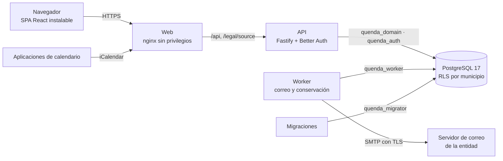

<p align="center">
  
</p>

<h1 align="center">Quenda</h1>

<p align="center">
  Plataforma libre para la consulta y reserva de instalaciones deportivas municipales,<br>
  preparada para que varios ayuntamientos compartan una misma instancia o desplieguen la suya.
</p>

<p align="center">
  <a href="LICENSE"></a>
  <a href="https://github.com/alanslzrr/quenda/actions/workflows/backend.yml"></a>
  <a href="https://github.com/alanslzrr/quenda/actions/workflows/web.yml"></a>
  
</p>

<p align="center">
  <a href="#funcionalidades">Funcionalidades</a> ·
  <a href="#arquitectura">Arquitectura</a> ·
  <a href="#puesta-en-marcha">Puesta en marcha</a> ·
  <a href="#documentación">Documentación</a> ·
  <a href="#estado-del-proyecto">Estado</a> ·
  <a href="#contribuir">Contribuir</a>
</p>

---

## Visión general

Muchos ayuntamientos, sobre todo los de menor tamaño, siguen gestionando sus pistas, salas y pabellones por teléfono, correo electrónico o atención presencial, con poca visibilidad de la disponibilidad real y procesos de modificación y cancelación poco ágiles. Quenda ofrece a la ciudadanía un servicio web para consultar, reservar, modificar y cancelar, y al personal municipal las herramientas para mantener instalaciones, horarios, normas e indicadores.

El producto se concibe como un **activo público reutilizable**:

- **Multimunicipio.** Una instancia aloja varios municipios con datos, permisos y configuración aislados, y una cuenta ciudadana única por instancia.
- **Autoalojable.** Se distribuye como imágenes OCI con una composición de referencia para un único servidor, sin dependencia de un proveedor de nube concreto.
- **Estándares y formatos abiertos.** OpenAPI 3, iCalendar, JSON Schema, CSV y PostgreSQL; exportación e importación de catálogos y copia íntegra de la instancia.
- **Software libre.** Licencia [AGPL-3.0-only](LICENSE): las mejoras de quien la ofrezca como servicio en red siguen disponibles para el resto de administraciones.

## Funcionalidades

### Ciudadanía

- Catálogo público de instalaciones y espacios, con ficha, normas de uso y disponibilidad en tiempo real.
- Reserva guiada por municipio, instalación, espacio, día y hora, con aceptación expresa de normas y condiciones de cancelación.
- Modificación y cancelación dentro de los plazos publicados, historial entre municipios y avisos por correo y en la aplicación.
- Calendario personal: descarga iCalendar y suscripción revocable que se actualiza sola.
- Código QR en cada reserva para que el personal compruebe su validez y registre la llegada.
- Recomendaciones de horario calculadas a partir de las propias reservas, sin perfiles almacenados ni inteligencia artificial, y desactivables.
- Cuenta con verificación en dos pasos, sesiones, descarga de datos personales y baja.
- Aplicación web instalable en móvil, tableta y ordenador, en gallego y castellano, con tema claro y oscuro.

### Ayuntamiento

- Alta y mantenimiento de instalaciones y espacios en borrador, con publicación explícita y retirada sin pérdida de historial.
- Calendarios semanales con excepciones, duraciones, antelación y plazos de cancelación, versionados y auditados.
- Normas de uso versionadas; las reservas conservan la versión aceptada.
- Agenda diaria, bloqueos por mantenimiento y reubicaciones con motivo y aviso a la persona afectada.
- Personal y permisos delegados por operación y espacio, con invitaciones, caducidad y retirada inmediata.
- Indicadores de ocupación, análisis de uso por día y hora y exportación de reservas en JSON y CSV.
- Apariencia municipal con catálogo de temas, colores propios con contraste verificado y textos legales propios.
- Convenios intermunicipales con acreditaciones, cuotas conjuntas e informes agregados con control de riesgo.

### Plataforma

- Alta de municipios, gestión de operadores y recuperación controlada de responsables.
- Conservación y supresión de datos por políticas aprobadas, con excepciones y auditoría.
- Copia lógica, restauración cerrada y conciliación antes de reabrir el servicio.
- Oferta del código fuente correspondiente a la versión desplegada (`/legal/source`), conforme a la sección 13 de la AGPL.

## Arquitectura

Quenda es un monolito modular en TypeScript. La API y los procesos de segundo plano comparten un mismo artefacto y una base PostgreSQL, en la que cada proceso se conecta con un rol de privilegios mínimos.



| Capa | Tecnología |
|---|---|
| API | Node.js 24, TypeScript, Fastify 5, Better Auth, OpenAPI 3.0.3 |
| Datos | PostgreSQL 17 con seguridad a nivel de fila, funciones `SECURITY DEFINER` y migraciones versionadas e inmutables |
| Web | React 19, React Router, TanStack Query y Vite, servida por nginx |
| Calidad | Biome, `node:test`, Playwright con axe-core, pruebas de imágenes OCI |
| Entrega | Imágenes OCI reproducibles y composición Docker de referencia |

Los cinco módulos del backend —identidad, catálogo, reservas, colaboración y comunicaciones— exponen su interfaz pública por `src/modules/<módulo>/index.ts`; una prueba de arquitectura impide dependencias circulares y accesos a archivos privados de otro módulo. Las decisiones y su justificación están en [Arquitectura](docs/04_arquitectura.md).

### Seguridad y privacidad desde el diseño

- Aislamiento por municipio en la propia base de datos mediante RLS y claves compuestas, no solo en la aplicación.
- Verificación en dos pasos obligatoria para cualquier permiso administrativo y prueba reciente para operaciones sensibles.
- Comandos idempotentes, protección de origen, límites de peticiones y auditoría de accesos y rechazos.
- Minimización de datos: las consultas públicas no exponen titulares y las exportaciones municipales no incluyen nombres ni correos.
- Contenedores de solo lectura, sin capacidades ni elevación de privilegios, y cabeceras de seguridad estrictas en la web.

Detalle en [Seguridad y cumplimiento](docs/05_seguridad_y_cumplimiento.md).

## Puesta en marcha

### Requisitos

- Node.js 24.21.0 y pnpm 10.30.3
- Docker con Compose
- Binarios de PostgreSQL 17.11 (`initdb`, `pg_ctl`, `postgres`) para las pruebas de integración y la demostración

### Entorno local

```sh
pnpm install --frozen-lockfile --ignore-scripts
pnpm db:local:config
docker compose --env-file .env.bootstrap.local up -d --wait db
pnpm db:bootstrap
pnpm db:migrate
pnpm dev
```

En otra terminal, la aplicación web:

```sh
pnpm --dir web install --frozen-lockfile --ignore-scripts
pnpm --dir web dev
```

La API escucha en `http://127.0.0.1:3000` y la web en `http://127.0.0.1:5173`. La [guía de desarrollo](docs/11_desarrollo.md) explica la configuración generada, el origen autorizado y el correo local.

### Demostración con datos ficticios

```sh
PG_BIN=/ruta/a/postgresql-17.11/bin pnpm demo:local
```

Crea una base temporal con dos municipios de ejemplo y muestra las cuentas y el comando para arrancar la web. Los datos desaparecen al detenerla. Véase el [acceso a la demostración](test/demo/README.md).

### Despliegue

```sh
pnpm image:build quenda-backend:local && pnpm image:build:web
docker compose --env-file .env.production -f compose.production.example.yaml up -d db
docker compose --env-file .env.production -f compose.production.example.yaml --profile setup run --rm bootstrap
docker compose --env-file .env.production -f compose.production.example.yaml up -d
```

[compose.production.example.yaml](compose.production.example.yaml) y [.env.production.example](.env.production.example) describen una instancia completa en un único servidor. Es una referencia para adaptar: dimensionamiento, TLS, secretos, copias y monitorización corresponden a la entidad que opera la instancia. La [guía de despliegue y operación](docs/12_operacion.md) cubre la inicialización del primer operador, las actualizaciones, las copias y la recuperación.

## Calidad

| Comprobación | Alcance |
|---|---|
| `pnpm check` | Tipos, lint, pruebas unitarias y HTTP, y validación del contrato OpenAPI |
| `pnpm test:integration` | API y base de datos reales sobre un PostgreSQL temporal: permisos, aislamiento, integridad, privacidad y recuperación |
| `pnpm --dir web test:browser` | Recorridos completos en escritorio, móvil y tableta, con análisis axe de WCAG 2.0 y 2.1, niveles A y AA |
| `pnpm test:oci` | Imágenes de API y web: arranque, migraciones, aislamiento entre instancias y disponibilidad ante una caída de la base |
| `pnpm validate` | Encadena todas las anteriores y la construcción de imágenes; se ejecuta antes de abrir cada pull request |

La integración continua de GitHub Actions ejecuta en cada pull request las comprobaciones rápidas de backend y web. Detalle en [Desarrollo y pruebas](docs/11_desarrollo.md#comprobaciones).

## Documentación

| Documento | Contenido |
|---|---|
| [Especificación técnica](docs/README.md) | Índice, terminología y licencia |
| [Requisitos](docs/01_requisitos.md) | Alcance, actores, requisitos funcionales y no funcionales |
| [Modelo de dominio](docs/02_modelo_dominio.md) | Entidades, invariantes, estados y configuración municipal |
| [Procesos y secuencias](docs/03_procesos_y_secuencias.md) | Registro, administración, reservas, avisos y conservación |
| [Arquitectura](docs/04_arquitectura.md) | Componentes, decisiones (ADR) y despliegue |
| [Seguridad y cumplimiento](docs/05_seguridad_y_cumplimiento.md) | Autorización, aislamiento, privacidad y accesibilidad |
| [Decisiones y validación](docs/06_decisiones_y_validacion.md) | Pruebas de aceptación, rendimiento y decisiones pendientes |
| [Identidad y colaboración](docs/07_identidad_y_colaboracion.md) | Cuenta global, convenios, acreditaciones e informes |
| [Casos de uso](docs/08_casos_de_uso.md) | Actores, flujos, excepciones y resultados |
| [Navegación](docs/09_navegacion.md) | Mapa de navegación y recorrido de reserva |
| [Referencia de la API](docs/10_api.md) | Rutas HTTP por área, permisos y respuestas |
| [Desarrollo y pruebas](docs/11_desarrollo.md) | Entorno local, aplicación web y comprobaciones |
| [Despliegue y operación](docs/12_operacion.md) | Imágenes, despliegue, workers, métricas, copias y recuperación |

El contrato OpenAPI se genera sin base de datos con `pnpm --silent openapi`.

## Estado del proyecto

Quenda está en desarrollo activo (versión `0.1.0`) y no tiene todavía una instalación en producción. El alcance funcional descrito está implementado y cubierto por las suites anteriores. Quedan abiertas, y documentadas en [Decisiones pendientes](docs/06_decisiones_y_validacion.md#decisiones-pendientes):

- **PD-AUTH-PUBLICA:** el mecanismo de autenticación pública. La identidad está aislada en su propio módulo para incorporar proveedores externos sin afectar a las reservas.
- **PD-OPERACION:** proveedor, capacidad, disponibilidad, RTO y RPO de cada instalación, que decide la entidad que la opere.
- **Accesibilidad:** el objetivo es WCAG 2.1 AA. Las pruebas automáticas cubren los niveles A y AA; la revisión manual con lectores de pantalla y dispositivos reales está pendiente antes de una declaración de conformidad.

## Seguridad

No publiques vulnerabilidades en issues. Sigue la [política de seguridad](SECURITY.md), que utiliza el aviso privado de vulnerabilidades de GitHub.

## Contribuir

Las aportaciones son bienvenidas. Antes de abrir una pull request, consulta la [guía de contribución](CONTRIBUTING.md).

## Licencia

Quenda se distribuye bajo **AGPL-3.0-only**, no «or later». El [texto íntegro](LICENSE) acompaña al código. Los despliegues sujetos a sus obligaciones deben facilitar el código fuente correspondiente; las versiones modificadas accesibles por red deben ofrecerlo a sus usuarios conforme a la sección 13. [Identificador SPDX y términos](https://spdx.org/licenses/AGPL-3.0-only.html).
