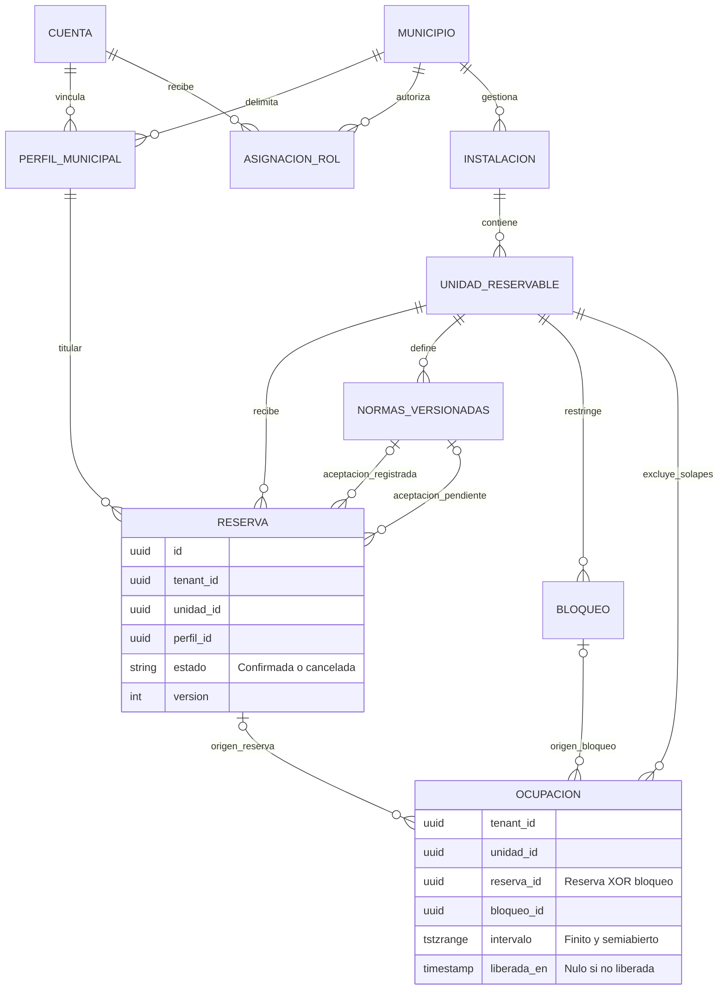
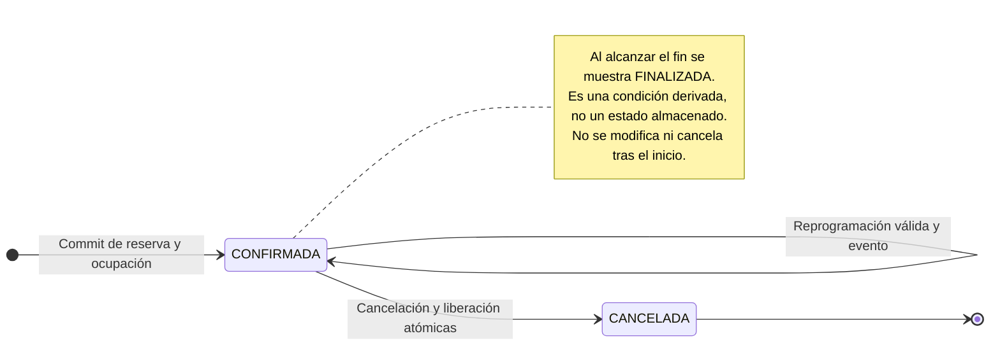

# 02 Modelo de dominio

## Entidades

Cada instalación y unidad reservable tiene un único municipio gestor, aunque participe en un convenio. La reserva identifica al titular y las condiciones de uso; la ocupación representa el intervalo que excluye otras reservas o cierres incompatibles.

| Entidad | Responsabilidad |
|---|---|
| Cuenta | Identidad y sesiones gestionadas por Better Auth, comunes a la instancia. |
| Perfil municipal | Relación única entre una cuenta y un municipio. |
| Asignación de rol | Permisos de una cuenta sobre un municipio y, cuando corresponda, unidades reservables concretas. |
| Instalación / Unidad reservable | Centro deportivo, espacios reservables y publicación del catálogo. |
| Regla horaria / Excepción | Aperturas regulares y cambios fechados del calendario. |
| Normas de uso | Texto versionado por unidad reservable; las versiones aceptadas no se sobrescriben. |
| Política de reserva | Condiciones versionadas que se aplican al crear o modificar una reserva. |
| Reserva | Titular, unidad, intervalo, estado, revisión, condiciones aceptadas y normas asignadas pendientes cuando corresponda. |
| Bloqueo | Cierre de una unidad reservable, con responsable y motivo. |
| Ocupación | Municipio, unidad reservable, intervalo y origen: reserva o bloqueo. |
| Evento / Auditoría | Cambios de negocio y operaciones sensibles, con autor, fecha y correlación. |
| Comando idempotente | Actor, municipio (nulo solo para alta de municipio), operación, clave, huella de entrada y resultado. |
| Evento pendiente / Entrega | Aviso persistido y sus intentos de envío. |

Los perfiles municipales no duplican credenciales ni sesiones. Las entidades de colaboración se definen en el [modelo de convenios](07_identidad_y_colaboracion.md#modelo-de-colaboración).

### D-02 Relaciones del dominio

## Invariantes

| ID | Regla | Mecanismo |
|---|---|---|
| RN-01 | Las referencias entre entidades municipales pertenecen al mismo municipio. | Claves foráneas compuestas por municipio e identificador; referencias explícitas para cuentas y convenios. |
| RN-02 | Dos ocupaciones no liberadas de la misma unidad reservable no se solapan. | Exclusión PostgreSQL por municipio, unidad e intervalo. |
| RN-03 | Una reserva confirmada tiene exactamente una ocupación no liberada de su municipio y unidad; una cancelada, ninguna. | Unicidad parcial, escritura transaccional y pruebas de existencia y coherencia. |
| RN-04 | Cada ocupación procede de una reserva o de un bloqueo, nunca de ambos. | Restricción de origen y claves foráneas. |
| RN-05 | Los intervalos son finitos, no vacíos y semiabiertos `[inicio, fin)`. | Validación y restricciones; las reservas contiguas son compatibles. |
| RN-06 | Reserva, ocupación, consumos y eventos cambian atómicamente. | Transacción y control de versión; cualquier fallo conserva la situación anterior. |
| RN-07 | La misma clave y contenido, dentro de su retención, no repiten efectos. | Resultado idempotente guardado en la transacción. |
| RN-08 | La concurrencia y las operaciones administrativas respetan reglas y cuotas. | Protocolo común de comandos y aislamiento `SERIALIZABLE`. |
| RN-09 | El fallo de un aviso no revierte una reserva confirmada. | Evento pendiente guardado con la reserva. |
| RN-10 | Un convenio no concede acceso a historiales ajenos ni permisos de gestión sobre otras unidades. | Capacidades delimitadas y autorización por objeto. |

La ocupación contiene el intervalo actual; los eventos conservan los valores anteriores. Una ocupación pasada puede mantenerse sin liberar porque no bloquea fechas futuras. Las relaciones del diagrama incluyen esas ocupaciones históricas.

**Justificación:** reservas y bloqueos utilizan la misma exclusión sin representar un cierre como una reserva. PostgreSQL permite combinar rangos temporales con igualdad de identificadores mediante `btree_gist`. [Rangos y exclusiones](https://www.postgresql.org/docs/current/rangetypes.html#RANGETYPES-CONSTRAINT).

## Tiempo y configuración municipal

El sistema intercambia instantes en UTC y conserva por separado la zona IANA del municipio. `timestamptz` no guarda la zona original. Las horas locales inexistentes no generan franjas; las repetidas muestran el desplazamiento UTC para permitir una selección inequívoca. [Tipos temporales de PostgreSQL](https://www.postgresql.org/docs/current/datatype-datetime.html).

| Parámetro | Regla |
|---|---|
| Antelación máxima | 30 días naturales por defecto; entero no negativo configurable por municipio. La unidad reservable puede reducir el límite. |
| Cómputo | En la zona municipal: `hoy ≤ fecha(inicio) ≤ hoy + N`, ambos días incluidos, e `inicio > ahora`. El fin respeta apertura y duración. |
| Duración | Mínimo, máximo y paso en minutos por unidad reservable; valores positivos y compatibles, obligatorios antes de publicar. |
| Apertura | Horarios semanales y excepciones fechadas; la reserva completa queda dentro de un intervalo permitido. |
| Modificación y cancelación | Plazo no negativo en minutos antes del inicio; valor predeterminado: 1.440 minutos —24 horas—. Se admite `ahora ≤ inicio − plazo` y siempre `ahora < inicio`. |
| Intervención administrativa | Solo sobre reservas futuras, con permiso y motivo. Puede omitir el plazo del titular y cambiar de unidad, sin eludir integridad, vigencia ni cuotas ni aceptar normas en su nombre. |
| Publicación | Configuración válida, normas vigentes con contenido y unidad físicamente independiente. No se publican como unidades distintas un espacio y sus partes solapadas. |

El plazo utiliza minutos transcurridos entre instantes, no días naturales. El valor predeterminado se aplica al crear municipios; una actualización conserva los valores municipales existentes y las condiciones ya aceptadas.

**Justificación:** el cómputo por fecha local conserva la antelación en días naturales durante los cambios de horario. Los parámetros tipados permiten configurar municipios sin ejecutar código introducido por administradores.

## Estados y cambios de reglas

Los estados almacenados son `CONFIRMADA` y `CANCELADA`. La consulta muestra `FINALIZADA` cuando el fin de una reserva confirmada es anterior o igual al instante actual. Modificar una reserva conserva su estado y registra un evento.

### D-03 Estados de la reserva

**Justificación:** derivar la finalización evita escrituras causadas únicamente por el paso del tiempo. El sistema no deduce asistencia a partir de una reserva finalizada.

La cancelación aplica las condiciones aceptadas de la reserva. La modificación del titular comprueba las reglas vigentes y conserva en el historial las versiones anterior y nueva. Puede cambiar la unidad reservable dentro del mismo municipio, pero no el titular ni el municipio.

Un cierre o cambio de calendario incompatible con reservas confirmadas se rechaza hasta resolverlas mediante operaciones explícitas. Retirar una unidad del catálogo impide nuevas reservas y mantiene las existentes y su historial.

## Normas de uso y aceptación

Cada unidad reservable tiene un texto de normas versionado. Crear una versión conserva las anteriores y registra autor, fecha, motivo y correlación. Sin normas con contenido, la unidad puede permanecer en borrador, pero no publicarse ni admitir reservas. Las unidades ya publicadas que carezcan de ellas quedan ocultas del catálogo y la disponibilidad hasta completarlas, sin borrar reservas ni alterar el historial de publicación.

El titular acepta expresamente las versiones vigentes de normas y política al reservar. La reserva conserva esas referencias, el plazo de cancelación aceptado, los instantes de aceptación y, cuando corresponde, la aceptación de no poder cancelar por sí mismo. El servidor comprueba las versiones dentro de la transacción; una diferencia exige revisarlas y no sustituye la aceptación enviada.

| Modificación | Regla de aceptación |
|---|---|
| Sin cambio de unidad ni intervalo | No genera aceptación ni evento nuevos. |
| Del titular, con condiciones todavía cubiertas por su aceptación | Puede conservar la evidencia anterior. |
| Del titular, con otra unidad, normas o política, sin evidencia anterior o entrando por primera vez fuera del plazo de cancelación | Exige aceptación expresa de las condiciones vigentes y registra su fecha actual. |
| Administrativa | Puede cambiar fecha, horario o unidad. Conserva las condiciones previamente aceptadas; si las normas asignadas no están aceptadas para esa unidad, registra su aceptación pendiente y avisa al titular. |
| Cancelación | No exige nuevas normas, incluso si falta evidencia de aceptación anterior. |

### Reubicación administrativa y aceptación posterior

La reubicación se confirma inmediatamente: libera la ocupación anterior, ocupa el destino y recalcula la cuota en una transacción. No es una propuesta ni reserva simultáneamente ambos espacios. Un conflicto conserva la situación anterior. El aviso identifica el cambio realizado y, cuando corresponde, las normas que el titular debe aceptar antes del uso.

La evidencia aceptada identifica unidad y versión, aunque pertenezca al destino anterior. La obligación pendiente identifica la unidad actual y la versión asignada en la reubicación. Dos unidades con el mismo número de versión o texto no comparten aceptación. Publicar normas posteriores no sustituye retroactivamente esa referencia pendiente.

El titular puede aceptar las normas asignadas antes del nuevo inicio, incluso dentro de las últimas 24 horas. Esta operación no modifica fecha, unidad, ocupación, cuota ni condiciones de cancelación. Comprueba titularidad, revisión y referencia pendiente exactas; registra la aceptación con su fecha real y conserva la anterior en el historial. No permite que un gestor acepte por el titular.

La falta de respuesta no revierte ni cancela la reubicación: la unidad sigue reservada y la cuota permanece consumida. Si el titular discrepa, contacta con el municipio. Al llegar el inicio sin aceptación, se conserva la evidencia pendiente; no se presume asistencia ni se generan incidencias o penalizaciones automáticas. El requisito de aceptación antes del uso es verificable por la aplicación y el personal autorizado, no un control físico de acceso.

### Reservas anteriores sin evidencia

Se identifican como «sin aceptación registrada», no como canceladas, rechazadas ni propuestas pendientes. Se consultan y cancelan conforme a las condiciones históricas guardadas. La ausencia histórica no crea por sí sola una obligación nueva.

Una modificación real del titular exige aceptación de las condiciones vigentes. Una modificación administrativa puede ejecutarse sin aceptación anterior y deja las normas asignadas pendientes para el titular, igual que una reubicación ordinaria. La aceptación posterior se fecha cuando ocurre; no rellena retrospectivamente la creación ni acredita una política de cancelación que no conste como aceptada.

## Cancelación y responsabilidad

Una vez vencido el plazo aceptado, el titular no puede cancelar ni modificar para eludirlo; la reserva y su cuota permanecen ocupadas. Se permiten reservas con menos antelación que ese plazo si cumplen las demás reglas y el titular acepta expresamente que no podrá cancelarlas por sí mismo.

Ante una imposibilidad de asistencia, el usuario contacta directamente con el ayuntamiento. El gestor autorizado puede reubicar o cancelar excepcionalmente antes del inicio, conforme a las normas municipales y con motivo registrado. La reubicación conserva el plazo de cancelación previamente aceptado, aplicado al nuevo inicio; aceptar las normas pendientes no concede otra excepción ni cambia ese plazo.

El titular mantiene su responsabilidad aunque no utilice la instalación. Puede reorganizar participantes cuando las normas municipales lo permitan, sin transferir la reserva; el sistema no registra jugadores. Una ausencia mantiene el historial y el tiempo reservado, sin inferir asistencia ni generar incidencias, deudas, multas o penalizaciones automáticas.

## Cuenta y continuidad administrativa

La baja voluntaria es lógica. Requiere la contraseña actual y, si el usuario tiene MFA, una verificación del segundo factor realizada hace menos de cinco minutos. Se rechaza mientras exista una reserva confirmada con `fin > ahora`, futura o en curso, en cualquier municipio. La comprobación y la baja son atómicas frente a reservas, cambios de credenciales y sesiones concurrentes.

La baja revoca sesiones, permisos administrativos propios e invitaciones pendientes recibidas o emitidas. No retira permisos que otros usuarios ya hayan aceptado. Conserva identidad, perfiles, reservas y auditorías; no ejecuta la supresión de datos personales.

El usuario puede reactivar una cuenta conservada mediante contraseña, enlace de correo de un solo uso y TOTP o código de respaldo si MFA estaba habilitado. El código de respaldo se consume en la misma transacción. Recupera únicamente acceso personal y debe iniciar sesión de nuevo. Las cuentas suprimidas requieren un nuevo registro. La reactivación no levanta suspensiones de seguridad.

Cada municipio inicializado mantiene un administrador habilitado con permiso indefinido; la plataforma mantiene un operador habilitado. Habilitado significa cuenta activa, correo verificado, MFA configurado y permiso vigente no revocado, sin exigir una sesión abierta. No se permite retirar la última responsabilidad por baja o revocación ordinaria. Un permiso temporal ya aceptado puede convertirse explícitamente en indefinido, con motivo, sin otra invitación ni extensiones automáticas.

La retirada municipal por seguridad afecta solo a los permisos e invitaciones de ese municipio. La suspensión global corresponde a un operador y revoca sesiones y autoridad administrativa en toda la instancia, sin cancelar reservas. La contención puede dejar temporalmente al ámbito sin responsable. La recuperación municipal no permite que el operador dirija a su propio correo la invitación de administrador ni que la acepte. Exige verificar identidad o autoridad, resolver el compromiso y registrar la intervención; nunca restaura permisos antiguos automáticamente.

## Conservación y derechos

La baja de cuenta, la retirada de un recurso y la supresión de datos son operaciones distintas. Las garantías de historial impiden borrados incidentales durante la gestión ordinaria; no establecen conservación indefinida.

### Políticas por ámbito

Cada política identifica ámbito, familia de datos, finalidad, referencia del responsable, referencia de aprobación, duración, actuación y motivo. La aprobación administrativa precede a su registro. Los plazos son obligatorios: no proceden de valores predeterminados del software ni se renuevan al desplegar una versión.

Existe una política vigente por ámbito y familia. Una nueva aprobación sustituye la anterior sin reescribirla ni revertir actuaciones ejecutadas. Revocar una política detiene nuevas actuaciones, no recupera datos ni amplía el plazo ya autorizado de un archivo bloqueado. Municipios de la misma instancia pueden aplicar duraciones diferentes a la misma familia.

| Familia | Ámbito | Inicio del cómputo |
|---|---|---|
| `COMMUNICATIONS` | Municipio | Último instante entre creación del evento, aviso, correo e intentos de entrega. |
| `RESERVATIONS` | Municipio | El posterior entre fin de la reserva y último evento de reserva o consumo compartido. |
| `MUNICIPAL_PROFILE` | Municipio | Última actividad conservada de perfil, reservas, comunicaciones, permisos o acreditaciones del servicio. |
| `AUTHENTICATION` | Global | Fecha del evento de seguridad; para sesiones y comprobaciones temporales, vencimiento. |
| `IDENTITY` | Global | Baja voluntaria de la cuenta. |
| `AUTHORITY` | Municipio o global | Última evidencia de la concesión o fecha del evento de acceso correspondiente; para la dirección de una invitación no aceptada, su revocación o, si no la hubo, su vencimiento. |
| `ACCREDITATIONS` | Municipio emisor | Revocación, si existe; en otro caso, fin de vigencia. |

El servidor compara el instante de referencia con una duración entera positiva en días de 24 horas, calculada en UTC. No convierte meses o años legales en un número aproximado de días. Los selectores y referencias temporales son fijos; las políticas no ejecutan expresiones, SQL ni filtros aportados por usuarios. La aprobación debe cubrir la familia completa del ámbito. Finalidades incompatibles dentro de una familia requieren resolver su clasificación o registrar la excepción correspondiente antes de automatizar su eliminación.

**Justificación:** un conjunto cerrado permite comprobar qué datos selecciona cada política y evita que una configuración amplíe su alcance a otro municipio o a evidencias dependientes.

### Ejecución y excepciones

El procesamiento existente ejecuta lotes sin confirmaciones manuales repetitivas. Cada actuación vuelve a comprobar la política, las excepciones, los datos actuales y sus dependencias dentro de la transacción. La auditoría conserva alcance, regla o autorización, instante y resultado. Un rechazo no produce una supresión parcial.

Una excepción de conservación —`hold`— identifica una familia y, exclusivamente, un registro o un interesado existente en su ámbito, incluido contenido ya bloqueado. Requiere autorización y motivo; su levantamiento también. Impide actuaciones destructivas de conservación sobre los datos afectados, pero no suspende por sí sola su consulta o tratamiento ordinario ni evita la revocación de credenciales por seguridad. No equivale a una suspensión de cuenta, un bloqueo de instalación ni una limitación del tratamiento. [AEPD: limitación](https://www.aepd.es/derechos-y-deberes/conoce-tus-derechos/derecho-la-limitacion-del-tratamiento).

Se conservan los datos necesarios para reservas futuras o en curso, concesiones activas, entregas en proceso y referencias todavía protegidas. Las evidencias de convenio que afecten a otros participantes no se eliminan unilateralmente; se identifican para revisión conjunta. Los demás registros elegibles pueden continuar su procesamiento.

Para reservas con consumos compartidos y acreditaciones, la revisión conjunta exige aprobación explícita de todos los municipios responsables identificados por las participaciones históricas. Cada aprobación vincula una huella del registro y sus evidencias, política vigente, actuación y plazo de bloqueo; un cambio invalida la aprobación anterior. El contexto revela referencias, responsables y estado de aprobación, no el contenido personal. Consultarlo requiere `PRIVACY_READ`; aprobar o retirar la aprobación requiere además `PRIVACY_EXECUTE` y MFA reciente. Cada municipio modifica únicamente su revisión, con autorización y motivo.

La ejecución permanece en el ámbito del titular del registro y vuelve a comprobar unanimidad, dependencias y excepciones de todos los responsables bajo el bloqueo de conservación. Al bloquear, el archivo conserva la lista de responsables; cualquiera puede mantener una excepción que impida su destrucción posterior. La actuación y el checkpoint conservan la prueba de las aprobaciones. La reconciliación de una restauración cerrada reproduce esa actuación verificada aunque la copia anterior carezca de las revisiones, sin permitir que el runtime omita aprobaciones ni reabrir el servicio automáticamente.

El personal autorizado también puede ejecutar una actuación individual con referencia de autorización y motivo. Obtiene `APPLIED`, `CONFLICT` o `ABSENT`; un conflicto o una ausencia quedan auditados y no se presentan como supresión realizada. Esta vía respeta las mismas excepciones e integridad que la ejecución automática.

### Supresión y bloqueo

| Actuación | Efecto |
|---|---|
| `ERASE` | Retira el conjunto autorizado de los registros operativos, sin crear una copia de su contenido para el servicio. |
| `BLOCK` | Retira el conjunto de los registros operativos y conserva su contenido en un archivo restringido, con fecha de destrucción autorizada. |

Los archivos bloqueados no son consultables por los roles de aplicación, autenticación o trabajos, ni mediante permisos ordinarios de privacidad. Su disponibilidad excepcional exige intervención operativa autorizada. La destrucción posterior comprueba de nuevo las excepciones vigentes. Este aislamiento impide reutilizar el contenido para reservas, avisos o exportaciones ordinarias. [LOPDGDD, artículo 32](https://www.boe.es/buscar/act.php?id=BOE-A-2018-16673#a3-4).

La retirada de identidad exige una cuenta dada de baja y las comprobaciones de protección aplicables. Elimina credenciales y datos identificativos operativos; conserva un identificador inhabilitado cuando es necesario para referencias históricas. Ese identificador no es anónimo ni permite recuperar la cuenta. Un nuevo registro crea otra identidad y no hereda actividad ni permisos.

Quenda no considera anónimo un historial por sustituir nombres o identificadores. Los agregados de colaboración mantienen sus [controles de publicación](07_identidad_y_colaboracion.md#c-03-informes-agregados).

Las solicitudes y su valoración jurídica se tramitan por los canales administrativos existentes, sin tickets ni expedientes nuevos en Quenda. Los mecanismos técnicos no sustituyen la identificación del responsable, la aprobación de los plazos ni la resolución del derecho. Las reservas protegidas pueden impedir una supresión concreta, no denegar indiscriminadamente acceso o rectificación.

## Apariencia y preferencias

Cada municipio elige un tema de un catálogo cerrado; cada tema define fondo, texto y acento para el modo claro y para el oscuro. Sobre él puede ajustar esos tres colores en cada modo, la tipografía (entre cuatro) y la forma de las esquinas (entre tres), además del modo inicial. Las superficies, bordes, textos secundarios, controles y series de gráficos se derivan de esos tres colores manteniendo el contraste; los colores de estado (éxito, aviso, error) son fijos. El servidor rechaza un texto con menos de 4,5:1 sobre el fondo, un acento con menos de 3:1 y un fondo que no corresponda a su modo. No se admite CSS ni ajustes por componente.

La configuración comienza con el tema neutro, sin ajustes, tipografía Inter, esquinas redondeadas y modo claro. Guardar o restaurar exige administrador municipal, MFA reciente y la revisión consultada; conserva auditoría con el estado anterior y el nuevo y rechaza una revisión obsoleta sin sobrescribir el cambio anterior.

El tema guardado se aplica a las páginas públicas del municipio, a su gestión y al detalle y la modificación de sus reservas. Las páginas de cuenta, plataforma y las listas que reúnen varios municipios conservan el tema de Quenda. El modo elegido por cada persona prevalece sobre el modo inicial del municipio. Mientras el editor está abierto, el borrador se aplica a toda la aplicación sin publicarse ni modificar preferencias. Cambiar de municipio no copia su apariencia al siguiente.

El municipio tiene además un nombre visible y un logo. El nombre con el que el operador de plataforma lo dio de alta se conserva como nombre oficial; la administración municipal cambia el visible, que es el que muestran todas las pantallas. El logo principal y, opcionalmente, una versión para fondo oscuro se guardan como una recodificación WebP propia del servidor (sin metadatos, hasta 512 px); solo se aceptan PNG, JPEG y WebP, reconocidos por su firma, nunca SVG. Cada cambio de nombre o logo exige administrador municipal y MFA reciente, incrementa una versión y queda auditado. El logo aparece en el menú de gestión, en la cabecera pública y como icono de la pestaña.

Idioma y modo se gestionan desde el menú superior de ajustes o el perfil, con una única preferencia por cuenta. Sin sesión, la elección se conserva en el navegador. Sin idioma explícito, la interfaz selecciona el primer idioma admitido del navegador —gallego o castellano— y utiliza gallego como alternativa. La preferencia explícita de idioma también se aplica a nuevos avisos; no reescribe mensajes ya generados.

## Recuperación de altas y errores de reserva

Las altas de municipios, instalaciones y unidades aceptan `Idempotency-Key`. Una misma cuenta, operación, ámbito y clave con el mismo contenido normalizado devuelve el recurso original; otro contenido devuelve `IDEMPOTENCY_KEY_REUSED`. Las altas municipales usan ámbito nulo exclusivamente para `municipality.create`, limitado al operador titular del recibo. La autorización vigente se comprueba antes de recuperar resultados. El encabezado es opcional por compatibilidad: omitirlo representa una nueva solicitud; la interfaz siempre lo envía.

Los conflictos de reserva distinguen ocupación (`SLOT_UNAVAILABLE`), condiciones (`BOOKING_RULES_CHANGED`), cuota (`QUOTA_EXCEEDED`), acreditación (`CREDENTIAL_REQUIRED`), convenio (`AGREEMENT_UNAVAILABLE`), revisión (`RESERVATION_CHANGED`) y cancelación (`RESERVATION_CANCELLED`). Un comando todavía en curso devuelve `COMMAND_IN_PROGRESS`. Solo el conflicto de ocupación se presenta como franja ocupada; los fallos transitorios de transacción mantienen su respuesta recuperable.

Los avisos de intervención administrativa incluyen fecha, motivo y nombre capturado del actor al producirse el evento. Un cambio posterior de nombre no reescribe ese aviso. Los eventos antiguos sin nombre capturado muestran su ausencia, sin atribuirles un nombre actual. La consulta sigue limitada al titular de la reserva.
