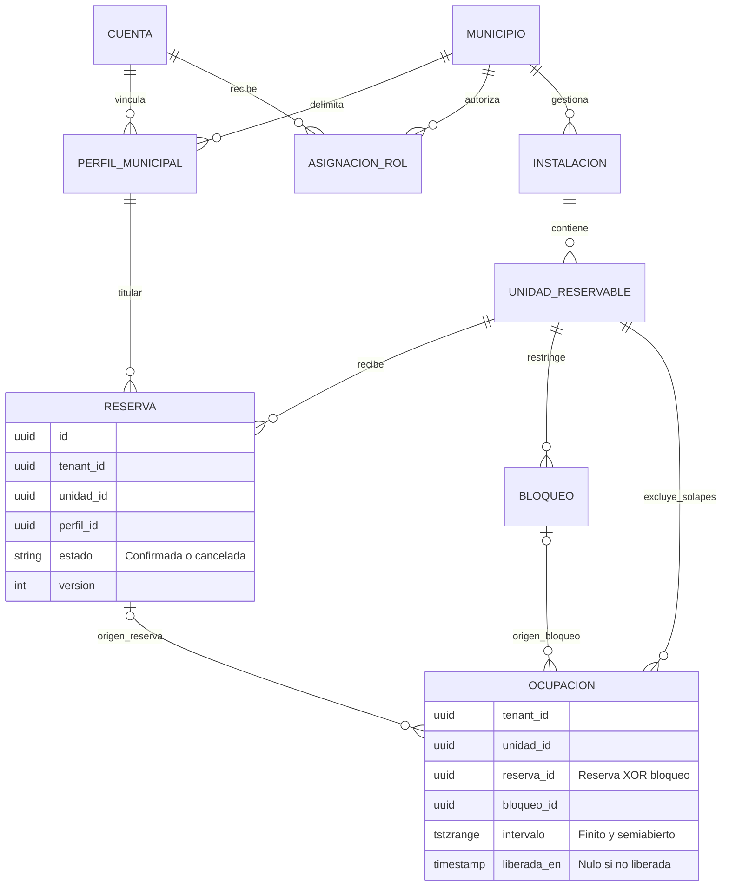
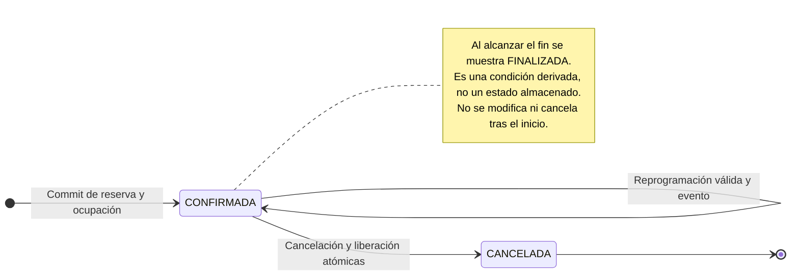

# 02 Modelo de dominio

## Entidades

Cada instalación y unidad reservable tiene un único municipio gestor, aunque participe en un convenio. La reserva identifica al titular y las condiciones de uso; la ocupación representa el intervalo que excluye otras reservas o cierres incompatibles.

| Entidad | Responsabilidad |
|---|---|
| Cuenta | Identidad y sesiones gestionadas por Better Auth, comunes a la instancia. |
| Perfil municipal | Relación única cuenta–municipio y datos necesarios para su servicio. |
| Asignación de rol | Permisos de una cuenta sobre un municipio y, cuando corresponda, unidades reservables concretas. |
| Instalación / Unidad reservable | Centro deportivo, espacios reservables y publicación del catálogo. |
| Regla horaria / Excepción | Aperturas regulares y cambios fechados del calendario. |
| Política de reserva | Condiciones versionadas que se aplican al crear o modificar una reserva. |
| Reserva | Titular, unidad reservable, estado y versión de concurrencia. |
| Bloqueo | Cierre de una unidad reservable, con responsable y motivo. |
| Ocupación | Municipio, unidad reservable, intervalo y origen: reserva o bloqueo. |
| Evento / Auditoría | Cambios de negocio y operaciones sensibles, con autor, fecha y correlación. |
| Comando idempotente | Actor, municipio, operación, clave, huella de entrada y resultado. |
| Evento pendiente / Entrega | Aviso persistido y sus intentos de envío. |

Los perfiles municipales no duplican credenciales ni sesiones. Las entidades de colaboración se definen en el [modelo de convenios](07_identidad_y_colaboracion.md#modelo-de-colaboración).

### D-02 Relaciones del dominio

## Invariantes

| ID | Regla | Mecanismo |
|---|---|---|
| RN-01 | Las referencias entre entidades municipales pertenecen al mismo municipio. | Claves foráneas compuestas por municipio e identificador; referencias explícitas para cuentas y convenios. |
| RN-02 | Dos ocupaciones no liberadas de la misma unidad reservable no se solapan. | Exclusión PostgreSQL por municipio, unidad e intervalo. |
| RN-03 | Una reserva confirmada tiene exactamente una ocupación no liberada de su municipio y unidad; una cancelada, ninguna. | Unicidad parcial, escritura transaccional y pruebas de existencia y coherencia. |
| RN-04 | Cada ocupación procede de una reserva o de un bloqueo, nunca de ambos. | Restricción de origen y claves foráneas. |
| RN-05 | Los intervalos son finitos, no vacíos y semiabiertos `[inicio, fin)`. | Validación y restricciones; las reservas contiguas son compatibles. |
| RN-06 | Reserva, ocupación, consumos y eventos cambian atómicamente. | Transacción y control de versión; cualquier fallo conserva la situación anterior. |
| RN-07 | La misma clave y contenido, dentro de su retención, no repiten efectos. | Resultado idempotente guardado en la transacción. |
| RN-08 | La concurrencia y las operaciones administrativas respetan reglas y cuotas. | Protocolo común de comandos y aislamiento `SERIALIZABLE`. |
| RN-09 | El fallo de un aviso no revierte una reserva confirmada. | Evento pendiente guardado con la reserva. |
| RN-10 | Un convenio no concede acceso a historiales ajenos ni permisos de gestión sobre otras unidades. | Capacidades delimitadas y autorización por objeto. |

La ocupación contiene el intervalo actual; los eventos conservan los valores anteriores. Una ocupación pasada puede mantenerse sin liberar porque no bloquea fechas futuras. Las relaciones del diagrama incluyen esas ocupaciones históricas.

**Justificación:** reservas y bloqueos utilizan la misma exclusión sin representar un cierre como una reserva. PostgreSQL permite combinar rangos temporales con igualdad de identificadores mediante `btree_gist`. [Rangos y exclusiones](https://www.postgresql.org/docs/current/rangetypes.html#RANGETYPES-CONSTRAINT).

## Tiempo y configuración municipal

El sistema intercambia instantes en UTC y conserva por separado la zona IANA del municipio. `timestamptz` no guarda la zona original. Las horas locales inexistentes no generan franjas; las repetidas muestran el desplazamiento UTC para permitir una selección inequívoca. [Tipos temporales de PostgreSQL](https://www.postgresql.org/docs/current/datatype-datetime.html).

| Parámetro | Regla |
|---|---|
| Antelación máxima | 30 días naturales por defecto; entero no negativo configurable por municipio. La unidad reservable puede reducir el límite. |
| Cómputo | En la zona municipal: `hoy ≤ fecha(inicio) ≤ hoy + N`, ambos días incluidos, e `inicio > ahora`. El fin respeta apertura y duración. |
| Duración | Mínimo, máximo y paso en minutos por unidad reservable; valores positivos y compatibles, obligatorios antes de publicar. |
| Apertura | Horarios semanales y excepciones fechadas; la reserva completa queda dentro de un intervalo permitido. |
| Modificación y cancelación | Plazo no negativo en minutos antes del inicio; valor predeterminado: 0. El usuario opera antes de `inicio − plazo`, nunca tras comenzar. |
| Intervención administrativa | Solo sobre reservas futuras, con permiso y motivo. Puede omitir el plazo del usuario, pero no integridad, vigencia ni cuotas. |
| Publicación | Configuración válida y unidad físicamente independiente. No se publican como unidades distintas un espacio y sus partes solapadas. |

**Justificación:** el cómputo por fecha local conserva la antelación en días naturales durante los cambios de horario. Los parámetros tipados permiten configurar municipios sin ejecutar código introducido por administradores.

## Estados y cambios de reglas

Los estados almacenados son `CONFIRMADA` y `CANCELADA`. La consulta muestra `FINALIZADA` cuando el fin de una reserva confirmada es anterior o igual al instante actual. Modificar una reserva conserva su estado y registra un evento.

### D-03 Estados de la reserva

**Justificación:** derivar la finalización evita escrituras causadas únicamente por el paso del tiempo. El sistema no deduce asistencia a partir de una reserva finalizada.

La cancelación aplica las condiciones aceptadas de la reserva. La modificación comprueba las reglas vigentes y conserva en el historial las versiones anterior y nueva. Puede cambiar la unidad reservable dentro del mismo municipio, pero no el titular ni el municipio.

Un cierre o cambio de calendario incompatible con reservas confirmadas se rechaza hasta resolverlas mediante operaciones explícitas. Retirar una unidad del catálogo impide nuevas reservas y mantiene las existentes y su historial.
