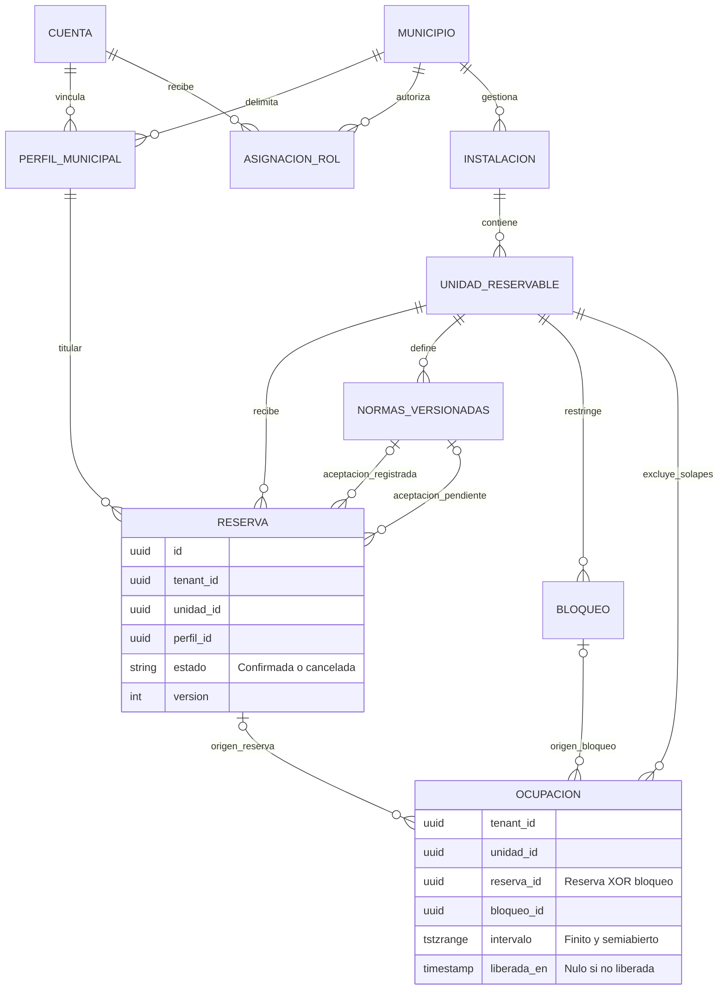
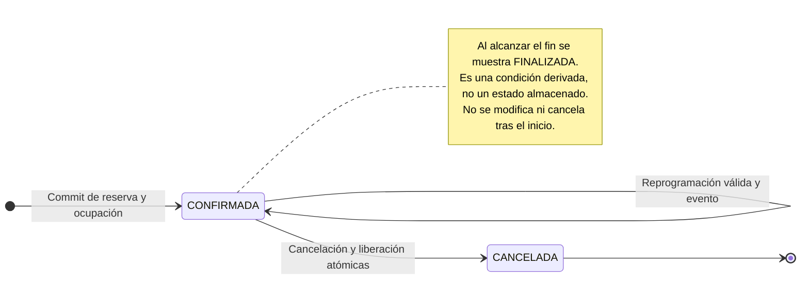

# 02 Modelo de dominio

## Entidades

Cada instalación y unidad reservable tiene un único municipio gestor, aunque participe en un convenio. La reserva identifica al titular y las condiciones de uso; la ocupación representa el intervalo que excluye otras reservas o cierres incompatibles.

| Entidad | Responsabilidad |
|---|---|
| Cuenta | Identidad y sesiones gestionadas por Better Auth, comunes a la instancia. |
| Perfil municipal | Relación única cuenta–municipio y datos necesarios para su servicio. |
| Asignación de rol | Permisos de una cuenta sobre un municipio y, cuando corresponda, unidades reservables concretas. |
| Instalación / Unidad reservable | Centro deportivo, espacios reservables y publicación del catálogo. |
| Regla horaria / Excepción | Aperturas regulares y cambios fechados del calendario. |
| Normas de uso | Texto versionado por unidad reservable; las versiones aceptadas se conservan sin sobrescribir. |
| Política de reserva | Condiciones versionadas que se aplican al crear o modificar una reserva. |
| Reserva | Titular, unidad, intervalo, estado, revisión, condiciones aceptadas y normas asignadas pendientes cuando corresponda. |
| Bloqueo | Cierre de una unidad reservable, con responsable y motivo. |
| Ocupación | Municipio, unidad reservable, intervalo y origen: reserva o bloqueo. |
| Evento / Auditoría | Cambios de negocio y operaciones sensibles, con autor, fecha y correlación. |
| Comando idempotente | Actor, municipio, operación, clave, huella de entrada y resultado. |
| Evento pendiente / Entrega | Aviso persistido y sus intentos de envío. |

Los perfiles municipales no duplican credenciales ni sesiones. Las entidades de colaboración se definen en el [modelo de convenios](07_identidad_y_colaboracion.md#modelo-de-colaboración).

### D-02 Relaciones del dominio

## Invariantes

| ID | Regla | Mecanismo |
|---|---|---|
| RN-01 | Las referencias entre entidades municipales pertenecen al mismo municipio. | Claves foráneas compuestas por municipio e identificador; referencias explícitas para cuentas y convenios. |
| RN-02 | Dos ocupaciones no liberadas de la misma unidad reservable no se solapan. | Exclusión PostgreSQL por municipio, unidad e intervalo. |
| RN-03 | Una reserva confirmada tiene exactamente una ocupación no liberada de su municipio y unidad; una cancelada, ninguna. | Unicidad parcial, escritura transaccional y pruebas de existencia y coherencia. |
| RN-04 | Cada ocupación procede de una reserva o de un bloqueo, nunca de ambos. | Restricción de origen y claves foráneas. |
| RN-05 | Los intervalos son finitos, no vacíos y semiabiertos `[inicio, fin)`. | Validación y restricciones; las reservas contiguas son compatibles. |
| RN-06 | Reserva, ocupación, consumos y eventos cambian atómicamente. | Transacción y control de versión; cualquier fallo conserva la situación anterior. |
| RN-07 | La misma clave y contenido, dentro de su retención, no repiten efectos. | Resultado idempotente guardado en la transacción. |
| RN-08 | La concurrencia y las operaciones administrativas respetan reglas y cuotas. | Protocolo común de comandos y aislamiento `SERIALIZABLE`. |
| RN-09 | El fallo de un aviso no revierte una reserva confirmada. | Evento pendiente guardado con la reserva. |
| RN-10 | Un convenio no concede acceso a historiales ajenos ni permisos de gestión sobre otras unidades. | Capacidades delimitadas y autorización por objeto. |

La ocupación contiene el intervalo actual; los eventos conservan los valores anteriores. Una ocupación pasada puede mantenerse sin liberar porque no bloquea fechas futuras. Las relaciones del diagrama incluyen esas ocupaciones históricas.

**Justificación:** reservas y bloqueos utilizan la misma exclusión sin representar un cierre como una reserva. PostgreSQL permite combinar rangos temporales con igualdad de identificadores mediante `btree_gist`. [Rangos y exclusiones](https://www.postgresql.org/docs/current/rangetypes.html#RANGETYPES-CONSTRAINT).

## Tiempo y configuración municipal

El sistema intercambia instantes en UTC y conserva por separado la zona IANA del municipio. `timestamptz` no guarda la zona original. Las horas locales inexistentes no generan franjas; las repetidas muestran el desplazamiento UTC para permitir una selección inequívoca. [Tipos temporales de PostgreSQL](https://www.postgresql.org/docs/current/datatype-datetime.html).

| Parámetro | Regla |
|---|---|
| Antelación máxima | 30 días naturales por defecto; entero no negativo configurable por municipio. La unidad reservable puede reducir el límite. |
| Cómputo | En la zona municipal: `hoy ≤ fecha(inicio) ≤ hoy + N`, ambos días incluidos, e `inicio > ahora`. El fin respeta apertura y duración. |
| Duración | Mínimo, máximo y paso en minutos por unidad reservable; valores positivos y compatibles, obligatorios antes de publicar. |
| Apertura | Horarios semanales y excepciones fechadas; la reserva completa queda dentro de un intervalo permitido. |
| Modificación y cancelación | Plazo no negativo en minutos antes del inicio; valor predeterminado: 1.440 minutos —24 horas—. Se admite `ahora ≤ inicio − plazo` y siempre `ahora < inicio`. |
| Intervención administrativa | Solo sobre reservas futuras, con permiso y motivo. Puede omitir el plazo del titular y cambiar de unidad, sin eludir integridad, vigencia ni cuotas ni aceptar normas en su nombre. |
| Publicación | Configuración válida, normas vigentes con contenido y unidad físicamente independiente. No se publican como unidades distintas un espacio y sus partes solapadas. |

El plazo utiliza minutos transcurridos entre instantes, no días naturales. El valor predeterminado se aplica al crear municipios; una actualización conserva los valores municipales existentes y las condiciones ya aceptadas.

**Justificación:** el cómputo por fecha local conserva la antelación en días naturales durante los cambios de horario. Los parámetros tipados permiten configurar municipios sin ejecutar código introducido por administradores.

## Estados y cambios de reglas

Los estados almacenados son `CONFIRMADA` y `CANCELADA`. La consulta muestra `FINALIZADA` cuando el fin de una reserva confirmada es anterior o igual al instante actual. Modificar una reserva conserva su estado y registra un evento.

### D-03 Estados de la reserva

**Justificación:** derivar la finalización evita escrituras causadas únicamente por el paso del tiempo. El sistema no deduce asistencia a partir de una reserva finalizada.

La cancelación aplica las condiciones aceptadas de la reserva. La modificación del titular comprueba las reglas vigentes y conserva en el historial las versiones anterior y nueva. Puede cambiar la unidad reservable dentro del mismo municipio, pero no el titular ni el municipio.

Un cierre o cambio de calendario incompatible con reservas confirmadas se rechaza hasta resolverlas mediante operaciones explícitas. Retirar una unidad del catálogo impide nuevas reservas y mantiene las existentes y su historial.

## Normas de uso y aceptación

Cada unidad reservable tiene un texto de normas versionado. Crear una versión conserva las anteriores y registra autor, fecha, motivo y correlación. Sin normas con contenido, la unidad puede permanecer en borrador, pero no publicarse ni admitir reservas. Las unidades ya publicadas que carezcan de ellas quedan ocultas del catálogo y la disponibilidad hasta completarlas, sin borrar reservas ni alterar el historial de publicación.

El titular acepta expresamente las versiones vigentes de normas y política al reservar. La reserva conserva esas referencias, el plazo de cancelación aceptado, los instantes de aceptación y, cuando corresponde, la aceptación de no poder cancelar por sí mismo. El servidor comprueba las versiones dentro de la transacción; una diferencia exige revisarlas y no sustituye la aceptación enviada.

| Modificación | Regla de aceptación |
|---|---|
| Sin cambio de unidad ni intervalo | No genera aceptación ni evento nuevos. |
| Del titular, con condiciones todavía cubiertas por su aceptación | Puede conservar la evidencia anterior. |
| Del titular, con otra unidad, normas o política, sin evidencia anterior o entrando por primera vez fuera del plazo de cancelación | Exige aceptación expresa de las condiciones vigentes y registra su fecha actual. |
| Administrativa | Puede cambiar fecha, horario o unidad. Conserva las condiciones previamente aceptadas; si las normas asignadas no están aceptadas para esa unidad, registra su aceptación pendiente y avisa al titular. |
| Cancelación | No exige nuevas normas, incluso si falta evidencia de aceptación anterior. |

### Reubicación administrativa y aceptación posterior

La reubicación se confirma inmediatamente: libera la ocupación anterior, ocupa el destino y recalcula la cuota en una transacción. No es una propuesta ni reserva simultáneamente ambos espacios. Un conflicto conserva la situación anterior. El aviso identifica el cambio realizado y, cuando corresponde, las normas que el titular debe aceptar antes del uso.

La evidencia aceptada identifica unidad y versión, aunque pertenezca al destino anterior. La obligación pendiente identifica la unidad actual y la versión asignada en la reubicación. Dos unidades con el mismo número de versión o texto no comparten aceptación. Publicar normas posteriores no sustituye retroactivamente esa referencia pendiente.

El titular puede aceptar las normas asignadas antes del nuevo inicio, incluso dentro de las últimas 24 horas. Esta operación no modifica fecha, unidad, ocupación, cuota ni condiciones de cancelación. Comprueba titularidad, revisión y referencia pendiente exactas; registra la aceptación con su fecha real y conserva la anterior en el historial. No permite que un gestor acepte por el titular.

La falta de respuesta no revierte ni cancela la reubicación: la unidad sigue reservada y la cuota permanece consumida. Si el titular discrepa, contacta con el municipio. Al llegar el inicio sin aceptación, se conserva la evidencia pendiente; no se presume asistencia ni se generan incidencias o penalizaciones automáticas. El requisito de aceptación antes del uso es verificable por la aplicación y el personal autorizado, no un control físico de acceso.

### Reservas anteriores sin evidencia

Se identifican como «sin aceptación registrada», no como canceladas, rechazadas ni propuestas pendientes. Se consultan y cancelan conforme a las condiciones históricas guardadas. La ausencia histórica no crea por sí sola una obligación nueva.

Una modificación real del titular exige aceptación de las condiciones vigentes. Una modificación administrativa puede ejecutarse sin aceptación anterior y deja las normas asignadas pendientes para el titular, igual que una reubicación ordinaria. La aceptación posterior se fecha cuando ocurre; no rellena retrospectivamente la creación ni acredita una política de cancelación que no conste como aceptada.

## Cancelación y responsabilidad

Una vez vencido el plazo aceptado, el titular no puede cancelar ni modificar para eludirlo; la reserva y su cuota permanecen ocupadas. Se permiten reservas con menos antelación que ese plazo si cumplen las demás reglas y el titular acepta expresamente que no podrá cancelarlas por sí mismo.

Ante una imposibilidad de asistencia, el usuario contacta directamente con el ayuntamiento. El gestor autorizado puede reubicar o cancelar excepcionalmente antes del inicio, conforme a las normas municipales y con motivo registrado. La reubicación conserva el plazo de cancelación previamente aceptado, aplicado al nuevo inicio; aceptar las normas pendientes no concede otra excepción ni cambia ese plazo.

El titular mantiene su responsabilidad aunque no utilice la instalación. Puede reorganizar participantes cuando las normas municipales lo permitan, sin transferir la reserva; el sistema no registra jugadores. Una ausencia mantiene el historial y el tiempo reservado, sin inferir asistencia ni generar incidencias, deudas, multas o penalizaciones automáticas.

## Cuenta y continuidad administrativa

La baja voluntaria es lógica. Requiere la contraseña actual y, si el usuario tiene MFA, una verificación del segundo factor realizada hace menos de cinco minutos. Se rechaza mientras exista una reserva confirmada con `fin > ahora`, futura o en curso, en cualquier municipio. La comprobación y la baja son atómicas frente a reservas, cambios de credenciales y sesiones concurrentes.

La baja revoca sesiones, permisos administrativos propios e invitaciones pendientes recibidas o emitidas. No retira permisos que otros usuarios ya hayan aceptado. Conserva identidad, perfiles, reservas y auditorías; no ejecuta la supresión de datos personales.

El usuario puede reactivar una cuenta conservada mediante contraseña, enlace de correo de un solo uso y TOTP o código de respaldo si MFA estaba habilitado. El código de respaldo se consume en la misma transacción. Recupera únicamente acceso personal y debe iniciar sesión de nuevo. Las cuentas suprimidas requieren un nuevo registro. La reactivación no levanta suspensiones de seguridad.

Cada municipio inicializado mantiene un administrador habilitado con permiso indefinido; la plataforma mantiene un operador habilitado. Habilitado significa cuenta activa, correo verificado, MFA configurado y permiso vigente no revocado, sin exigir una sesión abierta. No se permite retirar la última responsabilidad por baja o revocación ordinaria. Un permiso temporal ya aceptado puede convertirse explícitamente en indefinido, con motivo, sin otra invitación ni extensiones automáticas.

La retirada municipal por seguridad afecta solo a los permisos e invitaciones de ese municipio. La suspensión global corresponde a un operador y revoca sesiones y autoridad administrativa en toda la instancia, sin cancelar reservas. La contención puede dejar temporalmente al ámbito sin responsable. La recuperación exige verificar identidad o autoridad, resolver el compromiso y registrar la intervención; nunca restaura permisos antiguos automáticamente.
