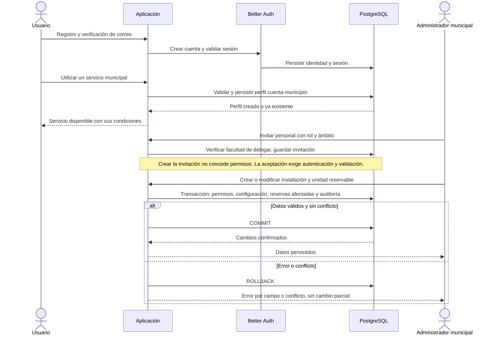
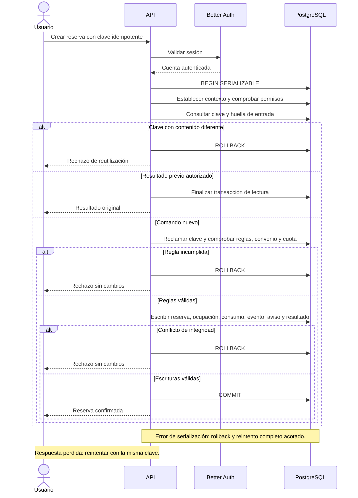
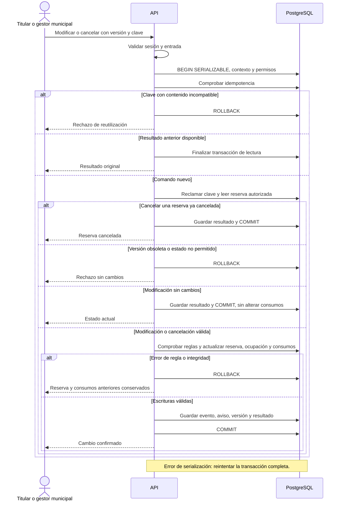
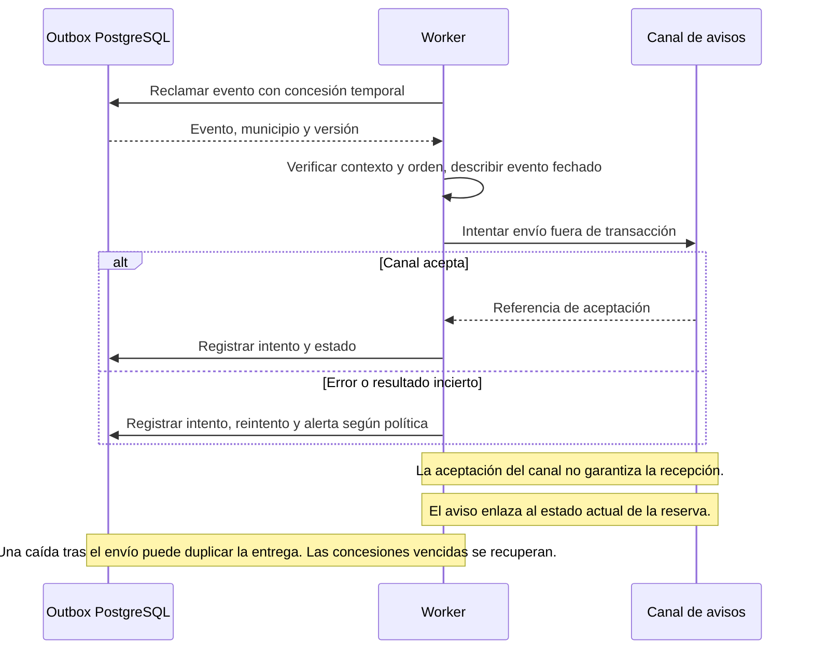

# 03 Procesos y secuencias

## Casos de uso

| ID | Actor y operación | Resultado |
|---|---|---|
| CU-01 | Un usuario consulta el catálogo y la disponibilidad. | Instalaciones publicadas y franjas en hora local, sin datos de titulares. |
| CU-02 | Un usuario autenticado crea una reserva. | Confirmación o rechazo sin cambios parciales. |
| CU-03 | El titular o un gestor municipal modifica o cancela una reserva. | Cambio atómico; motivo obligatorio para el gestor. |
| CU-04 | Un administrador o gestor autorizado mantiene el catálogo y calendario. | Configuración persistida y auditada, sin invalidar reservas confirmadas. |
| CU-05 | Un gestor autorizado consulta indicadores o exporta datos. | Resultados del municipio y periodo permitidos. |
| CU-06 | Un operador de plataforma da de alta un municipio. | Configuración inicial e invitación a su primer administrador. |
| CU-07 | Un usuario crea una cuenta o un perfil municipal. | Cuenta global y relación con el servicio municipal. |
| CU-08 | Un usuario consulta su historial. | Reservas propias de la instancia, filtrables por municipio. |
| CU-09 | Un usuario inicia o cierra sesión. | Sesión validada o revocada por Better Auth. |
| CU-10 | Los administradores participantes gestionan un convenio. | Capacidades y unidades reservables autorizadas según su versión y vigencia. |

## Registro y administración

El usuario crea una cuenta, verifica su correo y completa los datos mínimos del servicio municipal antes de reservar. Consultar el catálogo no crea un perfil municipal.

El operador de plataforma crea el municipio e invita a su primer administrador. El administrador municipal configura el catálogo y asigna permisos mediante invitaciones vinculadas a cuenta, municipio, rol, vigencia y unidades reservables, cuando el ámbito esté limitado. La aceptación exige autenticar al destinatario y comprobar que la invitación sigue vigente; no permite ampliar sus permisos.

Los formularios envían datos a la API, que valida las entradas, comprueba los permisos y persiste los cambios en PostgreSQL. El directorio municipal contiene únicamente los perfiles vinculados a ese servicio.

**Justificación:** separar registro y asignación de permisos impide que una cuenta nueva obtenga acceso administrativo.

### D-06 Registro y gestión manual

## Confirmación de reservas

1. La API valida la sesión, resuelve el municipio y comprueba la estructura del comando y su clave idempotente.
2. Abre una transacción `SERIALIZABLE`, establece el contexto autorizado y comprueba los permisos actuales.
3. Si existe un resultado para la misma clave y contenido, lo devuelve. Si el contenido difiere, rechaza la reutilización.
4. Para un comando nuevo, comprueba política, disponibilidad y, cuando corresponda, convenio, acreditación y cuota.
5. Guarda reserva, ocupación, consumo, evento, aviso pendiente y resultado idempotente; responde tras el `COMMIT`.
6. Ante un error de serialización, revierte y reintenta el comando completo dentro del límite configurado. Un solape de negocio se devuelve como conflicto.

### D-04 Confirmación de una reserva

### Idempotencia

La clave se delimita por municipio, actor y operación. La huella incluye todos los campos que afectan al resultado. Las ejecuciones simultáneas con la misma clave esperan de forma acotada o reciben una respuesta de operación en curso. Antes de recuperar un resultado se comprueba que el solicitante conserva acceso.

La API publica la duración de retención de los resultados, configurada para la instancia. Dentro de esa ventana, una respuesta perdida se recupera con la misma clave; el cliente no genera otra automáticamente. El resultado original y el estado actual de la reserva se consultan por separado.

Todas las operaciones de la transacción utilizan el mismo cliente del pool de conexiones. [Transacciones con `pg`](https://node-postgres.com/features/transactions).

## Modificación y cancelación

El comando incluye la versión conocida de la reserva. El sistema comprueba autorización e idempotencia antes de evaluar esa versión. Una versión obsoleta exige consultar de nuevo la reserva. Si una cancelación autorizada encuentra la reserva ya cancelada, devuelve ese estado sin repetir sus efectos.

Una modificación sin cambios de unidad o intervalo conserva la atribución de cuota y no genera un evento de cambio. Las demás modificaciones revalidan destino, horario y convenio; liberan el consumo anterior y registran el nuevo en la misma transacción. Un error conserva tanto la reserva como su consumo.

El titular y el municipio de la reserva no cambian. Reservar en otro municipio requiere cancelar y crear otra reserva como operaciones independientes. La cancelación libera ocupación y consumo al confirmar la transacción.

### D-05 Modificación y cancelación

Los cambios de horarios y excepciones comprueban las reservas afectadas con el mismo protocolo que los bloqueos. La sesión no sustituye la comprobación de permisos vigentes.

## Avisos

El sistema genera un aviso interno y un correo por confirmación, modificación o cancelación. El evento se guarda con la operación. Un fallo del correo mantiene la reserva confirmada y deja el aviso pendiente.

El worker reclama cada evento mediante una concesión temporal, envía el mensaje fuera de la transacción y registra el intento. Las concesiones vencidas permiten recuperar trabajos abandonados. Los avisos se procesan por reserva y versión; cada mensaje describe un evento fechado y enlaza al estado actual.

La aceptación por el proveedor no garantiza la recepción. Un fallo después de enviar y antes de registrar el resultado puede provocar una entrega duplicada.

### D-07 Envío de avisos

## Indicadores municipales

| Indicador | Cálculo |
|---|---|
| Reservas por estado | Número de reservas cuya fecha de inicio pertenece al periodo, agrupadas por estado. |
| Minutos reservados | Suma de la intersección entre intervalos confirmados y periodo consultado. |
| Ocupación reservada | `minutos reservados / minutos ofertados × 100`; denominador cero: «no aplicable». |

Los minutos ofertados se obtienen de los calendarios y cierres versionados correspondientes al periodo. Los indicadores describen reservas, no asistencia. Los [informes intermunicipales](07_identidad_y_colaboracion.md#c-03-informes-agregados) aplican controles adicionales de privacidad.

## Contratos de interfaz

La API utiliza OpenAPI para describir rutas, entradas, respuestas, permisos y ejemplos. Los comandos documentan clave idempotente, versión de concurrencia y errores por campo. Las exportaciones identifican versión de formato, municipio, periodo y entidades incluidas; aplican los mismos permisos que las consultas.

| Situación | Resultado |
|---|---|
| Entrada inválida | Errores por campo, sin cambios parciales. |
| Sesión ausente o permiso insuficiente | Rechazo sin revelar objetos ajenos. |
| Solape, cuota agotada o versión obsoleta | Conflicto, sin datos de reservas de terceros. |
| Dependencia no disponible | Fallo o resultado incierto recuperable con la misma clave. |
| Correo pendiente | Reserva confirmada con estado de aviso separado. |
