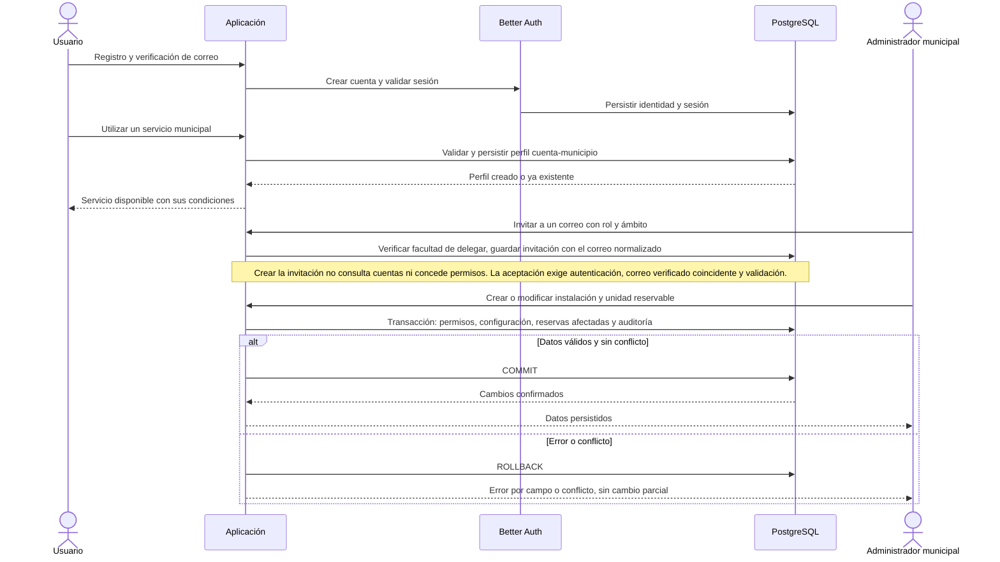
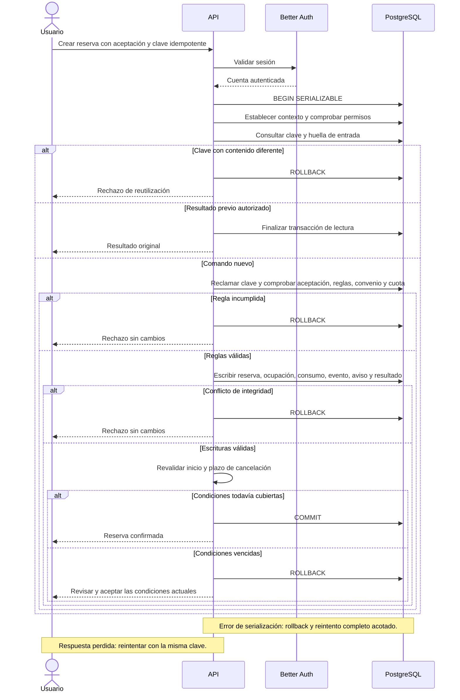
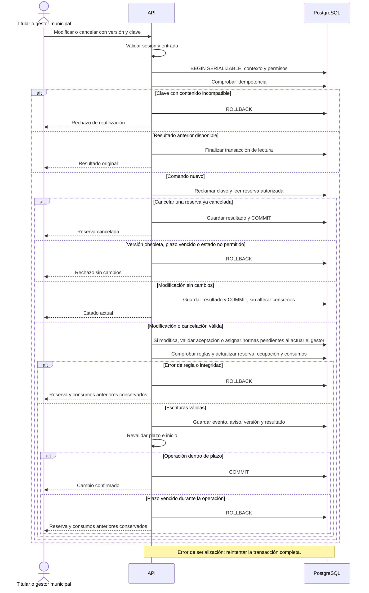
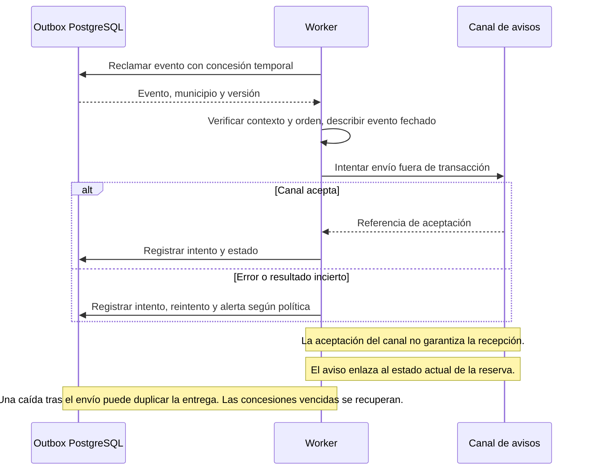
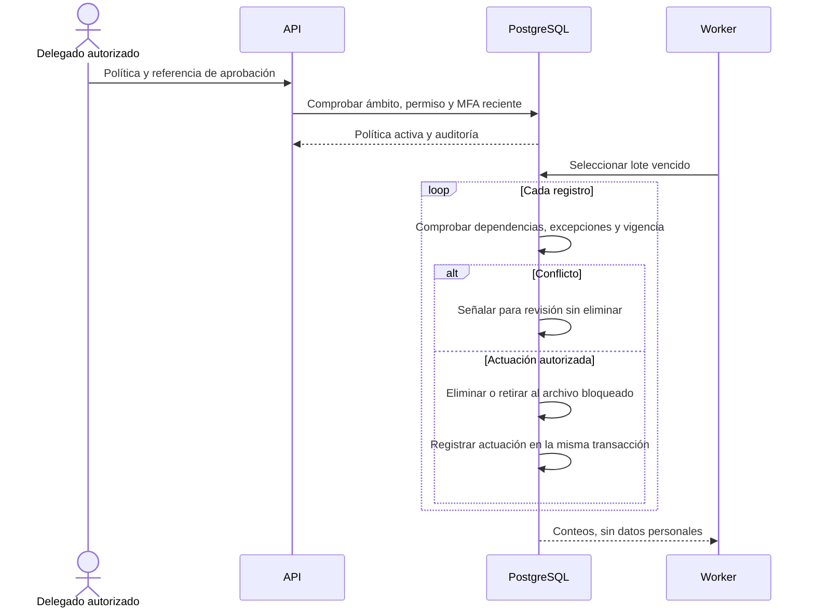

# 03 Procesos y secuencias

## Casos de uso

| ID | Actor y operación | Resultado |
|---|---|---|
| CU-01 | Un usuario consulta el catálogo y la disponibilidad. | Instalaciones publicadas y franjas en hora local, sin datos de titulares. |
| CU-02 | Un usuario autenticado acepta las condiciones y crea una reserva. | Confirmación con las versiones aceptadas o rechazo sin cambios parciales. |
| CU-03 | El titular o un gestor municipal modifica o cancela una reserva. | Cambio atómico; motivo obligatorio para el gestor y aceptación posterior del titular cuando la reubicación asigna normas no aceptadas. |
| CU-04 | Un administrador o gestor autorizado mantiene el catálogo y calendario. | Configuración persistida y auditada, sin invalidar reservas confirmadas. |
| CU-05 | Un gestor autorizado consulta indicadores o exporta datos. | Resultados del municipio y periodo permitidos. |
| CU-06 | Un operador de plataforma da de alta un municipio. | Configuración inicial e invitación a su primer administrador. |
| CU-07 | Un usuario crea una cuenta y utiliza un servicio municipal. | Cuenta global y relación automática con el municipio al reservar. |
| CU-08 | Un usuario consulta su historial. | Reservas propias de la instancia, filtrables por municipio. |
| CU-09 | Un usuario inicia o cierra sesión. | Sesión validada o revocada por Better Auth. |
| CU-10 | Los administradores participantes gestionan un convenio. | Capacidades y unidades reservables autorizadas según su versión y vigencia. |

## Registro y administración

El usuario crea una cuenta y verifica su correo antes de reservar. Al confirmar una reserva, Quenda crea la relación cuenta–municipio si no existe; el usuario no cumplimenta un perfil municipal adicional. Consultar el catálogo no crea esa relación.

El operador de plataforma crea el municipio e invita a su primer administrador. El administrador municipal configura el catálogo y asigna permisos mediante invitaciones dirigidas al correo del destinatario y vinculadas a municipio, rol, vigencia y unidades reservables, cuando el ámbito esté limitado. Crear la invitación no revela si existe una cuenta con ese correo. La aceptación exige autenticar al destinatario, que su correo verificado coincida en ese momento con la dirección invitada y que la invitación siga vigente; no permite ampliar sus permisos. Las invitaciones de operador y de privacidad global que emite un operador siguen el mismo procedimiento.

Los formularios envían datos a la API, que valida las entradas, comprueba los permisos y persiste los cambios en PostgreSQL. El directorio municipal contiene únicamente los perfiles vinculados a ese servicio y solo lo consulta su administración; los formularios eligen a las personas entre datos que quien actúa ya puede ver o piden un correo, y conservan el identificador exacto cuando no hay alternativa sin directorio ([referencias de cuenta](07_identidad_y_colaboracion.md#referencias-de-cuenta-en-los-formularios-del-personal)).

**Justificación:** separar registro y asignación de permisos impide que una cuenta nueva obtenga acceso administrativo.

### Baja, reactivación y relevo

```mermaid
sequenceDiagram
  actor U as Usuario
  participant A as API de identidad
  participant D as PostgreSQL
  U->>A: Solicita baja y confirma contraseña
  A->>D: Verifica prueba, sesión y MFA si está habilitado
  A->>D: Comprueba reservas futuras/en curso y continuidad
  alt Puede darse de baja
    A->>D: Baja, revocación de autoridad y sesiones, auditoría
    A-->>U: Cuenta desactivada
  else Reservas o relevo pendiente
    A-->>U: Rechazo sin cambios
  end
  U->>A: Solicita reactivación con contraseña
  A-->>U: Enlace de correo de un solo uso
  U->>A: Confirma token, contraseña y segundo factor si procede
  A->>D: Verifica baja voluntaria, consume prueba y reactiva
  A-->>U: Acceso personal recuperado; requiere nuevo inicio de sesión
```

Para un relevo ordinario, el sustituto acepta una invitación o ya dispone de un permiso válido. Antes de retirar al último responsable indefinido, otro debe quedar habilitado con permiso indefinido. La retirada por seguridad no espera al relevo; el administrador elige a la persona entre su personal y sus invitaciones pendientes, y una invitación por correo sin aceptar se retira por su dirección. Si no queda un responsable habilitado se utiliza la recuperación controlada, sin reaprovechar permisos ni invitaciones anteriores.

### D-06 Registro y gestión manual



## Confirmación de reservas

1. La API valida la sesión, resuelve el municipio y comprueba la estructura del comando y su clave idempotente.
2. Abre una transacción `SERIALIZABLE`, establece el contexto autorizado y comprueba los permisos actuales.
3. Si existe un resultado para la misma clave y contenido, lo devuelve. Si el contenido difiere, rechaza la reutilización.
4. Para un comando nuevo, bloquea las condiciones vigentes y comprueba su coincidencia con la aceptación del titular, disponibilidad y, cuando corresponda, convenio, acreditación y cuota.
5. Guarda reserva, ocupación, consumo, evento, aviso pendiente y resultado idempotente; responde tras el `COMMIT`.
6. Ante un error de serialización, revierte y reintenta el comando completo dentro del límite configurado. Un solape de negocio se devuelve como conflicto.

### D-04 Confirmación de una reserva



### Idempotencia

La clave se delimita por municipio, actor y operación. La huella incluye todos los campos que afectan al resultado, incluida la aceptación. Las ejecuciones simultáneas con la misma clave esperan de forma acotada o reciben una respuesta de operación en curso. Antes de recuperar un resultado se comprueba que el solicitante conserva acceso.

La API publica la duración de retención de los resultados, configurada para la instancia. Dentro de esa ventana, una respuesta perdida se recupera con la misma clave; el cliente no genera otra automáticamente. Los comandos anteriores sin aceptación conservan su huella y pueden recuperarse mientras su resultado siga retenido; la evidencia ausente se representa con valores nulos, sin completar ni modificar el resultado almacenado. Esto no permite crear reservas nuevas sin aceptación. El resultado original y el estado actual de la reserva se consultan por separado.

Todas las operaciones de la transacción utilizan el mismo cliente del pool de conexiones. [Transacciones con `pg`](https://node-postgres.com/features/transactions).

## Modificación y cancelación

Al elegir un nuevo horario, la consulta del titular excluye únicamente la ocupación de su reserva. Conserva las demás reservas y bloqueos, no libera la franja actual y vuelve a comprobar el plazo de modificación. La disponibilidad pública mantiene todas las ocupaciones.

El comando incluye la versión conocida de la reserva. El sistema comprueba autorización e idempotencia antes de evaluar esa versión. Una versión obsoleta exige consultar de nuevo la reserva. Si una cancelación autorizada encuentra la reserva ya cancelada, devuelve ese estado sin repetir sus efectos.

Una modificación sin cambios de unidad o intervalo conserva la atribución de cuota y no genera un evento de cambio. Las demás modificaciones revalidan destino, horario y convenio; liberan el consumo anterior y registran el nuevo en la misma transacción. Un error conserva tanto la reserva como su consumo.

Se aplica el plazo aceptado de origen y la [regla de aceptación correspondiente](02_modelo_dominio.md#normas-de-uso-y-aceptación). El gestor puede omitir el plazo del titular y reubicar dentro del mismo municipio, con permisos sobre origen y destino y motivo. La operación es inmediata; asigna las normas del destino y registra aceptación pendiente si no están cubiertas por la evidencia del titular. Conserva su política de cancelación y notifica el cambio. La cancelación no exige aceptar normas.

El titular y el municipio de la reserva no cambian. Reservar en otro municipio requiere cancelar y crear otra reserva como operaciones independientes. Solo una cancelación confirmada libera ocupación y consumo. Un rechazo por plazo vencido no genera liberaciones ni avisos.

### D-05 Modificación y cancelación



Los cambios de horarios y excepciones comprueban las reservas afectadas con el mismo protocolo que los bloqueos. La sesión no sustituye la comprobación de permisos vigentes.

### Aceptación de normas asignadas

El titular consulta la reserva y el texto exacto pendiente. Envía revisión, unidad y versión para aceptarlo. La API comprueba sesión, titularidad, idempotencia, coincidencia con la obligación asignada e inicio futuro, dentro de la misma transacción. Un cambio concurrente exige consultar de nuevo la reserva.

Aceptar incrementa la revisión y registra un evento de aceptación, no una modificación de horario. No toca ocupación, cuotas ni política de cancelación y no genera un aviso de reprogramación. No se aplica el plazo ordinario de modificación: puede aceptarse hasta antes del inicio, sin admitir aceptación retrospectiva.

## Avisos

El sistema genera un aviso interno y un correo por confirmación, modificación o cancelación. Una modificación administrativa indica si el titular debe aceptar las normas asignadas antes del uso. La aceptación posterior tiene auditoría propia, sin otro aviso de modificación. El evento se guarda con la operación. Un fallo del correo mantiene la reserva confirmada y deja el aviso pendiente.

El worker reclama cada evento mediante una concesión temporal, envía el mensaje fuera de la transacción y registra el intento. Las concesiones vencidas permiten recuperar trabajos abandonados. Los avisos se procesan por reserva y versión; cada mensaje describe un evento fechado y enlaza al estado actual.

La aceptación por el proveedor no garantiza la recepción. Un fallo después de enviar y antes de registrar el resultado puede provocar una entrega duplicada.

### D-07 Envío de avisos



## Indicadores municipales

| Indicador | Cálculo |
|---|---|
| Reservas por estado | Número de reservas cuya fecha de inicio pertenece al periodo, agrupadas por estado. |
| Minutos reservados | Suma de la intersección entre intervalos confirmados y periodo consultado. |
| Ocupación reservada | `minutos reservados / minutos ofertados × 100`; denominador cero: «no aplicable». |

Los minutos ofertados se obtienen de los calendarios y cierres versionados correspondientes al periodo. Los indicadores describen reservas, no asistencia. Los [informes intermunicipales](07_identidad_y_colaboracion.md#c-03-informes-agregados) aplican controles adicionales de privacidad.

## Contratos de interfaz

La API utiliza OpenAPI para describir rutas, entradas, respuestas, permisos y ejemplos. Los comandos documentan clave idempotente, versión de concurrencia y errores por campo. Las exportaciones identifican versión de formato, municipio, periodo y entidades incluidas; aplican los mismos permisos que las consultas.

Al crear o modificar por cuenta del titular, la aceptación se envía como `acceptance: { usageRulesVersion, bookingPolicyVersion, nonCancellable }`. Los identificadores proceden del detalle público de la unidad; el texto de normas se consulta por separado. `nonCancellable` identifica la aceptación expresa de reservar cuando ya no es posible cancelar por cuenta propia. El backend comprueba su valor con el inicio solicitado y el plazo vigente.

La exportación `quenda.reservations`, versión 3, distingue la unidad y versión aceptadas de la unidad y normas pendientes tras una reubicación. Incluye sus textos, instantes de aceptación, plazo conservado y aceptación de no cancelación. Los valores nulos indican evidencia no registrada; no cambian el estado de la reserva.

| Situación | Resultado |
|---|---|
| Entrada inválida | Errores por campo, sin cambios parciales. |
| Sesión ausente o permiso insuficiente | Rechazo sin revelar objetos ajenos. |
| Solape, cuota agotada o revisión de reserva obsoleta | Conflicto específico (`SLOT_UNAVAILABLE`, `QUOTA_EXCEEDED`, `RESERVATION_CHANGED`), sin datos de reservas de terceros. |
| Versión obsoleta de una ficha, calendario, normas, política o ajustes | `STALE_VERSION`: se recarga la versión actual y se vuelve a aplicar el cambio. |
| Calendario que deja fuera reservas confirmadas | `SCHEDULE_HAS_RESERVATIONS`: se cancelan o reubican antes esas reservas, sin que la respuesta las identifique. |
| Publicación sin normas | `USAGE_RULES_REQUIRED`: «Añade las normas de uso para publicar esta unidad». |
| Modificación que exige nueva aceptación o condiciones cambiadas | `CONDITIONS_ACCEPTANCE_REQUIRED` o `CONDITIONS_CHANGED`; el titular debe consultar y aceptar las condiciones aplicables. |
| Intento de aceptar por otro titular | Rechazo sin registrar aceptación ni alterar la reserva. |
| Aceptación posterior con revisión, unidad o versión distintas de las pendientes | Conflicto sin cambios; el titular debe consultar la reserva actual. |
| Modificación o cancelación fuera de plazo | `RESERVATION_DEADLINE_PASSED`; se conservan reserva, ocupación y cuota. |
| Dependencia no disponible | Fallo o resultado incierto recuperable con la misma clave. |
| Correo pendiente | Reserva confirmada con estado de aviso separado. |

## D-09 Conservación automática



La aprobación configura la ejecución posterior; no exige autorizar de nuevo cada vencimiento. Las políticas de distintos municipios no se sustituyen entre sí. La restitución de una copia anterior exige aplicar las actuaciones posteriores verificadas antes de autorizar el acceso ordinario.
