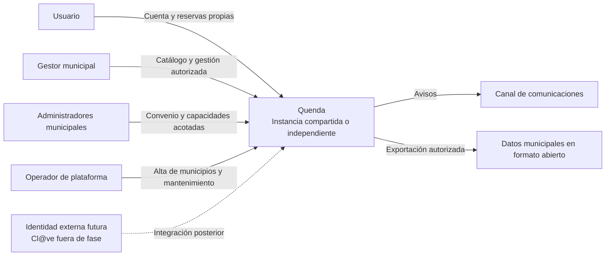
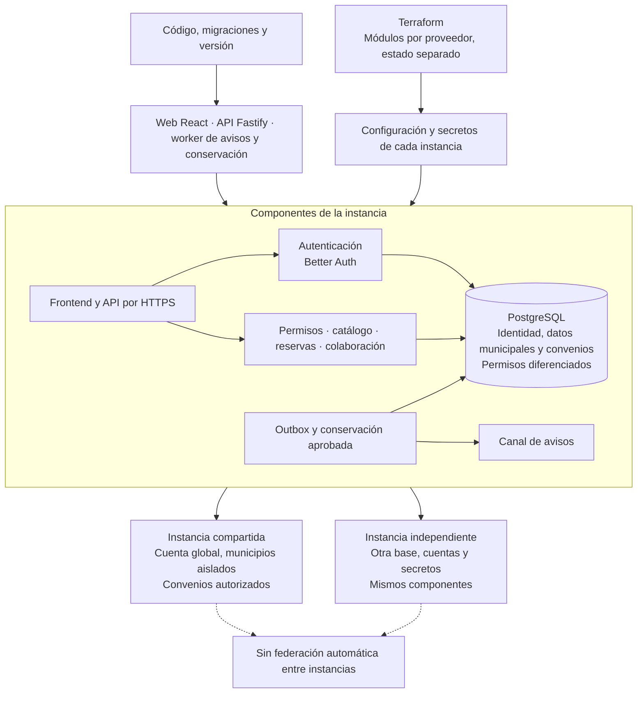

# 04 Arquitectura

## Contexto del sistema

El frontend accede a la API para consultar el catálogo, gestionar reservas y administrar municipios. La API autentica las cuentas con Better Auth y aplica los permisos del dominio.

### D-01 Contexto del sistema

## ADR-01 Monolito modular

El backend contiene cinco módulos: identidad y acceso; municipios y catálogo; reservas y disponibilidad; colaboración intermunicipal; avisos y salida de datos. Se comunican mediante interfaces internas. El worker ejecuta trabajos del mismo producto.

**Justificación:** reserva, ocupación, cuota y evento requieren una transacción común. El monolito evita coordinación distribuida y permite probar los módulos por separado. La API se despliega como una unidad; los microservicios no forman parte de esta arquitectura.

## ADR-02 TypeScript, Node.js y Fastify

Fastify proporciona la capa HTTP sobre una versión LTS compatible de Node.js. El código utiliza TypeScript y separa arranque, rutas y casos de uso. Los handlers validan entradas y delegan las reglas de negocio en los módulos.

**Justificación:** Fastify ofrece encapsulación y pruebas mediante `inject()`, con integración directa documentada por Better Auth. NestJS añade una estructura de módulos e inyección más prescriptiva, pero su integración con Better Auth es comunitaria; Fastify evita esa dependencia adicional. [Encapsulación](https://fastify.dev/docs/latest/Reference/Encapsulation/), [pruebas](https://fastify.dev/docs/latest/Guides/Testing/), [integración Fastify](https://better-auth.com/docs/integrations/fastify), [integración NestJS](https://better-auth.com/docs/integrations/nestjs).

Las versiones compatibles se fijan en los manifiestos y el archivo de bloqueo de pnpm. Los cambios de dependencias deben superar las pruebas del sistema.

## ADR-03 Better Auth

Better Auth gestiona cuentas y sesiones. El módulo de identidad expone la cuenta autenticada a los casos de uso; los permisos municipales y de colaboración se comprueban en el dominio. Esa interfaz permite incorporar proveedores externos sin acoplarlos a las reservas.

**Justificación:** centraliza la autenticación y utiliza PostgreSQL sin exigir un ORM. [Adaptador PostgreSQL](https://better-auth.com/docs/adapters/postgresql).

La cuenta es global por instancia. Una sesión válida no concede permisos municipales ni acceso a convenios. Cl@ve queda fuera del alcance inicial; la interpretación del requisito de autenticación pública se registra en [PD-AUTH-PUBLICA](06_decisiones_y_validacion.md#decisiones-pendientes).

## ADR-04 PostgreSQL y acceso SQL

PostgreSQL almacena el dominio y las tablas de Better Auth con credenciales separadas. El dominio utiliza `pg`, consultas parametrizadas y migraciones SQL versionadas. Cada transacción mantiene un único cliente del pool.

**Justificación:** el SQL explícito permite controlar exclusiones temporales, claves compuestas y políticas RLS sin depender de su representación en un ORM. Requiere mantener los tipos y mapeos de acceso. [Transacciones](https://node-postgres.com/features/transactions), [rangos y exclusiones](https://www.postgresql.org/docs/current/rangetypes.html#RANGETYPES-CONSTRAINT).

El alojamiento de PostgreSQL debe admitir `btree_gist` y roles de ejecución sin privilegios de bypass.

## ADR-05 Servicio compartido e instancias independientes

El servicio compartido utiliza tablas municipales con `tenant_id`. Las referencias compuestas y RLS limitan el acceso y las relaciones entre municipios. Una instancia independiente despliega los mismos artefactos con otra base de datos, cuentas, secretos y configuración.

**Justificación:** compartir infraestructura reduce los componentes operativos por municipio; una instancia independiente proporciona aislamiento dedicado sin bifurcar el código. [Seguridad por filas](https://www.postgresql.org/docs/current/ddl-rowsecurity.html).

No hay federación automática ni traslado de municipios entre bases en caliente. Exportar datos, restaurar una instancia y migrar un municipio son operaciones distintas.

## ADR-06 Integridad y concurrencia

Las ocupaciones aplican la exclusión temporal RN-02. Los comandos que modifican reservas, cuotas o disponibilidad utilizan `SERIALIZABLE`, leen las reglas dentro de la transacción y reintentan el comando completo ante errores de serialización.

**Justificación:** la exclusión impide solapes de una unidad reservable; el aislamiento coordina decisiones sobre varias filas, como el último consumo de una cuota compartida. [Aislamiento PostgreSQL](https://www.postgresql.org/docs/current/transaction-iso.html).

Las transacciones se mantienen breves y sin llamadas externas. Las pruebas de contención miden abortos y reintentos. La revocación de convenios y acreditaciones utiliza además el [protocolo de bloqueos](07_identidad_y_colaboracion.md#persistencia-y-concurrencia).

La confirmación bloquea las versiones de normas y política y las compara con la aceptación enviada. Recomprueba los límites temporales después de las esperas; nunca sustituye una versión aceptada por otra. La baja de cuenta, los comandos y la creación de sesiones se coordinan sobre el estado global de la cuenta: la baja revoca todas las sesiones y no puede coexistir con una reserva confirmada futura o en curso. El mismo bloqueo coordina cambios de credenciales, suspensión y reactivación. Las pruebas de autenticación de un solo uso permanecen en el esquema de identidad; el rol de dominio no puede emitirlas ni consultar credenciales.

La reubicación administrativa separa la referencia de normas aceptadas de la obligación pendiente sobre el destino. Reprogramación, ocupación, cuota y aviso se confirman juntos. La aceptación posterior es otro comando idempotente del titular: valida la revisión y referencia asignadas, registra evidencia y no modifica ocupaciones ni consumos.

## ADR-07 Outbox y worker

La transacción de reserva guarda los eventos pendientes en una outbox. Un worker del mismo producto los procesa y registra los intentos de envío. Puede ejecutarse separado de la API sin duplicar reglas ni código.

**Justificación:** conserva los avisos ante fallos del canal y permite confirmar reservas sin esperar al correo. No requiere un broker de mensajes. [Patrón outbox](https://docs.aws.amazon.com/prescriptive-guidance/latest/cloud-design-patterns/transactional-outbox.html).

El consumidor recupera concesiones vencidas y mantiene el orden por reserva. La entrega externa admite duplicados y no garantiza recepción por el destinatario.

El mismo proceso ejecuta lotes acotados de conservación. Selecciona registros ordinarios conforme a políticas aprobadas del ámbito y destruye archivos bloqueados conforme a su autorización y fecha de destrucción, respetando las excepciones vigentes. Registra resultados y separa los conflictos para revisión. Las actuaciones de datos, su evidencia y el archivo restringido comparten transacción. No se añade otro servicio ni un planificador externo.

## ADR-08 Frontend

El frontend es una SPA con React 19, TypeScript y Vite. Utiliza React Router para navegación, TanStack Query para estado remoto, CSS Modules y CSS custom properties para estilos, Radix UI Primitives para interacciones accesibles, Motion para animaciones y Lucide React para iconos. Las tipografías son Geist e Inter; pnpm gestiona las dependencias. Los componentes son propios y no dependen de Tailwind.

**Justificación:** CSS Modules evita colisiones de estilos; las variables CSS permiten configurar la apariencia municipal sin duplicar componentes. Radix proporciona comportamientos de teclado y foco, y Motion permite respetar movimiento reducido. La aplicación mantiene la responsabilidad sobre etiquetas, contraste y accesibilidad de los flujos. [Radix](https://www.radix-ui.com/primitives/docs/overview/accessibility), [Motion](https://motion.dev/docs/react-accessibility).

React Router y TanStack Query cubren funciones que Vite no incluye. La integración continua ejecuta por separado la comprobación de tipos, ya que Vite transpila TypeScript sin comprobarlo. [React](https://react.dev/learn/build-a-react-app-from-scratch), [Vite](https://vite.dev/guide/features.html#typescript).

La aplicación web reside en `web/`, con compilación y dependencias separadas del backend. Los componentes, estilos, helpers y fuentes son archivos locales; no dependen de otra biblioteca privada ni de su directorio de desarrollo. Las pantallas se cargan por ruta.

Las consultas privadas identifican cuenta y ámbito municipal en su clave de caché. Cerrar sesión cancela las consultas y retira los datos privados. Las mutaciones no reintentan automáticamente ni presentan una reserva como confirmada antes de la respuesta del servidor.

El selector público utiliza una proyección de identificador, nombre y zona horaria municipal. La navegación administrativa consulta únicamente los ámbitos y permisos propios; esa proyección no sustituye la autorización ni la comprobación de MFA de cada operación.

La [apariencia municipal](02_modelo_dominio.md#apariencia-y-preferencias) utiliza variables CSS y combinaciones predefinidas verificadas. La vista pública muestra un calendario de fechas y franjas; la administración utiliza una agenda diaria. Los controles representan fechas civiles del municipio y conservan los instantes y desplazamientos UTC recibidos del servidor.

## ADR-09 Entornos y versiones

`main` mantiene una única línea de producto. Cada versión se identifica por commit y genera artefactos que se promueven entre entornos. Frontend y API se sirven bajo el mismo origen. Configuración, secretos, datos y estado de infraestructura son independientes por entorno; la configuración pública no contiene secretos.

**Justificación:** evita divergencias funcionales y permite probar el mismo artefacto que se despliega. La demo utiliza una versión del producto con datos sintéticos, sin una rama funcional propia. [Código y despliegues](https://12factor.net/codebase), [configuración](https://12factor.net/config).

## ADR-10 Terraform y portabilidad

Terraform provisiona la infraestructura mediante módulos específicos del proveedor y configuración por entorno. La aplicación se distribuye en imágenes OCI y PostgreSQL permite exportar y restaurar sus datos. Las versiones de Terraform y sus proveedores quedan fijadas.

**Justificación:** los cambios de infraestructura son reproducibles y revisables. Cambiar de proveedor exige adaptar sus recursos; Terraform no proporciona una abstracción multicloud automática. [Composición de módulos](https://developer.hashicorp.com/terraform/language/modules/develop/composition#multi-cloud-abstractions).

El estado y los planes se mantienen fuera del repositorio, con acceso restringido, bloqueo y recuperación. Marcar un valor como `sensitive` no lo elimina del estado. Las licencias de Terraform y sus proveedores se revisan por separado de la licencia del producto. [Estado](https://developer.hashicorp.com/terraform/language/state/backends), [datos sensibles](https://developer.hashicorp.com/terraform/language/manage-sensitive-data), [licencia](https://github.com/hashicorp/terraform/blob/main/LICENSE).

La implantación requiere ejecución de trabajos, copias, restauración y monitorización. La topología y el proveedor se determinan en [PD-OPERACION](06_decisiones_y_validacion.md#decisiones-pendientes); Kubernetes y multizona no son requisitos del sistema.

## ADR-11 Colaboración mediante capacidades

El módulo de colaboración implementa elegibilidad, cuotas e informes según el [contrato intermunicipal](07_identidad_y_colaboracion.md). Valida parámetros mediante esquemas y rechaza SQL, scripts o reglas ejecutables introducidas por administradores.

**Justificación:** las capacidades combinan actor, titularidad, unidad reservable, convenio y vigencia. Una función centralizada de autorización evita decisiones distintas entre rutas sin añadir un motor externo de políticas. [OWASP: autorización](https://cheatsheetseries.owasp.org/cheatsheets/Authorization_Cheat_Sheet.html).

Las acreditaciones y los consumos compartidos siguen sujetos a protección de datos y controles de acceso; no habilitan lectura de historiales municipales.

## D-08 Componentes y modalidades de despliegue

## ADR-12 Privacidad por ámbito y operaciones cerradas

Las operaciones de privacidad permanecen en identidad y utilizan permisos explícitos, SQL parametrizado y el ejecutor transaccional. La selección de datos procede de manejadores cerrados por familia, no de consultas o reglas ejecutables configurables. El archivo bloqueado tiene permisos de mantenimiento independientes de los roles de ejecución. La exportación personal usa una proyección permitida por campo, no una serialización de tablas completas.

**Justificación:** reutiliza los límites del monolito y permite probar el aislamiento por municipio. Una política legal no se convierte en código arbitrario; ampliar las familias o sus selecciones requiere modificar y probar el manejador. Las referencias intermunicipales sin autorización conjunta producen un conflicto, no una eliminación en cascada.
