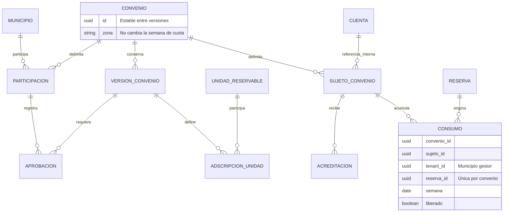
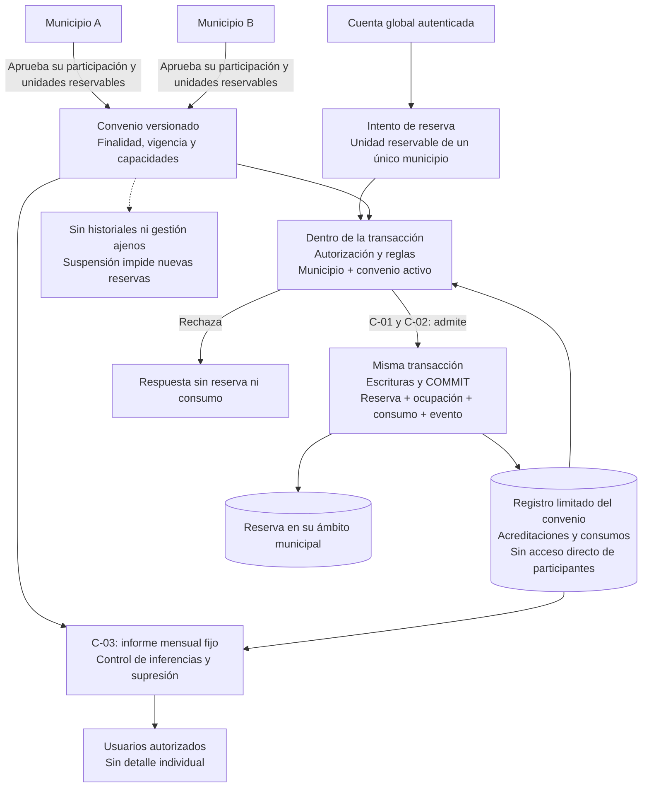

# 07 Identidad y colaboración intermunicipal

## Identidad global

Una cuenta Better Auth permite utilizar todos los municipios de la misma instancia. Cada perfil municipal mantiene sus datos y permisos. El usuario consulta sus reservas de cualquier municipio; el gestor municipal accede únicamente a las autorizadas por su función.

La consulta del historial propio obtiene la cuenta de la sesión y no acepta otro titular como parámetro. Los municipios no disponen de una consulta administrativa global ni de un directorio compartido de usuarios.

**Justificación:** la autenticación común evita registros repetidos y la autorización por objeto mantiene el aislamiento. Las cuotas se aplican por cuenta; verificar el correo no demuestra una persona física única. [NIST: prueba de identidad](https://pages.nist.gov/800-63-4/sp800-63a/ial-general/).

Las instancias independientes mantienen cuentas y sesiones propias. La federación entre instancias queda fuera del alcance inicial.

## Gobierno del convenio

El convenio define identificador estable, versiones, municipios participantes, unidades reservables, capacidades, finalidad, base jurídica, responsables, vigencia, zona IANA, emisores de acreditaciones, cuota y políticas de informes y conservación. Cada unidad pertenece a un único municipio gestor y, durante un intervalo, a un máximo de un convenio.

| Operación | Condición |
|---|---|
| Crear versión | Un administrador autorizado de un participante registra el borrador. |
| Aprobar | Cada participante aprueba la misma versión y sus unidades; modificarla invalida las aprobaciones. |
| Activar | Todas las aprobaciones, configuración válida, revisión jurídica registrada y conciliación de reservas. |
| Suspender | Cualquier participante autorizado, con motivo y efecto sobre todo el convenio. |
| Sustituir o reactivar | Nueva versión, aprobaciones y acto de activación. |
| Finalizar | Vencimiento o terminación acordada, con conservación de evidencias según su política. |

Los estados almacenados son `BORRADOR`, `APROBADO`, `ACTIVADO` y `SUSPENDIDO`. Solo una versión `ACTIVADO` dentro de su vigencia habilita operaciones. La aprobación no sustituye al acto de activación.

Existe como máximo una versión efectiva por convenio e instante. Sustituirla cierra atómicamente la vigencia anterior y conserva sus evidencias. Cada operación comprueba el vencimiento sin depender de un trabajo programado. Para reservar, el convenio debe estar activo al confirmar y cubrir todo el intervalo solicitado.

**Justificación:** la aprobación por versión impide ampliar unilateralmente los datos y operaciones compartidos. La activación exige una base jurídica y responsabilidades de tratamiento definidas; la corresponsabilidad del artículo 26 se aplica cuando se determinan conjuntamente fines y medios. [RGPD](https://www.boe.es/doue/2016/119/L00001-00088.pdf).

## Capacidades del convenio

| Capacidad | Entrada y resultado | Límite |
|---|---|---|
| C-01 Elegibilidad | Cuenta de sesión, unidad e intervalo → cumple/no cumple. | Solo dentro de un intento de reserva; sin búsqueda de personas ni consulta libre de acreditaciones ajenas. |
| C-02 Cuota conjunta | Convenio, cuenta y semana → admite/rechaza. | Sin devolver reservas, municipios visitados ni desglose de consumos ajenos. |
| C-03 Informe agregado | Convenio, mes publicado y solicitante autorizado → informe. | Sin detalle individual, filtros demográficos ni fechas arbitrarias. |

El convenio no concede gestión sobre reservas o instalaciones de otro municipio. Para ejercer esa función, el municipio gestor asigna un rol explícito al usuario y audita sus operaciones en ese ámbito.

**Justificación:** las capacidades vinculan actor, objeto, operación y vigencia sin habilitar consultas generales entre municipios. [OWASP: autorización](https://cheatsheetseries.owasp.org/cheatsheets/Authorization_Cheat_Sheet.html).

### C-01 Acreditaciones de uso

El convenio configura `acceso_abierto` o `acreditacion_vigente`. En el segundo modo, un emisor autorizado registra la acreditación de una cuenta vinculada a su servicio municipal. Conserva convenio, sujeto, emisor, vigencia, estado y referencia mínima de verificación, sin adjuntar documentos ni consultar padrones automáticamente.

En el modo `acreditacion_vigente`, la elegibilidad requiere una acreditación no revocada, emitida por un emisor autorizado y vigente durante todo el intervalo. La verificación administrativa precede a la concesión; el sistema no deduce residencia, edad ni discapacidad. La acreditación representa un derecho de uso, sin pagos ni facturación.

El resultado booleano es un dato personal y solo se entrega al flujo que decide esa reserva. La auditoría guarda resultado y versión de regla, no expedientes del otro municipio. Un fallo técnico se distingue internamente de «no cumple», pero ambos impiden confirmar.

### C-02 Cuota conjunta

La cuota se habilita con un máximo N de reservas por cuenta y semana natural, donde N es un entero positivo. La semana comprende desde el lunes a las 00:00 hasta el lunes siguiente, en la zona del convenio. La reserva se atribuye según su inicio.

Cuentan las reservas confirmadas del ámbito, futuras o finalizadas en esa semana; las canceladas no cuentan. Zona y unidad de periodo permanecen estables entre versiones. El sistema no admite cuotas móviles, por horas ni reglas programables.

Confirmar registra un consumo; cancelar lo libera; modificar recalcula unidad y semana en la misma transacción. Las condiciones municipales siguen siendo obligatorias. La prohibición de cancelar tras el inicio impide recuperar una cuota ya utilizada.

Al activar un convenio o cambiar sus unidades, se concilian las reservas confirmadas cuyo intervalo esté dentro de la vigencia. Las reservas anteriores se conservan aunque excedan N o incumplan una nueva condición de elegibilidad; no se admiten nuevos consumos que superen el límite.

Cambiar de versión no reinicia la cuota. Retirar una unidad no elimina consumos ya atribuidos; deshabilitar y reactivar el límite exige conciliar el periodo completo.

Una reprogramación aplica las condiciones vigentes del destino: si cambia del convenio A al B, libera A y consume B, con ambas atribuciones auditadas. No modifica los consumos de otras reservas. Un comando sin cambios de unidad ni intervalo conserva la atribución actual.

**Justificación:** la cuenta, el convenio estable y la semana identifican el cómputo de forma reproducible. La transacción evita consumos duplicados y el versionado conserva la cuota acumulada.

### C-03 Informes agregados

Cada publicación corresponde a un convenio y un mes cerrado. Contiene el número de reservas confirmadas que empiezan en el mes y los minutos reservados que intersectan ese periodo. Solo incluye el ámbito y vigencia del convenio; los minutos se recortan al mes.

El informe no contiene nombres, identificadores de cuentas o reservas, unidades individuales ni desglose municipal. El número de reservas no mide asistencia.

El sistema suprime el informe si el total o alguna contribución municipal tiene menos de 10 cuentas distintas. No publica totales alternativos que permitan reconstruir resultados suprimidos. La supresión se representa como «no publicable», nunca como cero.

Antes de habilitar la capacidad se evalúan inferencias mediante información auxiliar, datos propios del destinatario y entregas anteriores. Las correcciones de un mes requieren revisar el riesgo de diferencias entre versiones. Cada entrega registra destinatario, corte y versión del control aplicado.

**Justificación:** eliminar identificadores y aplicar un umbral no garantiza anonimato; las restas y los grupos pequeños pueden revelar datos individuales. La evaluación de riesgo determina si el informe puede publicarse. [AEPD: anonimización](https://www.aepd.es/preguntas-frecuentes/0-conceptos-basicos/FAQ-0005-sobre-los-datos-anonimizados).

## Modelo de colaboración

El convenio conserva versiones, participaciones, aprobaciones y adscripciones de unidades. Cada cuenta tiene una única relación con un convenio y un identificador interno de sujeto. Los participantes no acceden a la correspondencia entre ese identificador y la cuenta global.

Cada consumo referencia de forma coherente una reserva y su municipio gestor, con unicidad por convenio y reserva. Conserva una proyección del intervalo y estado necesarios para cuotas e informes, actualizada en la transacción de reserva. La ocupación sigue siendo la fuente del intervalo.

### D-10 Entidades de colaboración

## Persistencia y concurrencia

El módulo expone operaciones tipadas sobre acreditaciones y consumos. Sus tablas tienen políticas de acceso específicas; los participantes no consultan directamente ese registro. Las políticas municipales de reservas permanecen restringidas y no se utiliza `BYPASSRLS`.

La activación y sustitución incluyen una conciliación interna autorizada por cada participante para las unidades y fechas aprobadas. Los repositorios municipales proyectan identificador de reserva, unidad, sujeto, intervalo y estado bajo su contexto, dentro de la misma transacción. Esas proyecciones no se entregan a otros participantes.

Reserva, ocupación, consumo, evento y resultado idempotente se confirman juntos. La consulta de cuota incluye todos los consumos del convenio necesarios para decidir, no solo los del municipio solicitante. La transacción utiliza `SERIALIZABLE` y reintentos completos. [Aislamiento PostgreSQL](https://www.postgresql.org/docs/current/transaction-iso.html).

Los comandos mantienen un bloqueo de lectura sobre la versión vigente y la acreditación utilizada. Suspender, sustituir o revocar requiere el bloqueo incompatible. Una operación ya iniciada puede finalizar antes de la revocación; una vez confirmada esta, no se admiten decisiones con el permiso anterior. Los bloqueos siguen un orden común y los interbloqueos tienen reintentos acotados.

### D-09 Operación intermunicipal

## Suspensión y vencimiento

Una unidad adscrita no pasa a acceso abierto al vencer o suspenderse el convenio. El sistema rechaza nuevas reservas y reprogramaciones; mantiene las confirmadas y permite su consulta o cancelación conforme a sus condiciones.

Reabrir la unidad fuera del convenio exige configuración municipal explícita y respeta las ocupaciones existentes. La finalización termina el acceso compartido y conserva únicamente las evidencias exigidas por la política aplicable, sin redistribuir historiales.
