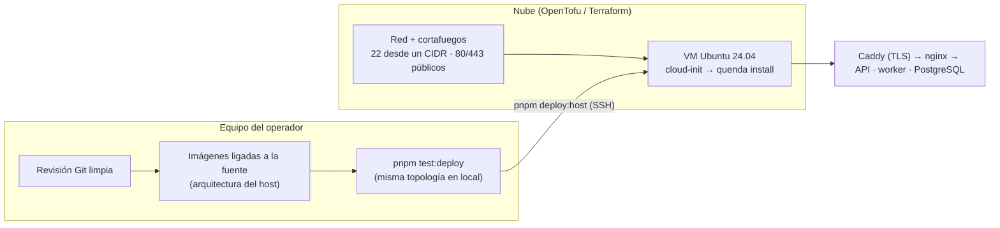

# Despliegue en la nube

Despliegue de una instancia de Quenda en una máquina virtual de OCI, AWS, Azure o GCP, y cómo se valida en local antes de tocar ninguna nube. Todas las nubes comparten la misma topología y el mismo arranque; solo cambia la infraestructura que rodea a la VM. Las decisiones de operación (proveedor, región, capacidad, copias, RTO y RPO) siguen siendo de la entidad que opera la instancia ([PD-OPERACION](06_decisiones_y_validacion.md#decisiones-pendientes)).

## Modelo



- **Infraestructura**: `infra/<nube>/` declara red, cortafuegos, IP pública fija y una VM. El HCL es compatible con OpenTofu y Terraform; los archivos de bloqueo de proveedores se generan con OpenTofu.
- **Primer arranque**: el módulo compartido [`infra/modules/cloud-init`](../infra/modules/cloud-init) genera el `user_data` de todas las nubes. Escribe `/etc/quenda/host.env` (dominio, contacto ACME, SMTP sin contraseña), instala el CLI [`quenda`](../deploy/host/quenda) y ejecuta `quenda install`: Docker, logs acotados, apertura de 80/443 si la imagen trae reglas `iptables` restrictivas y secretos generados en el propio host.
- **Publicación**: `pnpm deploy:host` construye en el equipo del operador las imágenes de la revisión para la arquitectura del host, las verifica en local cuando la arquitectura coincide y las envía por SSH con los archivos de composición. El host no necesita acceso al repositorio, a un registro ni a herramientas de compilación.
- **Ejecución**: la [composición de referencia](../compose.production.example.yaml) más [`deploy/compose.edge.yaml`](../deploy/compose.edge.yaml), que añade Caddy como entrada TLS con certificados de Let's Encrypt. nginx solo confía en la dirección fija de Caddy.

Ningún secreto pasa por el estado de OpenTofu ni por los metadatos de la VM: `AUTH_SECRET` y las contraseñas de los roles se generan en el host (`/etc/quenda/secrets.env`, `0600`) y la contraseña SMTP se entrega por SSH. `AUTH_SECRET` cifra los secretos TOTP: debe conservarse junto con las copias de la base.

## Validación local

Tres comprobaciones cubren capas distintas. Ninguna usa credenciales ni contacta con una nube.

| Comando | Qué valida | Duración aprox. |
|---|---|---|
| `pnpm test:deploy` | La topología del host con las imágenes locales: PostgreSQL, bootstrap, migraciones, API, worker, nginx y Caddy por HTTPS (CA local), redirección HTTP→HTTPS, HSTS a través del proxy de confianza y entrega de correo por SMTP con STARTTLS, autenticación y CA privada (Mailpit). | 25 s |
| `pnpm test:host` | Lo que ningún emulador ejecuta: una VM simulada (Ubuntu 24.04 con systemd y cloud-init leyendo una semilla NoCloud) arranca con el `user_data` que genera el módulo compartido, recibe la revisión confirmada con `pnpm deploy:host --demo`, la sirve por HTTPS, acepta un segundo despliegue idempotente y siembra la demostración sin dejar correos pendientes. Requiere el árbol de trabajo limpio. | 5–6 min |
| `pnpm infra:validate <oci\|aws\|azure\|gcp\|all>` | Cada raíz `infra/<nube>` contra su emulador con OpenTofu 1.13.2 en un contenedor: `init`, `validate`, `plan` completo, `apply`, `plan` sin cambios, `destroy` y estado vacío. Deja un informe en `.local/infra-validation/<nube>.json`. | 10 s – 2,5 min por nube |

`pnpm validate` incluye `pnpm test:deploy`. Los emuladores se definen en [`infra/emulators/compose.yaml`](../infra/emulators/compose.yaml); su configuración (endpoints, credenciales ficticias, CA) vive solo en `infra/emulators/<nube>/` y se copia a un directorio temporal junto a la raíz, de modo que `infra/<nube>/` contiene únicamente configuración real.

### Matriz validada

Resultado de `pnpm infra:validate all` el 16 de noviembre de 2026, con OpenTofu 1.13.2. Las siete fases terminan sin errores en las cuatro nubes.

| Nube | Emulador | Proveedor | Aplicado y destruido en el emulador | Solo en el plan |
|---|---|---|---|---|
| OCI | floci-oci 0.7.0 | oracle/oci 9.13.0 | Compartimento | VCN, gateway, tabla de rutas, lista de seguridad, subred, VM A1 y política de copias: floci-oci no implementa Networking ni Compute |
| AWS | aws-emulator 1.0.471 | hashicorp/aws 6.73.0 | VPC, subred, gateway, rutas, par de claves, instancia EC2 e IP elástica | Grupo de seguridad y sus reglas: el emulador no crea la regla de salida por defecto que el proveedor revoca (incidencia `ec2-revokesecuritygroupegress` de aws/aws-emulator) |
| Azure | floci-az 0.17.0 | hashicorp/azurerm 4.81.0 | Toda la configuración: grupo de recursos, VNet, subred, NSG y asociación, IP pública, NIC y VM | — |
| GCP | floci-gcp 0.13.0 | hashicorp/google 7.46.2 | Toda la configuración: red, subred, cortafuegos, IP estática y VM con `ubuntu-2404-lts-amd64` | — |

Los ajustes que solo existen por el emulador están comentados en su `emulator_override.tf`: en AWS, la instancia se aplica sin el grupo de seguridad y la búsqueda de AMI usa una imagen de Amazon porque el emulador no tiene AMIs de Canonical; en Azure se declaran los valores por defecto de `additional_capabilities` que floci-az devuelve sin haberlos recibido. La configuración real de `infra/<nube>/` no contiene ninguno de ellos. El único cambio que motivó un emulador, fijar la zona de la instancia de AWS a la de su subred, es igualmente correcto en AWS.

Un emulador valida el plano de control: que el proveedor acepta la configuración, que los recursos se crean y se relacionan y que una lectura posterior no produce cambios. No arranca la VM ni ejecuta cloud-init; esa parte la cubre `pnpm test:host`.

## Despliegue paso a paso

Requisitos del operador: Docker, Node.js 24 y pnpm (los del proyecto), OpenTofu ≥ 1.6 o Terraform ≥ 1.6, un par de claves SSH y las credenciales de la nube elegida. La VM necesita al menos 2 GB de memoria; las imágenes no se compilan en ella.

1. **Infraestructura.** Copiar `infra/<nube>/terraform.tfvars.example` a `terraform.tfvars` (excluido de Git), completar los valores y aplicar:

   ```sh
   cd infra/oci
   tofu init
   tofu apply
   tofu output
   ```

   `ssh_source_cidr` limita SSH a la dirección del operador. Con `domain` vacío la instancia se publica en `https://<ip>.sslip.io`; con un dominio propio, crear antes de desplegar un registro `A` hacia `public_ip`, porque Caddy pide el certificado en el primer arranque.

2. **Contraseña SMTP**, si el servidor la exige (una sola vez):

   ```sh
   ssh ubuntu@IP 'sudo quenda smtp-password' < archivo-con-la-contraseña
   ```

3. **Publicación** de la revisión actual (repetir para cada actualización):

   ```sh
   pnpm deploy:host ubuntu@IP
   ```

   El host conserva la revisión en ejecución y la anterior. `migrate` se ejecuta antes de sustituir la API; si falla, la API no se reemplaza y el enlace vuelve a la revisión previa. Si las migraciones ya se aplicaron, seguir la [recuperación de una actualización fallida](12_operacion.md#recuperación-de-una-actualización-fallida).

4. **Primer operador.** Crear una cuenta en la aplicación, verificar el correo, activar la verificación en dos pasos y ejecutar `ssh ubuntu@IP 'sudo quenda operator IDENTIFICADOR_DE_CUENTA'`.

Operación diaria en el host: `sudo quenda status`, `sudo quenda logs [servicio]` y `sudo quenda compose <argumentos>`. Los cambios de `host.env` (dominio, SMTP) se aplican con `sudo quenda deploy <revisión>`; las raíces ignoran los cambios del `user_data` para no reemplazar nunca la VM, cuyo disco contiene la base de datos.

## Proveedores

| Nube | Credenciales del proveedor | VM por defecto | Notas |
|---|---|---|---|
| OCI | Perfil de `~/.oci/config` (`config_profile`) | `VM.Standard.A1.Flex` 2 OCPU / 12 GB, arranque de 50 GB | Compartimento propio. Copias semanales incrementales del volumen de arranque, retenidas cuatro semanas (≤ 5, el límite Always Free). |
| AWS | Cadena estándar (perfil, SSO, variables) | `t4g.small` (ARM, 2 GB), gp3 cifrado de 30 GB | IP elástica; IMDSv2 obligatorio. |
| Azure | `az login` o variables `ARM_*` | `Standard_B2ps_v2` (ARM, 4 GB), 32 GB | Grupo de recursos propio; IP estática Standard. |
| GCP | Application Default Credentials | `e2-small` (x86, 2 GB), 30 GB | Arranque seguro; OS Login desactivado para usar la clave de `ssh-keys`. |

### OCI Always Free

La configuración por defecto cabe en la capa Always Free: una VM Ampere A1 de 2 OCPU y 12 GB (la asignación A1 se comparte entre todas las VM A1 de la cuenta), 50 GB de los 200 GB de almacenamiento en bloque, una VCN de las dos permitidas y como máximo cinco copias de volumen. La capacidad A1 solo existe en la región principal de la cuenta; si `apply` devuelve `Out of host capacity`, cambiar `availability_domain_number` o reintentar más tarde. La lista de seguridad abre 22/TCP solo para `ssh_source_cidr` y 80/TCP, 443/TCP y 443/UDP para todos; las imágenes Ubuntu de OCI traen reglas `iptables` que solo admiten SSH, y `quenda install` añade y persiste las de 80 y 443.

Las copias del volumen de arranque son consistentes ante caídas: PostgreSQL se recupera con su WAL, pero no sustituyen a la [copia lógica](12_operacion.md#copia-lógica-de-postgresql) ni conservan `AUTH_SECRET` fuera de la VM.

## Correo

Quenda solo habla SMTP genérico: cualquier relé con STARTTLS o TLS sirve, y cambiarlo no requiere modificar código. Por ejemplo, con [Resend](https://resend.com/docs/send-with-smtp) (plan gratuito: 3.000 correos al mes y 100 al día, un dominio verificado por DNS):

```hcl
smtp = {
  host = "smtp.resend.com"
  port = 587
  user = "resend"
  from = "reservas@example.org"
}
```

La contraseña es la clave de API y se entrega con `quenda smtp-password`. El remitente debe pertenecer al dominio verificado en el proveedor.

## Demostración

`pnpm deploy:host ubuntu@IP --demo` construye además la imagen del sembrador, que no forma parte del artefacto publicado, y la ejecuta una sola vez si la instalación no tiene cuentas ni municipios. Detiene el worker de correo mientras siembra y marca como ya atendidos los correos de las reservas sembradas, para que nada se envíe a las direcciones `*.demo.test`.

El conjunto de datos ([test/demo/cloud.ts](../test/demo/cloud.ts)) parte del de la demostración local y añade:

- **Personas y permisos**: operación de la plataforma, administración de Valdeira y de Ribasanta, una gestora de reservas de Valdeira (lectura y gestión de reservas, bloqueos e informes) y nueve vecinos. Las cuatro cuentas de personal tienen verificación en dos pasos.
- **Identidad municipal**: nombre visible, tema (Atlántico y Viñedo) y escudo, con versión para fondo oscuro en Valdeira.
- **Catálogo**: instalaciones y espacios con fotografías, normas de uso, cierres y horario reducido en Navidad y Reyes, y un bloqueo por mantenimiento la próxima semana.
- **Actividad**: unas 2.000 reservas en ocho semanas de historial y las tres siguientes, con más demanda por la tarde y en fin de semana, cancelaciones de vecinos y de la administración con motivo, llegadas registradas y una reserva semanal fija que alimenta las recomendaciones. Las fechas de creación son retroactivas, de modo que la antelación y la ocupación de los indicadores son verosímiles.
- **Cuenta de la vecina**: avisos leídos y sin leer, idioma y suscripción de calendario.
- **Páginas legales** de cada municipio: privacidad, aviso legal y accesibilidad.

La contraseña común de las cuentas se genera en cada instalación. `ssh ubuntu@IP 'sudo quenda demo access'` muestra la contraseña, las cuentas y los URI `otpauth://` de las cuentas con verificación en dos pasos, para añadirlos a una aplicación de autenticación. El archivo vive solo en el host (`/etc/quenda/demo-access.json`, `0600`). `pnpm test:host` ejecuta este recorrido completo en la VM simulada.

## Limitaciones

- Una VM por instancia: sin alta disponibilidad. Una caída de la VM interrumpe el servicio hasta que vuelve a arrancar.
- Las copias externas de la base y de `AUTH_SECRET`, la monitorización y las alertas siguen siendo responsabilidad del operador ([PD-OPERACION](06_decisiones_y_validacion.md#decisiones-pendientes)).
- El estado de OpenTofu se guarda en local por defecto. Para un equipo, configurar un backend remoto con cifrado y bloqueo; el estado no contiene secretos de la aplicación, pero sí identificadores de la infraestructura.
