# Guía de casos de uso · Ciudadanía

Esta guía es para cualquier persona que quiera reservar una instalación deportiva municipal con Quenda: consultar qué está libre, crear una cuenta, reservar, cambiar o cancelar una reserva, seguir sus avisos y gestionar sus datos personales. Cada apartado explica un caso de uso paso a paso y qué hacer cuando algo no sale como se espera. En las imágenes, el recuadro naranja señala dónde hay que pulsar o escribir.

## Índice

- [CU-01 — Consultar catálogo y disponibilidad](#cu-01--consultar-catálogo-y-disponibilidad)
- [CU-02 — Crear una reserva](#cu-02--crear-una-reserva)
- [CU-03 — Modificar o cancelar una reserva](#cu-03--modificar-o-cancelar-una-reserva)
- [CU-07 — Crear una cuenta y utilizar un servicio municipal](#cu-07--crear-una-cuenta-y-utilizar-un-servicio-municipal)
- [CU-08 — Consultar el historial de reservas](#cu-08--consultar-el-historial-de-reservas)
- [CU-09 — Iniciar o cerrar sesión](#cu-09--iniciar-o-cerrar-sesión)
- [CU-11 — Recibir y consultar avisos de reserva](#cu-11--recibir-y-consultar-avisos-de-reserva)
- [CU-13 — Actualizar datos personales y correo](#cu-13--actualizar-datos-personales-y-correo)
- [CU-14 — Dar de baja la cuenta](#cu-14--dar-de-baja-la-cuenta)
- [CU-15 — Reactivar una cuenta](#cu-15--reactivar-una-cuenta)
- [CU-19 — Obtener una copia de datos personales](#cu-19--obtener-una-copia-de-datos-personales)

## CU-01 — Consultar catálogo y disponibilidad

Sirve para encontrar un espacio (una pista, una sala, un campo) y una hora libre antes de reservar. Lo puede hacer cualquier persona, haya iniciado sesión o no. Consultar no reserva nada ni crea ningún perfil en el municipio.

**Antes de empezar:** solo necesitas acceder a la web de Quenda. **Especificación:** [CU-01](../08_casos_de_uso.md#cu-01--consultar-catálogo-y-disponibilidad).

### Paso a paso

1. **Elige el municipio.** La página de inicio muestra los municipios disponibles. Pulsa el que te interese; la estrella de la derecha lo marca como favorito para empezar ahí la próxima vez.

   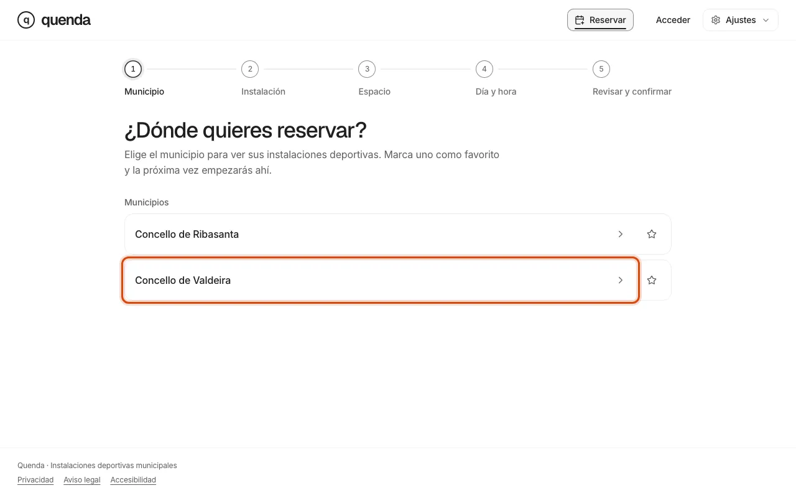

   *La barra de pasos de arriba indica que estás en el paso 1 de 5, «Municipio». El recuadro marca Concello de Valdeira; al pulsarlo se abren sus instalaciones.*

2. **Elige la instalación.** Aparecen solo las instalaciones que el municipio tiene publicadas, cada una con el número de espacios que se pueden reservar.

   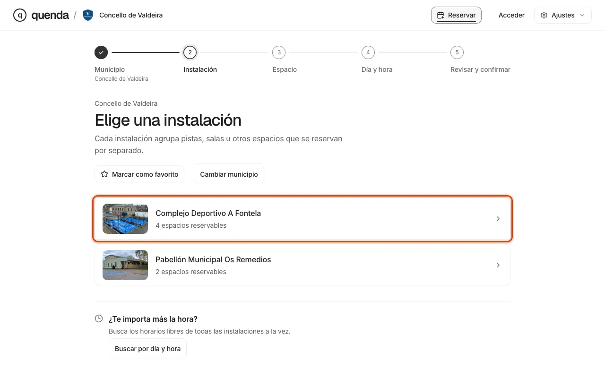

   *El paso 1 ya aparece completado con el municipio elegido. Complejo Deportivo A Fontela, con 4 espacios reservables, está recuadrado; debajo se ofrece también «Buscar por día y hora».*

3. **Elige el espacio.** Cada espacio se reserva entero y por separado; bajo su nombre se indica cuánto puede durar una reserva.

   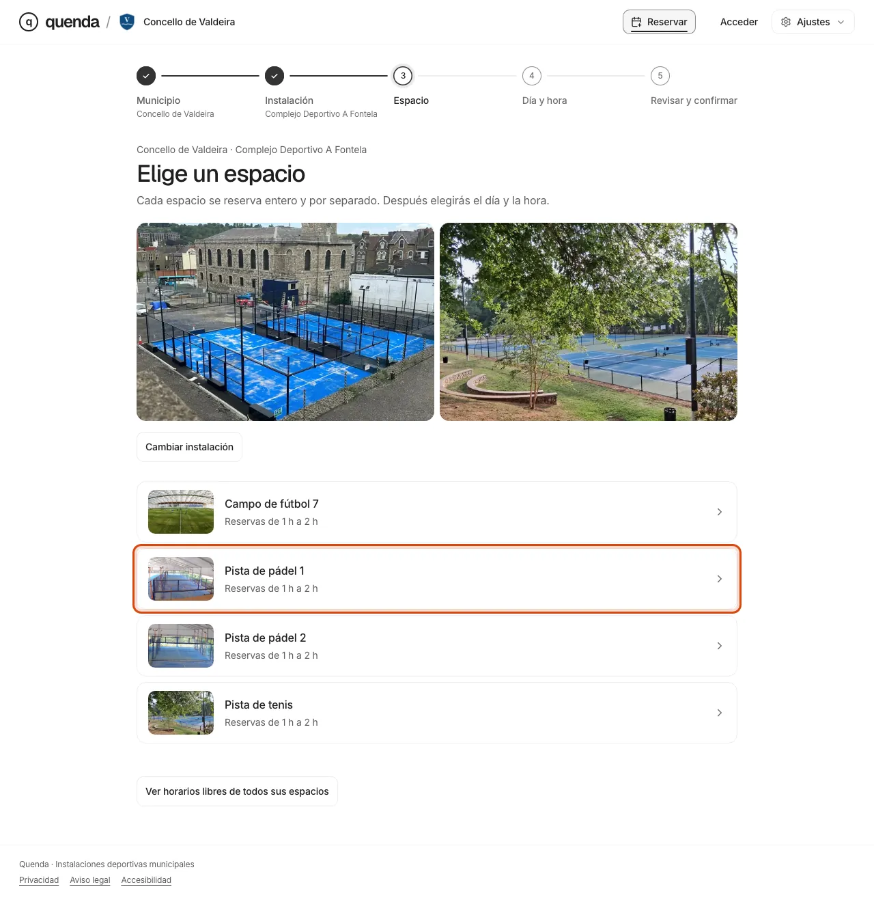

   *Bajo las fotos de la instalación están sus cuatro espacios, todos con reservas de 1 h a 2 h. El recuadro marca Pista de pádel 1.*

4. **Abre el día.** La página del espacio muestra su foto, el día y la duración elegidos y las horas libres de ese día.

   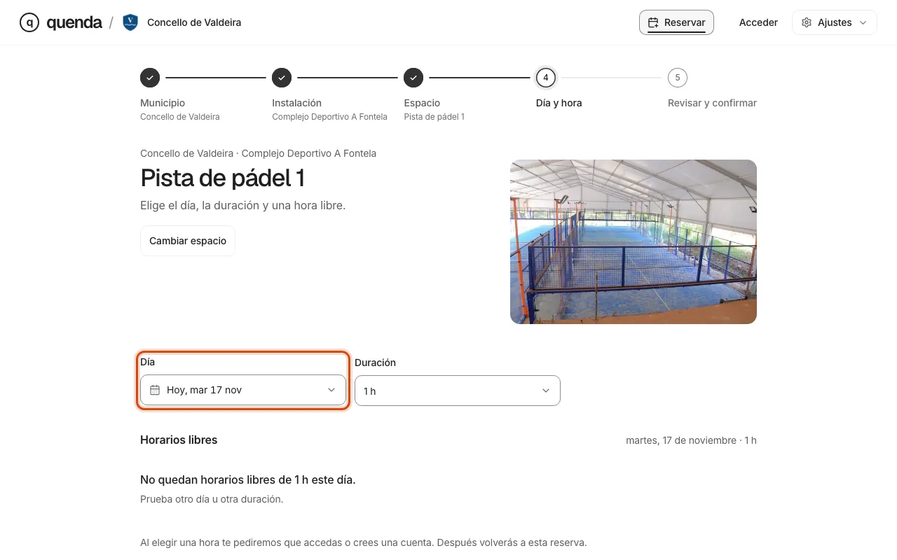

   *Por defecto se muestra el día de hoy con 1 h de duración. El recuadro marca el campo «Día»; debajo, «Horarios libres» lista las franjas que siguen disponibles.*

5. **Elige el día en el calendario.** Pulsa el día que quieras. Los días anteriores a hoy aparecen en gris y no se pueden elegir.

   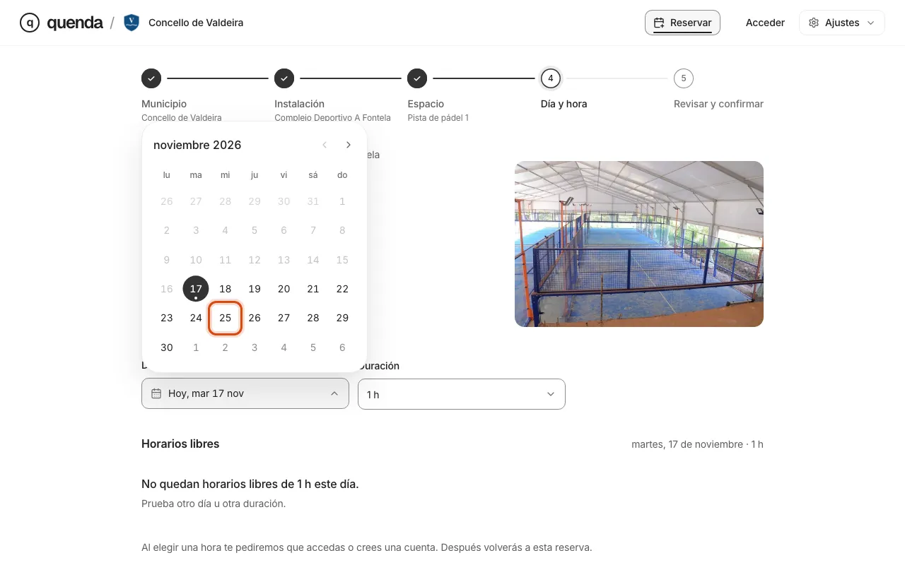

   *El día de hoy aparece relleno en oscuro y el recuadro marca el día elegido. Al pulsarlo, el calendario se cierra y la lista de horarios se actualiza.*

6. **Elige la duración.** Las duraciones posibles las fija el ayuntamiento para cada espacio.

   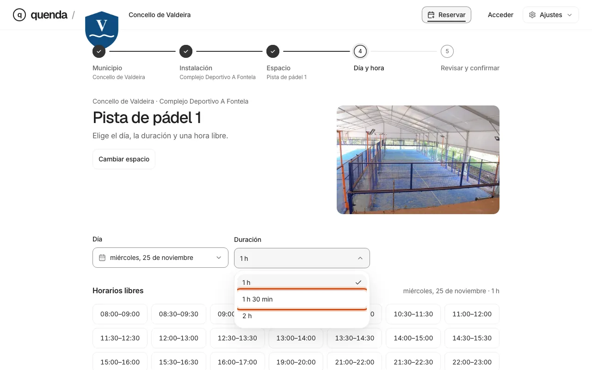

   *El día ya muestra la fecha elegida. En el desplegable, «1 h» está marcada como actual y el recuadro señala «1 h 30 min».*

7. **Elige una franja libre.** Solo aparecen intervalos completos que están libres, en hora local.

   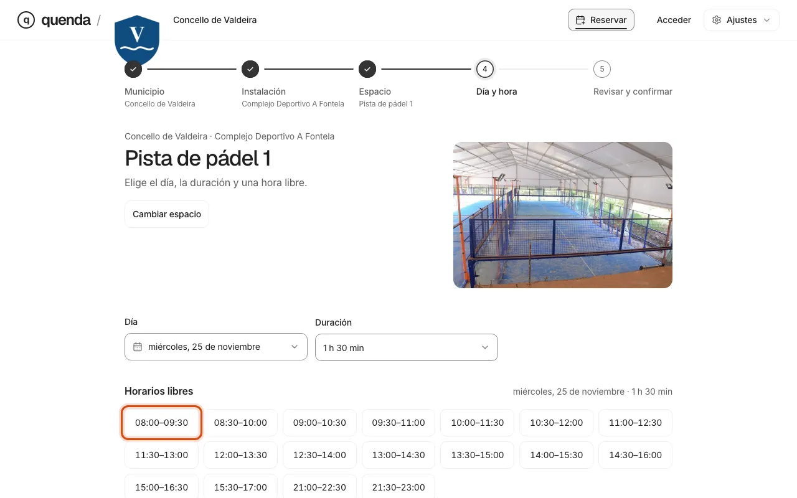

   *A la derecha de «Horarios libres» se repiten el día y la duración elegidos. El recuadro marca la primera franja; al pie se avisa de que, al elegir una hora, Quenda pedirá acceder o crear una cuenta.*

8. **Continúa hacia la reserva.** Si no has iniciado sesión, Quenda te pide acceder o crear una cuenta y después te devuelve a la reserva que estabas eligiendo (sigue en [CU-02](#cu-02--crear-una-reserva)).

   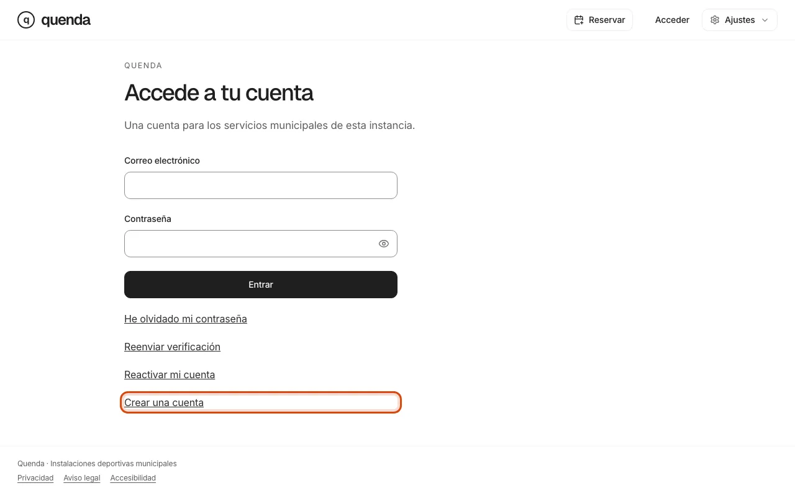

   *Se abre el formulario de acceso. Si ya tienes cuenta, escribe tu correo y contraseña; si no, el recuadro marca «Crear una cuenta» ([CU-07](#cu-07--crear-una-cuenta-y-utilizar-un-servicio-municipal)).*

### Si algo no sale como se espera

#### Te importa más la hora que la instalación

Puedes ver a la vez los horarios libres de todas las instalaciones del municipio.

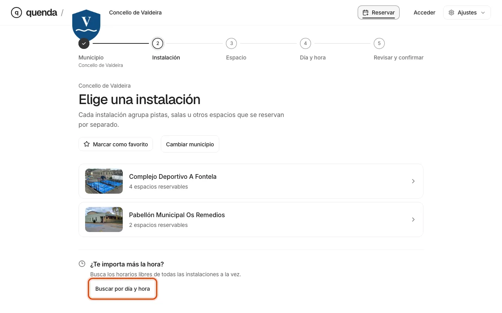

*Bajo la lista de instalaciones, el apartado «¿Te importa más la hora?» ofrece el botón «Buscar por día y hora», aquí recuadrado.*

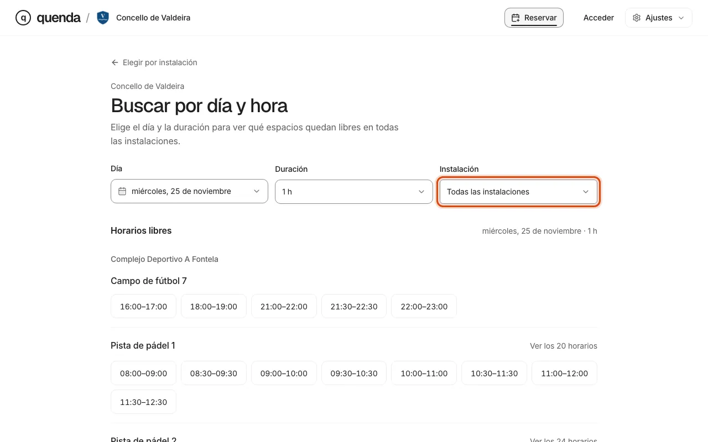

*La búsqueda tiene tres campos: Día, Duración e Instalación (recuadrado, con «Todas las instalaciones»). Los horarios libres aparecen agrupados por instalación y espacio, con un enlace «Ver los … horarios» cuando hay más de los que caben.*

#### El día elegido no tiene horas libres

Si el espacio no abre ese día, o ya está todo ocupado, la lista queda vacía. Las horas ocupadas, cerradas o fuera de las normas del municipio nunca aparecen como libres.

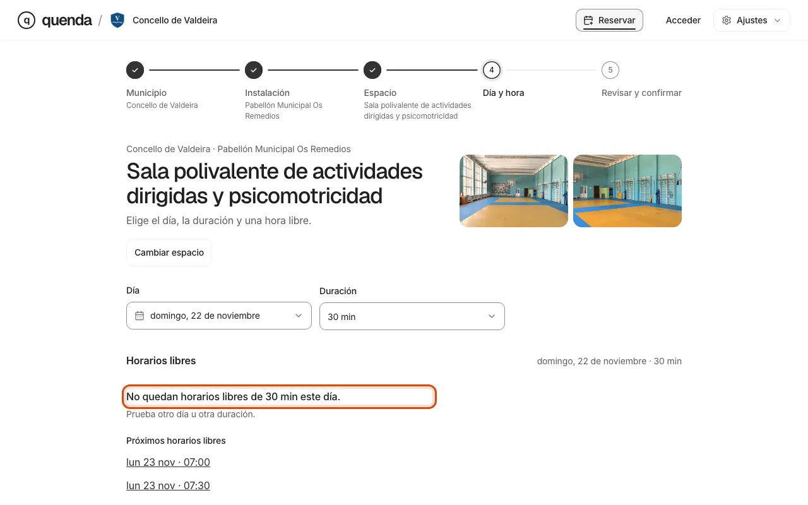

*En el recuadro, la sección «Horarios libres» dice «No quedan horarios libres de 30 min este día» y propone probar otro día u otra duración. En el ejemplo, la sala no abre los domingos.*

#### No puedes elegir un día lejano

Cada espacio solo admite reservas con cierta antelación. Los días posteriores aparecen en gris en el calendario y no se pueden pulsar.

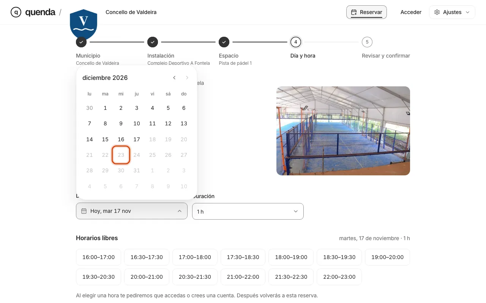

*En diciembre, los días a partir de cierta fecha aparecen en gris. El día recuadrado no se puede elegir porque queda fuera del plazo de antelación.*

#### La instalación no tiene espacios reservables

Una instalación publicada sin ningún espacio disponible aparece en la lista del municipio sin enlace y con el motivo.

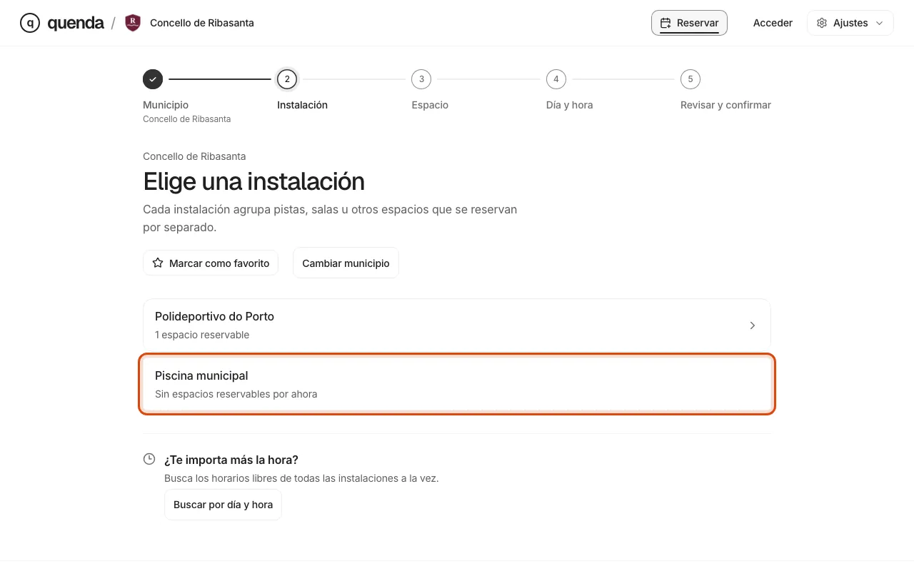

*Polideportivo do Porto tiene 1 espacio reservable y una flecha para entrar. La Piscina municipal, recuadrada, no tiene flecha y dice «Sin espacios reservables por ahora».*

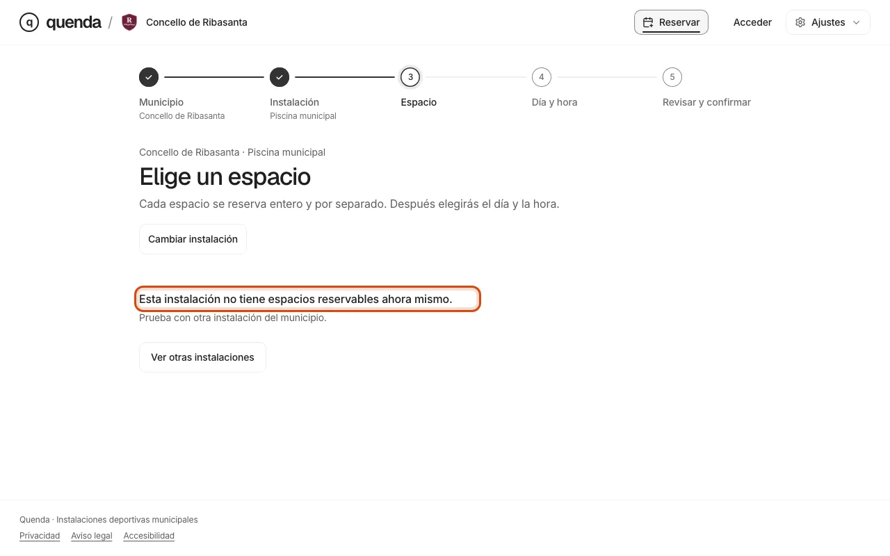

*Si llegas a esa instalación por un enlace directo, Quenda muestra el mensaje recuadrado y el botón «Ver otras instalaciones».*

#### El enlace lleva a un espacio que ya no existe

Un espacio retirado, incompleto o sin normas válidas no se ofrece, aunque tengas un enlace antiguo.

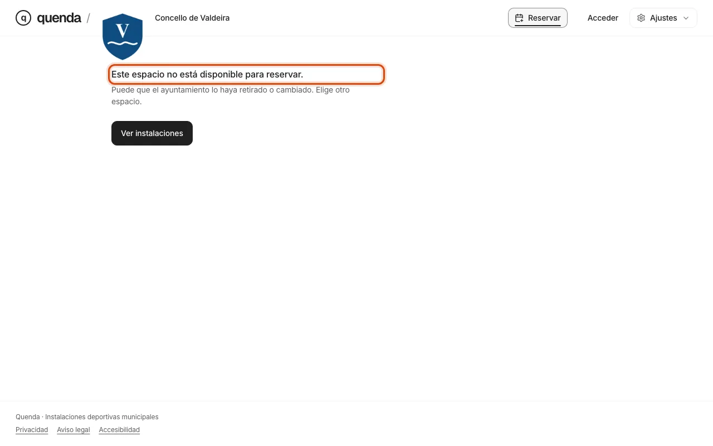

*El mensaje recuadrado explica que puede que el ayuntamiento lo haya retirado o cambiado. El botón «Ver instalaciones» vuelve a la lista del municipio.*

#### Hay muchos municipios o se cambia la hora

- Cuando una instalación de Quenda reúne muchos municipios, la primera página ofrece una búsqueda. Una página de resultados sin coincidencias no significa que no haya más: puedes seguir buscando entre los restantes.
- En los días de cambio de hora, las horas que no existen no se ofrecen y las que se repiten se distinguen por su diferencia con la hora universal.

#### Consultar desde el móvil

En el móvil el recorrido es el mismo, con la cabecera y el calendario adaptados a la pantalla.

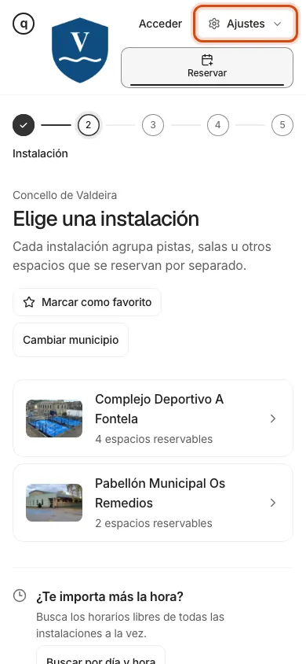

*Sin sesión, la cabecera muestra «Acceder» y «Ajustes» (recuadrado) arriba, y «Reservar» en una fila propia. La barra de pasos se reduce a números con el nombre del paso actual debajo.*

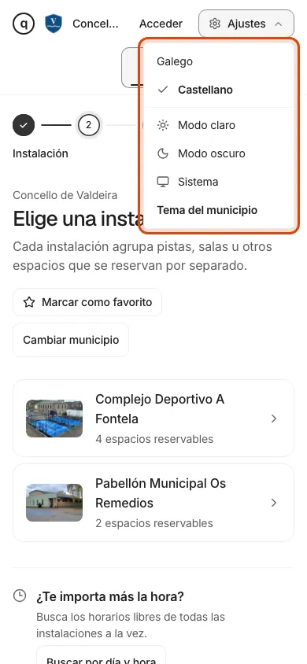

*El menú «Ajustes» permite cambiar el idioma (Galego o Castellano) y la apariencia: modo claro, modo oscuro, el del sistema o el tema del municipio.*

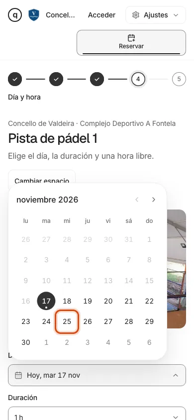

*En el móvil, el calendario se abre sobre la página con el mismo funcionamiento: pulsa el día recuadrado para elegirlo.*

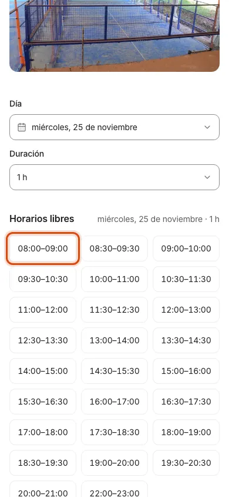

*Los campos Día y Duración quedan uno debajo del otro y los horarios libres se reparten en tres columnas. El recuadro marca la primera franja.*

### Resultado

Has encontrado un espacio y una franja libres sin crear ningún perfil y sin ver quién ocupa el resto de horas. La consulta orienta la elección: solo la confirmación de [CU-02](#cu-02--crear-una-reserva) garantiza la reserva.

## CU-02 — Crear una reserva

Sirve para reservar un espacio completo durante un intervalo. Lo hace la persona titular de la reserva, con su cuenta, después de elegir la franja en [CU-01](#cu-01--consultar-catálogo-y-disponibilidad).

**Antes de empezar:** necesitas una cuenta verificada ([CU-07](#cu-07--crear-una-cuenta-y-utilizar-un-servicio-municipal)) y que el espacio esté publicado. **Especificación:** [CU-02](../08_casos_de_uso.md#cu-02--crear-una-reserva).

### Paso a paso

1. **Elige la franja.** En la página del espacio, pulsa la hora que quieras.

   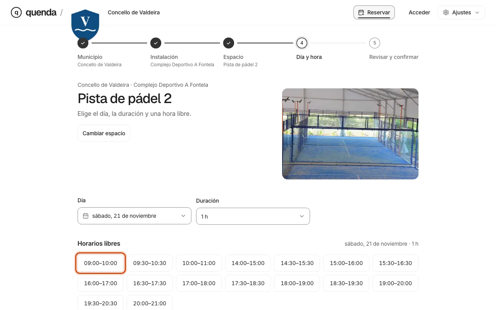

   *La cabecera muestra «Acceder», así que todavía no hay sesión iniciada. El recuadro marca la franja elegida en la lista de horarios libres.*

2. **Accede con tu cuenta.** Si no habías iniciado sesión, escribe tu correo y contraseña y pulsa «Entrar».

   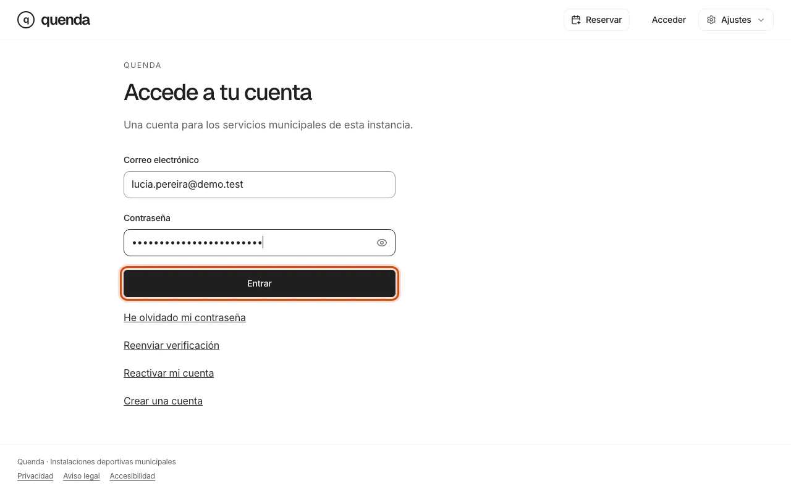

   *Con los datos escritos, el recuadro marca «Entrar». Al acceder, Quenda vuelve directamente a la reserva que estabas eligiendo.*

3. **Revisa los datos y las condiciones.** Hasta que confirmes no hay nada reservado.

   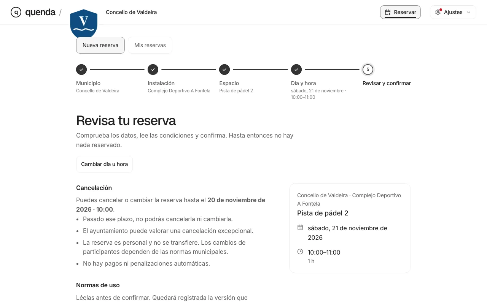

   *Los cinco pasos aparecen completados. A la izquierda, «Cancelación» indica hasta cuándo podrás cancelar o cambiar la reserva; a la derecha, el resumen muestra municipio, instalación, espacio, fecha, horario y duración. «Cambiar día u hora» permite volver atrás.*

4. **Acepta las normas de uso.** Lee las normas del municipio y marca la casilla de aceptación. Si pulsas «Confirmar reserva» sin marcarla, la reserva no se confirma.

   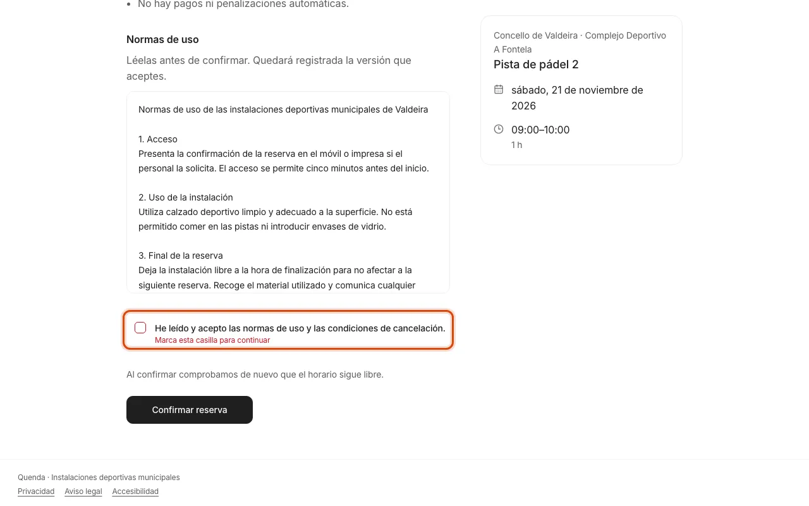

   *Bajo el texto de las normas, la casilla recuadrada «He leído y acepto las normas de uso y las condiciones de cancelación» muestra en rojo «Marca esta casilla para continuar».*

5. **Confirma la reserva.** Con la casilla marcada, pulsa «Confirmar reserva». Quenda vuelve a comprobar que la hora sigue libre y que se cumplen las normas del municipio.

   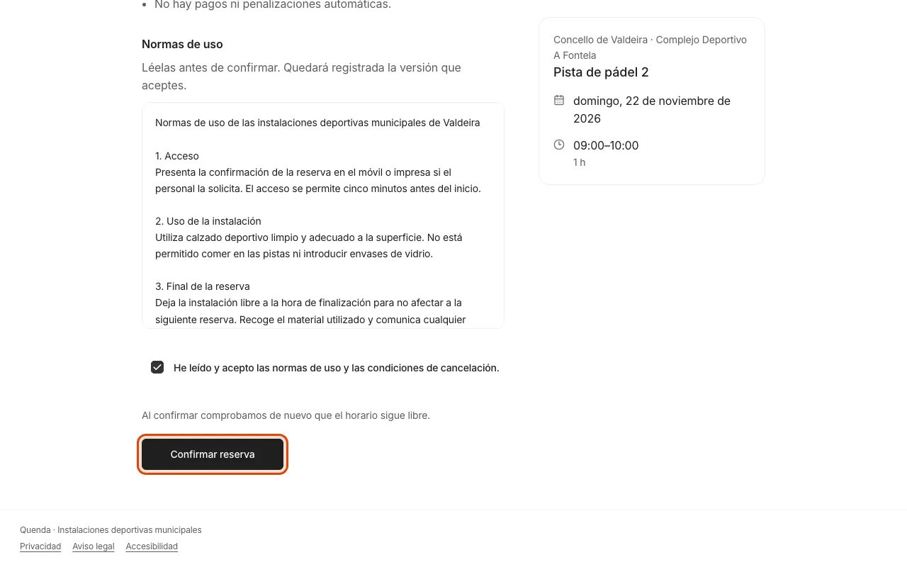

   *La casilla ya está marcada y el recuadro señala «Confirmar reserva». Encima se recuerda que al confirmar se comprueba de nuevo que el horario sigue libre.*

6. **Reserva confirmada.** Quenda muestra la reserva, la guarda en «Mis reservas», registra un aviso y envía un correo ([CU-11](#cu-11--recibir-y-consultar-avisos-de-reserva)).

   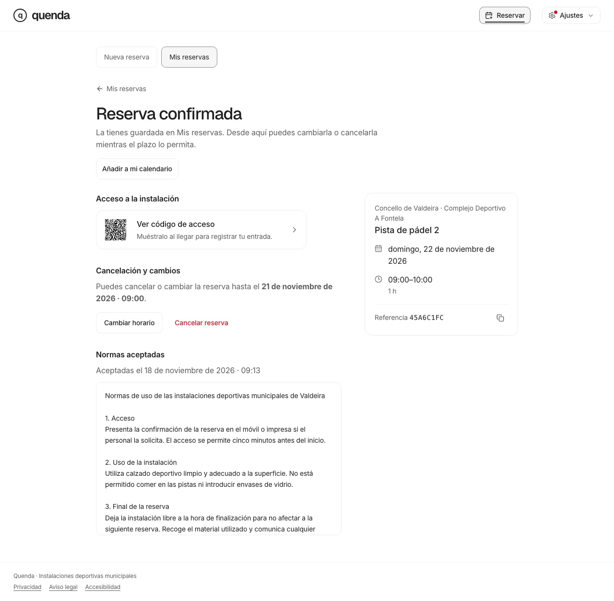

   *La página ofrece «Añadir a mi calendario» y «Ver código de acceso» para mostrarlo al llegar. «Cancelación y cambios» repite el plazo y da los botones «Cambiar horario» y «Cancelar reserva». Al final aparecen las normas aceptadas con su fecha, y en el resumen, la referencia de la reserva.*

### Si algo no sale como se espera

#### La reserva empieza muy pronto y ya no se podrá cancelar

Si la reserva empieza dentro del plazo en que ya no se admiten cancelaciones ni cambios, Quenda lo avisa y pide aceptar expresamente esa restricción.

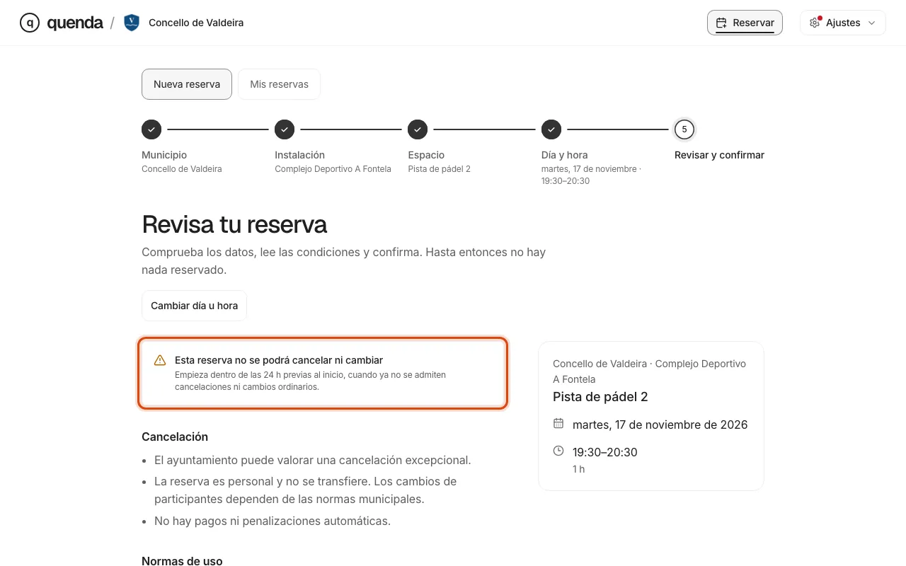

*El aviso recuadrado explica que la reserva empieza dentro de las 24 h previas al inicio, cuando ya no se admiten cancelaciones ni cambios ordinarios. La lista de condiciones ya no muestra un plazo para cancelar.*

*Aunque las normas estén aceptadas, falta la segunda casilla, recuadrada con «Marca esta casilla para continuar». Hay que marcar ambas para confirmar.*

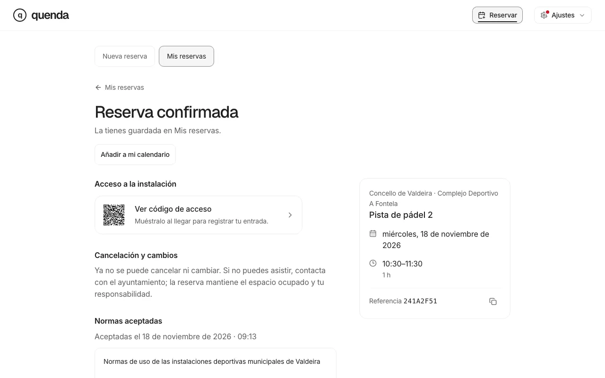

*La reserva queda confirmada, pero «Cancelación y cambios» dice que ya no se puede cancelar ni cambiar y que, si no puedes asistir, contactes con el ayuntamiento. No aparecen los botones de cambio ni de cancelación.*

#### La hora se ocupa mientras revisas

Si otra reserva ocupa la franja antes de que confirmes, Quenda no crea nada y te lo dice sin revelar quién la ha reservado.

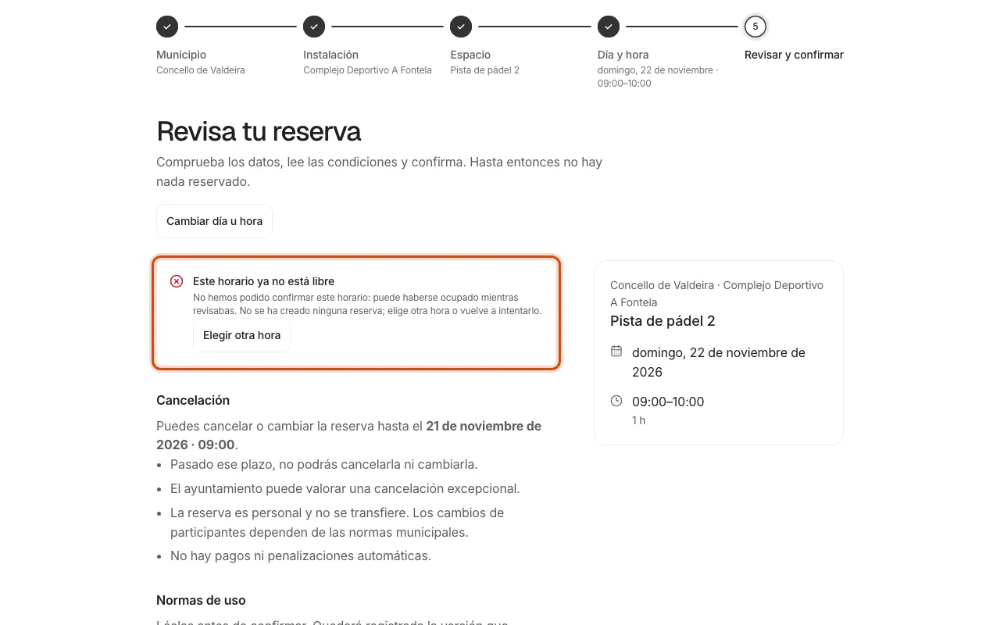

*El mensaje recuadrado indica que no se ha podido confirmar el horario y que no se ha creado ninguna reserva. «Elegir otra hora» vuelve a la lista de horarios.*

Superar un límite del municipio o de un convenio entre municipios, o no cumplir sus condiciones de uso, también impide la reserva, sin revelar la actividad de otras personas.

#### Se pierde la conexión al confirmar

Si pulsas «Confirmar reserva» y no llega la respuesta, la reserva puede haberse creado o no. Quenda no la vuelve a enviar por su cuenta: te ofrece comprobarlo.

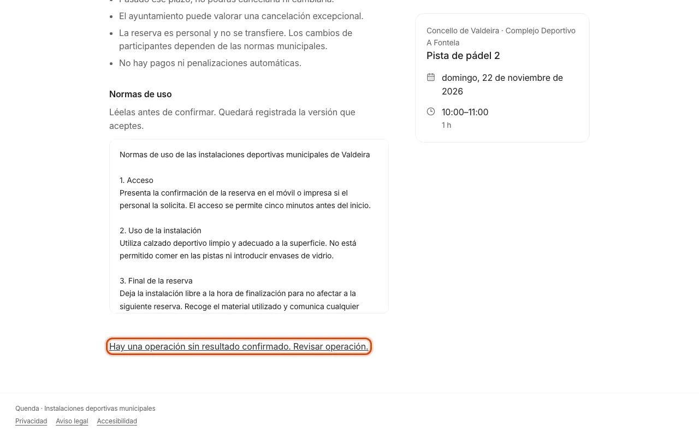

*Al pie de la página de revisión aparece el enlace recuadrado «Hay una operación sin resultado confirmado. Revisar operación.».*

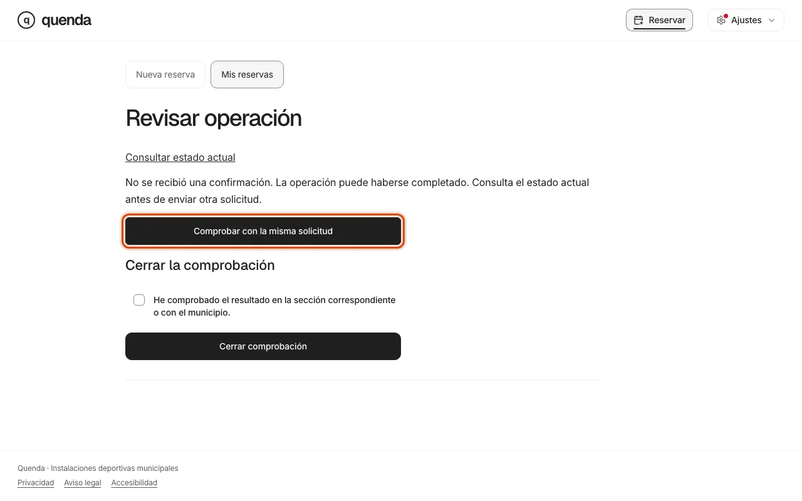

*La página explica que no se recibió confirmación y que hay que consultar el estado antes de enviar otra solicitud. «Comprobar con la misma solicitud» (recuadrado) pregunta por la misma operación sin duplicarla; debajo, «Cerrar la comprobación» sirve para darla por revisada.*

*En este caso la reserva sí se había creado: la comprobación lleva a su página «Reserva confirmada», sin crear una segunda.*

#### Las normas cambian mientras revisas

Si el ayuntamiento publica normas o condiciones nuevas mientras estás en la página de revisión, Quenda no confirma la reserva y te pide volver a leerlas y aceptarlas. Sin esa aceptación no hay reserva.

#### El correo de confirmación no llega

Un fallo al enviar el correo no anula la reserva: sigue confirmada y aparece en «Mis reservas» y en «Avisos».

#### Reservar desde el móvil

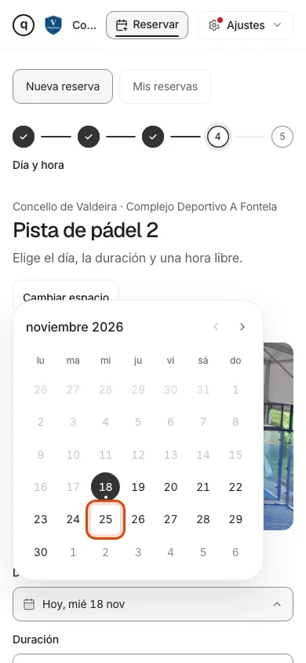

*Con la sesión iniciada, la cabecera del móvil muestra «Reservar» y «Ajustes», y encima de los pasos aparecen «Nueva reserva» y «Mis reservas». El calendario funciona igual que en el ordenador.*

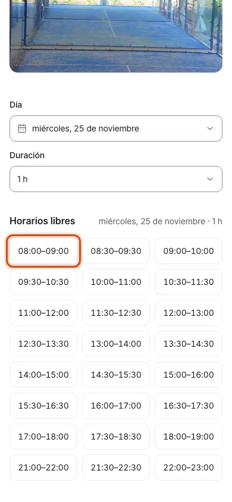

*Tras elegir el día, la franja recuadrada lleva directamente a la revisión de la reserva.*

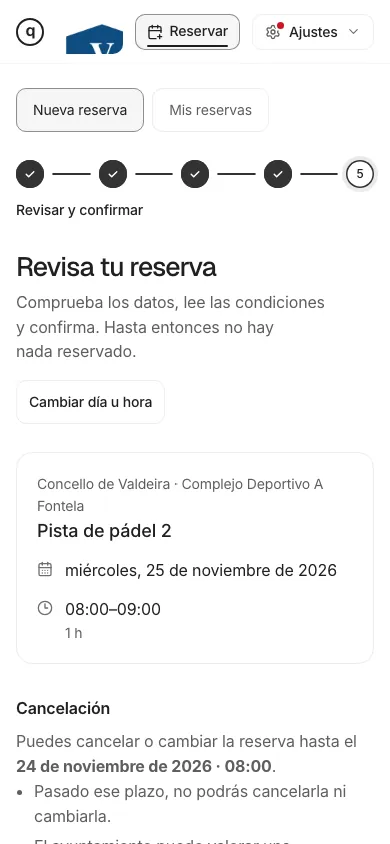

*En el móvil, el resumen de la reserva aparece primero y las condiciones de cancelación debajo.*

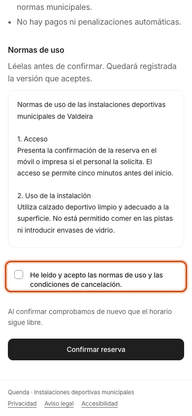

*Al final de la página están la casilla de aceptación, recuadrada, y el botón «Confirmar reserva».*

### Resultado

La reserva queda confirmada con su espacio ocupado, las normas aceptadas registradas y su aviso, o bien se rechaza sin dejar nada a medias.

## CU-03 — Modificar o cancelar una reserva

Sirve para cambiar el día, la hora o el espacio de una reserva futura, o para cancelarla, mientras el plazo lo permita. Lo hace la persona titular desde su reserva; el ayuntamiento también puede intervenir en casos justificados.

**Antes de empezar:** necesitas haber iniciado sesión y que la reserva no haya empezado ni esté fuera de plazo. **Especificación:** [CU-03](../08_casos_de_uso.md#cu-03--modificar-o-cancelar-una-reserva).

### Paso a paso

1. **Abre la reserva.** En «Mis reservas», pulsa la reserva que quieres cambiar.

   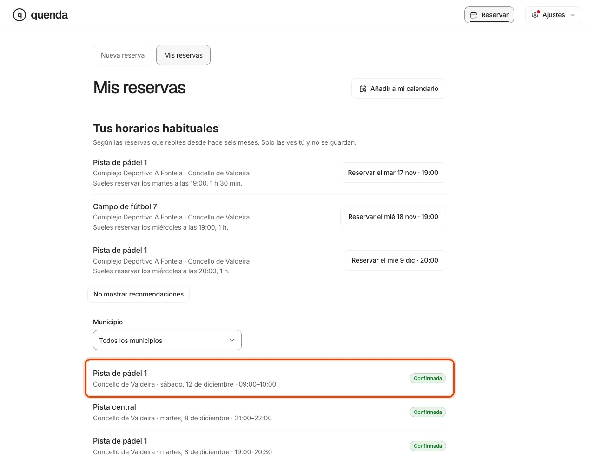

   *Bajo el filtro «Municipio», la lista empieza por la reserva recuadrada, con la etiqueta verde «Confirmada».*

2. **Pulsa «Cambiar horario».** La página de la reserva indica hasta cuándo puedes cambiarla o cancelarla.

   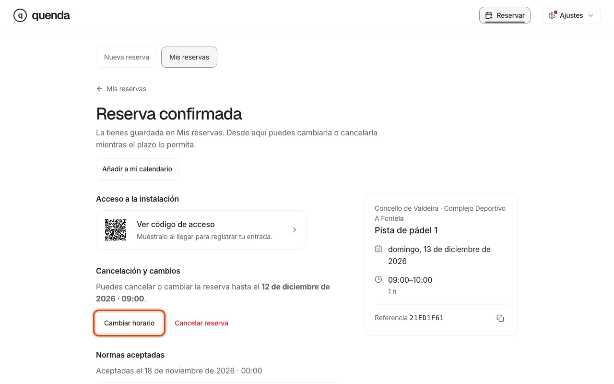

   *En «Cancelación y cambios» aparece la fecha límite y, debajo, «Cambiar horario» (recuadrado) y «Cancelar reserva».*

3. **Elige el nuevo horario.** Puedes cambiar la instalación, el espacio, el día y la duración dentro del mismo municipio. Tu reserva actual se mantiene hasta que confirmes el cambio.

   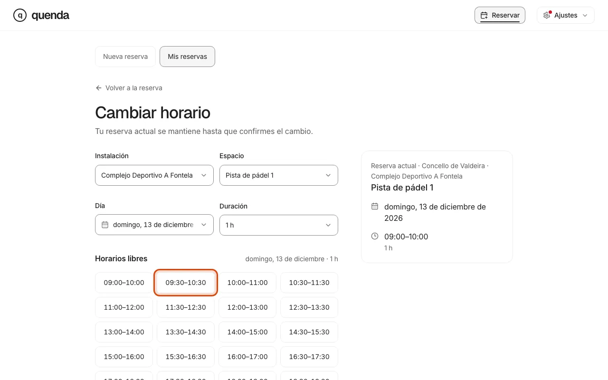

   *A la derecha, la tarjeta «Reserva actual» recuerda lo que tienes reservado. El recuadro marca la nueva franja elegida en «Horarios libres».*

4. **Revisa el cambio.** Quenda muestra las condiciones que se aplicarán al nuevo horario.

   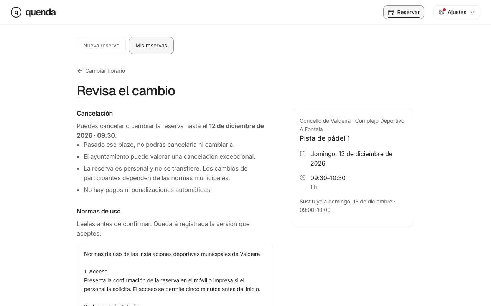

   *El plazo de cancelación se calcula sobre el nuevo inicio. La tarjeta de la derecha muestra el nuevo horario y, debajo, «Sustituye a» con el horario anterior.*

5. **Acepta las condiciones vigentes y confirma.** Si no están cubiertas por tu aceptación anterior, hay que marcar la casilla antes de pulsar «Confirmar el cambio».

   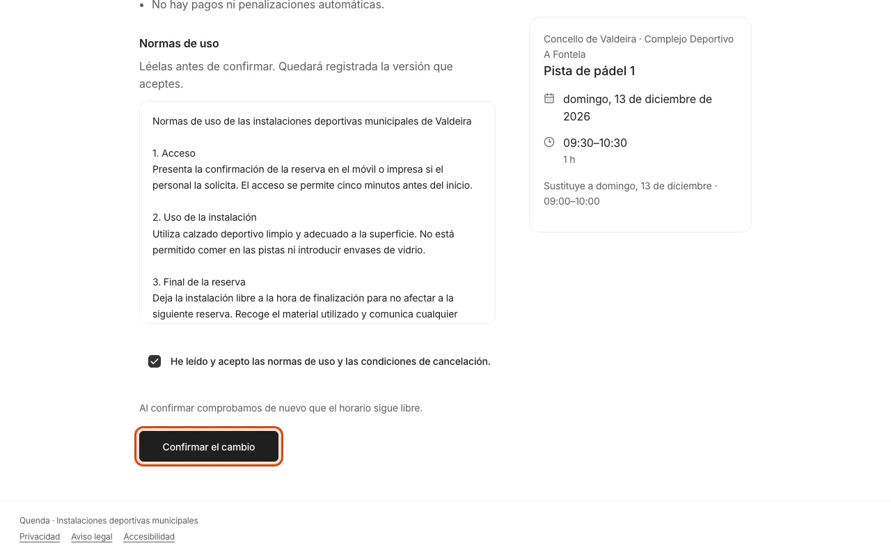

   *Con la casilla de normas marcada, el recuadro señala «Confirmar el cambio». Quenda comprueba de nuevo que el horario sigue libre.*

6. **Cambio aplicado.** La reserva conserva su referencia y muestra el nuevo horario. Quenda genera el aviso correspondiente.

   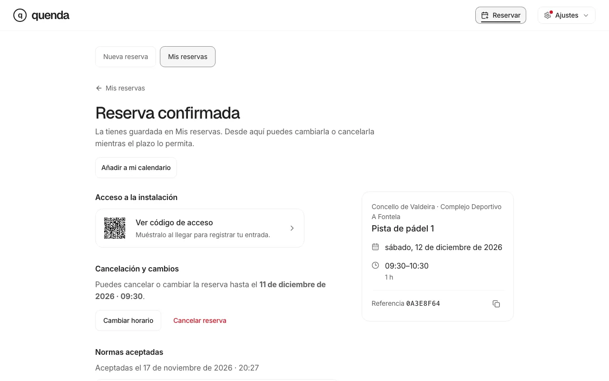

   *La página vuelve a «Reserva confirmada» con el nuevo horario en el resumen y el plazo de cancelación actualizado. La referencia no cambia.*

### Si algo no sale como se espera

#### Quieres cancelar la reserva

Cancelar libera el espacio para otras personas y no exige aceptar normas nuevas. Pulsa «Cancelar reserva» en la página de la reserva y confirma.

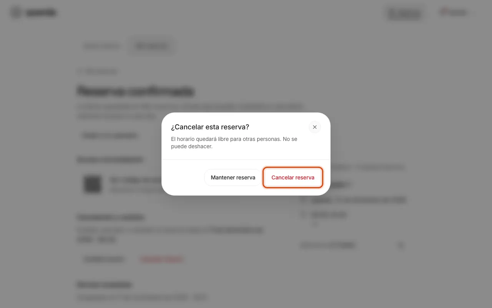

*El diálogo avisa de que el horario quedará libre para otras personas y de que no se puede deshacer. «Cancelar reserva», recuadrado, confirma; «Mantener reserva» cierra sin cambios.*

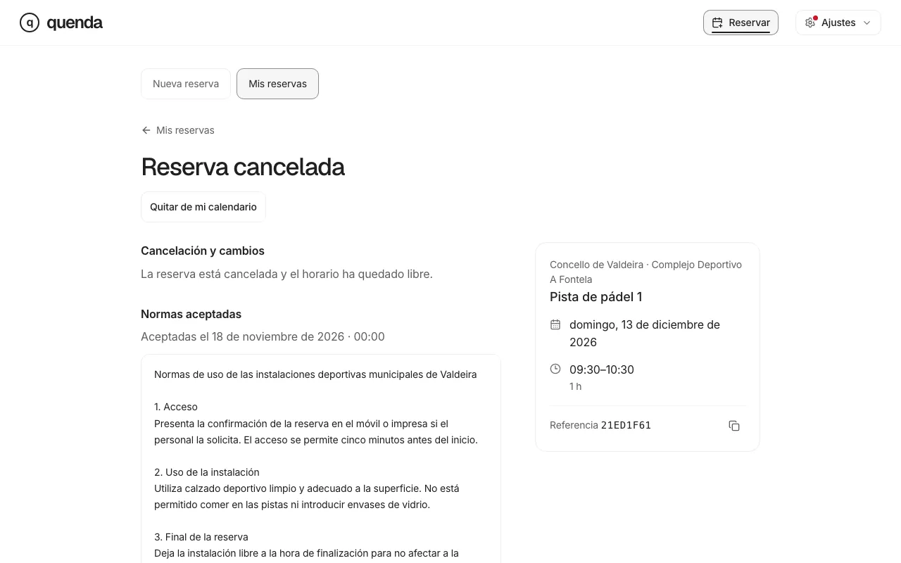

*El título pasa a «Reserva cancelada» y «Cancelación y cambios» dice que el horario ha quedado libre. La reserva sigue en tu historial con sus normas aceptadas.*

#### La reserva cambió en otra pestaña o en otro dispositivo

Si la reserva se modificó después de abrirla (por ejemplo, desde el móvil), Quenda no aplica un cambio basado en datos antiguos.

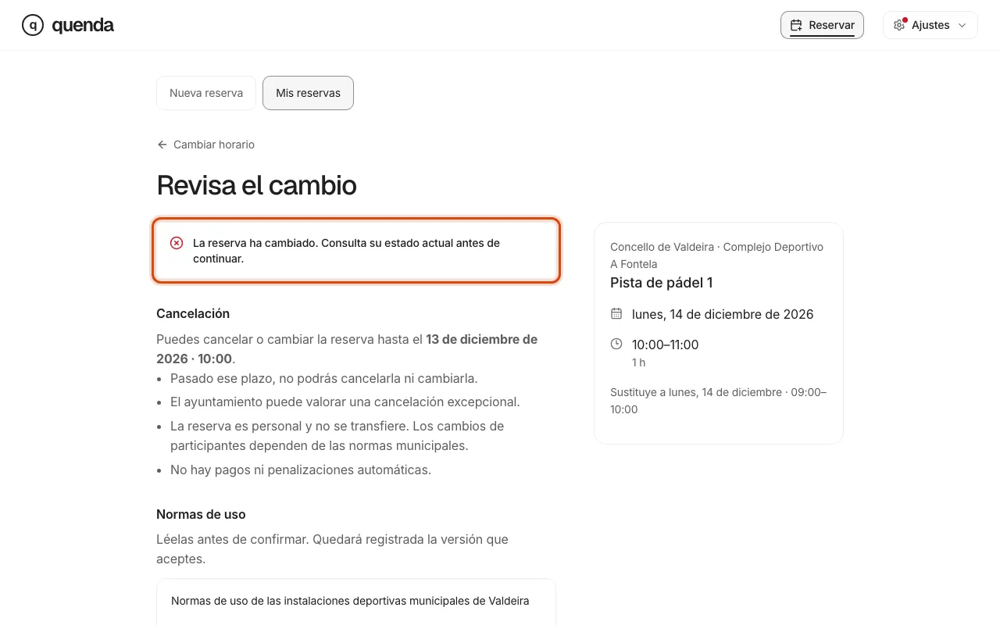

*El mensaje recuadrado, sobre «Confirmar el cambio», pide consultar el estado actual. Vuelve a abrir la reserva desde «Mis reservas» y repite el cambio si sigue siendo necesario.*

Si sucede al cancelar, la cancelación no se aplica y la página de la reserva se actualiza con sus datos actuales. Cierra el diálogo con «Mantener reserva», revisa el horario y vuelve a cancelar si lo sigues necesitando.

#### El nuevo horario se ocupa antes de confirmar

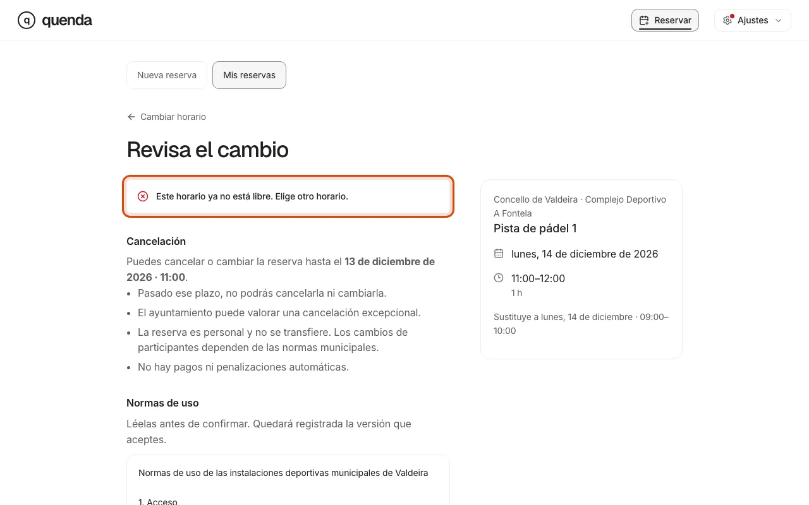

*El mensaje recuadrado aparece arriba de la revisión. Tu reserva anterior se conserva tal como estaba; vuelve con «Cambiar horario» para elegir otra franja.*

#### Ha pasado el plazo para cancelar o cambiar

Dentro del plazo restringido (en el ejemplo, las 24 h previas al inicio) la reserva, su espacio y su responsabilidad se mantienen. Modificarla tampoco permite saltarse el plazo.

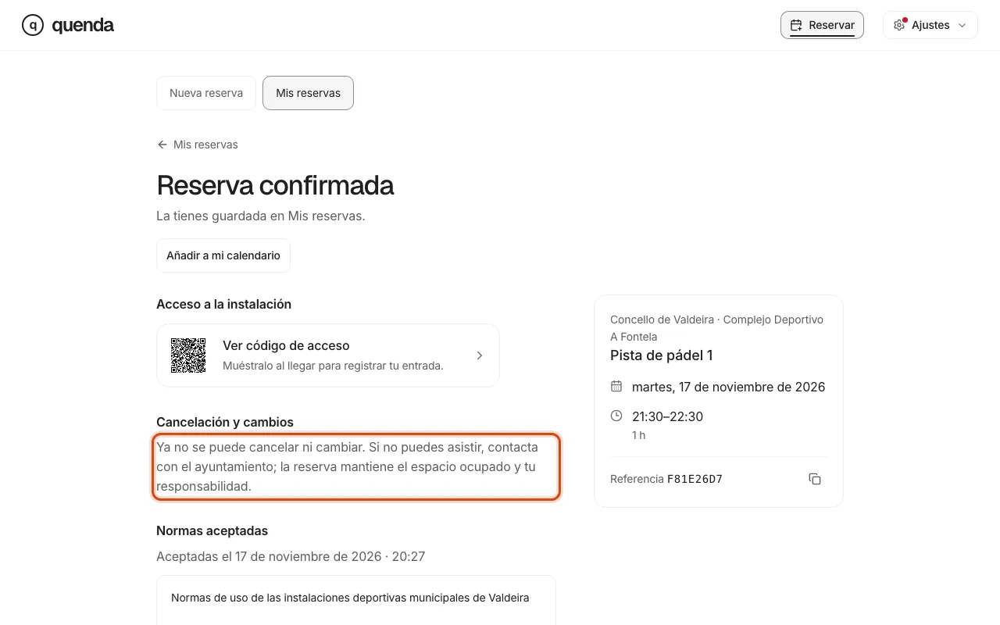

*En «Cancelación y cambios», el texto recuadrado indica que ya no se puede cancelar ni cambiar y que, si no puedes asistir, contactes con el ayuntamiento. Faltan los botones «Cambiar horario» y «Cancelar reserva».*

Si no vas, la reserva no se cancela ni se penaliza automáticamente: conservas tu historial y el tiempo reservado. Si las normas lo permiten, puedes reorganizar a quién te acompaña, pero no transferir la reserva.

#### El ayuntamiento cancela o reubica tu reserva

Antes del inicio y con un motivo, el personal municipal autorizado puede cancelar excepcionalmente una reserva o trasladarla a otro espacio. Recibes un aviso que indica quién hizo el cambio y por qué.

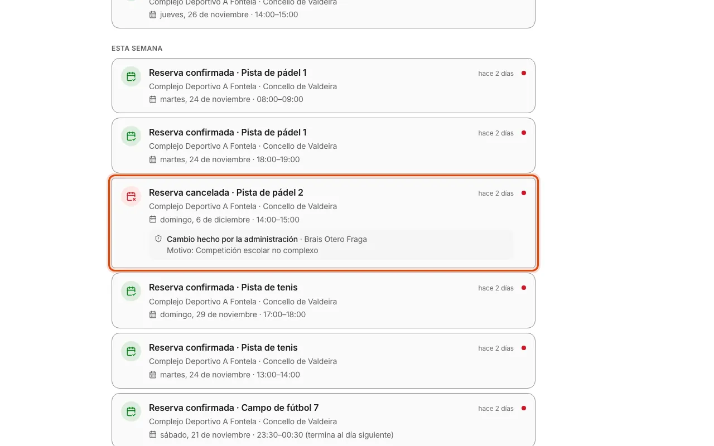

*El aviso recuadrado muestra «Cambio hecho por la administración», el nombre de la persona y el motivo («Competición escolar no complexo»). El punto rojo indica que está sin leer.*

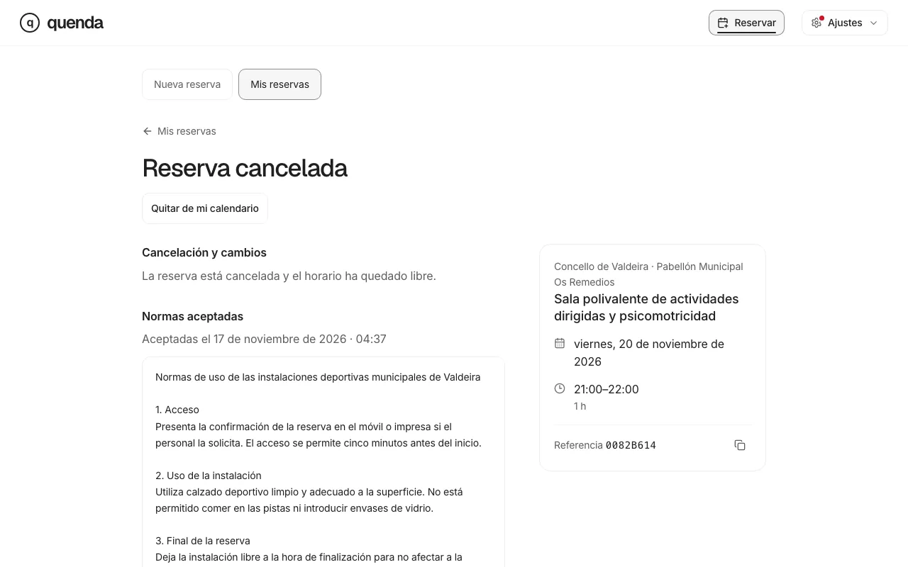

*Al abrir el aviso se ve el estado actual de la reserva: cancelada y con el horario libre. El motivo se consulta en el aviso.*

Si el ayuntamiento traslada tu reserva a un espacio con otras normas, la reserva muestra «Tienes normas nuevas pendientes de aceptar». Puedes leerlas y aceptarlas antes del nuevo inicio, incluso dentro del plazo restringido; aceptarlas no cambia el horario ni las condiciones de cancelación. Si no las aceptas, la reubicación no se deshace: contacta con el ayuntamiento si no estás de acuerdo. Nadie del personal puede aceptarlas en tu nombre.

#### No hay nada que cambiar o la reserva ya empezó

Confirmar el mismo horario que ya tenías no registra ningún cambio. Una reserva que ya ha empezado no se modifica ni se cancela, y nunca se cambia de titular ni de municipio.

### Resultado

La reserva queda cambiada o cancelada y el cambio consta en su historial y en tus avisos; si algo falla, la reserva anterior se conserva intacta.

## CU-07 — Crear una cuenta y utilizar un servicio municipal

Sirve para tener una cuenta con la que reservar en cualquier municipio que use esta instalación de Quenda. Lo hace cualquier persona con un correo electrónico propio.

**Antes de empezar:** necesitas acceso a tu buzón de correo. **Especificación:** [CU-07](../08_casos_de_uso.md#cu-07--crear-una-cuenta-y-utilizar-un-servicio-municipal).

### Paso a paso

1. **Abre el registro.** En la página de acceso, pulsa «Crear una cuenta».

   

   *El enlace recuadrado está al final, bajo las opciones de recuperación de acceso.*

2. **Escribe tus datos.** Nombre, correo y una contraseña de al menos 8 caracteres. El enlace «Cómo se tratan tus datos al crear la cuenta» explica la información de privacidad. Pulsa «Crear cuenta».

   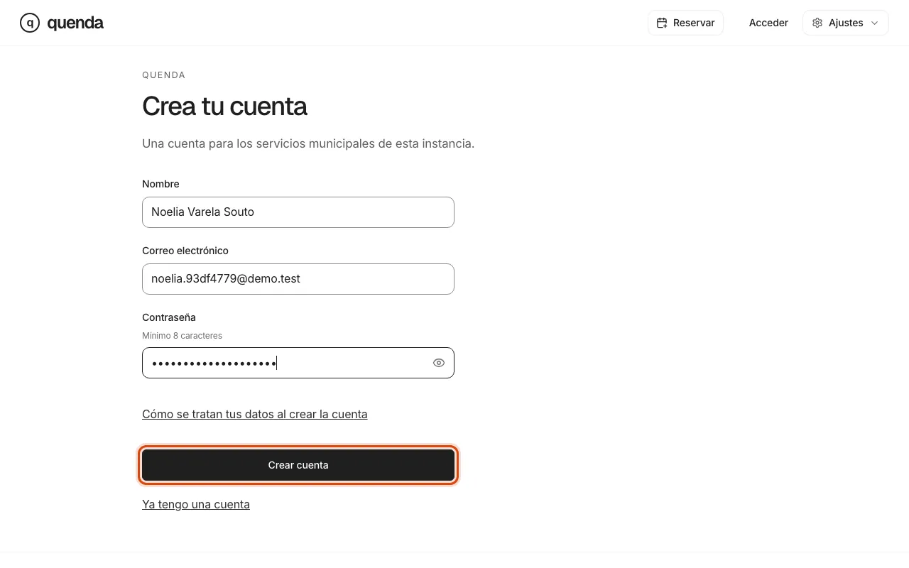

   *Los tres campos están completos y el recuadro marca «Crear cuenta».*

3. **Comprueba tu correo.** Quenda no activa la cuenta hasta que verificas el correo.

   

   *El formulario desaparece y queda el aviso recuadrado. El siguiente paso se hace desde tu buzón.*

4. **Abre el correo de verificación.** Llega un mensaje con un enlace para verificar el correo.

   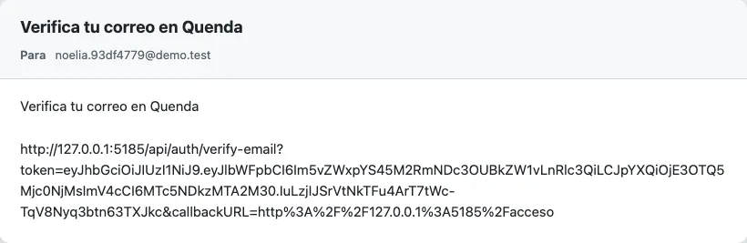

   *El correo, con asunto «Verifica tu correo en Quenda», contiene solo el enlace. Ábrelo en el mismo navegador.*

5. **Accede por primera vez.** El enlace verifica el correo y te lleva a la página de acceso ([CU-09](#cu-09--iniciar-o-cerrar-sesión)).

   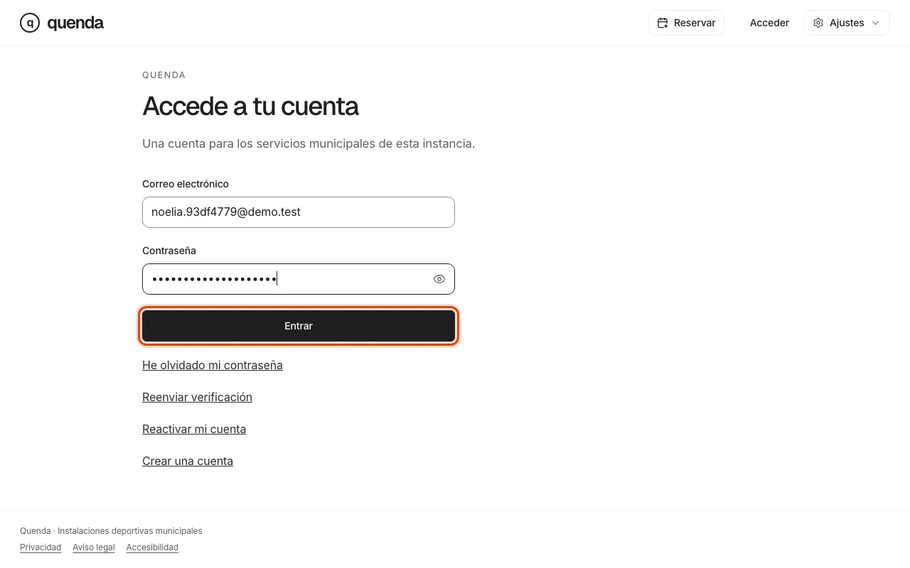

   *Escribe el correo y la contraseña que acabas de registrar y pulsa «Entrar», recuadrado.*

   

   *Al entrar se abre «Mi cuenta» en «Preferencias», con el idioma y la apariencia. Abajo a la izquierda aparece el correo de la cuenta.*

6. **Reserva en un municipio.** Puedes reservar en cualquier municipio sin rellenar ningún perfil adicional: Quenda crea la relación con el municipio al confirmar la primera reserva.

   

   *La revisión muestra las normas de uso de Ribasanta (en gallego, tal como las publica el ayuntamiento). Con la casilla marcada, el recuadro señala «Confirmar reserva».*

   

   *La primera reserva de la cuenta queda confirmada, con sus botones de cambio y cancelación.*

### Si algo no sale como se espera

#### La contraseña es demasiado corta

*El campo «Contraseña» queda bordeado en rojo y la cuenta no se crea. Encima del campo se recuerda «Mínimo 8 caracteres»; escribe una contraseña más larga y vuelve a pulsar «Crear cuenta».*

#### El enlace de verificación no funciona

Si el enlace está incompleto, ya se usó o ha caducado, Quenda no verifica la cuenta.

*El mensaje recuadrado aparece sobre el formulario de acceso. Usa «Reenviar verificación» para pedir un enlace nuevo.*

#### Ya tienes una cuenta con ese correo

Si ya te registraste antes, usa la misma cuenta en todos los municipios de esta instalación. El registro responde igual tanto si el correo existe como si no, para no revelar qué correos están registrados.

*La respuesta es la misma que en un registro nuevo. Si ya tenías cuenta, accede con ella o recupera la contraseña ([CU-09](#cu-09--iniciar-o-cerrar-sesión)).*

#### Otra instalación de Quenda

Cada instalación independiente de Quenda tiene sus propias cuentas: si otro organismo usa una instalación distinta, allí necesitas registrarte de nuevo. Consultar el catálogo no crea ningún perfil, y verificar el correo no acredita tu identidad ni tu residencia.

### Resultado

Tienes una cuenta verificada, sin permisos de gestión, y la relación con cada municipio se crea al reservar en él por primera vez.

## CU-08 — Consultar el historial de reservas

Sirve para ver todas tus reservas, pasadas y futuras, y la situación actual de cada una. Lo hace la persona titular desde «Mis reservas».

**Antes de empezar:** necesitas haber iniciado sesión. **Especificación:** [CU-08](../08_casos_de_uso.md#cu-08--consultar-el-historial-de-reservas).

### Paso a paso

1. **Abre «Mis reservas».** Desde la pestaña «Mis reservas» o desde el menú «Ajustes».

   

   *Arriba, «Tus horarios habituales» propone reservar de nuevo los horarios que repites (solo los ves tú y se pueden ocultar con «No mostrar recomendaciones»). El recuadro marca el filtro «Municipio», con «Todos los municipios».*

2. **Filtra por municipio si lo necesitas.** El filtro ofrece solo los municipios donde tienes reservas.

   

   *El desplegable lista los dos municipios con reservas de esta cuenta. El recuadro marca Concello de Ribasanta.*

   

   *Con el filtro aplicado (recuadrado), la lista muestra solo reservas de Ribasanta. Cada una indica espacio, municipio, fecha y hora, y una etiqueta con su estado.*

3. **Carga más reservas.** La lista va de la más reciente a la más antigua por fecha de inicio; las siguientes se cargan al final.

   

   *Al final de cada bloque aparece «Ver más reservas», recuadrado.*

   

   *Tras las confirmadas próximas aparecen las pasadas, con la etiqueta «Finalizada» o «Cancelada». El recuadro marca una reserva finalizada.*

4. **Consulta una reserva.** Al abrirla, se ven su estado, el registro de llegada si lo hubo y las normas aceptadas.

   

   *«Cancelación y cambios» aclara que el horario ya ha pasado y que el estado «Finalizada» no acredita la asistencia. Debajo están las normas aceptadas con su fecha. Cuando el personal registra tu llegada, la página la muestra además en «Acceso a la instalación».*

   

   *Una reserva cancelada conserva su página, su referencia y sus normas aceptadas.*

### Si algo no sale como se espera

#### Una reserva antigua no tiene normas aceptadas

Si la reserva es anterior al registro de aceptaciones, verás «No consta una aceptación registrada». Solo describe que falta esa evidencia: el estado de la reserva no cambia.

#### Personal municipal

El personal del ayuntamiento consulta las reservas de su ámbito desde la gestión municipal y solo ve las incluidas en sus permisos. Nunca ve tu historial en otros municipios.

### Resultado

Has consultado tus reservas y su situación actual, sin acceso a reservas de otras personas.

## CU-09 — Iniciar o cerrar sesión

Sirve para entrar con tu cuenta y para salir cuando terminas. Lo hace cualquier persona con una cuenta verificada; las cuentas con permisos de gestión deben completar además un segundo factor.

**Antes de empezar:** necesitas una cuenta verificada y activa. **Especificación:** [CU-09](../08_casos_de_uso.md#cu-09--iniciar-o-cerrar-sesión).

### Paso a paso

1. **Pulsa «Acceder».** Está en la cabecera de cualquier página.

   

   *Sin sesión, la cabecera muestra «Reservar», «Acceder» (recuadrado) y «Ajustes».*

2. **Escribe tu correo y contraseña.** El ojo del campo de contraseña permite verla mientras escribes.

   

   *Debajo del botón «Entrar» están las opciones para recuperar la contraseña, reenviar la verificación, reactivar la cuenta o crear una nueva.*

3. **Pulsa «Entrar».**

   

   *Con el correo y la contraseña correctos, pulsa «Entrar», recuadrado. El mensaje de error que se ve corresponde al intento anterior y desaparece al entrar.*

4. **Sesión iniciada.** Quenda te lleva a «Mi cuenta» o a la página que estabas visitando. Iniciar sesión no da permisos nuevos.

   

   *La cabecera ya no muestra «Acceder». El punto rojo en «Ajustes» indica que tienes avisos sin leer.*

5. **Cierra la sesión.** Abre «Ajustes» y pulsa «Cerrar sesión».

   

   *El menú reúne Mi cuenta, Mis reservas, Avisos (con el número de avisos sin leer), idioma y apariencia. «Cerrar sesión», recuadrado, está al final.*

   

   *Tras cerrar la sesión vuelves al inicio y la cabecera muestra de nuevo «Acceder». La sesión cerrada ya no sirve para ninguna otra petición.*

### Si algo no sale como se espera

#### El correo o la contraseña no son correctos

*El mensaje recuadrado no dice cuál de los dos datos falla. Revísalos y vuelve a intentarlo, o usa «He olvidado mi contraseña».*

#### Tu cuenta tiene verificación en dos pasos

Las cuentas con permisos de gestión, y las que la activan voluntariamente, piden después un código de seis cifras de su aplicación de autenticación.

*Tras la contraseña aparece «Verifica tu acceso». El recuadro marca el campo del código; «Usar un código de respaldo» permite usar uno de los códigos guardados al activar la verificación.*

*Si el código no es correcto, aparece el mensaje recuadrado y no se inicia la sesión.*

*Escribe el código vigente y pulsa «Verificar». Cada código solo sirve una vez y cambia cada 30 segundos: si entras dos veces seguidas, espera al siguiente.*

*Con la verificación completada se abre la cuenta. Las cuentas de gestión ven además «Gestión» en la cabecera.*

Mientras la cuenta conserve permisos de gestión no se puede desactivar la verificación en dos pasos.

#### Has olvidado la contraseña

*El enlace recuadrado está justo debajo de «Entrar».*

*Escribe el correo de tu cuenta y pulsa «Enviar instrucciones».*

*La respuesta, recuadrada, es la misma exista o no la cuenta, para no revelar qué correos están registrados.*

*El correo contiene el enlace para elegir una contraseña nueva.*

*Escribe la nueva contraseña, de al menos 8 caracteres, y pulsa «Guardar contraseña».*

*La contraseña queda cambiada. Usa «Acceder» para entrar con ella.*

*El enlace solo sirve una vez: si lo vuelves a abrir, aparece este mensaje. «Solicitar otro enlace» inicia de nuevo la recuperación.*

#### La cuenta está dada de baja o suspendida

Si diste de baja tu cuenta, Quenda lo indica al intentar entrar (ver [CU-14](#cu-14--dar-de-baja-la-cuenta)) y puedes recuperarla con «Reactivar mi cuenta» ([CU-15](#cu-15--reactivar-una-cuenta)). Una cuenta suspendida por seguridad solo la recupera el equipo que opera Quenda.

### Resultado

La sesión queda iniciada con los permisos que ya tenía la cuenta, o cerrada y sin posibilidad de reutilizarse.

## CU-11 — Recibir y consultar avisos de reserva

Sirve para enterarte de que una reserva se ha confirmado, modificado o cancelado, la hayas cambiado tú o el ayuntamiento. Quenda registra un aviso en la web y envía un correo a la persona titular.

**Antes de empezar:** necesitas una reserva con alguna operación confirmada y haber iniciado sesión para ver los avisos en la web. **Especificación:** [CU-11](../08_casos_de_uso.md#cu-11--recibir-y-consultar-avisos-de-reserva).

### Paso a paso

1. **Quenda envía el correo.** Al confirmarse una operación, el aviso queda registrado al momento y el servicio de correo de Quenda envía los mensajes pendientes.

   

   *Así lo registra el servicio de correo: «EMAIL_WORKER_READY» indica que está en marcha, «EMAIL_QUEUE_HEALTH» resume la cola (pendientes, en curso y agotados) y cada «EMAIL_ATTEMPT … ACCEPTED» es un mensaje que el servidor de correo ha aceptado. Aceptarlo no garantiza que llegue al buzón.*

2. **Recibes el correo.** Describe el evento, su fecha y el horario, con un enlace a la reserva.

   

   *El correo indica el evento («Reserva confirmada»), la referencia, la revisión, cuándo ocurrió, el inicio y el fin con su zona horaria. Advierte de que la reserva puede haber cambiado después y enlaza a «Consultar el estado actual».*

3. **Mira los avisos en la web.** El punto rojo en «Ajustes» indica que hay avisos sin leer.

   

   *El botón «Ajustes», recuadrado, lleva un punto rojo junto al icono.*

   

   *En el menú, «Avisos» (recuadrado) muestra cuántos quedan sin leer.*

4. **Abre el aviso.** La lista agrupa los avisos por día; los no leídos llevan un punto rojo.

   

   *Cada aviso indica el evento, el espacio, la instalación, el municipio y el horario. El recuadro marca el aviso de la nueva reserva; los cambios hechos por el ayuntamiento llevan además «Cambio hecho por la administración» y el motivo.*

5. **Consulta la reserva enlazada.** El aviso, igual que el enlace del correo, abre la reserva con su estado actual y las normas pendientes, si las hay.

   

   *La página muestra el estado actual de la reserva, que puede ser distinto del que describía el aviso si hubo cambios posteriores.*

6. **Cada cambio genera su propio aviso.** Si la reserva se cancela o se modifica después, llega otro correo con su revisión.

   

   *El correo de cancelación tiene el mismo formato, con «Reserva cancelada», la revisión 2 y el enlace a la misma reserva.*

7. **Marca los avisos como leídos.**

   

   *El botón recuadrado marca de una vez todos los avisos. Los que ya habías abierto aparecen sin punto rojo.*

   

   *Todos los avisos quedan leídos, el botón desaparece y «Ajustes» deja de mostrar el punto rojo.*

### Si algo no sale como se espera

#### El correo no llega o llega dos veces

Si el envío falla, Quenda lo reintenta más tarde sin tocar la reserva; el aviso de la web está disponible desde el primer momento. En raras ocasiones puede llegar un correo repetido: no representa otra reserva. Ante cualquier duda, el enlace del correo muestra el estado actual.

#### El aviso habla de normas nuevas

Recibir o leer un aviso no acepta normas. Si el ayuntamiento traslada tu reserva a un espacio con otras normas, acéptalas desde la página de la reserva ([CU-03](#cu-03--modificar-o-cancelar-una-reserva)); aceptarlas no genera otro aviso de cambio.

### Resultado

Conoces el evento (confirmación, cambio o cancelación) por el aviso y el correo, y su estado actual en la página de la reserva.

## CU-13 — Actualizar datos personales y correo

Sirve para mantener al día tu nombre, tus preferencias de idioma y apariencia, y el correo con el que accedes. Cada persona lo hace desde «Mi cuenta».

**Antes de empezar:** necesitas haber iniciado sesión; para cambiar el correo, tu contraseña actual y acceso a los dos buzones (el actual y el nuevo). **Especificación:** [CU-13](../08_casos_de_uso.md#cu-13--actualizar-datos-personales-y-correo).

### Paso a paso

1. **Cambia tu nombre.** En «Mi cuenta» › «Datos personales», escribe el nombre y pulsa «Guardar nombre». Es el nombre que ve el personal municipal en tus reservas.

   

   *El campo «Nombre» tiene el nuevo valor y el recuadro marca «Guardar nombre». Debajo empieza el apartado «Correo electrónico».*

   

   *El aviso recuadrado confirma el cambio.*

2. **Elige idioma y apariencia.** En «Preferencias» o en el menú «Ajustes»; los dos lugares guardan las mismas preferencias de la cuenta.

   

   *«Idioma» ofrece Castellano y Galego. «Apariencia», recuadrada, permite seguir el tema del municipio, el del sistema, o fijar claro u oscuro.*

   

   *El mismo cambio puede hacerse desde «Ajustes», en cualquier página.*

3. **Solicita el cambio de correo.** En «Datos personales», escribe el nuevo correo y tu contraseña actual, y pulsa «Solicitar cambio de correo».

   

   *El texto superior recuerda que hay que autorizar el cambio desde el correo actual, verificar el nuevo y que al completarlo se cerrarán todas tus sesiones.*

   

   *El aviso recuadrado indica el siguiente paso: abrir el buzón actual.*

4. **Autoriza desde tu correo actual.**

   

   *El correo llega al buzón actual. Explica que el enlace solo sirve una vez, caduca a los diez minutos y no debe confirmarse si no pediste el cambio.*

   

   *Abrir el enlace no ejecuta nada: hay que pulsar «Autorizar cambio», recuadrado, en la misma sesión con la que se pidió el cambio.*

   

   *El aviso recuadrado indica que ahora hay que ir al buzón nuevo.*

5. **Verifica el nuevo correo.**

   

   *El mensaje llega a la nueva dirección, con las mismas condiciones de uso único y caducidad.*

   

   *Pulsa «Confirmar nuevo correo», recuadrado. El campo «Contraseña para recuperación asistida» solo se usa cuando el cambio lo tramita el equipo que opera Quenda.*

6. **Vuelve a entrar con el nuevo correo.** Quenda sustituye el correo y cierra todas tus sesiones.

   

   *El aviso recuadrado confirma el cambio sobre el formulario de acceso.*

   

   *Tras entrar con el nuevo correo, «Datos personales» lo muestra en «Correo electrónico». El nombre y el resto de la cuenta se mantienen.*

### Si algo no sale como se espera

#### La contraseña actual no es correcta

*El mensaje recuadrado aparece bajo los campos y el cambio no se solicita. Escribe tu contraseña actual y vuelve a pulsar «Solicitar cambio de correo».*

#### El enlace caduca o la cuenta cambia entretanto

Si no completas los dos pasos a tiempo, o si mientras tanto cambias la contraseña o cambia el estado de la cuenta, el correo no se sustituye. Vuelve a solicitar el cambio.

#### No puedes acceder al correo actual

Hace falta una recuperación asistida: pídela al equipo que opera Quenda, que verificará tu identidad. Aun así tendrás que verificar el nuevo correo y confirmar tus credenciales. El personal de un ayuntamiento no puede cambiar tu correo por su cuenta.

### Resultado

Tus datos quedan actualizados; el correo solo cambia tras completar las dos verificaciones, y entonces se cierran todas tus sesiones.

## CU-14 — Dar de baja la cuenta

Sirve para desactivar voluntariamente tu cuenta en toda la instalación de Quenda. Lo hace la persona titular desde «Mi cuenta». La baja cierra el acceso, pero no borra automáticamente tus reservas ni las evidencias que deben conservarse.

**Antes de empezar:** necesitas haber iniciado sesión, tu contraseña actual y no tener reservas confirmadas futuras o en curso. **Especificación:** [CU-14](../08_casos_de_uso.md#cu-14--dar-de-baja-la-cuenta).

### Paso a paso

1. **Abre «Privacidad y baja».** El apartado «Dar de baja la cuenta» explica qué implica la baja.

   

   *El texto recuerda que la baja afecta a toda la instancia, cierra sesiones y retira permisos, y que no puedes darte de baja con reservas futuras o en curso. Debajo están «Contraseña actual», la casilla «Quiero desactivar mi cuenta global» y «Confirmar baja de cuenta».*

2. **Confirma la baja.** Escribe tu contraseña, marca la casilla y pulsa «Confirmar baja de cuenta».

   

   *Con los datos completos, el recuadro marca el botón. El mensaje de error visible corresponde al intento anterior.*

3. **Cuenta desactivada.** Quenda cierra tus sesiones y te lleva a la página de acceso.

   

   *El aviso recuadrado confirma la baja.*

   

   *Si intentas entrar después, aparece «La cuenta está dada de baja.». Para volver a usarla, sigue [CU-15](#cu-15--reactivar-una-cuenta).*

### Si algo no sale como se espera

#### La contraseña no es correcta

*El mensaje recuadrado aparece sobre el botón y la cuenta sigue activa.*

#### Tienes reservas confirmadas pendientes

*El mensaje recuadrado pide consultar tus reservas o contactar con el ayuntamiento. La baja no cancela reservas: cancélalas tú si el plazo lo permite ([CU-03](#cu-03--modificar-o-cancelar-una-reserva)) y vuelve a intentarlo.*

#### Tienes verificación en dos pasos o responsabilidades municipales

- Si tienes la verificación en dos pasos activada, complétala antes de confirmar con el enlace «Si tienes la verificación en dos pasos, complétala antes de continuar».
- Si eres la última persona responsable de un municipio, primero debe completarse el relevo en la gestión municipal. La baja no retira los permisos que ya aceptaron otras personas.

### Resultado

La cuenta queda desactivada, sin sesiones ni permisos propios, y no puede realizar nuevas operaciones; o, si falta algún requisito, sigue como estaba.

## CU-15 — Reactivar una cuenta

Sirve para recuperar el acceso a una cuenta que diste de baja voluntariamente. Lo hace la propia persona, con su contraseña y su correo.

**Antes de empezar:** necesitas tu contraseña, acceso al correo de la cuenta y, si lo tenías, tu segundo factor. **Especificación:** [CU-15](../08_casos_de_uso.md#cu-15--reactivar-una-cuenta).

### Paso a paso

1. **Pulsa «Reactivar mi cuenta».** Está en la página de acceso.

   

   *El enlace recuadrado está entre «Reenviar verificación» y «Crear una cuenta».*

2. **Solicita la reactivación.** Escribe tu correo y tu contraseña actual y pulsa «Enviar instrucciones».

   

   *La página advierte que la reactivación recupera el acceso personal de una baja voluntaria, pero no levanta suspensiones ni recupera permisos administrativos.*

   

   *La respuesta es la misma en cualquier caso, para no revelar si la cuenta existe o está suspendida.*

3. **Abre el correo de reactivación.**

   

   *El correo pide confirmar la reactivación con la contraseña y, si lo tenías, el segundo factor. El enlace caduca en 10 minutos y solo sirve una vez.*

4. **Confirma con tu contraseña.** Escribe tu contraseña y, si tenías verificación en dos pasos, el código. Pulsa «Reactivar cuenta».

   

   *El campo «Código de autenticación» solo hace falta si tenías activada la verificación en dos pasos. El mensaje de error visible corresponde al intento anterior.*

   

   *El aviso recuadrado confirma la reactivación y recuerda que los permisos administrativos no se recuperan.*

5. **Inicia una sesión nueva.** La reactivación no abre sesión por sí sola: entra con [CU-09](#cu-09--iniciar-o-cerrar-sesión).

   

   *La cuenta vuelve a funcionar con normalidad.*

### Si algo no sale como se espera

#### La contraseña no es correcta

*El mensaje recuadrado no detalla qué dato falla y la cuenta sigue desactivada. Revisa la contraseña y vuelve a intentarlo.*

#### El enlace ya se usó o ha caducado

*Un enlace usado, caducado o incorrecto no reactiva la cuenta. Pide uno nuevo con «Solicitar otro enlace».*

#### La cuenta está suspendida o ya no existe

Una cuenta suspendida por seguridad no se reactiva por esta vía: debe recuperarla el equipo que opera Quenda. Si tu identidad ya se suprimió, necesitas registrarte de nuevo ([CU-07](#cu-07--crear-una-cuenta-y-utilizar-un-servicio-municipal)). Las invitaciones y los permisos de gestión que tenías antes de la baja no se recuperan.

### Resultado

Recuperas el acceso personal a la cuenta, sin sesión abierta automáticamente y sin permisos de gestión restaurados.

## CU-19 — Obtener una copia de datos personales

Sirve para descargar una copia de los datos de tu cuenta que Quenda puede entregarte directamente. Lo hace la persona titular desde «Mi cuenta»; es una copia técnica y parcial, no la respuesta completa a una solicitud de derecho de acceso.

**Antes de empezar:** necesitas haber iniciado sesión. **Especificación:** [CU-19](../08_casos_de_uso.md#cu-19--obtener-una-copia-de-datos-personales).

### Paso a paso

1. **Descarga tus datos.** En «Mi cuenta» › «Privacidad y baja», pulsa «Descargar datos personales». Quenda prepara el archivo `quenda-personal-data.json` con los datos accesibles de tu cuenta en toda la instancia.

   

   *El texto explica que la descarga identifica sus exclusiones y no equivale a una respuesta completa al derecho de acceso. El recuadro marca el botón.*

2. **Revisa el alcance de la copia.** El archivo declara al principio qué incluye y qué no. Puedes abrirlo con cualquier editor de texto o, como aquí, con la herramienta `jq`.

   

   *«status: PARTIAL» indica que la copia es parcial. «reviewRequired» enumera la información que requiere revisión (texto libre e información de terceros, otras evidencias, contexto del responsable), «excludedSecurityMaterial» lo que nunca se entrega (contraseñas, tokens y secretos del segundo factor) y «administrativeChannel» cómo pedir el resto.*

3. **Consulta tus registros.** El resto del archivo contiene los registros agrupados por categoría.

   

   *El recuento muestra cuántos registros hay de autenticación, comunicaciones (avisos), identidad, perfil municipal y reservas.*

### Si algo no sale como se espera

#### Necesitas más información de la que contiene la copia

La información adicional, o una respuesta formal al derecho de acceso, se pide a la administración responsable por sus canales habituales, como indica el propio archivo. No hace falta reactivar una cuenta dada de baja para solicitarlo.

#### Tus datos superan el volumen admitido

Quenda no entrega nunca un archivo recortado: si la copia es demasiado grande, debe prepararla la administración.

#### Te atiende el personal del ayuntamiento

El personal con permisos de privacidad de un municipio prepara solo los datos de ese municipio, con su propia verificación y motivo. El permiso global de la plataforma cubre la identidad y la seguridad de la cuenta, no los historiales municipales.

### Resultado

Tienes una copia de tus datos identificada como parcial, que indica lo que excluye y cómo pedir el resto.
