# Guía de casos de uso · Personal municipal

Esta guía es para el personal de los ayuntamientos que usan Quenda. La **administración municipal** configura el municipio: sus instalaciones, su personal, sus convenios con otros municipios y su apariencia. La **gestión municipal** trabaja con los permisos que la administración le concede, por ejemplo consultar el uso de los espacios o bloquear una pista. Cuando un convenio lo prevé, el municipio **emisor** registra acreditaciones de uso y las personas con permiso de informes consultan el informe conjunto mensual. Cada caso de uso explica qué hacer, qué se ve en pantalla y qué hacer si algo no sale como se espera. En las imágenes, el recuadro naranja señala dónde hay que pulsar o escribir.

## Índice

- [CU-04 — Mantener catálogo y calendario](#cu-04--mantener-catálogo-y-calendario)
- [CU-05 — Consultar el uso de los espacios o exportar datos municipales](#cu-05--consultar-el-uso-de-los-espacios-o-exportar-datos-municipales)
- [CU-10 — Gestionar un convenio](#cu-10--gestionar-un-convenio)
- [CU-12 — Delegar permisos y relevar responsables](#cu-12--delegar-permisos-y-relevar-responsables)
- [CU-17 — Gestionar una acreditación de uso](#cu-17--gestionar-una-acreditación-de-uso)
- [CU-18 — Consultar un informe conjunto](#cu-18--consultar-un-informe-conjunto)
- [CU-23 — Configurar la apariencia pública](#cu-23--configurar-la-apariencia-pública)

## CU-04 — Mantener catálogo y calendario

El catálogo es lo que la ciudadanía puede reservar. Cada **instalación** (un complejo, un pabellón) agrupa **unidades reservables** (una pista, una sala), y cada unidad tiene su ficha, sus horarios y sus normas. La administración o la gestión con permiso sobre el catálogo da de alta instalaciones y unidades, las publica cuando están listas y las retira cuando dejan de ofrecerse.

**Antes de empezar:** necesitas una sesión con verificación en dos pasos y permiso sobre el catálogo del municipio y sobre las unidades que vas a tocar. **Especificación:** [CU-04](../08_casos_de_uso.md#cu-04--mantener-catálogo-y-calendario).

### Paso a paso

1. **Crea la instalación.** En **Gestión**, abre **Instalaciones y unidades**. Al final de la página, en **Nueva instalación**, escribe el nombre y pulsa **Crear instalación**.

   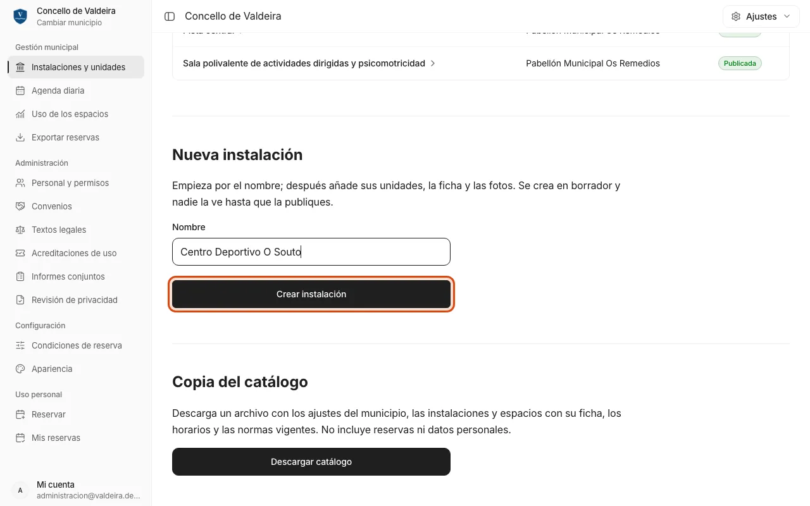

   *Debajo de la lista de unidades está el formulario «Nueva instalación». El texto avisa de que se crea en borrador y que nadie la ve hasta publicarla; el recuadro marca el botón que la crea.*

2. **Abre la ficha de la instalación.** La instalación nueva aparece con la etiqueta **Borrador**. Pulsa la pestaña **Ficha**.

   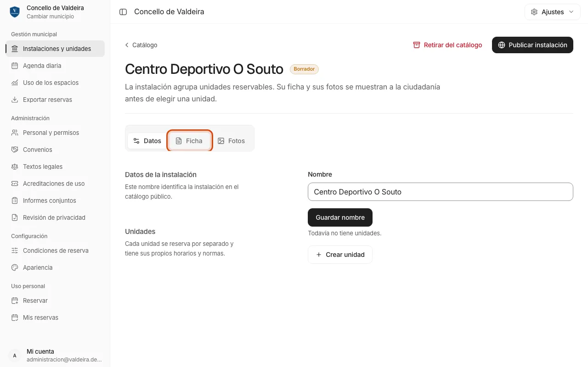

   *La página muestra el nombre, la etiqueta «Borrador», los botones «Retirar del catálogo» y «Publicar instalación» y el aviso «Todavía no tiene unidades». El recuadro marca la pestaña «Ficha».*

3. **Completa la ficha pública.** Rellena dirección, código postal, latitud y longitud (para ofrecer el enlace «Cómo llegar»), descripción y accesibilidad en gallego y en castellano, y un teléfono y un correo institucionales. Todos los campos son opcionales. Pulsa **Guardar ficha**.

   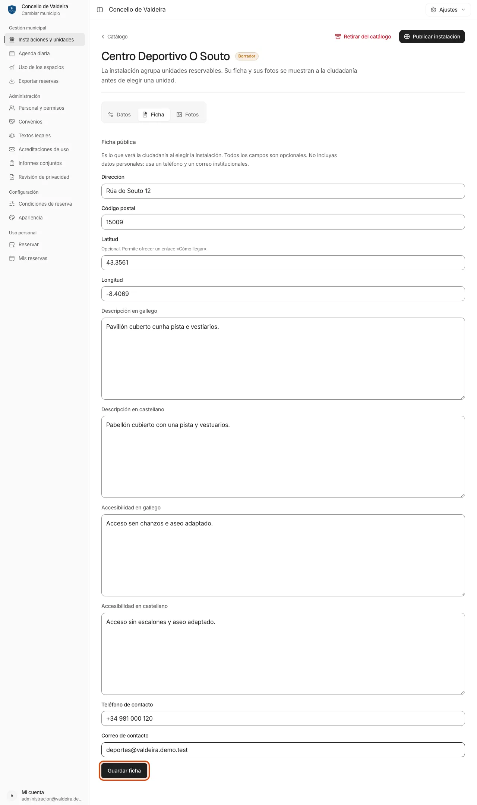

   *Se ve la ficha completa tal como la verá la ciudadanía al elegir la instalación. La pantalla recuerda que no se deben incluir datos personales. Tras pulsar el botón señalado aparece «Cambios guardados».*

4. **Publica la instalación.** Pulsa **Publicar instalación**, escribe el motivo y confirma con **Publicar instalación**.

   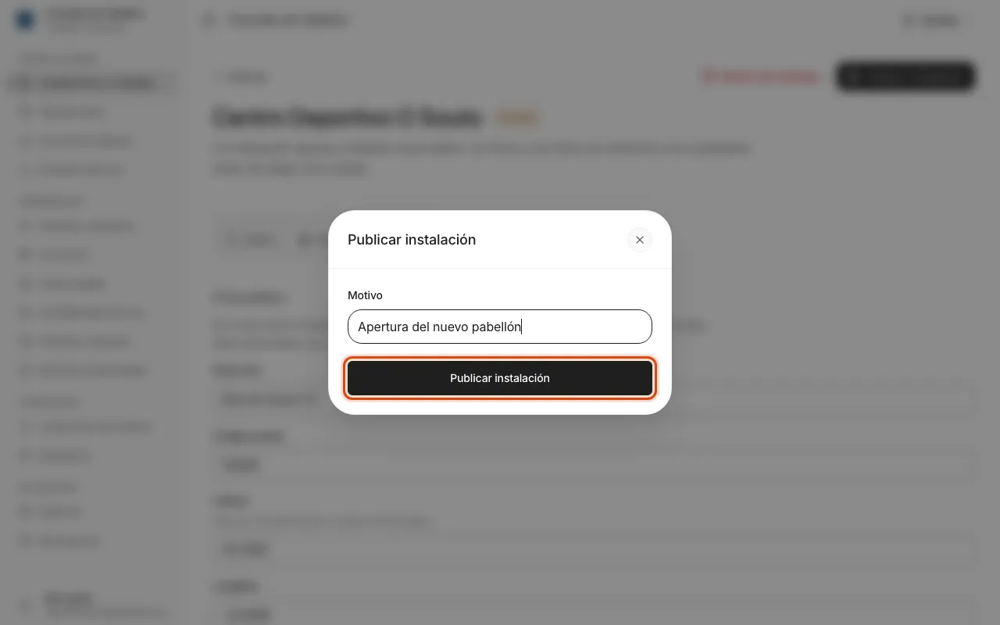

   *La ventana pide un motivo, que queda registrado con la actuación. Al confirmar, la etiqueta de la instalación pasa a «Publicada».*

5. **Crea la unidad reservable.** En la pestaña **Datos** de la instalación, pulsa **Crear unidad**, escribe el nombre y pulsa **Crear unidad**.

   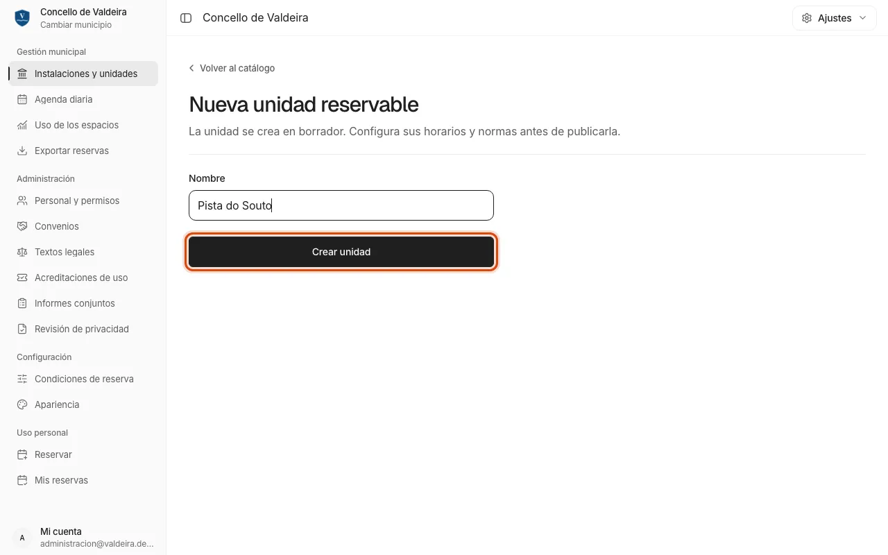

   *La pantalla indica que la unidad se crea en borrador y que hay que configurar sus horarios y normas antes de publicarla. Después, vuelve al catálogo y abre la unidad nueva.*

6. **Describe la unidad.** En la pestaña **Ficha** de la unidad, elige el tipo de espacio y la ubicación, indica el aforo máximo y escribe la descripción en los dos idiomas. Pulsa **Guardar ficha**.

   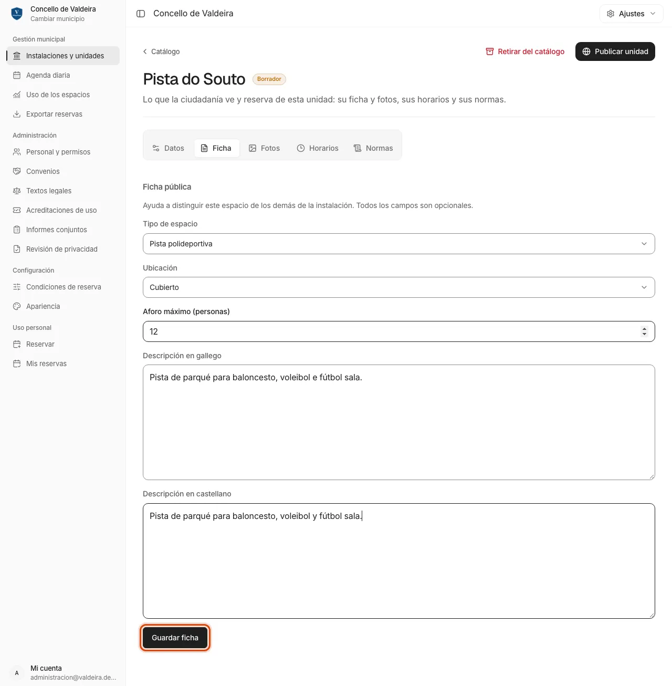

   *La ficha de la unidad ayuda a distinguirla de las demás de la instalación. La unidad sigue en «Borrador» y en la cabecera está el botón «Publicar unidad».*

7. **Escribe las normas de uso.** En la pestaña **Normas**, escribe el texto de las normas y el motivo, y pulsa **Guardar normas**.

   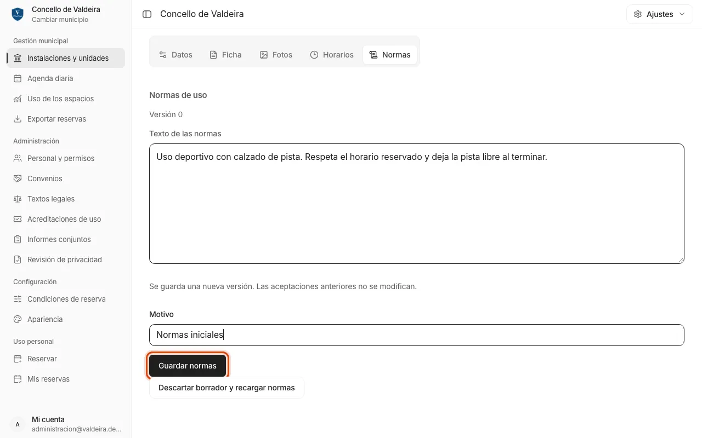

   *La pestaña muestra la versión de las normas. Debajo del texto se lee «Se guarda una nueva versión. Las aceptaciones anteriores no se modifican»: cambiar las normas no altera lo que cada persona aceptó al reservar.*

8. **Configura horarios, duración y antelación.** En la pestaña **Horarios**, indica la duración mínima y máxima, el paso entre horarios y, si quieres, una antelación propia de la unidad. Añade las franjas semanales con **Añadir franja semanal** y los días especiales con **Añadir excepción**. Escribe el motivo y pulsa **Guardar horarios**.

   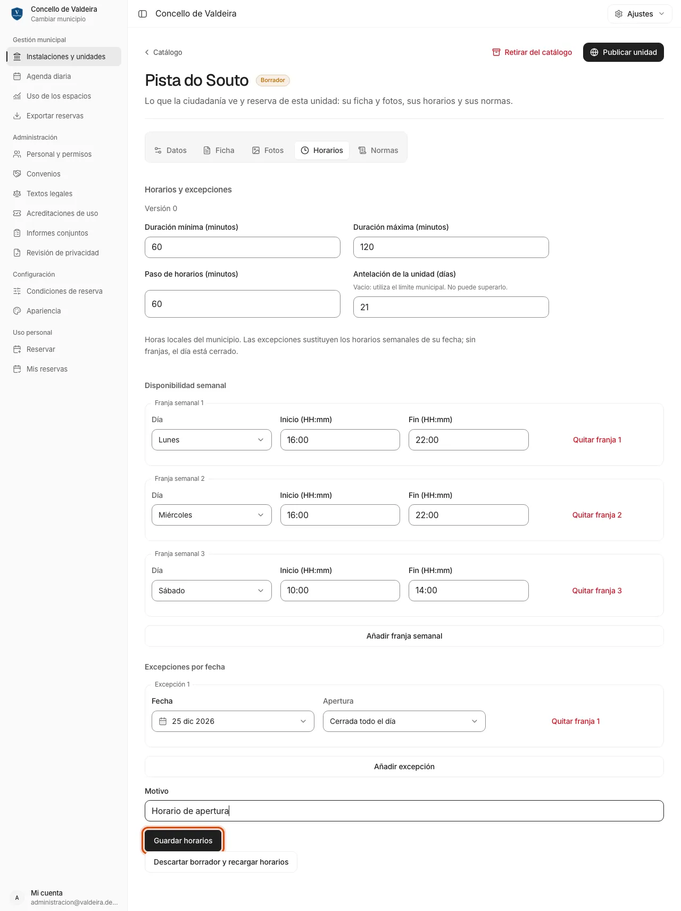

   *Hay franjas los lunes y miércoles de 16:00 a 22:00 y los sábados de 10:00 a 14:00, y una excepción que cierra todo el día de Navidad. Las horas son las locales del municipio; una excepción sustituye el horario semanal de su fecha.*

9. **Publica la unidad.** Pulsa **Publicar unidad**, escribe el motivo, marca la casilla que confirma que la unidad es independiente y no se solapa con otro espacio reservable, y pulsa **Publicar unidad**.

   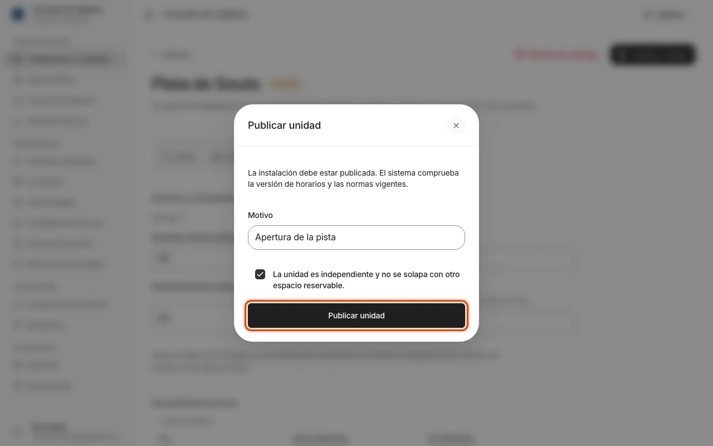

   *La ventana recuerda que la instalación debe estar publicada y que el sistema comprueba la versión de horarios y las normas vigentes antes de publicar.*

10. **Comprueba el resultado.** La unidad muestra la etiqueta **Publicada**.

    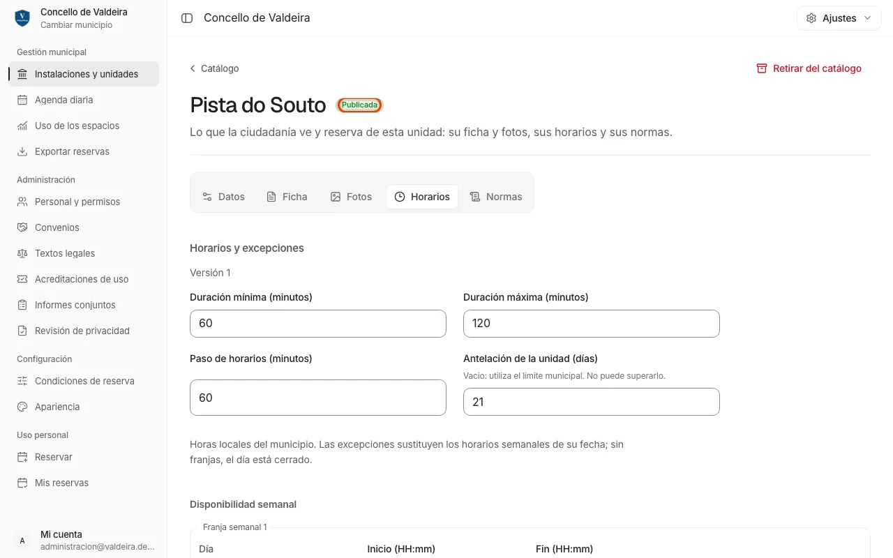

    *La etiqueta pasa de «Borrador» a «Publicada» y la pestaña de horarios muestra la versión 1. En la cabecera solo queda «Retirar del catálogo».*

11. **Mira cómo la ve la ciudadanía.** En la página pública del municipio, la instalación nueva ya aparece entre las que se pueden elegir.

    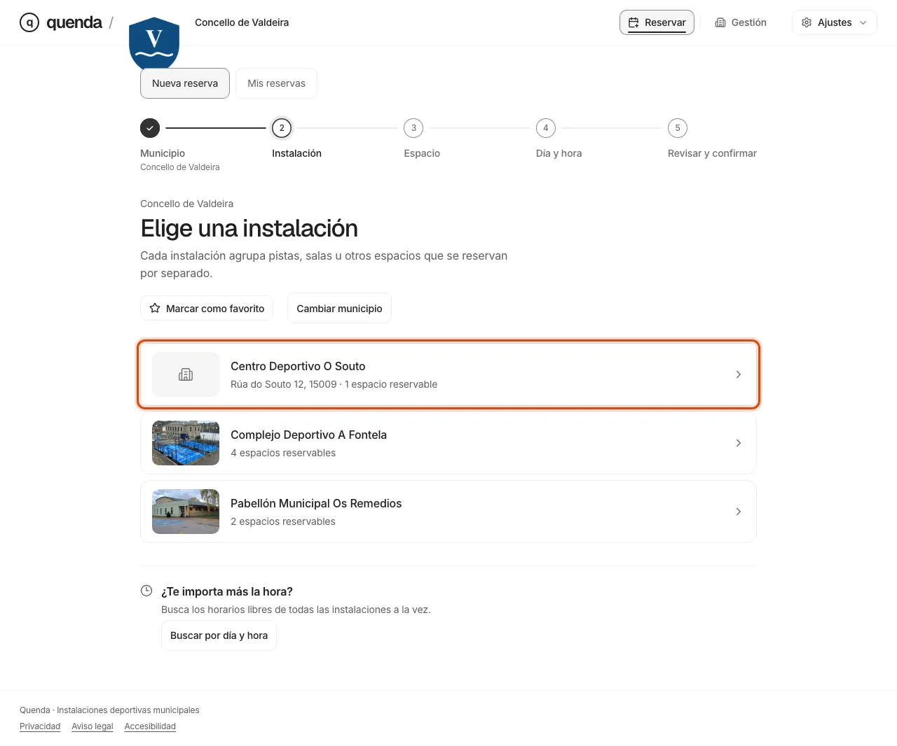

    *La tarjeta de la instalación muestra la dirección de su ficha y «1 espacio reservable». Desde aquí la ciudadanía sigue el recorrido de reserva.*

### Si algo no sale como se espera

#### Intentas publicar una unidad sin normas

La unidad se queda en borrador y la ventana de publicación lo explica. Cierra la ventana, añade las normas en la pestaña **Normas** (paso 7) y vuelve a publicar.

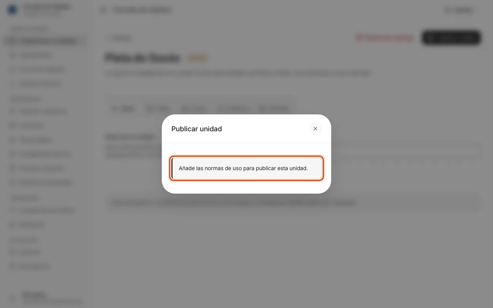

*En lugar del formulario, la ventana muestra solo el aviso señalado. No se publica nada.*

#### Otra persona guardó la ficha antes que tú

Si otra persona del municipio guarda la misma ficha mientras tú la editas, tu guardado se rechaza para no borrar su cambio. Recarga la página para ver la ficha actual y vuelve a aplicar tu cambio.

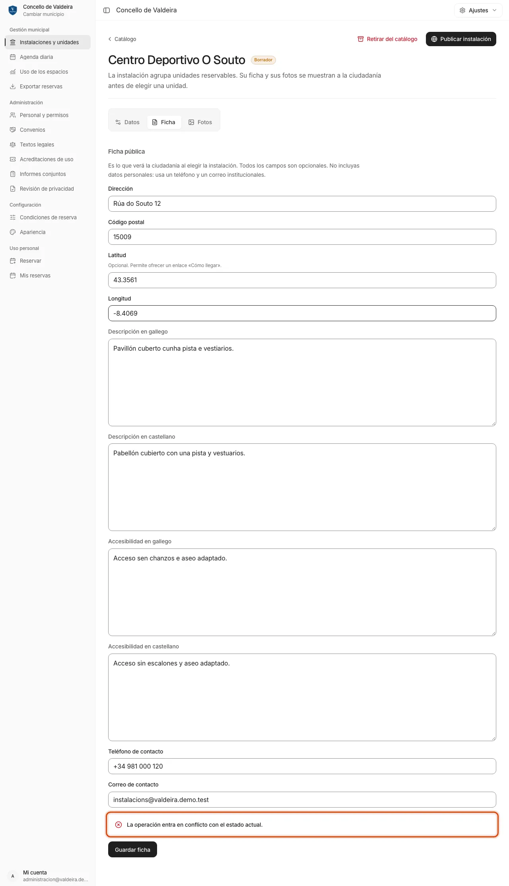

*El mensaje aparece encima de «Guardar ficha» y tu correo de contacto modificado no se guarda. La ficha se guarda completa: si dejas un campo vacío, ese dato desaparece de la ficha pública.*

#### Necesitas cerrar una unidad unas horas

Un bloqueo impide nuevas reservas en su intervalo, por ejemplo para mantenimiento. En **Agenda diaria**, elige el día, y en **Nuevo bloqueo** elige la unidad, el inicio y el fin, escribe el motivo, marca **Confirmo el bloqueo** y pulsa **Crear bloqueo**.

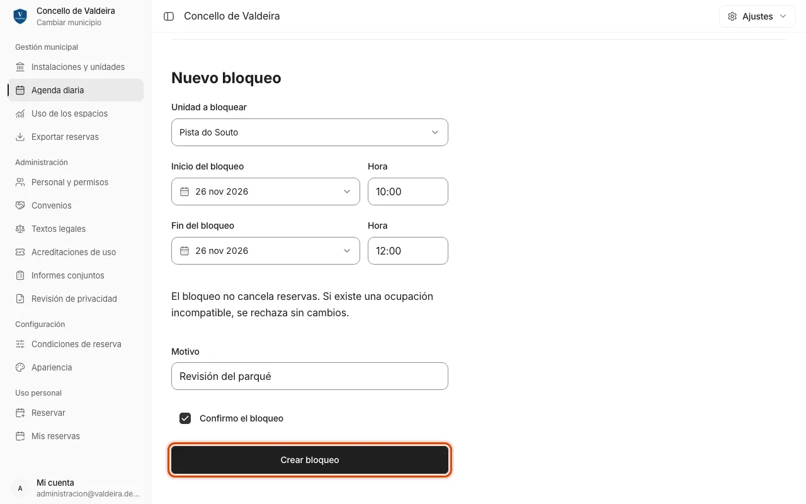

*El formulario avisa de que el bloqueo no cancela reservas y de que se rechaza si coincide con una ocupación incompatible.*

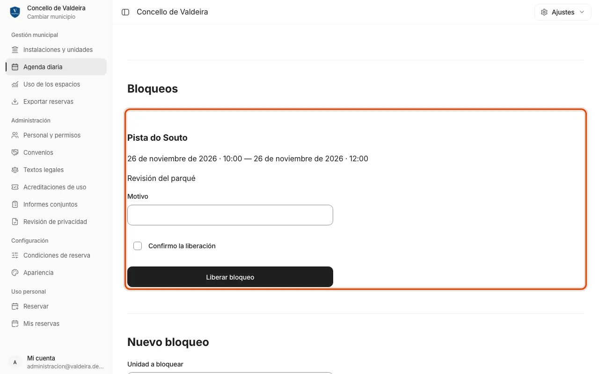

*El bloqueo aparece en la sección «Bloqueos» del día, con su horario y su motivo. Desde el mismo recuadro se puede liberar más adelante, con motivo y confirmación.*

#### El bloqueo coincide con una reserva confirmada

Quenda no bloquea encima de reservas confirmadas. Si hace falta cerrar ese horario, primero hay que resolver esas reservas (cambiarlas o cancelarlas, como explica CU-03) y después crear el bloqueo.

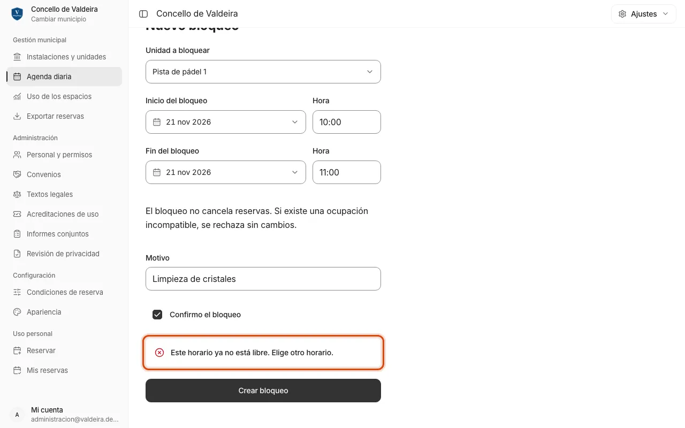

*El mensaje aparece sobre «Crear bloqueo» y no se crea nada.*

#### Un cambio de horario deja fuera reservas confirmadas

Si quitas franjas en una unidad que ya tiene reservas confirmadas en esos horarios, el cambio se rechaza entero. Pulsa **Descartar borrador y recargar horarios** para volver al horario guardado y resuelve antes esas reservas.

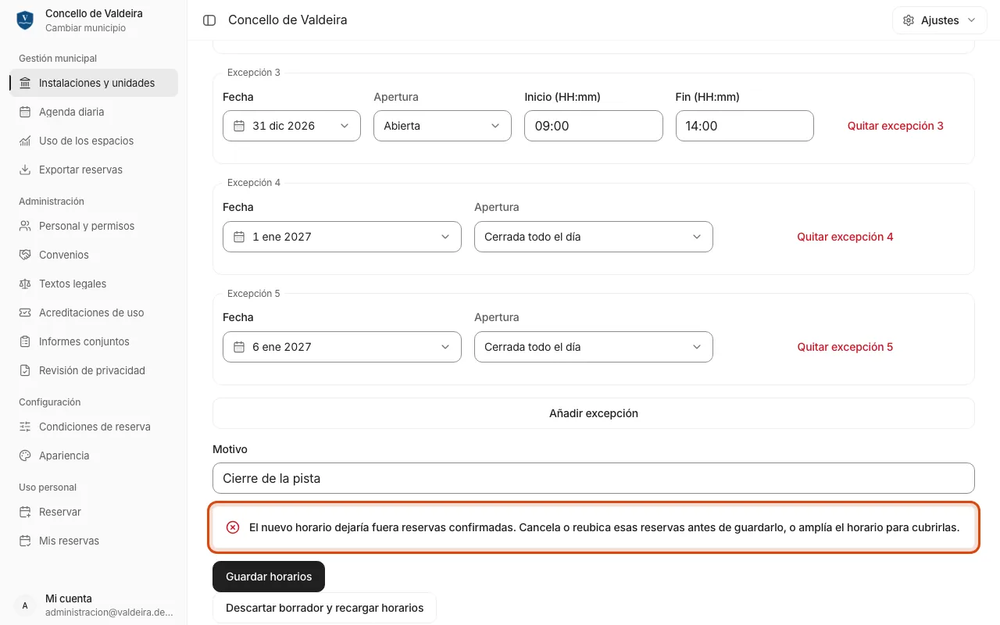

*Se han quitado todas las franjas semanales y solo quedan las excepciones de fechas. Al guardar aparece el mensaje señalado y el horario guardado no cambia.*

#### Quieres dejar de ofrecer una unidad

Retirar una unidad la oculta del catálogo público sin borrar sus reservas ni su historial. Pulsa **Retirar del catálogo**, escribe el motivo, marca **Confirmo la retirada** y pulsa **Retirar**.

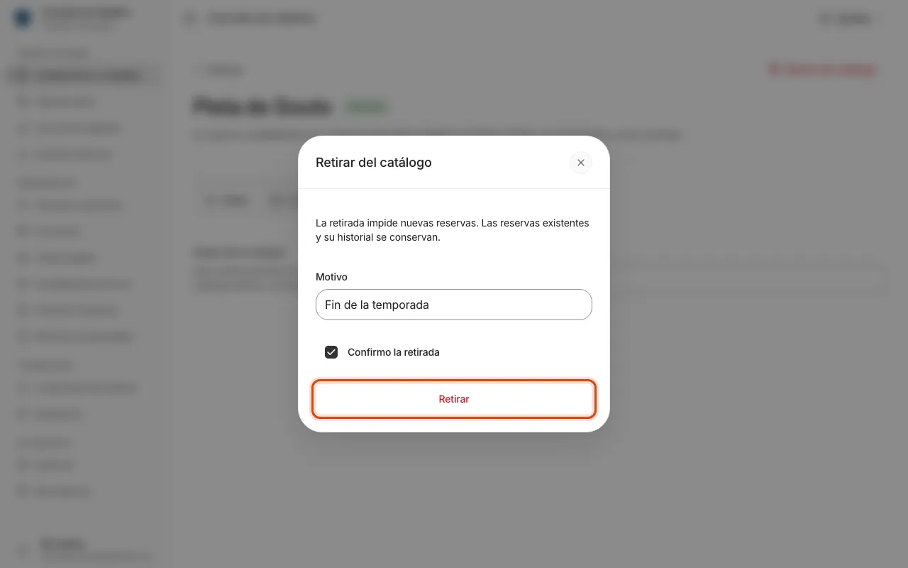

*La ventana explica que la retirada impide nuevas reservas y que las reservas existentes y su historial se conservan.*

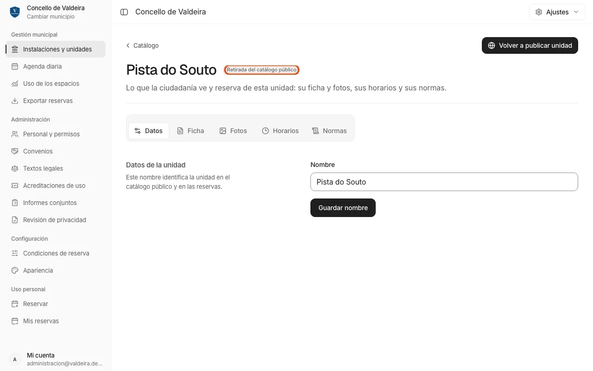

*La etiqueta cambia a «Retirada del catálogo público» y aparece «Volver a publicar unidad» por si se quiere ofrecer de nuevo. Retirar no es lo mismo que cerrar un día ni que borrar datos.*

### Resultado

La instalación y su unidad quedan en el catálogo con su ficha, sus normas y su horario, y cada cambio queda registrado con su motivo. Las reservas ya confirmadas no se invalidan: los cambios incompatibles con ellas se rechazan.

## CU-05 — Consultar el uso de los espacios o exportar datos municipales

«Uso de los espacios» resume cuánto se reservan las instalaciones del municipio, cómo evoluciona la ocupación y cuándo hay más demanda. Para trabajar con las reservas una a una, «Exportar reservas» descarga un archivo. Las cifras describen reservas, no asistencia real.

**Antes de empezar:** necesitas verificación en dos pasos y el permiso de consultar el uso de los espacios. Para exportar necesitas además el permiso de exportar datos y el de consultar o gestionar reservas en el mismo ámbito, y haber verificado el segundo factor hace poco. **Especificación:** [CU-05](../08_casos_de_uso.md#cu-05--consultar-el-uso-de-los-espacios-o-exportar-datos-municipales).

### Paso a paso

1. **Abre «Uso de los espacios».** En **Gestión**, pulsa **Uso de los espacios**. La pantalla abre con el periodo inicial del municipio y todos los espacios que puedes analizar.

   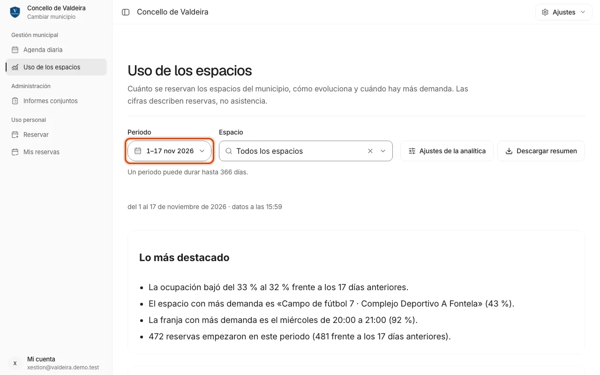

   *Arriba están el periodo, el espacio, los ajustes de la analítica y «Descargar resumen». Debajo, «Lo más destacado» resume en frases la ocupación, el espacio y la franja con más demanda y el número de reservas.*

2. **Cambia el periodo.** Pulsa el selector de periodo. Puedes elegir un atajo (esta semana, este mes, el mes pasado, los últimos 30 días) o marcar el primer y el último día en el calendario.

   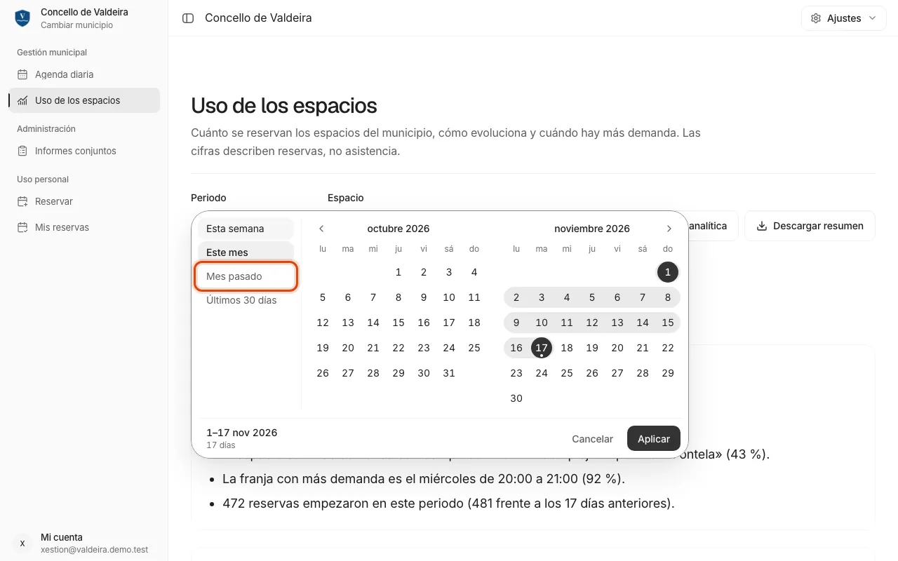

   *El calendario muestra dos meses y marca el periodo actual. Abajo se ven el periodo elegido, su número de días y los botones «Cancelar» y «Aplicar».*

   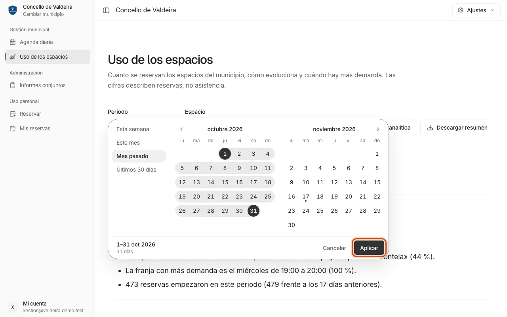

   *Al elegir el atajo se marca el mes anterior completo y abajo se leen sus fechas y su número de días. El cambio se aplica al pulsar «Aplicar».*

   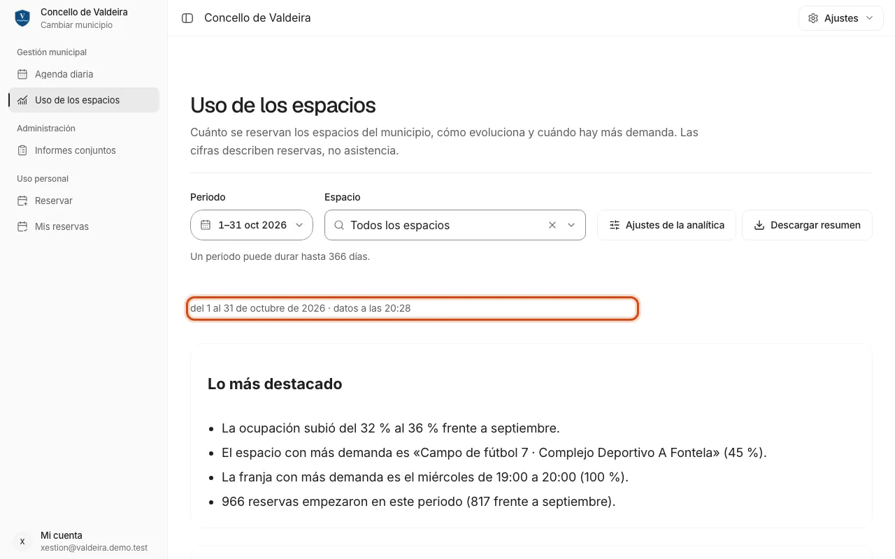

   *La pantalla se actualiza sola: la línea señalada confirma el periodo y la hora de los datos, y «Lo más destacado» compara ahora con el mes anterior a ese.*

3. **Lee el resumen y las secciones.** Desplázate por la pantalla. Cada sección compara con el periodo anterior cuando tiene sentido.

   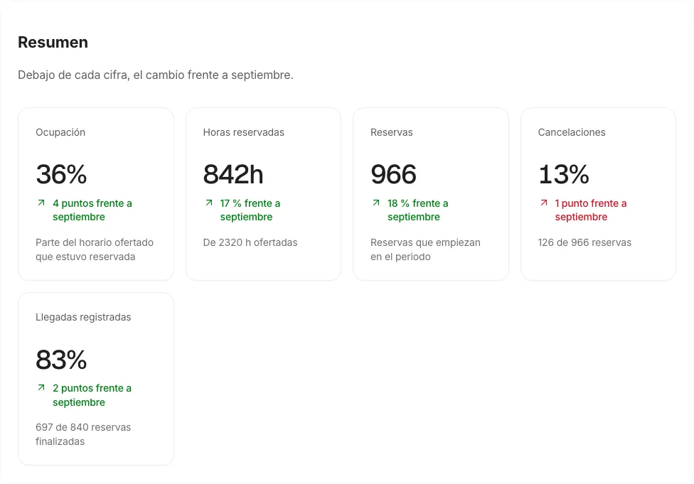

   *Cada tarjeta muestra una cifra y, debajo, el cambio frente al periodo anterior, en verde si sube y en rojo si empeora. Las horas reservadas se acompañan de las horas ofertadas.*

   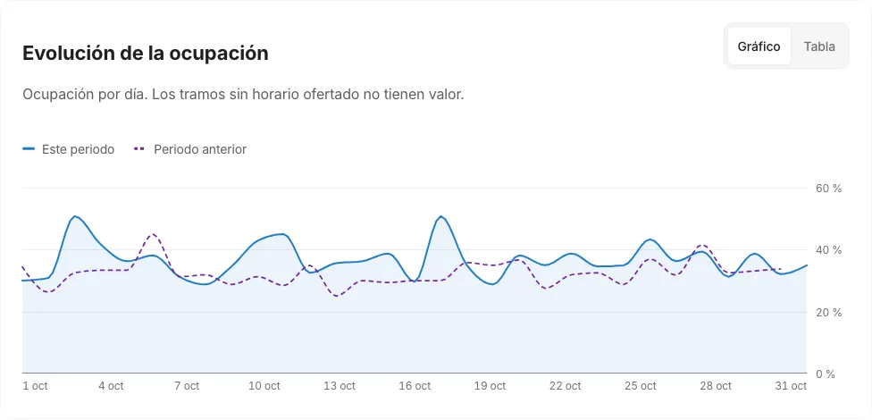

   *La línea continua es este periodo y la discontinua, el anterior. El texto aclara que los tramos sin horario ofertado no tienen valor; los botones «Gráfico» y «Tabla» cambian la forma de verlo.*

   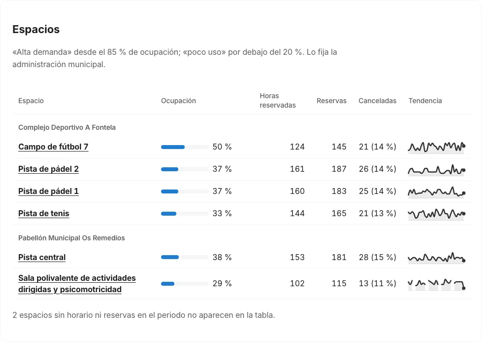

   *Los espacios se agrupan por instalación. El texto superior explica los umbrales de «alta demanda» y «poco uso», y la nota final avisa de que un espacio sin horario ni reservas en el periodo no aparece en la tabla.*

   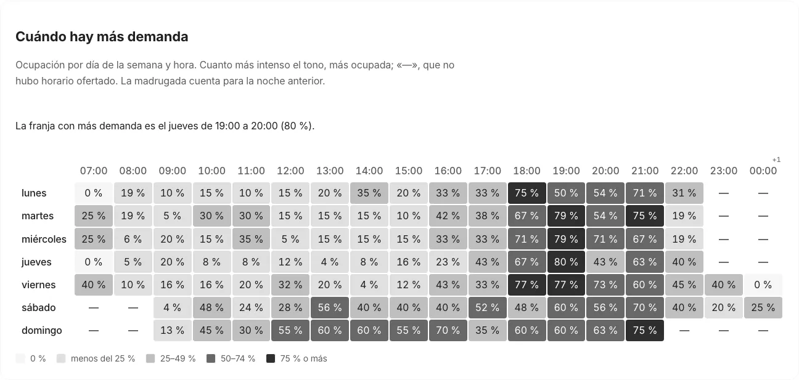

   *Cuanto más oscura la casilla, más ocupada esa hora; «—» significa que no hubo horario ofertado, no que la ocupación fuera cero.*

   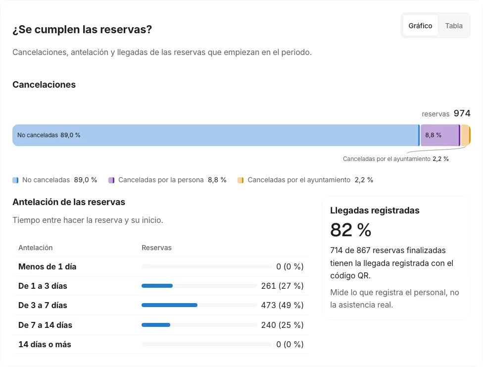

   *La barra separa las reservas no canceladas, las canceladas por la persona y las canceladas por el ayuntamiento. La tarjeta de llegadas recuerda que mide lo que registra el personal, no la asistencia real.*

4. **Elige un espacio por su nombre.** Pulsa el campo **Espacio** y elige uno de la lista.

   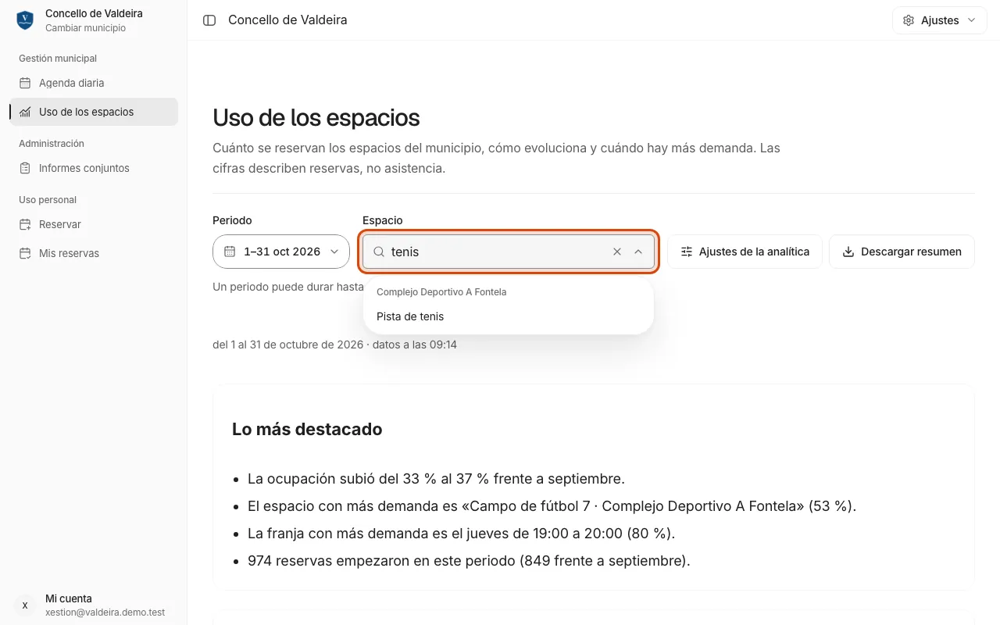

   *La lista agrupa los espacios por instalación. Un espacio retirado del catálogo aparece con la marca «retirado».*

   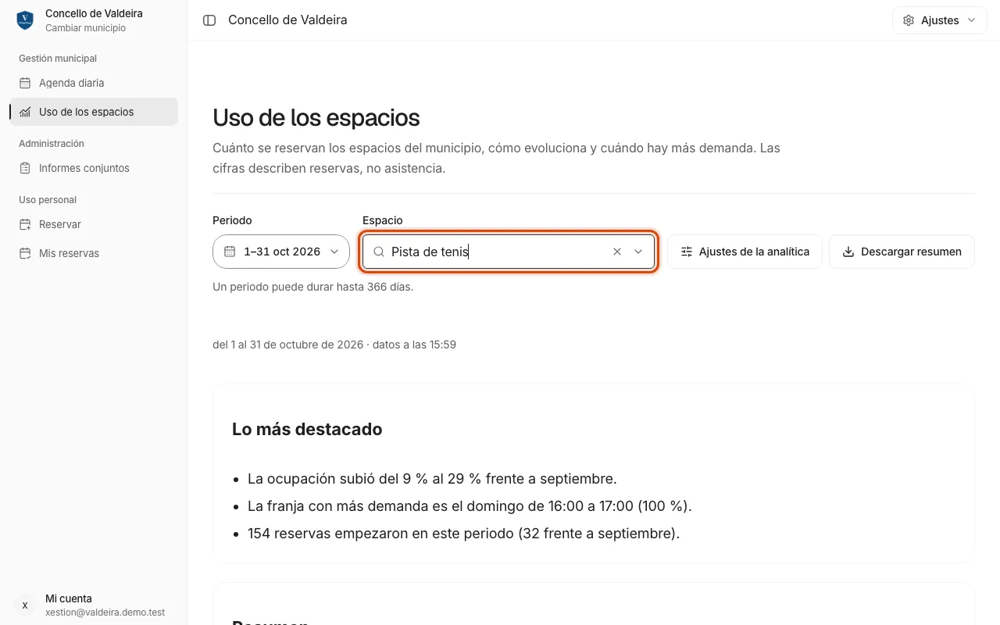

   *Toda la pantalla pasa a describir solo ese espacio, sin pulsar ningún otro botón. Para volver a todos, usa la «×» del campo.*

5. **Exporta las reservas.** Abre **Exportar reservas**. Elige el ámbito (todo el municipio o una unidad), el día inicial (incluido) y el final (excluido) y el formato: **Hoja de cálculo** o **Datos completos para otros sistemas**. Marca **Confirmo la descarga de datos del ámbito autorizado** y pulsa el botón de descarga.

   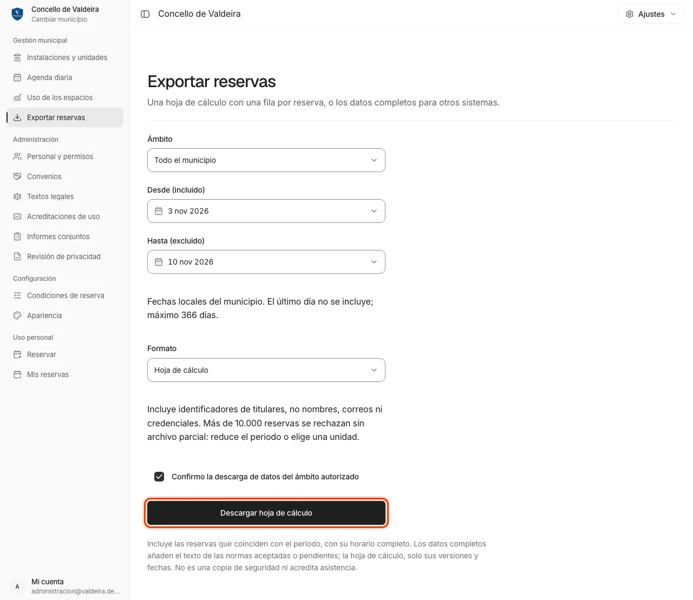

   *El formulario recuerda que el archivo incluye identificadores de titulares pero no nombres, correos ni credenciales, que el máximo son 366 días y que más de 10.000 reservas se rechazan sin archivo parcial.*

   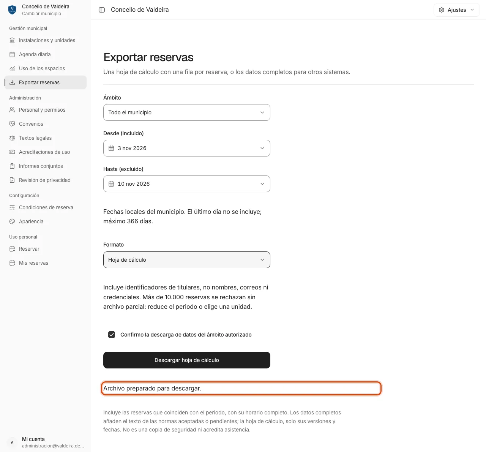

   *El mensaje confirma la descarga; el navegador guarda el archivo en la carpeta de descargas.*

6. **Abre el archivo.** La hoja de cálculo tiene una fila por reserva. Así se ven sus primeras líneas:

   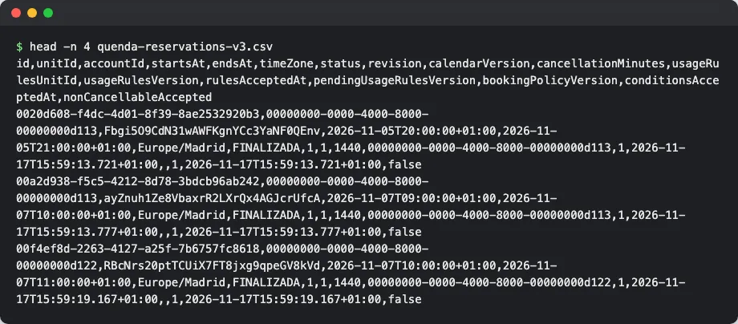

   *La primera línea nombra las columnas: identificadores de reserva, unidad y titular, inicio y fin, zona horaria, estado y versiones de calendario, normas y condiciones. Las columnas de normas aceptadas y pendientes permiten distinguir si la persona aceptó las normas o si tiene una versión pendiente.*

### Si algo no sale como se espera

#### No ves «Exportar reservas»

Sin el permiso de exportar datos, la opción no aparece en el menú, y si abres su dirección directamente la pantalla lo indica. Pide el permiso a la administración municipal (CU-12).

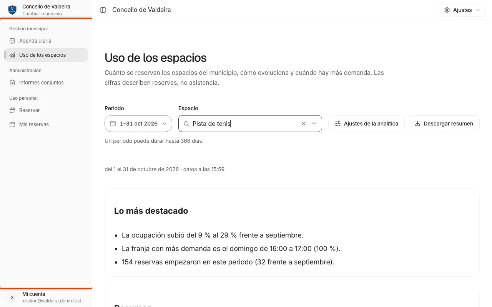

*El menú señalado solo muestra las secciones para las que este gestor tiene permiso.*

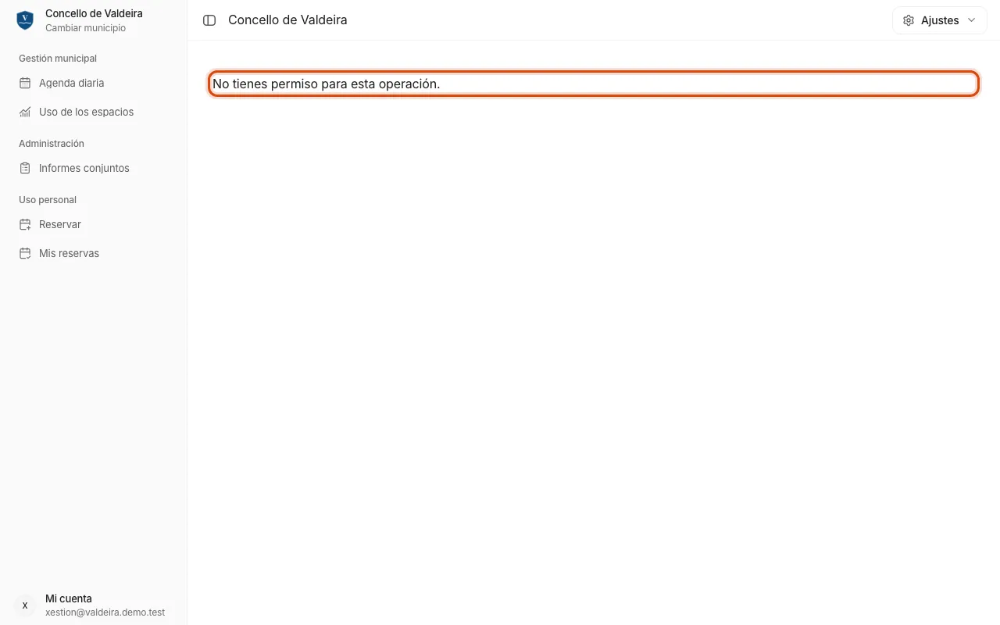

*Es lo que aparece al abrir «Exportar reservas» sin el permiso: no se muestra ningún dato.*

#### Tu permiso solo cubre algunos espacios

Si te concedieron el permiso sobre espacios concretos, solo puedes elegir esos espacios y no ves el total del municipio.

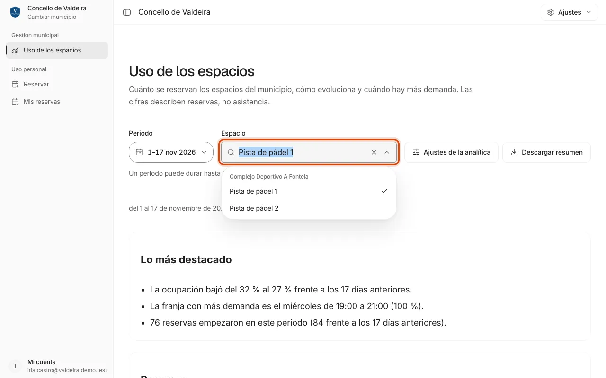

*La lista señalada ofrece únicamente los dos espacios autorizados y no incluye «Todos los espacios».*

#### El periodo de la exportación es demasiado largo

Una exportación de más de 366 días se rechaza y no se genera ningún archivo. Acorta el periodo y vuelve a descargar. Lo mismo ocurre si el resultado supera 10.000 reservas: reduce el periodo o elige una unidad.

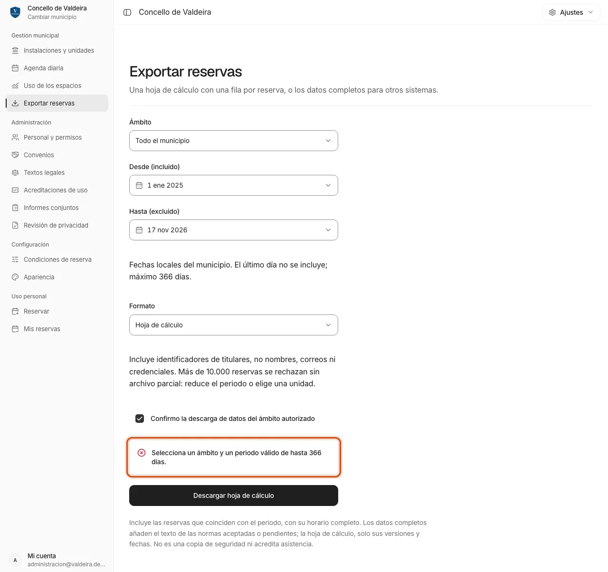

*El mensaje aparece sobre el botón de descarga y no se descarga nada.*

#### Quieres ver reservas de otro municipio del convenio

Un convenio no da acceso al historial de otros municipios: el uso de los espacios y la exportación solo incluyen el municipio en el que estás trabajando.

### Resultado

Obtienes los indicadores del ámbito que tienes autorizado, con el periodo y la hora de los datos a la vista, y, si tienes permiso, un archivo con las reservas de ese ámbito. Nada de esto acredita la asistencia real.

## CU-10 — Gestionar un convenio

Un convenio permite a varios municipios compartir instalaciones con unas condiciones acordadas: quién puede reservar, cuántas reservas por semana y durante qué vigencia. La administración de uno de los municipios redacta la versión, cada municipio aprueba esa misma versión y sus propias unidades, y después se activa.

**Antes de empezar:** necesitas ser administrador de tu municipio con verificación en dos pasos, conocer el identificador del otro municipio y de sus unidades y tener la referencia de la revisión jurídica. **Especificación:** [CU-10](../08_casos_de_uso.md#cu-10--gestionar-un-convenio).

### Paso a paso

1. **Abre los convenios.** En **Gestión**, pulsa **Convenios** y después **Nuevo convenio**.

   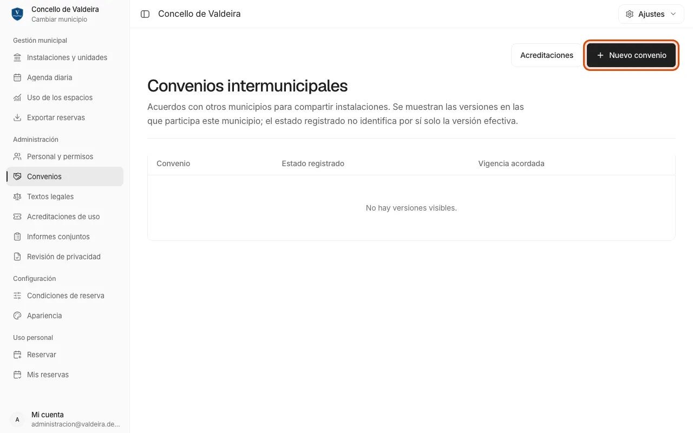

   *La tabla lista las versiones en las que participa el municipio; todavía no hay ninguna.*

2. **Redacta la versión.** Escribe el nombre, la vigencia (inicio y fin), la finalidad, la base jurídica, las responsabilidades y la conservación acordada. Elige el acceso (abierto o con acreditación) y, si quieres, un máximo de reservas por cuenta y semana. Añade tus unidades con **Añadir unidad municipal** y **Añadir unidad**. Con **Añadir participante**, escribe el identificador del otro municipio y de sus unidades. Marca **Confirmo la configuración del borrador** y pulsa **Crear borrador**.

   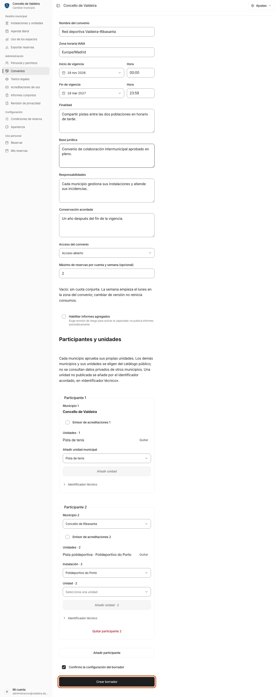

   *El convenio tiene acceso abierto y un máximo de 2 reservas por cuenta y semana. El texto bajo ese campo recuerda que cambiar de versión no reinicia los consumos; los datos de otros municipios se indican por su identificador, sin consultar sus datos privados.*

3. **Aprueba tu parte.** El borrador se abre en su página. Al final, marca **Confirmo esta versión y mis unidades** y pulsa **Aprobar versión**.

   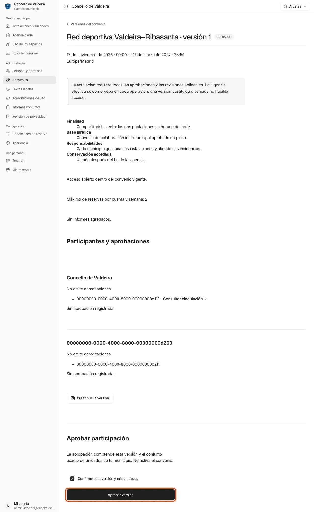

   *La página resume las condiciones y los participantes; ninguno tiene aún aprobación registrada. El texto aclara que la aprobación comprende esta versión y las unidades de tu municipio, y que no activa el convenio.*

4. **El otro municipio aprueba la misma versión.** Su administración ve el convenio en su lista, lo abre y aprueba su parte del mismo modo.

   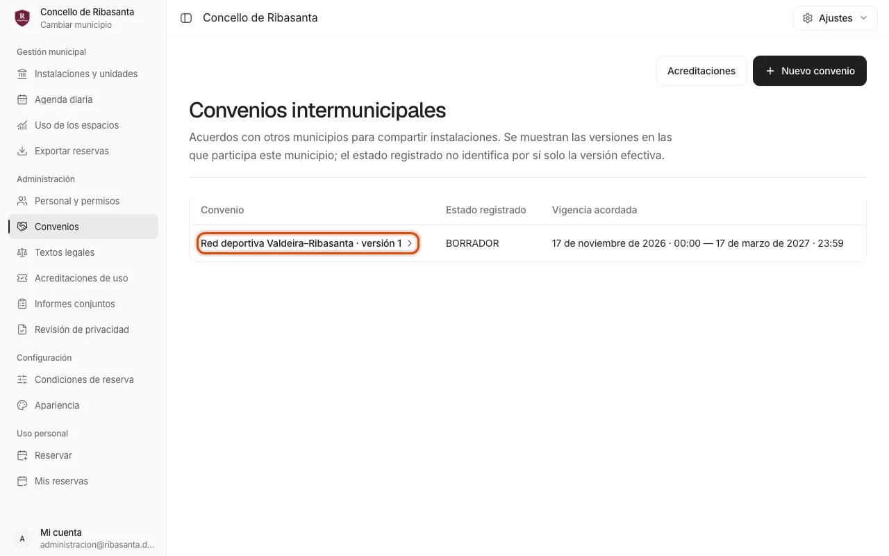

   *El otro municipio ve la misma versión, en borrador y con la vigencia acordada.*

   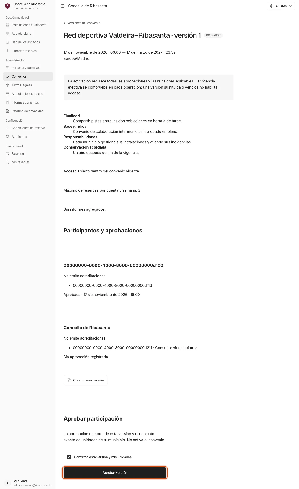

   *En la ficha ya consta «Aprobada» para el primer municipio; el segundo confirma su unidad y pulsa el botón señalado.*

5. **Activa el convenio.** Con todas las aprobaciones, la versión pasa a **APROBADO** y aparece **Activar convenio**. Escribe la **Referencia de revisión jurídica**, marca **Confirmo la activación de esta versión** y pulsa **Activar versión**.

   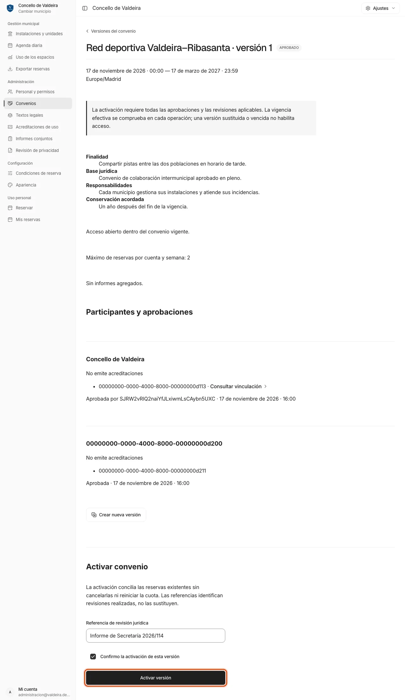

   *El texto explica que la activación concilia las reservas existentes sin cancelarlas ni reiniciar la cuota, y que la referencia identifica una revisión ya hecha, no la sustituye.*

   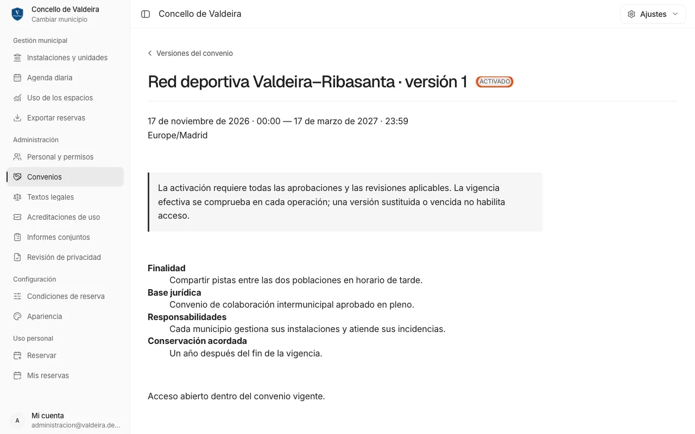

   *La etiqueta pasa a «ACTIVADO». La página muestra además la referencia de la revisión jurídica.*

### Si algo no sale como se espera

#### Has aprobado pero el convenio no se activa

Aprobar no activa: hacen falta las aprobaciones de todos los participantes. Mientras falte alguna, no aparece el botón de activar.

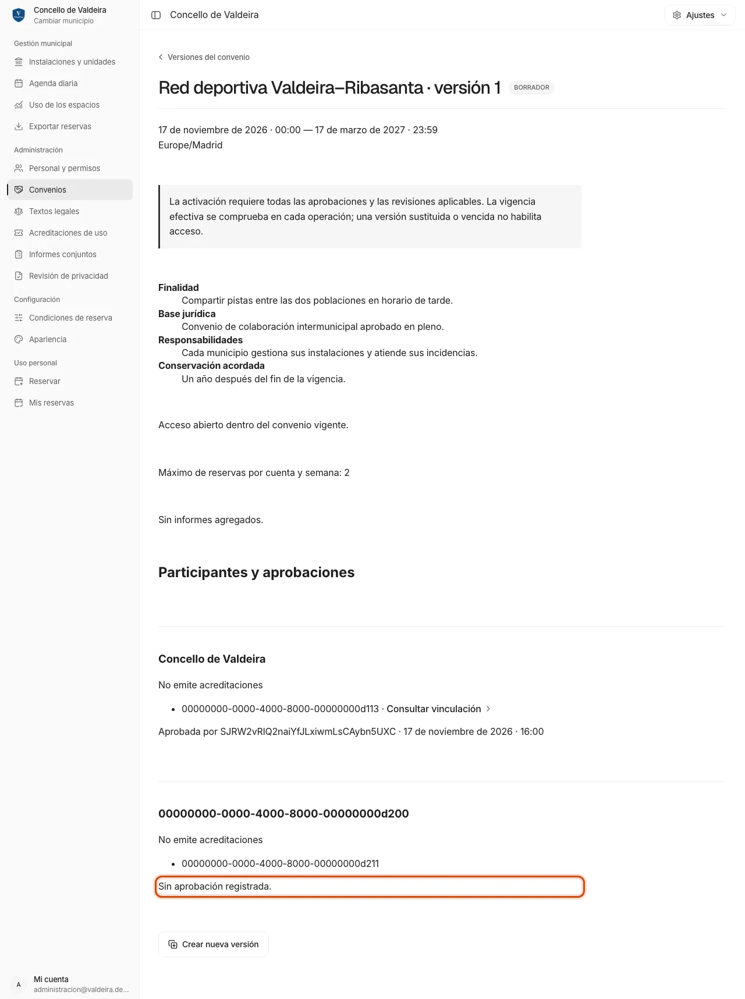

*El recuadro marca el participante que aún no ha aprobado. La sección de activación no aparece hasta que apruebe.*

#### Un participante necesita suspender el convenio

Cualquier participante puede suspenderlo con un motivo. En la versión activa, escribe el motivo en **Suspender convenio**, marca la confirmación y pulsa **Suspender convenio**.

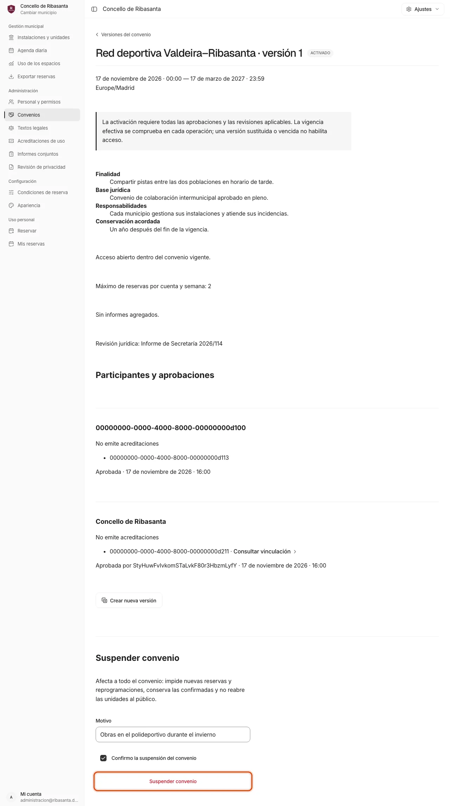

*El texto avisa de que la suspensión afecta a todo el convenio: impide nuevas reservas y reprogramaciones, conserva las confirmadas y no reabre las unidades al público.*

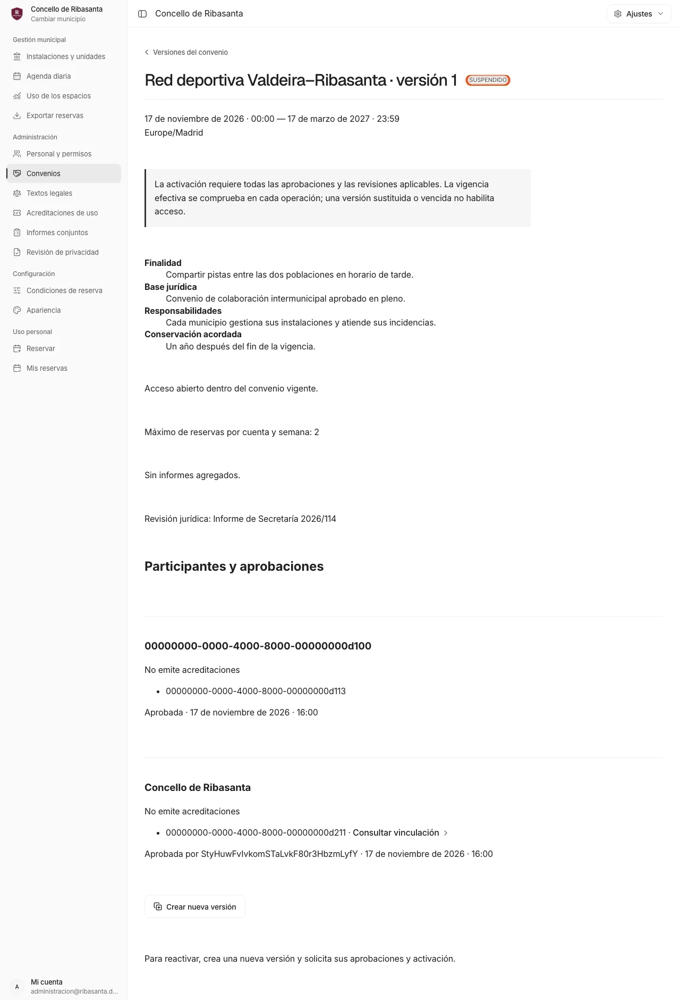

*La etiqueta cambia a «SUSPENDIDO» y al final se lee que, para reactivar, hay que crear una nueva versión y solicitar sus aprobaciones y su activación. El vencimiento de la vigencia tiene el mismo efecto sobre las reservas nuevas.*

#### La unidad no vuelve sola al acceso abierto

Tras suspender o vencer el convenio, cada unidad sigue vinculada a él. Para que la ciudadanía pueda volver a reservarla con normalidad, cada municipio retira la vinculación de sus unidades: pulsa **Consultar vinculación** junto a la unidad, escribe el motivo, confirma y pulsa **Retirar vinculación**.

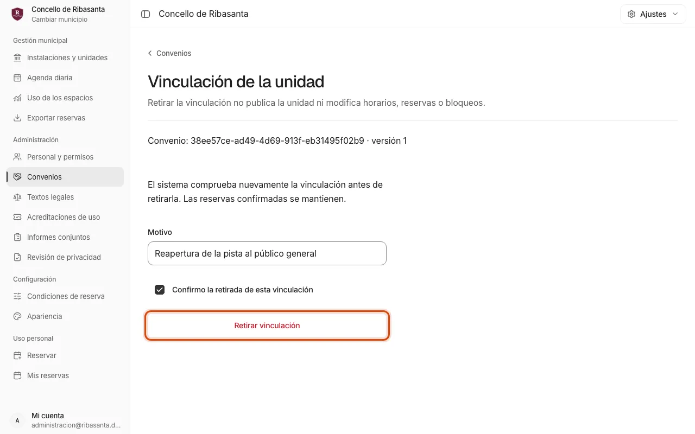

*La pantalla aclara que retirar la vinculación no publica la unidad ni cambia horarios, reservas o bloqueos, y que las reservas confirmadas se mantienen.*

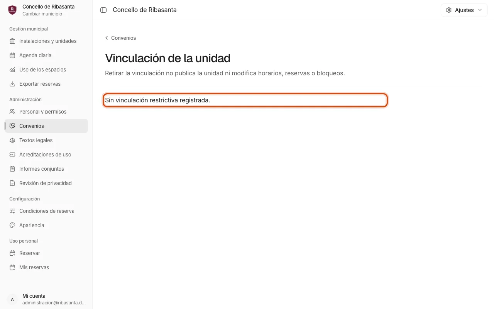

*La unidad ya no tiene ninguna vinculación con el convenio.*

#### Hay que cambiar o reactivar el convenio

Una versión aprobada no se edita: se crea otra. En la versión, pulsa **Crear nueva versión**, revisa los datos, marca la confirmación y pulsa **Crear versión**. La nueva versión necesita sus propias aprobaciones y su activación; la anterior se conserva.

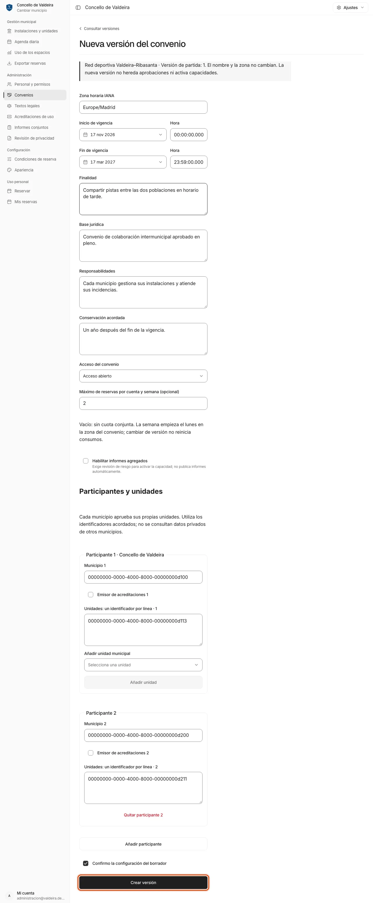

*El aviso superior indica la versión de partida y que la nueva no hereda aprobaciones ni activa capacidades. El nombre y la zona no cambian.*

*La versión 2 empieza en borrador y ningún participante la ha aprobado todavía.*

*La tabla conserva las dos versiones con su estado. El estado registrado no indica por sí solo cuál es la versión efectiva.*

### Resultado

El convenio queda activo solo en la versión aprobada por todos y durante su vigencia. Cada municipio sigue gestionando sus propias instalaciones y no ve los historiales de los demás.

## CU-12 — Delegar permisos y relevar responsables

La administración municipal decide quién gestiona el municipio y con qué permisos. Para hacerlo envía una invitación con permisos, ámbito y plazo; los permisos solo se activan cuando la persona invitada la acepta. Del mismo modo se retira a una persona o se releva a quien administra el municipio.

**Antes de empezar:** necesitas ser administrador del municipio y haber verificado el segundo factor hace poco. La persona invitada necesita una cuenta en Quenda con la verificación en dos pasos activada. **Especificación:** [CU-12](../08_casos_de_uso.md#cu-12--delegar-permisos-y-relevar-responsables).

### Paso a paso

1. **Abre «Personal y permisos».** En **Gestión**, pulsa **Personal y permisos**. Verás quién administra el municipio y, en las pestañas, los gestores, el formulario para invitar y la retirada por seguridad.

   

   *La tabla muestra cada responsable con su estado y su vigencia. El texto recuerda que la retirada ordinaria exige otro administrador habilitado sin caducidad.*

2. **Pide el identificador de cuenta.** No se busca a las personas por correo: la persona invitada consulta su identificador en **Mi cuenta → Datos personales** y te lo facilita.

   

   *El identificador aparece al final de la página, en letra monoespaciada.*

3. **Envía la invitación.** En **Invitar**, elige el tipo (**Gestor municipal** o **Administrador municipal**), pega el identificador e indica hasta cuándo puede aceptarla. Si el permiso debe caducar, rellena **Permiso válido hasta**. Añade cada permiso eligiendo la operación y el ámbito (todo el municipio o una unidad) y pulsando **Añadir permiso**. Marca **Confirmo la cuenta, el alcance y la vigencia** y pulsa **Enviar invitación**.

   

   *Se han añadido «Consultar reservas · Todo el municipio» y «Bloquear unidades · Pista central». El formulario recuerda que cada permiso es independiente y que los de privacidad requieren una concesión expresa.*

   

   *La invitación queda registrada, pero todavía no da ningún permiso.*

4. **La persona invitada acepta.** En **Mi cuenta → Invitaciones** ve la invitación pendiente con el municipio, el plazo y los permisos, y pulsa **Aceptar invitación**.

   

   *La tarjeta indica hasta cuándo puede aceptarse, que el permiso no caduca solo y los permisos exactos. Para aceptar hace falta la verificación en dos pasos completada en esta sesión.*

   

   *Tras aceptar, la invitación pasa al historial con la etiqueta «Activa» y los mismos permisos que se invitaron.*

5. **La persona ya gestiona su ámbito.** Al entrar en **Gestión** solo ve las secciones de sus permisos.

   

   *El menú señalado solo ofrece «Agenda diaria» y el uso personal; la agenda muestra las reservas que puede consultar.*

### Si algo no sale como se espera

#### La verificación en dos pasos ya no es reciente

Las operaciones sensibles, como aceptar una invitación, exigen haber verificado el segundo factor en los últimos cinco minutos. Si ha pasado más tiempo, Quenda lo pide de nuevo sin cerrar la sesión: pulsa **Verificar acceso**, escribe el código de tu aplicación de autenticación y vuelve a pulsar la acción.

*La invitación sigue pendiente. El aviso superior indica que la sesión sigue abierta y que los cambios se conservan.*

*La ventana recuerda que la verificación dura cinco minutos y que ninguna operación se ejecuta automáticamente: después hay que volver a pulsar «Aceptar invitación».*

#### Un gestor intenta gestionar el personal

Gestionar el personal es una facultad de la administración. Un gestor que abre esa sección no ve ningún dato.

*El menú lateral de la gestora sigue mostrando solo «Agenda diaria».*

#### Hay que retirar los permisos de un gestor

En **Gestores**, pulsa sobre la persona para ver el detalle de su concesión. Escribe el motivo, marca **Confirmo la revocación** y pulsa **Revocar concesión**.

*El detalle muestra quién invitó, cuándo se aceptó y los permisos concedidos. «Sustituir permisos» permite cambiarlos; la persona debe aceptar la nueva invitación.*

*Después de la revocación, la persona ya no puede abrir la gestión del municipio.*

#### Quieres dejar la administración, pero eres el único responsable

Para relevar a quien administra, primero hay que invitar a otro administrador. En **Invitar**, elige **Administrador municipal**. Si el permiso es temporal, indica **Permiso válido hasta**.

*El aviso del formulario aclara que la administración permite configurar el municipio y asignar permisos, pero no incluye permisos de privacidad.*

Mientras el otro administrador solo tenga un permiso temporal (o su invitación siga pendiente), tu retirada se rechaza.

*La tabla muestra al nuevo administrador habilitado, pero con una fecha de fin en «Vigencia». El texto del detalle recuerda que retirar el rol invalida las invitaciones pendientes que concedió esa persona.*

Si el sustituto ya tiene el permiso adecuado no necesita otra invitación: su permiso temporal puede hacerse indefinido. Pulsa sobre su cuenta, escribe el motivo, marca la confirmación y pulsa **Convertir en indefinido**.

*Antes del cambio, su vigencia tiene fecha de fin; después pasará a «Sin caducidad».*

*Los dos responsables ya están habilitados sin caducidad: el relevo es posible.*

#### Completar el relevo

Con otro responsable habilitado sin caducidad, quien se va abre su propia cuenta en la tabla, escribe el motivo, marca **Confirmo la retirada ordinaria** y pulsa **Retirar administración**.

*El texto recuerda que se retira el rol y se invalidan sus invitaciones pendientes, pero no se cierra la cuenta ni se borran reservas.*

*La persona que se retira vuelve a la pantalla de gestión sin municipios; el otro responsable sigue habilitado.*

#### Otros casos

- **Invitación inválida, caducada o de otra persona:** no concede ningún permiso. Si hay que ampliar los permisos, se envía una nueva invitación que también hay que aceptar.
- **Permisos de privacidad:** son independientes. Ni la administración ni la exportación de datos deportivos los incluyen.
- **Retirada por seguridad:** la pestaña **Retirada por seguridad** se usa ante un compromiso de la cuenta y sigue otro procedimiento (CU-16).

### Resultado

Los permisos quedan concedidos o retirados con su motivo y su fecha, sin elevar a nadie de forma implícita, y el municipio nunca se queda sin un responsable ordinario.

## CU-17 — Gestionar una acreditación de uso

Cuando un convenio exige acreditación, solo pueden reservar sus espacios las personas acreditadas. El municipio designado como **emisor** registra la acreditación después de su propia verificación administrativa, y puede revocarla. Quenda no deduce el derecho de la cuenta ni comprueba la residencia: solo registra lo que el emisor verificó.

**Antes de empezar:** necesitas ser administrador del municipio emisor, haber verificado el segundo factor hace poco y que la persona tenga cuenta vinculada a tu municipio. El convenio debe estar activo y exigir acreditación. **Especificación:** [CU-17](../08_casos_de_uso.md#cu-17--gestionar-una-acreditación-de-uso).

### Paso a paso

1. **Ve al convenio.** En **Gestión → Acreditaciones de uso**, pulsa **Emitir desde un convenio**: las acreditaciones se emiten desde la versión del convenio.

   

   *Esta pantalla explica que las acreditaciones no son reservas ni garantizan disponibilidad, y es donde se revocan las emitidas por el municipio.*

2. **Abre «Emitir acreditación».** En la versión activa del convenio, pulsa **Emitir acreditación**. El botón solo aparece si tu municipio es emisor y el convenio exige acreditación.

   

   *La página indica «Requiere acreditación vigente durante toda la reserva» y que el Concello de Valdeira es emisor de acreditaciones.*

3. **Registra la acreditación.** Elige la **Persona beneficiaria**, la fecha y hora de inicio y de fin y la **Referencia de verificación** (por ejemplo, el número de expediente). Marca **Confirmo la verificación y la vigencia indicadas** y pulsa **Emitir acreditación**.

   

   *La pantalla recuerda que la cuenta debe estar vinculada al municipio y que la acreditación no garantiza por sí sola una reserva. La referencia debe ser mínima: no se adjuntan documentos.*

4. **Guarda el identificador.** Quenda conserva la acreditación y su emisor, y muestra su identificador.

   

   *Debajo del mensaje está el identificador de la acreditación y un acceso directo para revocarla.*

5. **La persona acreditada reserva.** Al confirmar una reserva en un espacio del convenio, Quenda comprueba que la acreditación cubra todo el intervalo.

   

   *Con la acreditación vigente, la reserva se confirma como cualquier otra.*

### Si algo no sale como se espera

#### La persona no tiene acreditación

Sin una acreditación vigente que cubra toda la reserva, la reserva no se confirma y la persona ve a quién dirigirse.

*La persona ha aceptado las normas, pero al pulsar «Confirmar reserva» aparece el mensaje señalado y no se reserva nada. Lo mismo ocurre si la acreditación es insuficiente o de un emisor no autorizado, y si falla la comprobación: un fallo técnico tampoco concede el derecho.*

#### Hay que revocar una acreditación

En **Acreditaciones de uso**, elige la acreditación emitida (o usa su identificador con **Usar una referencia conocida**), escribe el motivo, marca **Confirmo la revocación** y pulsa **Revocar acreditación**.

*El texto recuerda que puede revocarse aunque el convenio esté suspendido y que las reservas confirmadas se conservan.*

*La revocación queda registrada con el identificador de la acreditación.*

Desde ese momento, la acreditación ya no sirve para nuevas reservas o cambios:

*La misma persona que reservó en el paso 5 ya no puede confirmar otra reserva en el espacio del convenio.*

#### Otros casos

- Cancelar una reserva o aceptar unas normas pendientes no vuelve a comprobar la acreditación.
- En un convenio de acceso abierto no hace falta acreditación.
- Quenda no ofrece búsquedas de personas, documentos adjuntos ni comprobación automática de residencia.

### Resultado

El derecho de uso queda registrado (o revocado) con su emisor, su vigencia y su referencia, y la comprobación al reservar no expone expedientes de nadie.

## CU-18 — Consultar un informe conjunto

Si un convenio tiene habilitados los informes agregados, cada mes cerrado se prepara un informe con cifras conjuntas de los municipios participantes. Solo lo recibe una persona con permiso de informes en su municipio y con evaluaciones de privacidad favorables para su cuenta. Las cifras son agregadas y describen reservas, no asistencia.

**Antes de empezar:** necesitas verificación en dos pasos y el permiso de consultar el uso de los espacios en tu municipio. Las administraciones participantes deben haber evaluado el riesgo para tu cuenta y el mes debe estar preparado. **Especificación:** [CU-18](../08_casos_de_uso.md#cu-18--consultar-un-informe-conjunto).

### Paso a paso

1. **El mes cerrado se prepara.** Cuando termina un mes, el personal técnico ejecuta el proceso de preparación del informe de cada convenio. Ese proceso calcula el agregado y deja el mes listo para su revisión.

   

   *La respuesta confirma el convenio, el mes, la revisión preparada (1) y el corte, es decir, el momento al que corresponden los datos.*

2. **Escribe el identificador del convenio.** En **Gestión → Informes conjuntos**, escribe el identificador del convenio que te facilite la administración municipal.

   

   *La página avisa de que cada entrega se registra y de que no admite filtros adicionales ni selección de revisiones.*

3. **Elige el mes y consulta.** En **Mes publicado**, elige el mes y pulsa **Consultar informe**.

   

   *Solo se elige un convenio y un mes cerrado; no hay fechas arbitrarias ni filtros por personas o municipios.*

4. **Recibe el informe.** Si el permiso y las evaluaciones son favorables, aparece **Informe autorizado** con las cifras del mes.

   

   *Además de las cifras, el informe muestra la revisión, la versión del control aplicado y el corte. Cada entrega queda registrada con su destinatario.*

### Si algo no sale como se espera

#### El informe sale «No publicable»

Mientras falte una evaluación favorable para tu cuenta, o si el total o la contribución de algún municipio no llega al umbral establecido, el informe aparece como «No publicable». No significa que la cifra sea cero: significa que no se puede entregar.

*No se muestra ninguna cifra. Pide a las administraciones participantes que revisen el informe para tu cuenta.*

#### Cómo revisan las administraciones el informe

Cada administración participante abre **Gestión → Revisión de privacidad**, elige el convenio, el mes preparado, el municipio destinatario y la persona destinataria (o escribe la referencia de cuenta que le facilitó el otro municipio), y pulsa **Consultar contexto de revisión**.

*La página aclara que una evaluación favorable no publica el informe ni concede permisos al destinatario, y pide no introducir datos personales.*

Después elige la **Decisión**, escribe las referencias de la revisión, marca la confirmación y pulsa **Registrar evaluación**.

*El contexto muestra el convenio, el mes, la revisión y la cuenta destinataria. Las referencias documentan la revisión humana; no acreditan anonimato.*

*La evaluación queda registrada. Si cambia el historial de entregas, hay que actualizar el contexto y revisar de nuevo.*

#### Una evaluación posterior es desfavorable

Si una administración registra después una evaluación desfavorable para tu cuenta, el informe deja de entregarse.

*El mismo mes que antes estaba autorizado vuelve a mostrarse como «No publicable», sin cifras.*

#### Otros casos

- Si existe riesgo de que las cifras permitan reconstruir datos de personas, el informe no se publica; corregir un mes exige revisarlo junto con las entregas anteriores.
- No hay filtros demográficos, fechas arbitrarias ni detalle por persona o por municipio.

### Resultado

Recibes el informe autorizado o una supresión expresa («No publicable»), sin que se revelen historiales de nadie. Queda registrado quién lo recibió, con qué corte y con qué versión del control.

## CU-23 — Configurar la apariencia pública

La administración municipal da al municipio su nombre visible, su logo y su identidad visual, que se ven en la página pública y en la gestión. Los cambios de tema se prueban al momento en la pantalla y nadie más los ve hasta que se guardan.

**Antes de empezar:** necesitas ser administrador del municipio y haber verificado el segundo factor hace poco para guardar. **Especificación:** [CU-23](../08_casos_de_uso.md#cu-23--configurar-la-apariencia-pública).

### Paso a paso

1. **Cambia el nombre visible.** En **Gestión → Apariencia**, escribe el nombre en **Nombre visible** y pulsa **Guardar nombre**. El nombre se guarda por separado del resto.

   

   *La sección «Identidad» indica el nombre oficial de alta y que el nombre visible aparece en toda la aplicación. El texto de la página recuerda que cada persona solo elige si lo ve en claro u oscuro.*

   

   *El nuevo nombre aparece al instante en el menú lateral y en la barra superior.*

2. **Sube el logo para fondo oscuro.** En **Logo para fondo oscuro**, pulsa **Subir** y elige una imagen PNG, JPG o WebP. El logo principal se cambia igual, con **Cambiar**, y se quita con **Quitar**.

   

   *La vista previa sobre fondo oscuro confirma que el logo se ha guardado. Si no se sube, en modo oscuro se usa el logo principal.*

3. **Elige un tema del catálogo.** En **Tema**, pulsa el tema actual y elige otro de la lista.

   

   *Cada tema trae su versión clara y oscura.*

   

   *Los colores de toda la pantalla cambian al momento. Abajo aparece la barra «Cambios sin guardar» con «Descartar» y «Guardar»: todavía no se ha publicado nada.*

4. **Ajusta los detalles.** En el modo que estás viendo (claro u oscuro) puedes cambiar el acento, el fondo y el texto escribiendo el color en hexadecimal, además de la tipografía, las esquinas y el modo inicial.

   

   *Junto al acento modificado aparece un icono para volver al color del tema. Las esquinas pasan a «Suaves».*

5. **Guarda.** Pulsa **Guardar** en la barra inferior. Quenda comprueba tus permisos, el contraste y que nadie haya guardado antes otra versión.

   

   *En este caso la verificación ya se ha repetido (ver «La verificación en dos pasos ya no es reciente»); la barra recuerda que la verificación no envía la operación automáticamente y hay que volver a pulsar «Guardar».*

   

   *La barra de cambios desaparece y el mensaje confirma que la apariencia ya es pública.*

6. **Comprueba la página pública.** La página del municipio usa el nuevo nombre, el logo y los colores.

   

   *Una persona sin sesión ya ve el nuevo nombre en la cabecera y en el recorrido de reserva, y el fondo y los botones del tema elegido.*

### Si algo no sale como se espera

#### El logo no se acepta

Un logo en SVG, de menos de 32 píxeles por lado o más de cuatro veces más ancho que alto (o al revés) se rechaza y no se guarda. Exporta la imagen como PNG, JPG o WebP con un tamaño adecuado y vuelve a subirla.

*El logo anterior se mantiene en la vista previa.*

*El mensaje enumera los requisitos: PNG, JPG o WebP de hasta 2 MB, de al menos 32 píxeles por lado y proporciones de hasta 4 a 1.*

#### Los colores no tienen contraste suficiente

Antes de guardar, Quenda señala la combinación que no se lee bien y desactiva **Guardar**. Corrige el color o pulsa **Descartar**. Si una combinación así llegara al servidor, también se rechazaría.

*El color de texto #C8D2E0 sobre el fondo claro no llega al contraste exigido; el botón «Guardar» aparece en gris.*

#### Has recargado la página antes de guardar

El borrador sin guardar se conserva en la pestaña aunque navegues o recargues.

*Tras recargar, la pantalla recupera el borrador y lo indica con el mensaje señalado.*

#### La verificación en dos pasos ya no es reciente

Para guardar hace falta haber verificado el segundo factor en los últimos cinco minutos. Si no, aparece un aviso: pulsa **Verificar acceso**, escribe el código y vuelve a pulsar **Guardar**. Tus cambios se conservan.

*La sesión sigue abierta; mientras tanto, «Guardar nombre» aparece desactivado.*

#### Otra persona guardó antes que tú

Si otra persona (u otra pestaña) guarda la apariencia mientras tú editas, tu guardado se rechaza para no sobrescribir su cambio. Pulsa **Descartar**: la pantalla vuelve a leer la configuración actual y puedes repetir tus cambios sobre ella.

*Las esquinas elegidas en esta pestaña no se guardan; al descartar se muestran las que guardó la otra persona.*

#### Quieres volver a la apariencia por defecto

Pulsa **Restaurar valores predeterminados** y después **Guardar**. Vuelve el tema neutro sin ajustes y el modo claro.

*Restaurar solo cambia el borrador: hasta pulsar «Guardar» no se publica.*

#### Otros casos

- La elección personal de claro u oscuro de cada persona prevalece sobre el modo inicial del municipio.
- No se admite CSS ni estilos por componente: solo el catálogo de temas y sus ajustes.

### Resultado

El nombre, el logo y la apariencia quedan guardados solo para tu municipio y se aplican a su página pública y a su gestión.
