# Guía de casos de uso · Operación de plataforma

Esta guía es para el equipo que opera una instancia de Quenda: los operadores de plataforma, que incorporan municipios y contienen cuentas comprometidas, y el personal de operación autorizado, que ejecuta las recuperaciones excepcionales con credenciales de mantenimiento. También recoge lo que hace la administración municipal cuando retira el acceso de una persona de su equipo por seguridad. En las imágenes, el recuadro naranja señala dónde hay que pulsar o escribir.

## Índice

- [CU-06 — Incorporar un municipio](#cu-06--incorporar-un-municipio)
- [CU-16 — Contener un compromiso y recuperar acceso](#cu-16--contener-un-compromiso-y-recuperar-acceso)

## CU-06 — Incorporar un municipio

Sirve para dar de alta un municipio nuevo en la instancia y dejar preparada la invitación de su primera persona administradora. Lo hace un operador de plataforma cuando el municipio ya ha decidido quién lo administrará. El alta no da al operador acceso a los datos del municipio, y la administración solo queda habilitada cuando la persona invitada acepta.

**Antes de empezar:** necesitas una cuenta con permiso de operador y haber completado la verificación en dos pasos en los últimos cinco minutos. Necesitas el correo electrónico de la futura persona administradora. Para aceptar, esa persona necesitará una cuenta de Quenda con ese correo verificado y la verificación en dos pasos activada; puede crearla después del alta. **Especificación:** [CU-06](../08_casos_de_uso.md#cu-06--incorporar-un-municipio).

### Paso a paso

1. **Confirma el correo de la persona destinataria.** La invitación se dirige a un correo electrónico. Si la futura persona administradora ya usa Quenda, conviene que confirme cuál es el correo con el que accede: lo ve en **Mi cuenta › Datos personales**.

   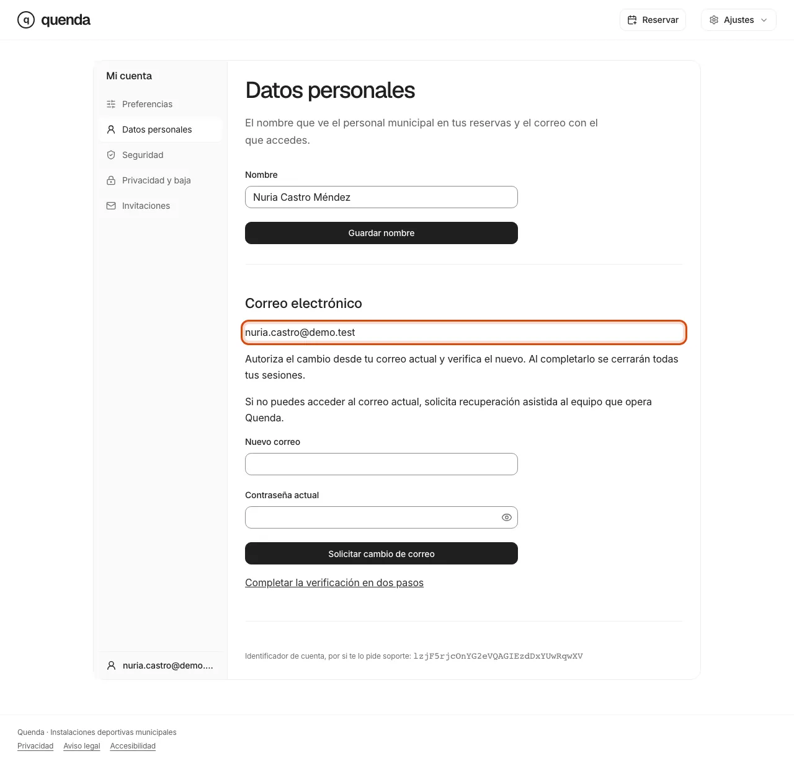

   *El recuadro marca el correo de la cuenta, «nuria.castro@demo.test». Es la dirección que el operador escribirá en el alta; solo la cuenta que tenga ese correo verificado podrá aceptar la invitación.*

2. **Entra en la administración de plataforma.** Con tu cuenta de operador, abre **Gestión** y pulsa **Administración de plataforma**.

   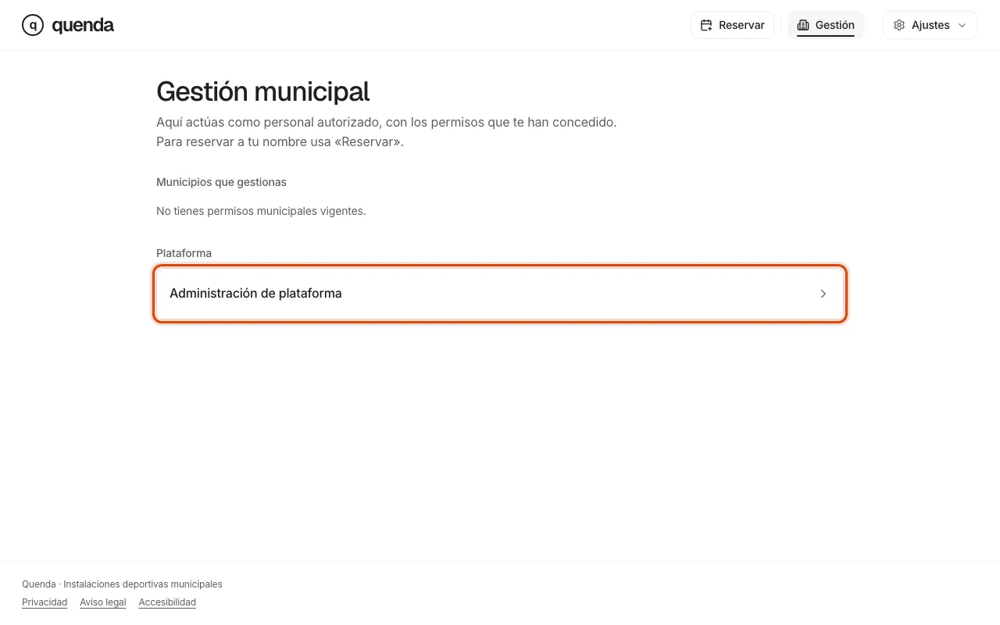

   *El operador no gestiona ningún municipio («No tienes permisos municipales vigentes»), pero ve el apartado Plataforma con el acceso recuadrado.*

3. **Abre «Incorporar municipio».** En el menú lateral, dentro de **Municipios**, pulsa **Incorporar municipio**.

   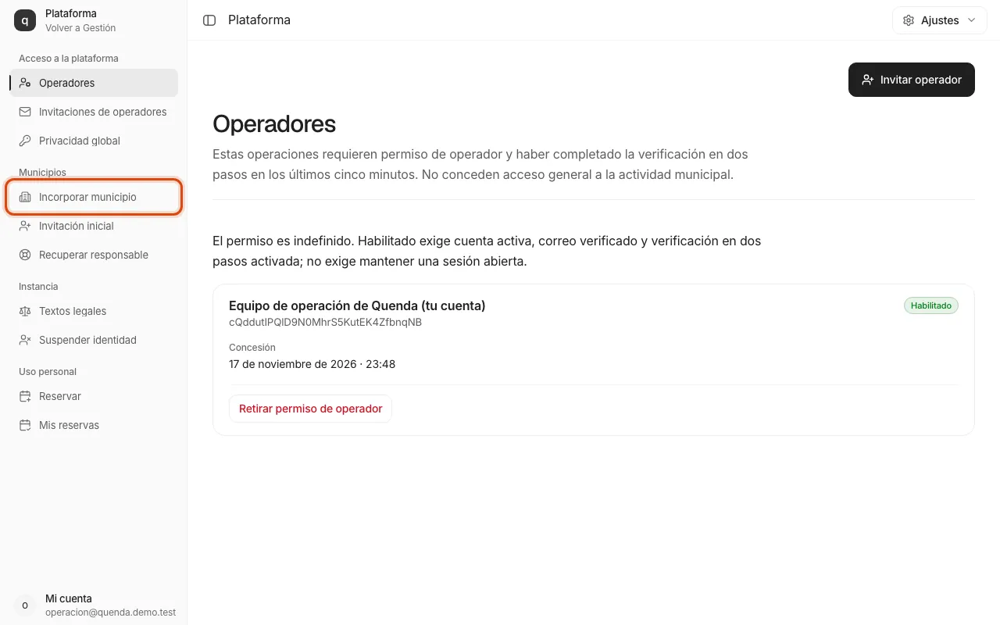

   *Se abre la plataforma por la lista de Operadores, donde figura tu propia cuenta como habilitada; la opción del menú que hay que pulsar está recuadrada.*

4. **Rellena el alta y regístrala.** Escribe el nombre del municipio, su zona horaria en formato IANA (por ejemplo `Europe/Madrid`), el correo de la persona destinataria y la fecha y hora límite para aceptar. Marca la casilla de confirmación y pulsa **Registrar municipio**.

   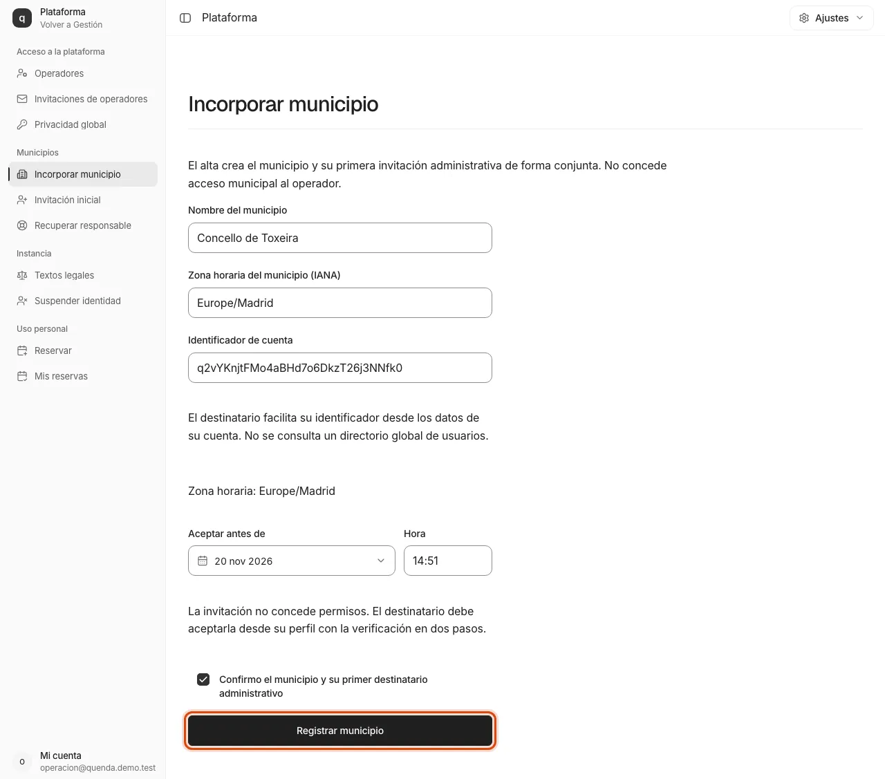

   *El formulario recuerda que el alta crea el municipio y su primera invitación a la vez y que la invitación no concede permisos hasta que se acepta. Bajo «Correo del destinatario» explica que solo puede aceptarla la cuenta cuyo correo verificado sea esa dirección. El botón recuadrado envía el alta.*

5. **Comprueba el registro.** Quenda confirma el alta y muestra los identificadores del municipio y de la invitación. Guarda el del municipio: lo necesitarás para cualquier intervención posterior.

   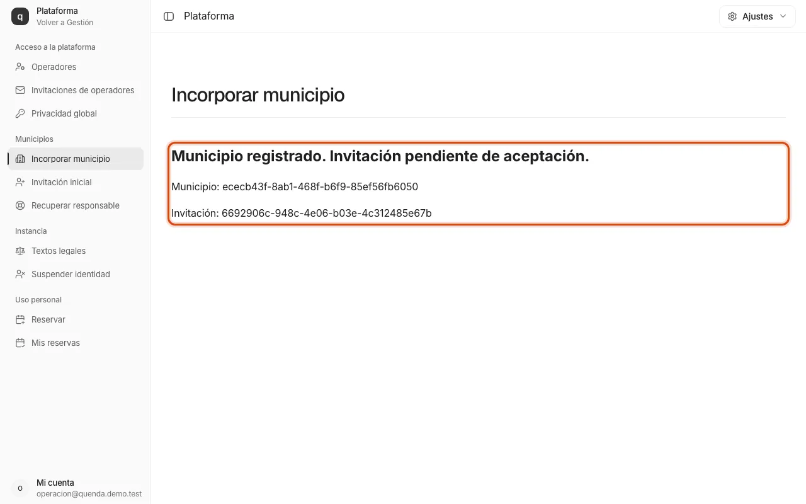

   *El mensaje recuadrado dice «Municipio registrado. Invitación pendiente de aceptación.» y debajo aparecen los dos identificadores.*

6. **La persona destinataria acepta la invitación.** Desde **Mi cuenta › Invitaciones**, con la verificación en dos pasos completada en esa sesión, pulsa **Aceptar invitación**.

   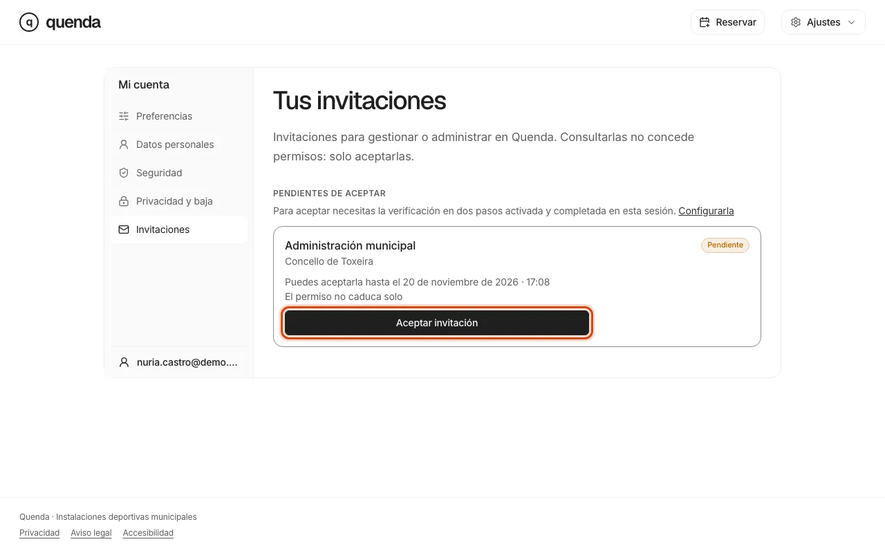

   *La tarjeta indica el rol (Administración municipal), el municipio, la fecha límite para aceptarla y que el permiso no caduca solo. El botón recuadrado completa la aceptación.*

7. **La invitación queda aceptada.** La tarjeta pasa al historial con la etiqueta **Aceptada**.

   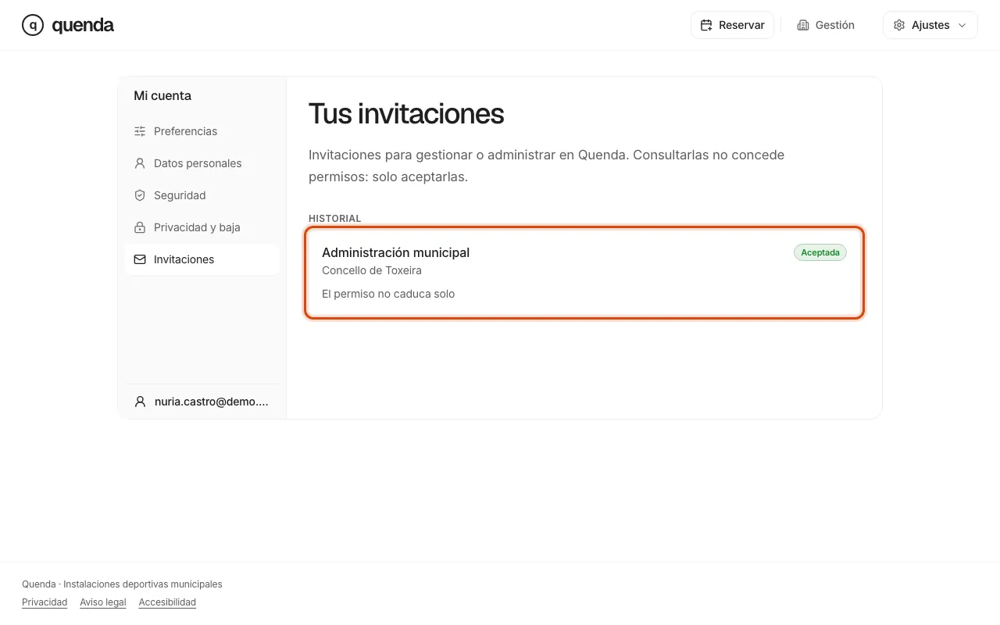

   *La invitación recuadrada figura como Aceptada y en la cabecera aparece ya el acceso Gestión.*

8. **El municipio aparece en Gestión.** La nueva persona administradora abre **Gestión** y encuentra su municipio en «Municipios que gestionas».

   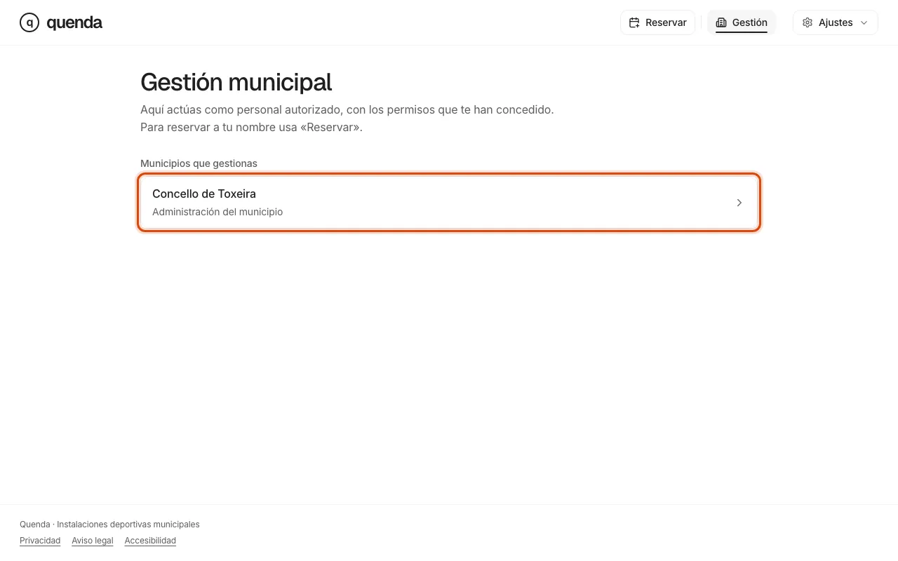

   *El municipio recuadrado aparece con el rol «Administración del municipio». Al pulsarlo se entra en su gestión.*

9. **Empieza la administración del municipio.** Se abre la gestión municipal, todavía vacía. Desde **Personal y permisos** la persona administradora puede invitar a su equipo.

   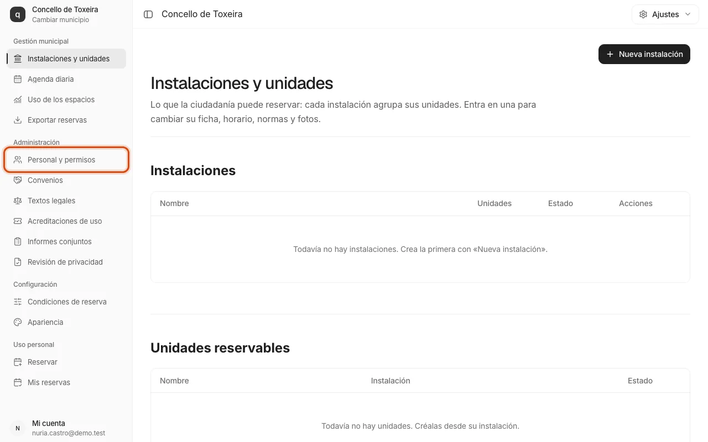

   *La página Instalaciones y unidades indica que todavía no hay instalaciones; en el menú lateral está recuadrado Personal y permisos, el siguiente paso habitual.*

### Si algo no sale como se espera

#### La zona horaria no es válida

Quenda solo acepta nombres de zona horaria IANA. Si escribes, por ejemplo, «Madrid», el alta no se envía y aparece un aviso junto al botón. Corrige el campo y vuelve a registrar.

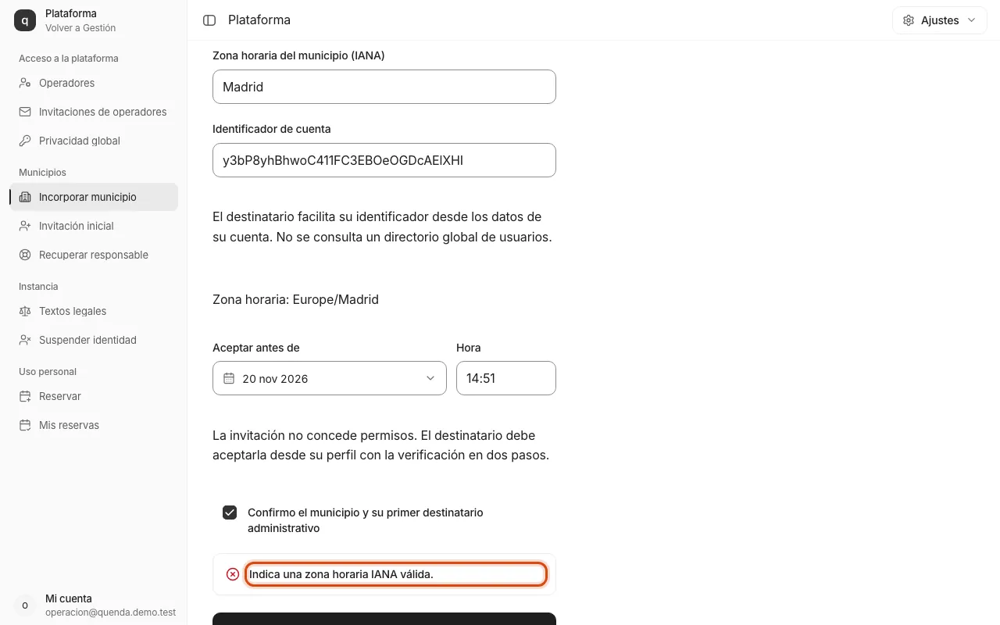

*Bajo la casilla de confirmación aparece el aviso recuadrado «Indica una zona horaria IANA válida.», justo encima del botón Registrar municipio. Los datos del formulario se conservan: basta con corregir la zona horaria y volver a pulsar el botón.*

#### El correo todavía no tiene cuenta

Quenda no comprueba si existe una cuenta con ese correo, para no revelar quién está registrado: el alta se registra igual. La invitación espera a que alguien cree una cuenta con esa dirección, la verifique y active la verificación en dos pasos; entonces aparece en su **Mi cuenta › Invitaciones**. Si el correo estaba mal escrito, nadie podrá aceptarla: sustitúyela como se explica en «La invitación se envió a un correo equivocado».

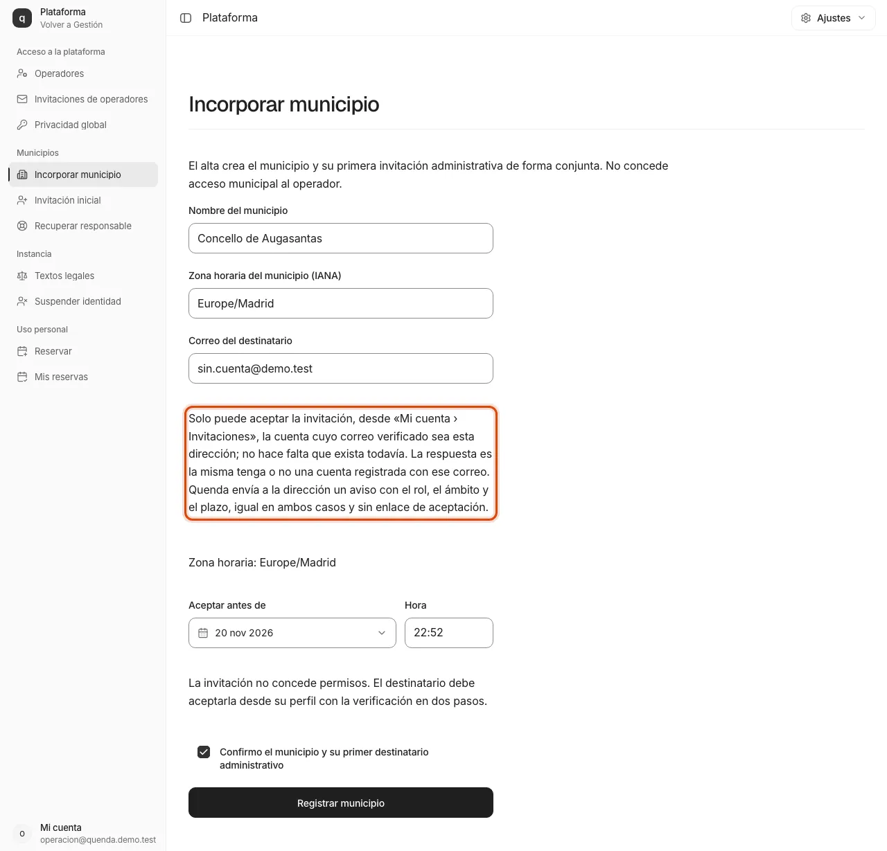

*El recuadro marca la explicación del formulario: solo puede aceptar la cuenta cuyo correo verificado sea esa dirección, no hace falta que exista todavía y la respuesta es la misma tenga o no cuenta.*

#### La verificación en dos pasos ya no es reciente

Si han pasado más de cinco minutos desde tu última verificación, Quenda no ejecuta el alta y te pide confirmar tu identidad. La sesión sigue abierta y el formulario conserva lo que habías escrito.

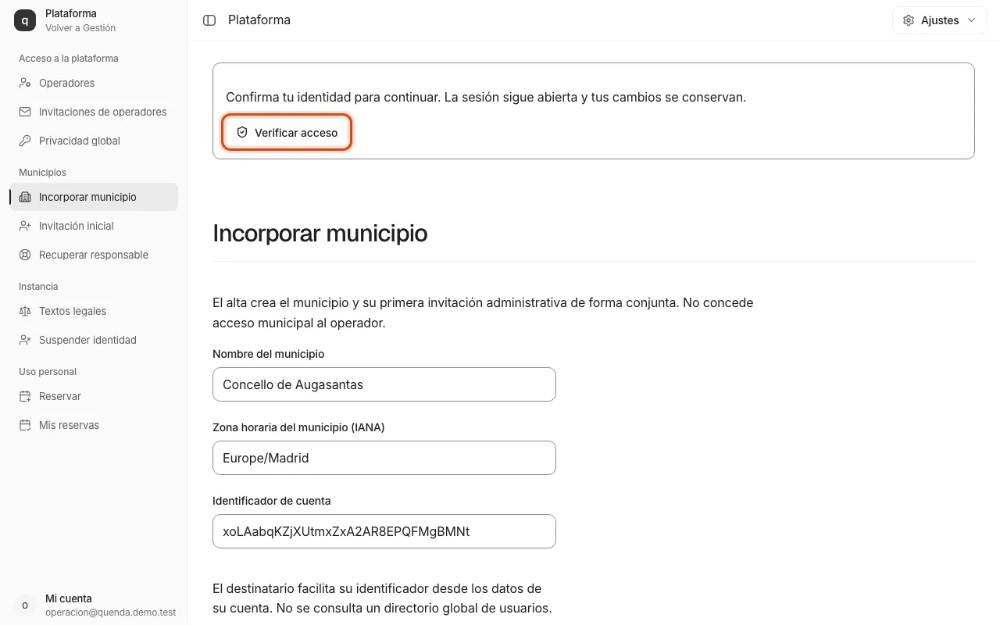

*Encima del formulario aparece el aviso «Confirma tu identidad para continuar. La sesión sigue abierta y tus cambios se conservan.» con el botón recuadrado Verificar acceso.*

Pulsa **Verificar acceso**, escribe el código de tu aplicación de autenticación y vuelve a pulsar **Registrar municipio**: la verificación no envía la operación por sí sola.

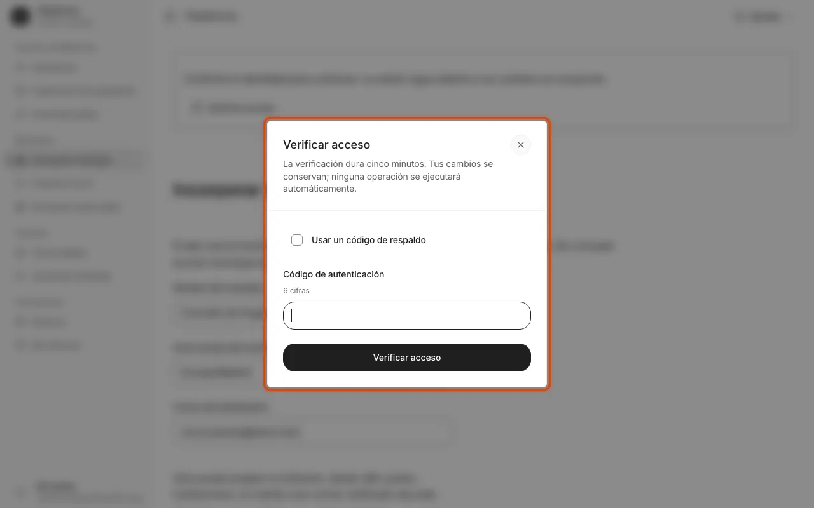

*La ventana recuadrada explica que la verificación dura cinco minutos y que ninguna operación se ejecutará automáticamente; también permite usar un código de respaldo.*

#### La invitación se envió a un correo equivocado

Mientras nadie haya aceptado la administración del municipio, puedes sustituir la invitación inicial. Abre **Invitación inicial**, indica el identificador del municipio, el correo correcto, una nueva fecha límite y el motivo, confirma y pulsa **Sustituir invitación**.

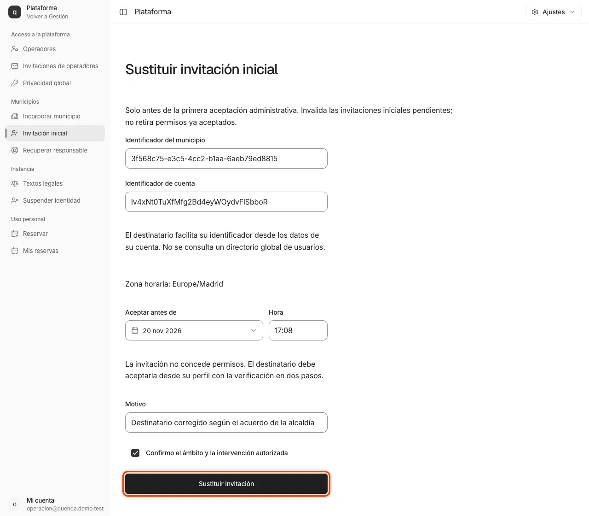

*El formulario recuerda que solo vale antes de la primera aceptación y que invalida las invitaciones iniciales pendientes. El motivo queda registrado; el botón recuadrado envía la sustitución.*

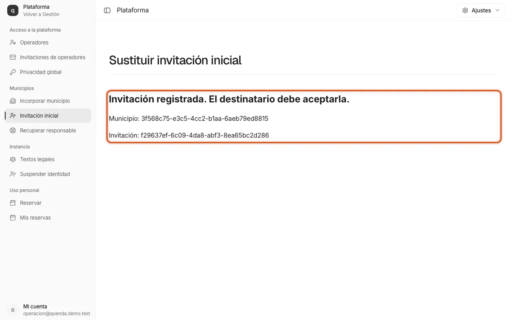

*El mensaje recuadrado confirma la nueva invitación e indica los identificadores del municipio y de la invitación.*

La cuenta del correo al que se envió la invitación anterior la ve como **Revocada** y ya no puede aceptarla.

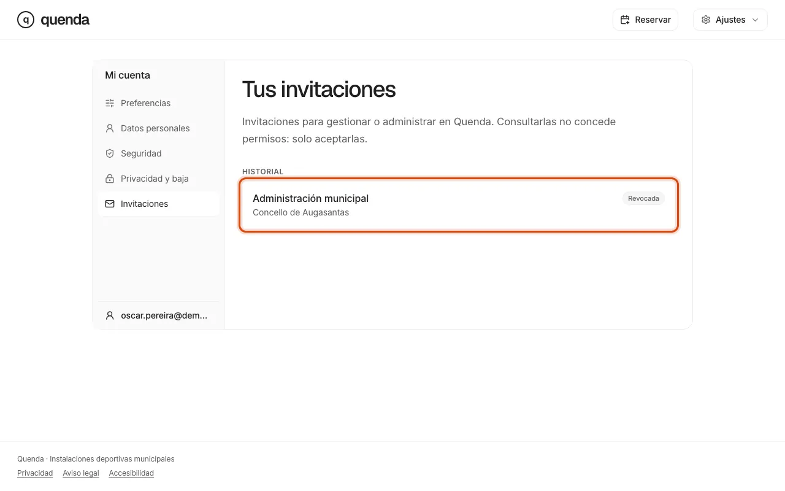

*En las invitaciones de esa cuenta solo queda la tarjeta recuadrada, en el historial y marcada como Revocada, sin botón para aceptarla.*

#### La invitación inicial ya fue aceptada

Una vez que alguien ha aceptado la administración del municipio, la invitación inicial no se puede sustituir. Los cambios de responsable se hacen desde **Personal y permisos** del propio municipio o, si no queda ningún administrador habilitado, con la recuperación descrita en [CU-16](#cu-16--contener-un-compromiso-y-recuperar-acceso).

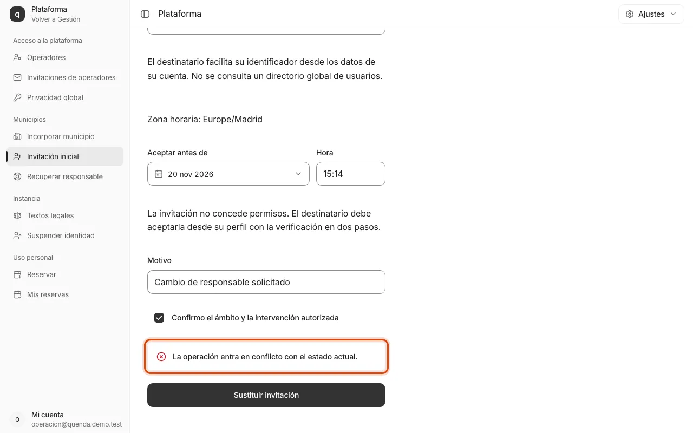

*Al intentar sustituir la invitación del Concello de Toxeira, ya aceptada, aparece sobre el botón Sustituir invitación el aviso recuadrado: el ayuntamiento ya completó su alta inicial y, si no queda ningún responsable habilitado, hay que usar la recuperación de responsable.*

#### La invitación ha vencido

Si la persona destinataria no acepta antes de la fecha límite, la invitación deja de poder aceptarse y no concede ningún permiso. Como nadie ha aceptado todavía, el operador puede emitir una nueva con **Invitación inicial**, igual que en el caso del correo equivocado.

#### La invitación la presenta otra cuenta

Solo puede aceptar la invitación la cuenta cuyo correo verificado coincide con la dirección invitada. Si otra cuenta la presenta, Quenda la rechaza y no le concede ningún permiso.

#### El operador intenta entrar en el municipio

El alta no da al operador acceso a la gestión ni a los datos del municipio. Si abre la dirección del municipio, Quenda le indica que no tiene acceso y le ofrece volver a Gestión.

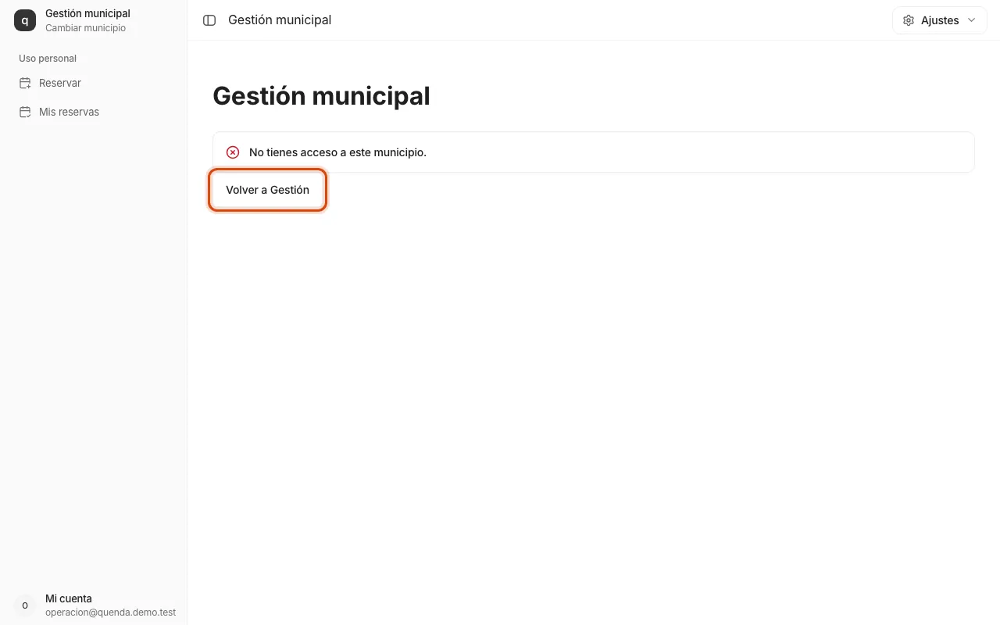

*La página se abre dentro del marco de gestión, con el título «Gestión municipal» y solo las opciones de uso personal en el menú lateral. Muestra el aviso «No tienes acceso a este municipio.» y, recuadrado, el botón Volver a Gestión.*

#### Una cuenta sin permiso de operador abre la plataforma

Quien no es operador no ve la administración de plataforma. Si llega a su dirección, solo encuentra un aviso y su menú de uso personal.

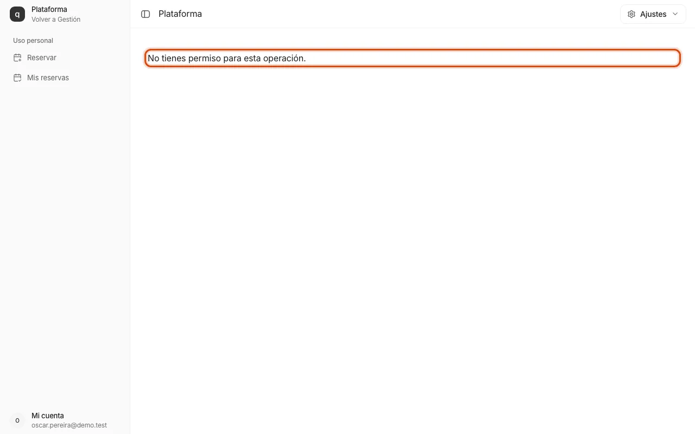

*El menú lateral solo ofrece Reservar y Mis reservas, y el contenido es el aviso recuadrado «No tienes permiso para esta operación.».*

### Resultado

El municipio queda configurado en la instancia con su nombre y su zona horaria, y su primera persona administradora queda habilitada solo después de aceptar la invitación con la verificación en dos pasos. El operador no obtiene acceso a los datos municipales.

## CU-16 — Contener un compromiso y recuperar acceso

Sirve para cortar de inmediato un acceso que puede estar en manos equivocadas y, después, recuperar el servicio sin devolver permisos por el camino. Intervienen tres figuras, según el alcance: la administración municipal retira el acceso de una persona en su municipio; un operador de plataforma suspende una identidad en toda la instancia e invita a un sustituto si el municipio se queda sin responsable; y el personal de operación autorizado recupera el acceso personal de una cuenta suspendida con sus credenciales de mantenimiento.

**Antes de empezar:** cada intervención exige autorización para su ámbito, la verificación en dos pasos y un motivo, que queda registrado. Para la recuperación excepcional hace falta una verificación externa documentada de la identidad o de la autoridad y acceso a las credenciales de mantenimiento. **Especificación:** [CU-16](../08_casos_de_uso.md#cu-16--contener-un-compromiso-y-recuperar-acceso).

### Paso a paso

#### Retirada por seguridad en un municipio (administración municipal)

1. **Localiza a la persona afectada.** En **Personal y permisos › Gestores** comprueba la concesión de la persona y abre la pestaña **Retirada por seguridad**.

   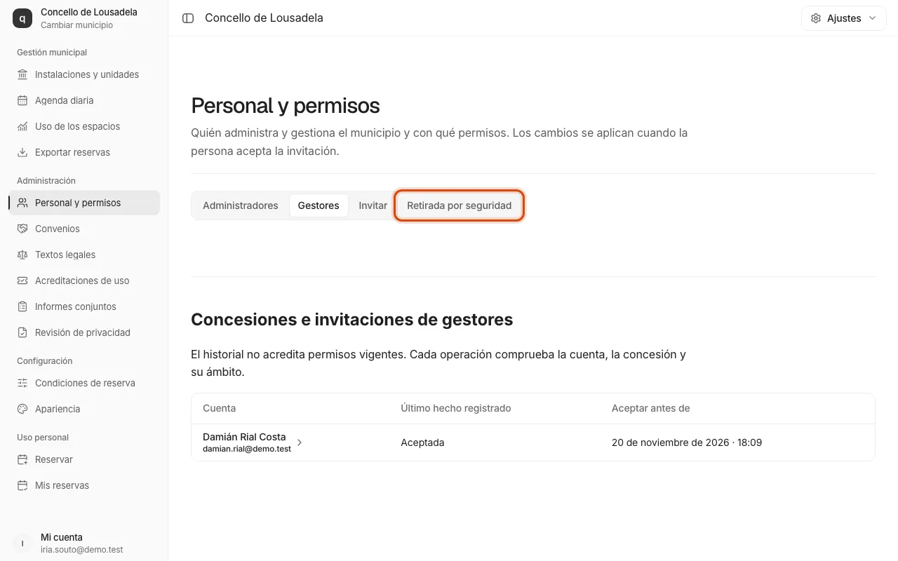

   *La tabla muestra a Damián Rial Costa con la concesión Aceptada; la pestaña recuadrada lleva al formulario de retirada.*

2. **Retira su acceso municipal.** Escribe el identificador de cuenta y el motivo, marca la confirmación y pulsa **Retirar acceso por seguridad**.

   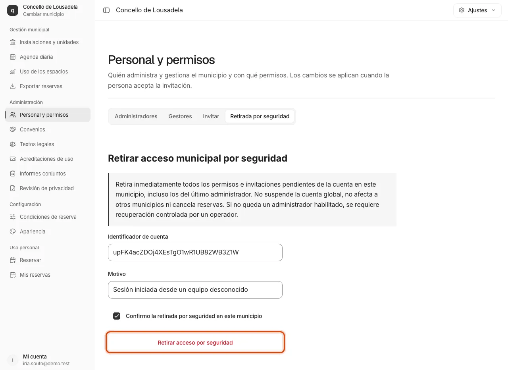

   *El recuadro gris explica el alcance: retira al momento todos los permisos e invitaciones pendientes de la cuenta en este municipio, incluso los del último administrador, sin suspender la cuenta global, afectar a otros municipios ni cancelar reservas. El botón recuadrado ejecuta la retirada.*

3. **Comprueba la confirmación.** Quenda muestra «Cambios guardados.» y vacía el formulario.

   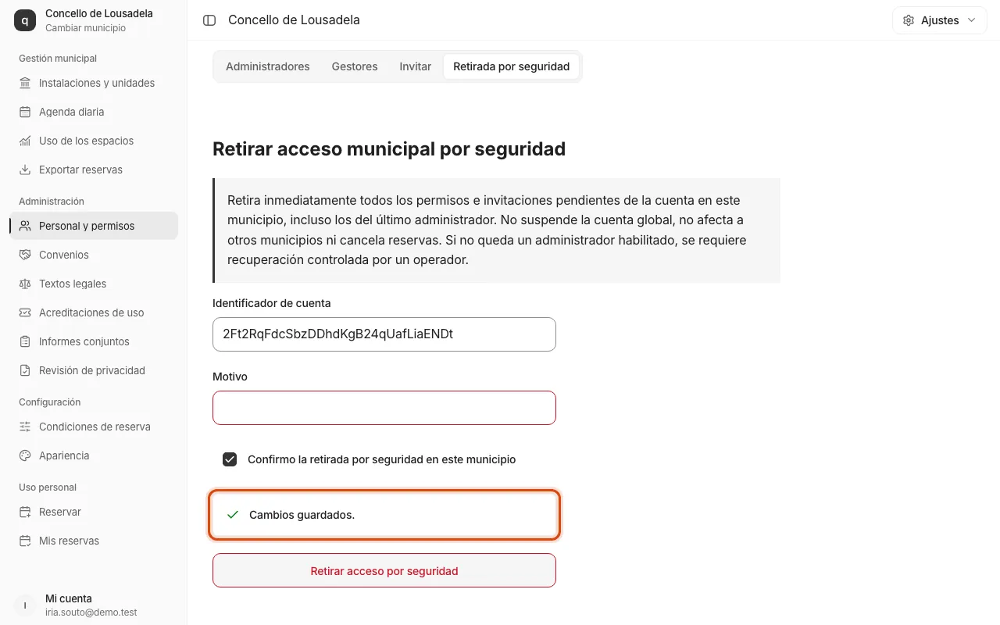

   *El mensaje recuadrado, sobre el botón Retirar acceso por seguridad, confirma la retirada. El campo Motivo queda vacío y en estado normal, listo para otra retirada.*

4. **Verifica que la concesión ya no está vigente.** En **Gestores**, la concesión figura como **Revocada**.

   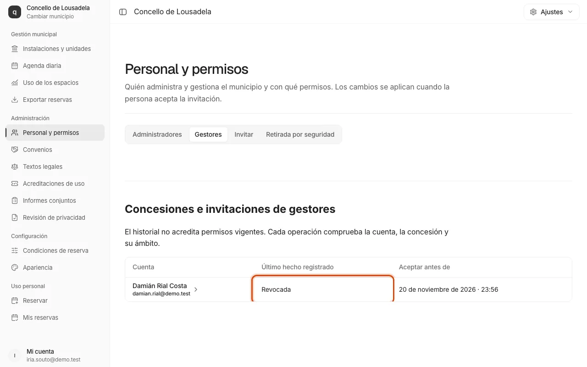

   *La celda recuadrada «Último hecho registrado» indica Revocada.*

5. **La persona conserva su cuenta.** Al entrar en Gestión ya no ve el municipio, pero su cuenta sigue activa para reservar a su nombre y para cualquier otro municipio en el que tenga permisos.

   

   *El recuadro muestra «No tienes permisos municipales vigentes.»; en la cabecera sigue disponible Reservar.*

#### Suspensión de una identidad en toda la instancia (operador)

6. **Abre «Suspender identidad».** En la administración de plataforma, dentro de **Instancia**, pulsa **Suspender identidad**.

   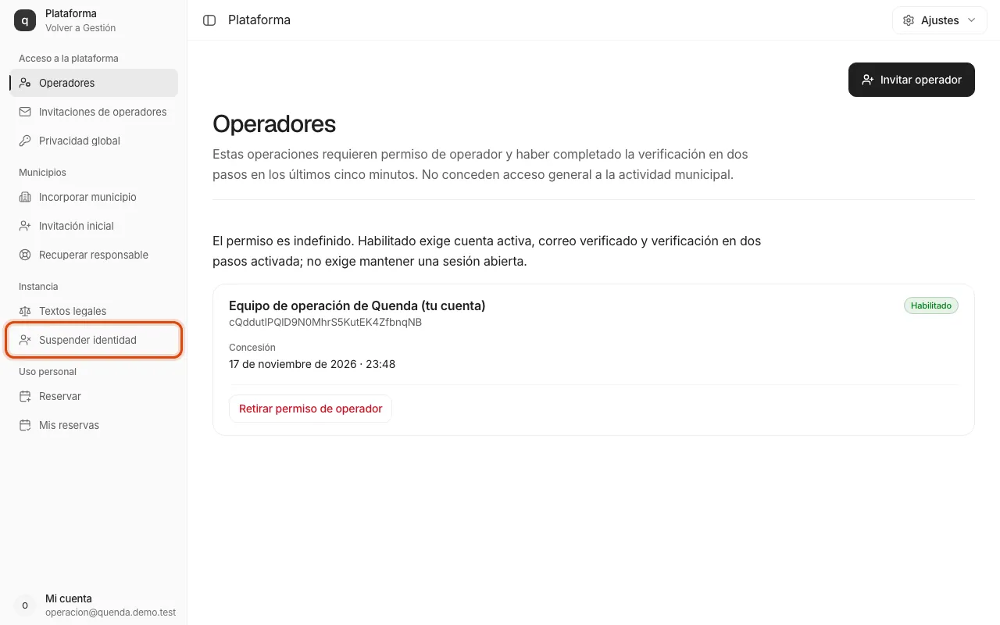

   *La opción recuadrada del menú lateral abre el formulario de suspensión.*

7. **Suspende la cuenta comprometida.** Escribe su identificador y el motivo, marca la confirmación y pulsa **Suspender cuenta**. En el ejemplo se suspende a la persona administradora del Concello de Lousadela, cuyas credenciales se han expuesto.

   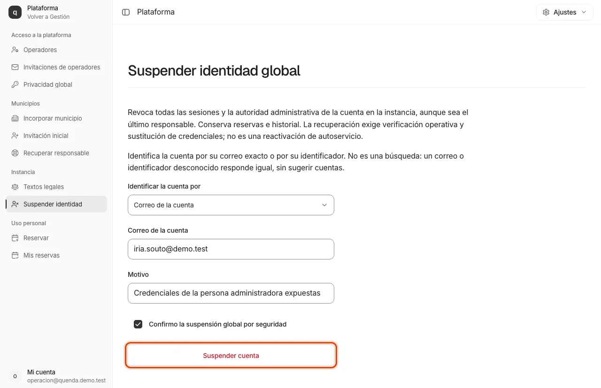

   *El texto explica que la suspensión revoca todas las sesiones y la autoridad administrativa de la cuenta en la instancia, aunque sea el último responsable, y que conserva reservas e historial. El botón recuadrado ejecuta la suspensión.*

8. **Comprueba la suspensión.** Quenda confirma que la cuenta está suspendida y que las reservas se conservan.

   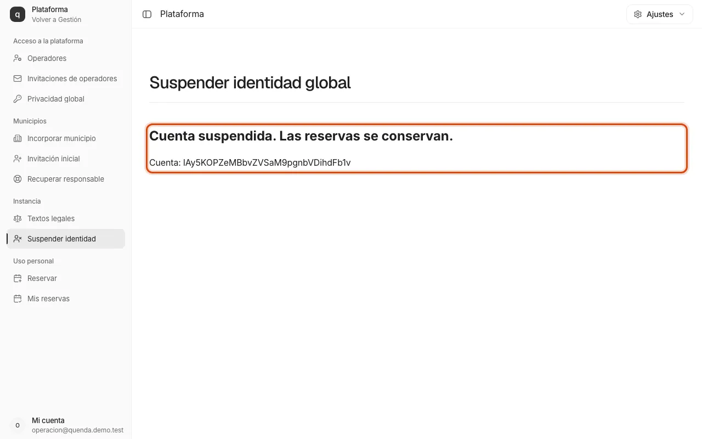

   *El mensaje recuadrado muestra la confirmación y el identificador de la cuenta suspendida.*

9. **La cuenta ya no puede entrar.** Sus sesiones abiertas dejan de valer y un nuevo inicio de sesión se rechaza, aunque la contraseña sea correcta.

   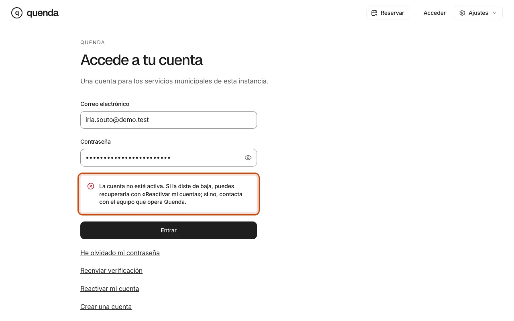

   *Al intentar entrar con su correo y su contraseña, la persona suspendida ve el aviso recuadrado «La cuenta no está activa. Si la diste de baja, puedes recuperarla con «Reactivar mi cuenta»; si no, contacta con el equipo que opera Quenda.». En una suspensión, la reactivación por su cuenta no sirve: el acceso se recupera con el equipo de operación, como en los pasos 15 a 17.*

#### Recuperación del responsable municipal (operador)

Si la contención deja a un municipio sin ningún administrador habilitado, como en el ejemplo, el operador invita a un sustituto. Antes, verifica la autoridad de quien lo designa por el procedimiento administrativo que corresponda.

10. **Abre «Recuperar responsable».** En el menú lateral, dentro de **Municipios**, pulsa **Recuperar responsable**.

    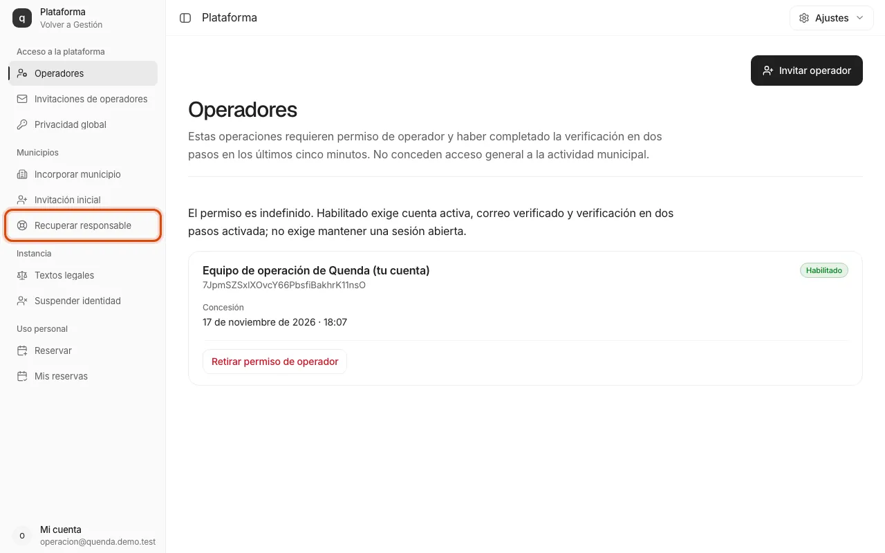

    *La opción recuadrada lleva al formulario de recuperación.*

11. **Invita al sustituto.** Indica el identificador del municipio y el correo de la persona sustituta, la fecha límite para aceptar, el motivo y la referencia de la verificación de autoridad. Confirma y pulsa **Invitar a un sustituto**.

    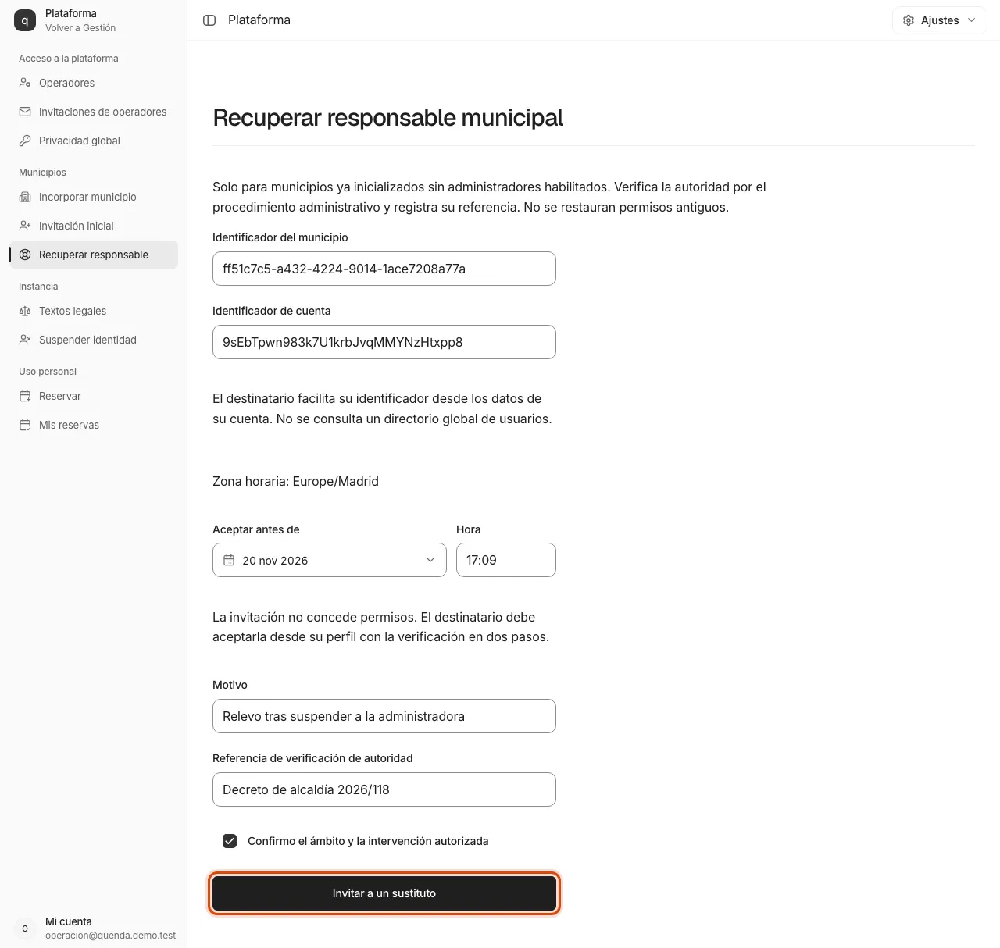

    *El texto recuerda que solo sirve para municipios sin administradores habilitados y que no se restauran permisos antiguos. La invitación va al correo de la persona sustituta («rocio.tella@demo.test»), y solo podrá aceptarla la cuenta con ese correo verificado. La referencia de verificación (un decreto de alcaldía en el ejemplo) queda registrada; el botón recuadrado envía la invitación.*

12. **Comprueba la invitación.** Quenda confirma que la invitación está registrada y que el destinatario debe aceptarla.

    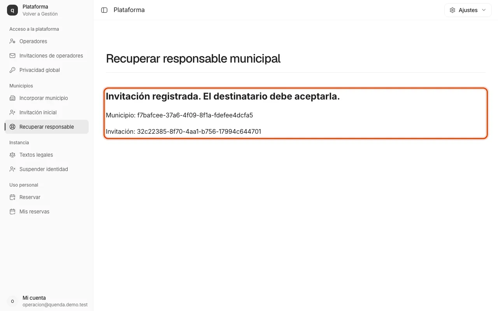

    *El mensaje recuadrado muestra los identificadores del municipio y de la invitación. El operador sigue sin acceso al municipio.*

13. **La persona sustituta acepta.** Desde **Mi cuenta › Invitaciones**, con la verificación en dos pasos completada, pulsa **Aceptar invitación**.

    

    *La tarjeta muestra el rol, el municipio y el plazo para aceptarla; el botón recuadrado completa la aceptación.*

14. **El municipio vuelve a tener responsable.** En **Personal y permisos › Administradores**, la persona sustituta figura como habilitada y la persona administradora suspendida como no habilitada.

    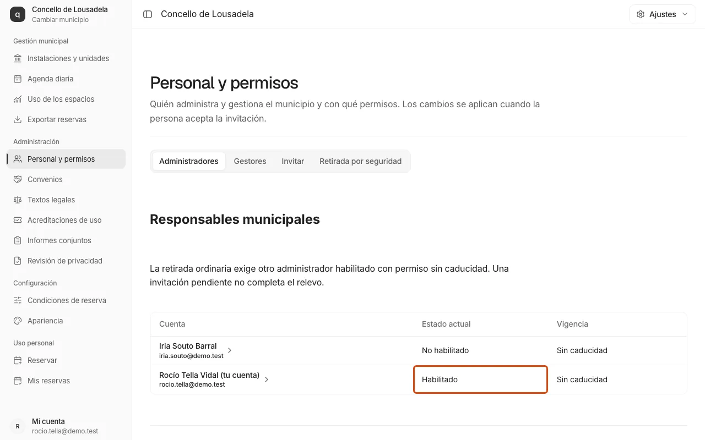

    *La celda recuadrada indica Habilitado para Rocío Tella Vidal; Iria Souto Barral aparece como No habilitado.*

#### Recuperación del acceso personal (personal de operación)

Una cuenta suspendida solo vuelve a funcionar con la recuperación asistida, que realiza el personal de operación con las credenciales de mantenimiento cargadas desde los secretos del entorno. No hay pantalla para ello y la persona suspendida no puede restablecer su contraseña por correo. En el ejemplo se recupera a la misma administradora suspendida en el paso 7.

15. **Sustituye las credenciales comprometidas.** Antes de levantar la suspensión, la persona titular cambia, por el procedimiento controlado del equipo de operación, la contraseña y, si los tenía, el segundo factor y los códigos de respaldo. Este paso no tiene pantalla en Quenda y nunca se escriben contraseñas ni secretos en los comandos ni en las referencias.

16. **Ejecuta la recuperación.** Lanza `pnpm -s account:recover` con el identificador de la cuenta, quién la realiza, la referencia de la verificación de identidad, la referencia de la sustitución de credenciales y el motivo.

    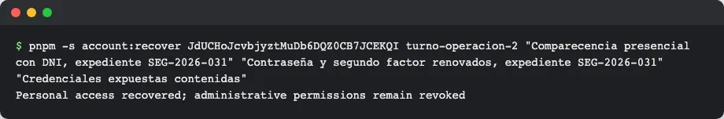

    *La salida «Personal access recovered; administrative permissions remain revoked» confirma que se recupera solo el acceso personal: los permisos administrativos siguen retirados.*

17. **La persona titular vuelve a entrar.** Inicia sesión con su nueva contraseña y, si lo tenía, su nuevo segundo factor. Puede reservar a su nombre, pero ya no administra el municipio: en **Personal y permisos** sigue figurando como «No habilitado» (paso 14). Si vuelve a necesitar el permiso, tendrá que recibir y aceptar una invitación nueva.

    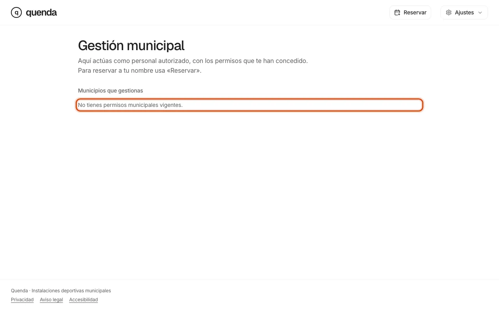

    *Tras iniciar sesión, la página Gestión municipal de la persona administradora recuperada muestra, recuadrado, «No tienes permisos municipales vigentes.»; en la cabecera sigue disponible Reservar.*

### Si algo no sale como se espera

#### Se intenta recuperar un municipio que ya tiene administrador

La recuperación de responsable solo funciona cuando no queda ningún administrador habilitado. Si ya hay uno, Quenda la rechaza: el relevo se hace desde **Personal y permisos** del municipio.

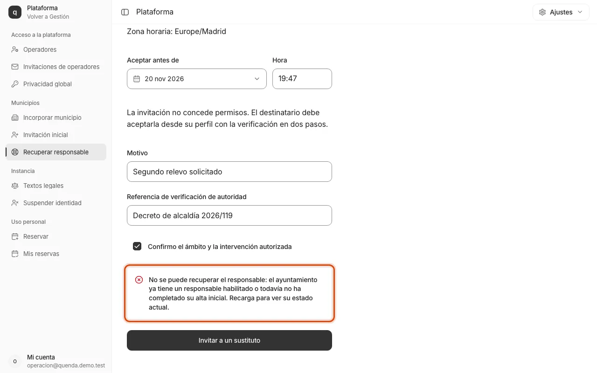

*Tras la aceptación de la persona sustituta, un segundo intento de recuperación muestra, sobre el botón Invitar a un sustituto, el aviso recuadrado: no se puede recuperar el responsable porque el ayuntamiento ya tiene uno habilitado o todavía no ha completado su alta inicial.*

#### Las credenciales comprometidas no se han sustituido

Si la contraseña (y, cuando existían, el segundo factor y los códigos de respaldo) siguen siendo las mismas que en el momento de la suspensión, el comando se rechaza y la cuenta sigue suspendida. En el ejemplo, es lo que ocurre si se ejecuta la recuperación de la persona administradora antes del paso 15.

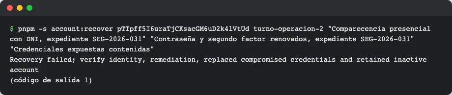

*Es el mismo comando del paso 16. La salida «Recovery failed; verify identity, remediation, replaced compromised credentials and retained inactive account» y el código de salida 1 indican que no se ha cambiado nada.*

#### Se intenta la recuperación excepcional de operadores con un operador habilitado

`pnpm -s operator:recover` solo actúa cuando no queda ningún operador habilitado; mientras haya uno, la gestión de operadores se hace desde **Operadores** en la plataforma. La cuenta destino debe estar activa, con correo verificado y verificación en dos pasos.

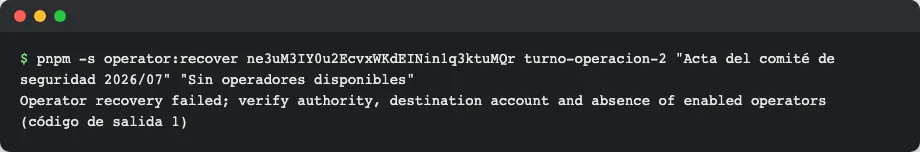

*El comando recibe la cuenta destino, quién lo ejecuta, la referencia de la autoridad verificada y el motivo. La salida «Operator recovery failed; verify authority, destination account and absence of enabled operators» y el código de salida 1 indican que sigue habiendo un operador habilitado.*

#### La contención deja el ámbito sin responsable

La seguridad tiene prioridad: tanto la retirada municipal como la suspensión global se aplican aunque afecten al último administrador. El municipio queda sin responsable hasta que un operador invite a un sustituto, como en los pasos 10 a 14.

#### Las reservas de la persona afectada

Ninguna de las dos intervenciones cancela reservas. Las reservas e historial de la cuenta se conservan y el municipio decide qué hacer con ellas por los procedimientos ordinarios.

### Resultado

El acceso comprometido queda cortado en el ámbito que corresponde, cada intervención queda registrada con su motivo y sus referencias, y la recuperación devuelve el servicio sin restituir permisos antiguos: los permisos administrativos se conceden de nuevo solo por invitación y aceptación.
