# Guía de casos de uso · Privacidad y operación

Esta guía es para el personal municipal con permisos de privacidad, que aplica las políticas de conservación aprobadas y ejecuta actuaciones individuales de supresión o bloqueo, y para el personal de operación que recupera una instancia a partir de una copia sin devolver al uso datos ya suprimidos o restringidos. Los permisos de privacidad son explícitos: ni la administración del municipio ni el permiso de operador los incluyen. En las imágenes, el recuadro naranja señala dónde hay que pulsar o escribir.

## Índice

- [CU-20 — Aplicar una política de conservación](#cu-20--aplicar-una-política-de-conservación)
- [CU-21 — Ejecutar una actuación individual de privacidad](#cu-21--ejecutar-una-actuación-individual-de-privacidad)
- [CU-22 — Recuperar una instancia sin rehabilitar datos restringidos](#cu-22--recuperar-una-instancia-sin-rehabilitar-datos-restringidos)

## CU-20 — Aplicar una política de conservación

Sirve para que Quenda elimine o bloquee automáticamente los datos de una familia cuando vence el plazo que ha aprobado el responsable del tratamiento. Lo registra el personal con permiso para ejecutar actuaciones de privacidad en el municipio, una vez que existe la aprobación administrativa. Quenda no propone plazos: los días y la actuación salen siempre de esa aprobación.

**Antes de empezar:** necesitas el permiso «Ejecutar actuaciones de privacidad» del municipio (y «Consultar datos de privacidad» para ver políticas, excepciones y conflictos), haber completado la verificación en dos pasos en los últimos cinco minutos y tener a mano la aprobación con su finalidad, responsable, plazo y actuación. **Especificación:** [CU-20](../08_casos_de_uso.md#cu-20--aplicar-una-política-de-conservación).

### Paso a paso

1. **Entra en «Conservación y derechos».** En la gestión del municipio, abre **Conservación y derechos** en el menú lateral.

   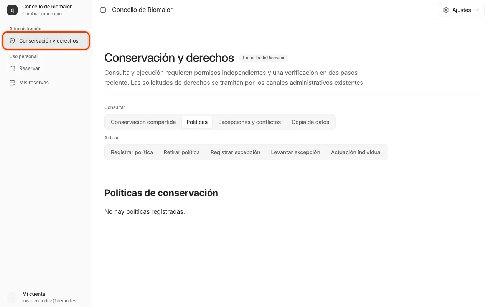

   *El personal de privacidad solo ve esta opción en Administración, además de su uso personal. La página se abre en Políticas y avisa de que consulta y ejecución son permisos independientes.*

2. **Abre «Registrar política».** Mientras no haya ninguna política, la lista indica «No hay políticas registradas.» y Quenda no elimina nada de forma automática. En el grupo **Actuar**, pulsa **Registrar política**.

   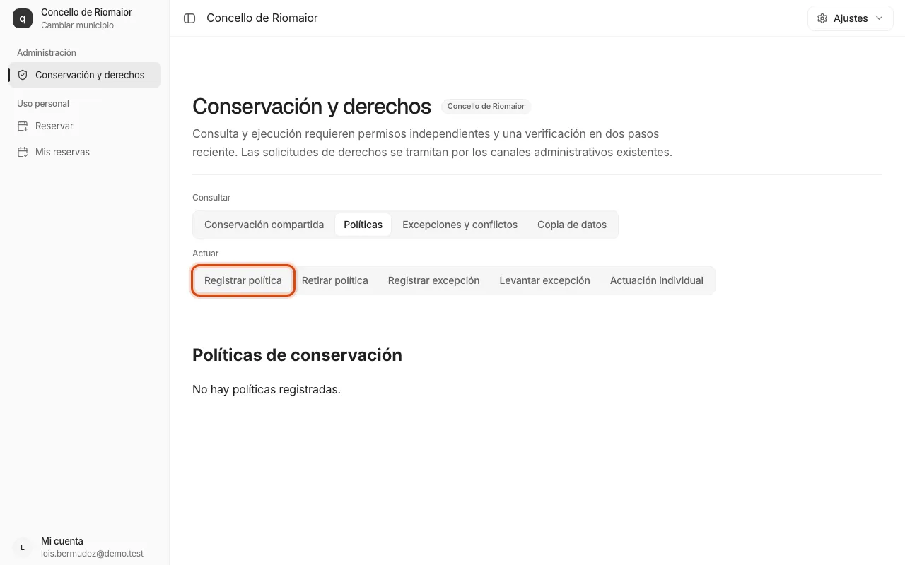

   *La sección Consultar agrupa Conservación compartida, Políticas, Excepciones y conflictos y Copia de datos; la sección Actuar, las operaciones. Está recuadrada la que abre el formulario.*

3. **Registra la política aprobada.** Elige la familia de datos (al elegirla, Quenda explica desde cuándo se cuenta el plazo), escribe el plazo en días completos, elige la actuación y, si es un bloqueo, la duración autorizada del archivo bloqueado. Completa finalidad, referencia del responsable, referencia de aprobación y motivo, marca la confirmación y pulsa **Registrar política**.

   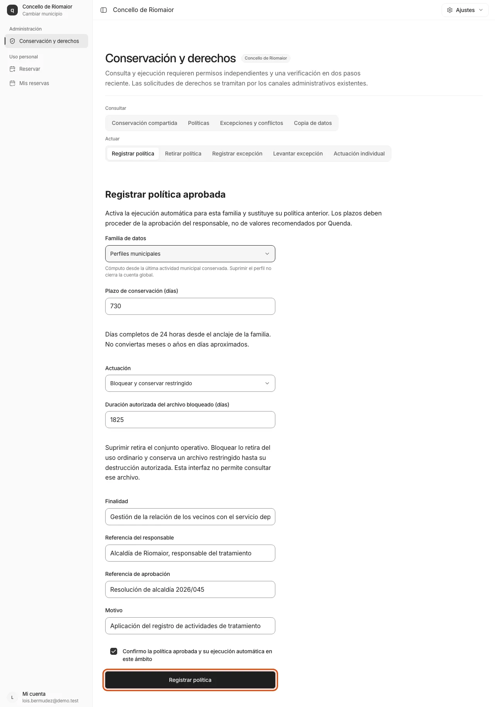

   *En el ejemplo, los perfiles municipales se bloquean a los 730 días sin actividad y el archivo restringido se conserva 1825 días. El formulario advierte que no hay que convertir meses o años en días aproximados y que esta interfaz no permite consultar el archivo bloqueado. El botón recuadrado registra la política.*

4. **Comprueba el registro.** Quenda confirma la política con su identificador.

   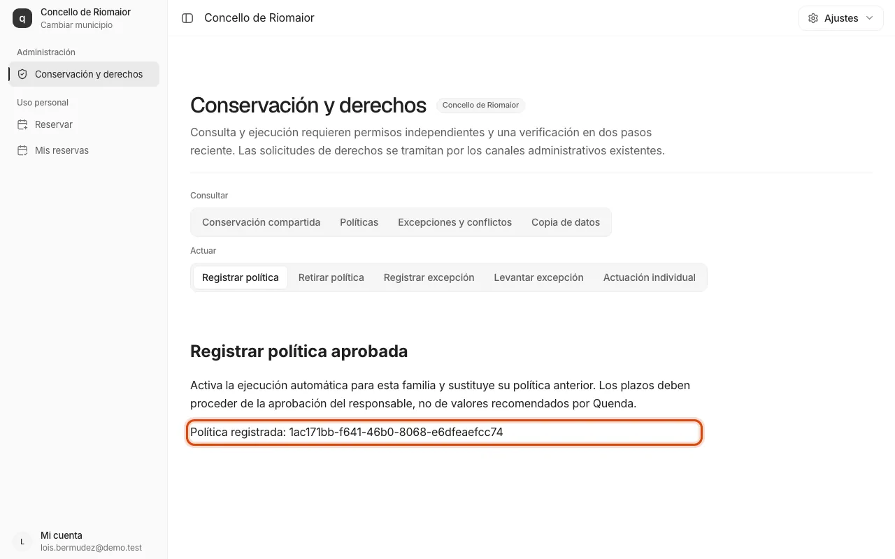

   *El mensaje recuadrado «Política registrada» indica el identificador que la distingue en el historial.*

5. **Revisa la política activa.** En **Políticas**, la nueva política aparece como **Activa** con todos sus datos.

   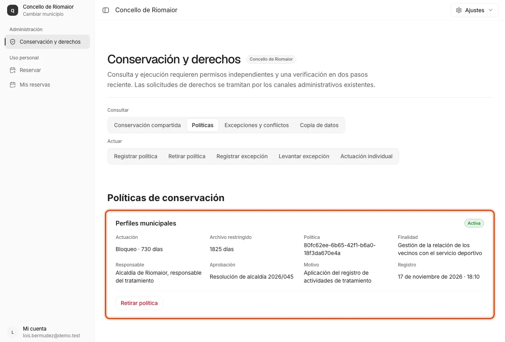

   *La tarjeta recuadrada muestra la actuación y el plazo (Bloqueo · 730 días), el archivo restringido, la finalidad, el responsable, la aprobación, el motivo y la fecha de registro, y ofrece Retirar política.*

6. **Si procede, registra una excepción.** Cuando unos datos deben conservarse por otra causa autorizada (un procedimiento judicial, por ejemplo), abre **Registrar excepción**, elige la familia y el alcance (un registro o un interesado), indica la referencia de autorización y el motivo y pulsa **Registrar excepción**.

   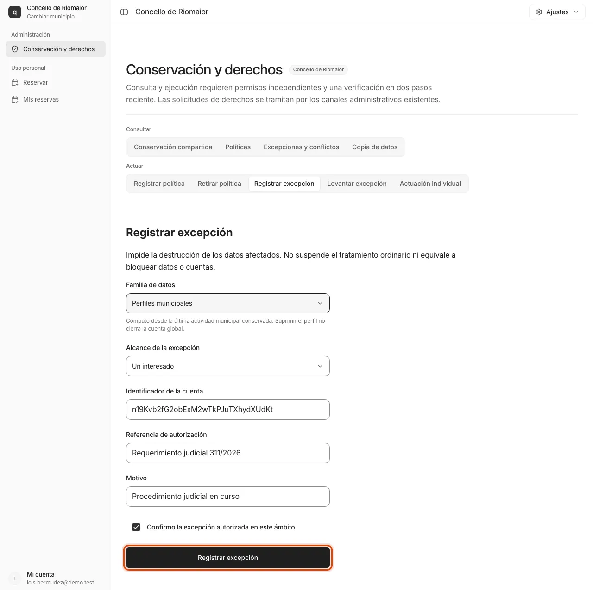

   *El formulario recuerda que la excepción impide destruir los datos afectados, pero no suspende el tratamiento ordinario ni bloquea la cuenta. En el ejemplo protege el perfil de una persona vecina por un requerimiento judicial. Como quien registra solo tiene permiso de privacidad, el formulario pide el identificador exacto y explica que ese permiso no da acceso al listado de personas del municipio; quien además administra el municipio puede elegir a la persona en una lista.*

   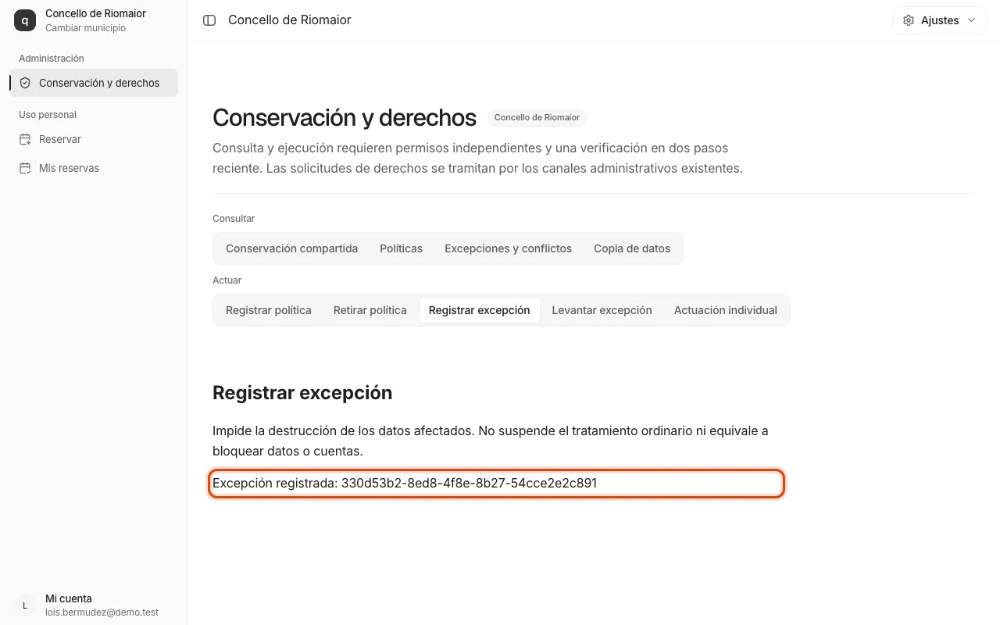

   *El mensaje recuadrado «Excepción registrada» incluye el identificador que se usará para levantarla.*

7. **Quenda procesa los vencimientos.** El proceso de segundo plano (el worker) revisa las políticas activas cada minuto, selecciona los registros vencidos y vuelve a comprobar excepciones y dependencias de cada uno antes de actuar. No hay nada que pulsar. Si el equipo de operación necesita forzar una revisión, puede ejecutar un único ciclo del worker con la configuración del propio worker: `node dist/email-worker.js --once` en la instancia (en un entorno local, `pnpm -s worker:local --once`):

   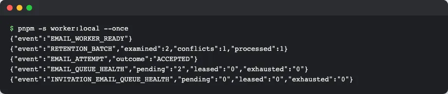

   *La imagen muestra el equivalente local. La línea EMAIL_WORKER_READY indica que el worker ha arrancado y la línea RETENTION_BATCH resume el ciclo: ha examinado 2 registros vencidos, ha aplicado la actuación a 1 y ha dejado 1 en conflicto. En el mismo ciclo el worker también envía un correo pendiente (EMAIL_ATTEMPT) y EMAIL_QUEUE_HEALTH resume la cola de correo de reservas (2 pendientes, ninguno agotado) e INVITATION_EMAIL_QUEUE_HEALTH, la de avisos de invitación, vacía.*

8. **Revisa excepciones y conflictos.** En **Excepciones y conflictos**, el registro protegido aparece como conflicto con su motivo; sus datos no se han tocado. El otro perfil vencido se ha bloqueado.

   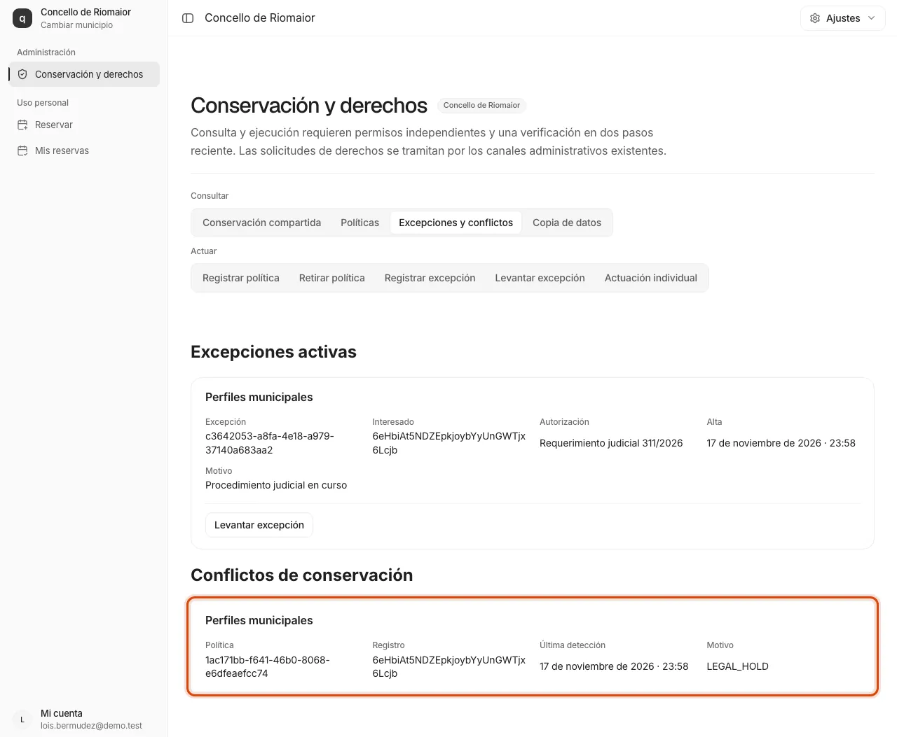

   *Arriba, la excepción activa con su interesado, autorización y motivo, y el botón Levantar excepción. Debajo, en «Conflictos de conservación», la tarjeta recuadrada muestra el conflicto de la misma persona: la política que lo detectó, el registro, la fecha de la última detección y el motivo LEGAL_HOLD (excepción de conservación).*

### Si algo no sale como se espera

#### Hay una nueva aprobación para la misma familia

Cada familia tiene una sola política activa por municipio. Registra la nueva aprobación como en el paso 3: sustituye a la anterior sin rehacer lo que ya se aplicó.

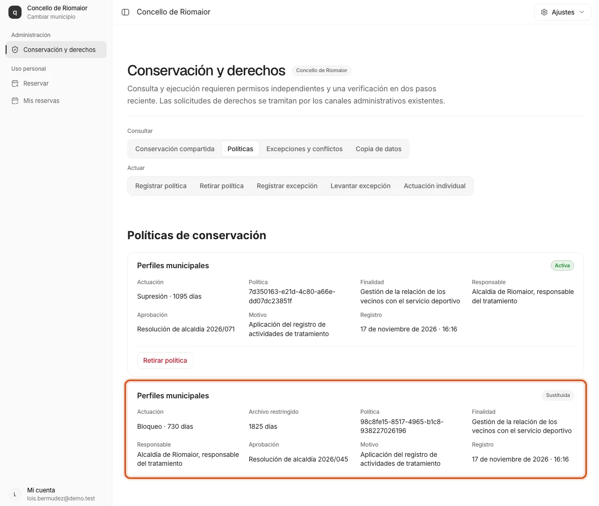

*Arriba, la nueva política (Supresión · 1095 días) como Activa; abajo, recuadrada, la anterior marcada como Sustituida, que ya no ofrece Retirar política.*

#### La excepción ya no es necesaria

Levantar una excepción exige también autorización y motivo. En **Excepciones y conflictos**, pulsa **Levantar excepción** en su tarjeta.

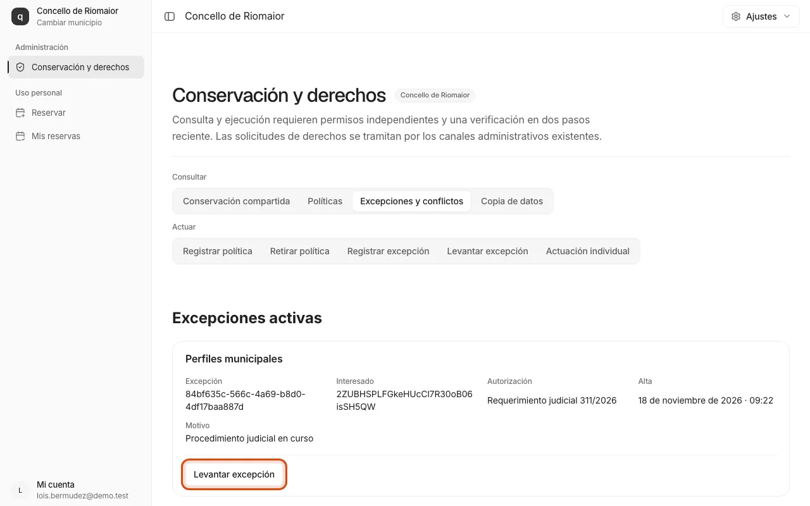

*La tarjeta muestra el identificador de la excepción, el interesado, la autorización, la fecha de alta y el motivo; el botón recuadrado abre el formulario.*

Completa la referencia de autorización y el motivo, marca la confirmación y pulsa **Levantar excepción**.

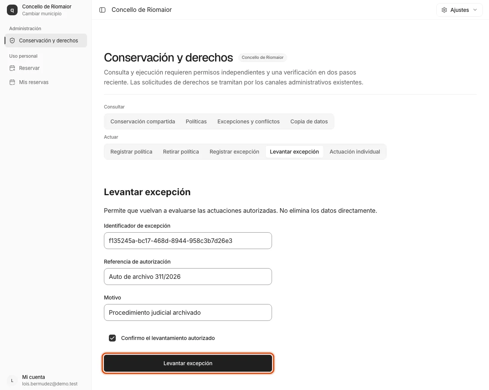

*El formulario llega con el identificador de la excepción ya escrito y recuerda que levantarla permite volver a evaluar las actuaciones autorizadas, sin eliminar datos directamente.*

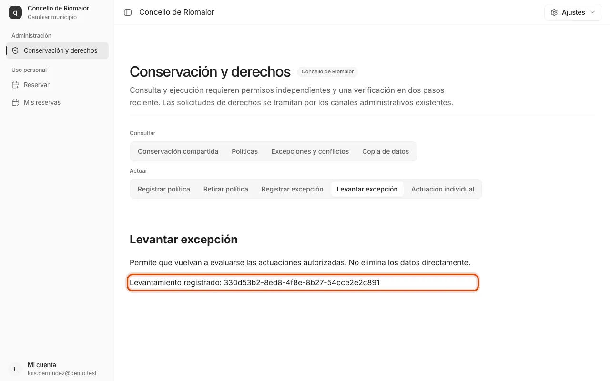

*El mensaje recuadrado «Levantamiento registrado» confirma la operación. Si la política sigue activa, el registro se evaluará de nuevo en la próxima revisión.*

#### El interesado o el registro de la excepción no existe

Una excepción tiene que referirse a un registro o a un interesado existente. Si el identificador no corresponde a ninguno, Quenda la rechaza.

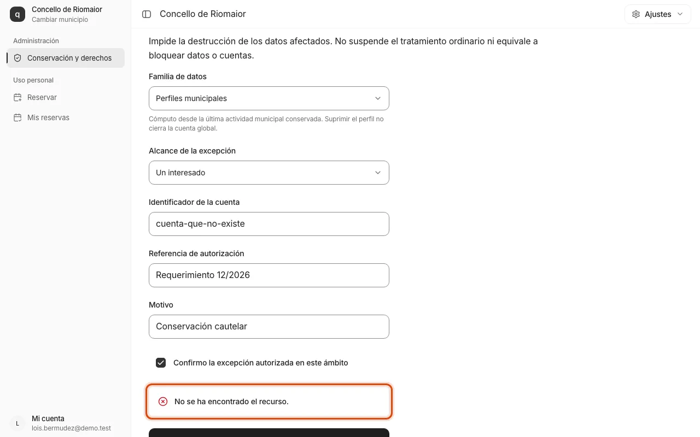

*Con «cuenta-que-no-existe» como identificador, el aviso recuadrado, sobre el botón Registrar excepción, indica «No se ha encontrado el recurso.» y no se registra ninguna excepción.*

#### La aprobación se revoca

Si el responsable revoca la aprobación, retira la política: Quenda deja de actuar sobre los registros ordinarios de esa familia. No se recuperan los datos ya suprimidos ni se amplía la conservación de los archivos ya bloqueados. En **Políticas**, pulsa **Retirar política** en la política activa.

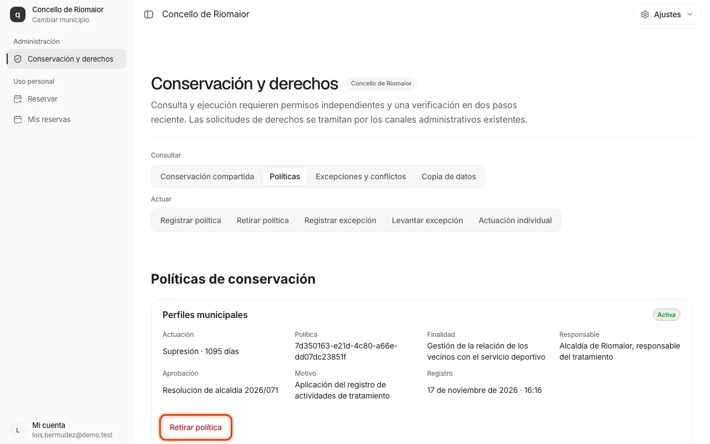

*La tarjeta de la política activa ofrece el botón recuadrado Retirar política.*

Indica el motivo, confirma y pulsa **Retirar política**.

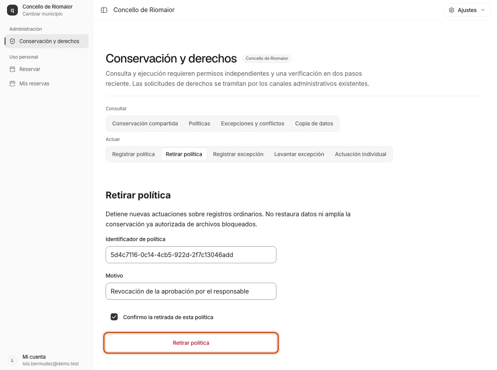

*El formulario llega con el identificador de la política ya escrito y recuerda que la retirada detiene nuevas actuaciones sin restaurar datos ni ampliar la conservación de los archivos bloqueados. Con el motivo y la confirmación completados, el botón recuadrado registra la retirada.*

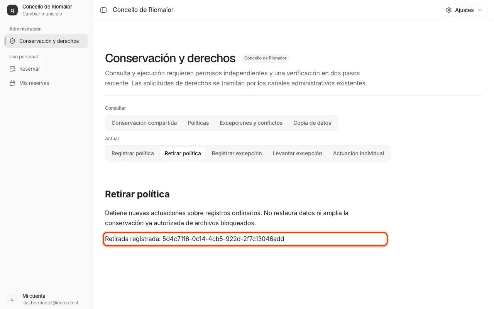

*El mensaje recuadrado «Retirada registrada» confirma la retirada con el identificador de la política.*

#### Una persona sin permisos de privacidad abre estos controles

Administrar el municipio no da permisos de privacidad. Una persona administradora que abre la dirección de **Conservación y derechos** solo ve un aviso.

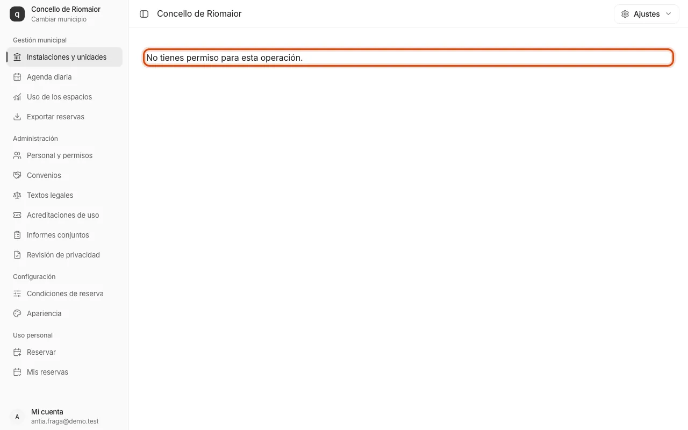

*El menú lateral de la persona administradora no incluye Conservación y derechos y el contenido es el aviso recuadrado «No tienes permiso para esta operación.».*

#### Un conflicto no detiene el resto

Cuando un registro tiene una excepción, una reserva vigente u otra dependencia protegida, Quenda lo deja tal cual, anota el conflicto y sigue con los demás registros vencidos, como muestra el resumen del paso 7.

#### Ámbito global

Las familias de identidad global, autenticación y permisos de plataforma se gestionan igual desde **Plataforma › Conservación y derechos**, con permisos de privacidad globales concedidos por un operador. Cada municipio conserva su propia política aunque comparta instancia.

### Resultado

Los vencimientos se ejecutan de forma automática según la política aprobada del municipio, cada actuación y cada conflicto quedan registrados y los datos protegidos por excepciones o dependencias se conservan.

## CU-21 — Ejecutar una actuación individual de privacidad

Sirve para suprimir o bloquear un conjunto concreto de datos cuando el responsable del tratamiento lo ha valorado y autorizado, por ejemplo al atender un derecho de supresión. Lo ejecuta el personal con permiso para ejecutar actuaciones de privacidad en el municipio. Quenda comprueba antes el ámbito, las excepciones y las dependencias y, si algo lo impide, conserva los datos y deja constancia.

**Antes de empezar:** necesitas el permiso «Ejecutar actuaciones de privacidad» del municipio, haber completado la verificación en dos pasos en los últimos cinco minutos, la referencia exacta del registro y la referencia de la autorización. **Especificación:** [CU-21](../08_casos_de_uso.md#cu-21--ejecutar-una-actuación-individual-de-privacidad).

### Paso a paso

1. **Abre «Actuación individual».** En **Conservación y derechos**, dentro de **Actuar**, pulsa **Actuación individual**.

   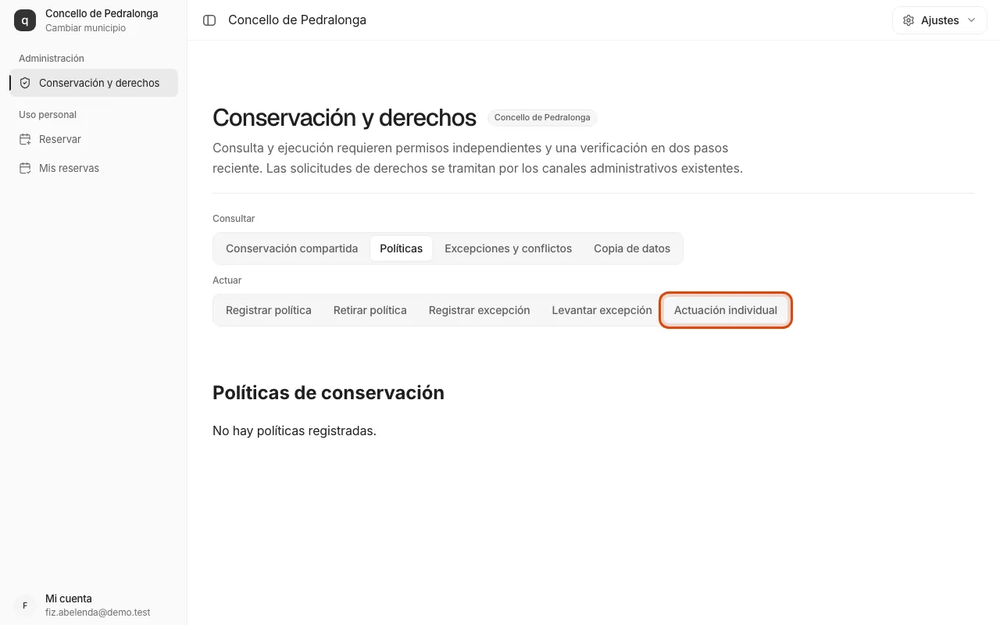

   *La página se abre en Políticas; la opción recuadrada abre el formulario de actuación.*

2. **Identifica el registro y la actuación.** Elige la familia de datos, escribe la referencia exacta del registro (para un perfil municipal, el identificador de la cuenta), elige **Suprimir**, indica la referencia de autorización y el motivo, marca la confirmación y pulsa **Ejecutar actuación**.

   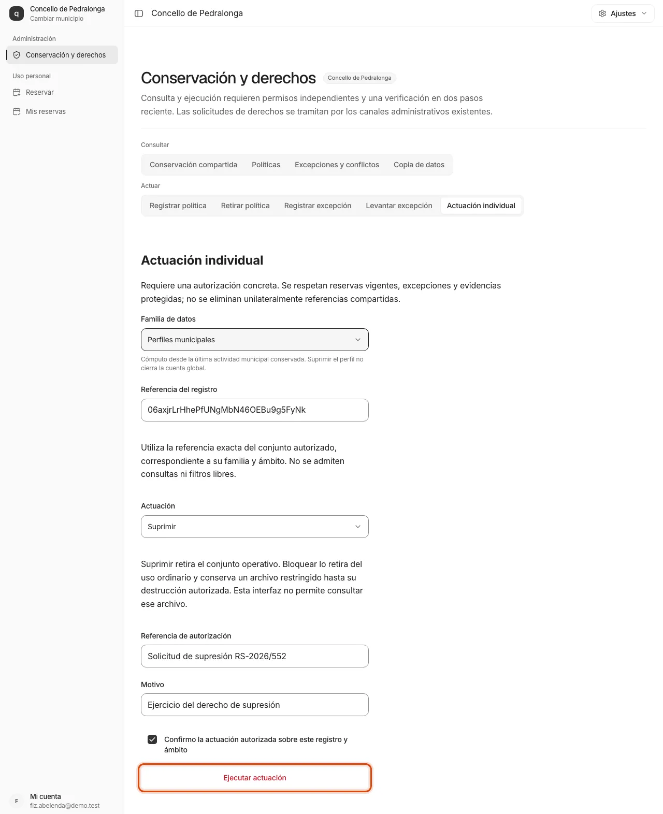

   *El formulario avisa de que se respetan reservas vigentes, excepciones y evidencias protegidas y de que no se admiten búsquedas ni filtros libres. El botón recuadrado ejecuta la actuación.*

3. **Comprueba el resultado.** Si nada lo impide, Quenda aplica la actuación y la registra en la auditoría.

   

   *El resultado recuadrado «Actuación aplicada» indica el número del evento de auditoría que la acredita.*

### Si algo no sale como se espera

#### Hay que conservar los datos restringidos en lugar de suprimirlos

Elige **Bloquear y conservar restringido** e indica la duración autorizada del archivo bloqueado. Los datos salen del uso ordinario y se guardan en un archivo restringido hasta su destrucción autorizada.

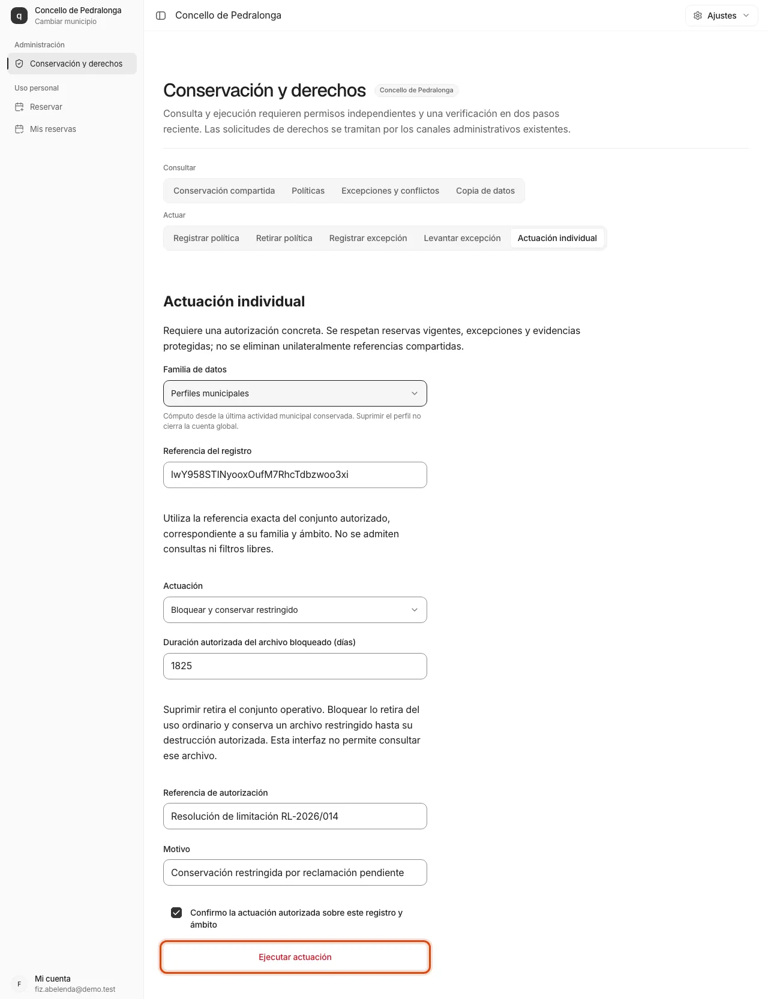

*Al elegir el bloqueo aparece el campo «Duración autorizada del archivo bloqueado (días)», 1825 en el ejemplo. El botón recuadrado ejecuta la actuación.*

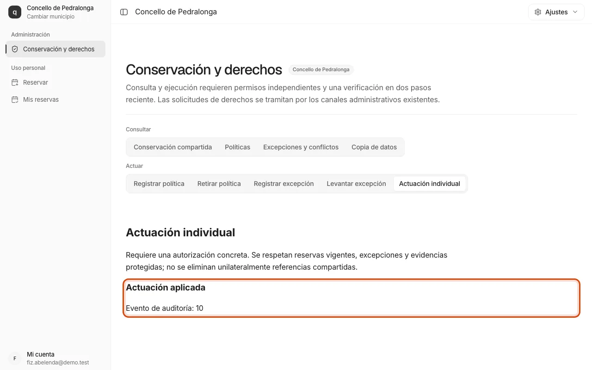

*El resultado recuadrado confirma la actuación con su evento de auditoría.*

Los permisos de privacidad no permiten leer ese archivo: solo se accede a él con un procedimiento de mantenimiento autorizado y auditado.

#### Una excepción de conservación lo impide

Si el registro o el interesado tienen una excepción vigente, Quenda no actúa y lo registra como conflicto.

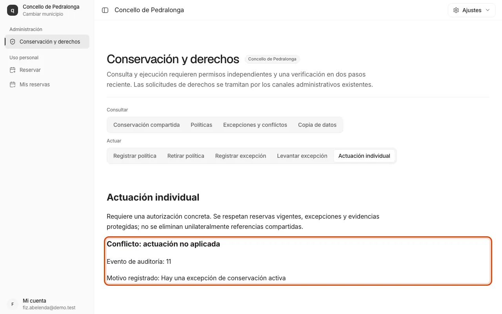

*El resultado recuadrado «Conflicto: actuación no aplicada» indica su evento de auditoría y el motivo registrado LEGAL_HOLD, que corresponde a una excepción de conservación. La excepción se gestiona como en [CU-20](#cu-20--aplicar-una-política-de-conservación).*

#### Hay dependencias vigentes

Las reservas, los permisos, las invitaciones o las acreditaciones que la persona conserva en el municipio impiden suprimir su perfil por separado. En el ejemplo, el perfil es el de la persona administradora del municipio.

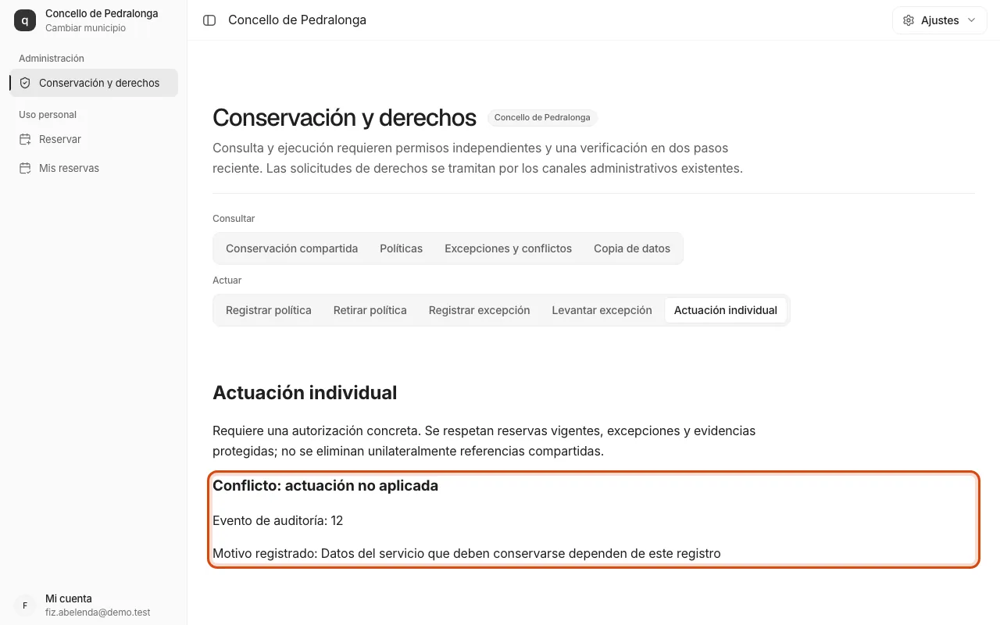

*El motivo registrado RETAINED_SERVICE_DEPENDENCIES indica que el perfil tiene relaciones de servicio que se conservan. No se ha suprimido nada.*

#### El conjunto ya no existe

Si el registro ya se suprimió o bloqueó antes, o la referencia no corresponde a ningún conjunto de esa familia y municipio, Quenda no actúa y lo deja registrado.

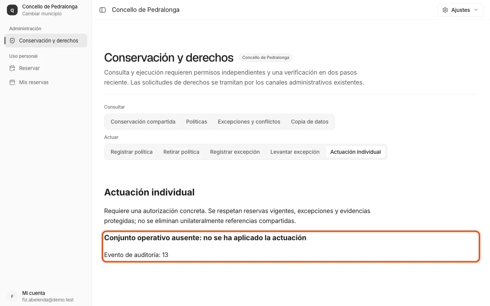

*Al repetir la supresión del primer perfil, el resultado recuadrado indica que el conjunto operativo está ausente, con su evento de auditoría.*

#### La verificación en dos pasos ya no es reciente

Si han pasado más de cinco minutos desde la última verificación, Quenda no ejecuta la actuación y pide confirmar la identidad. Pulsa **Verificar acceso**, escribe el código y vuelve a ejecutar la actuación: la verificación no la envía por sí sola.

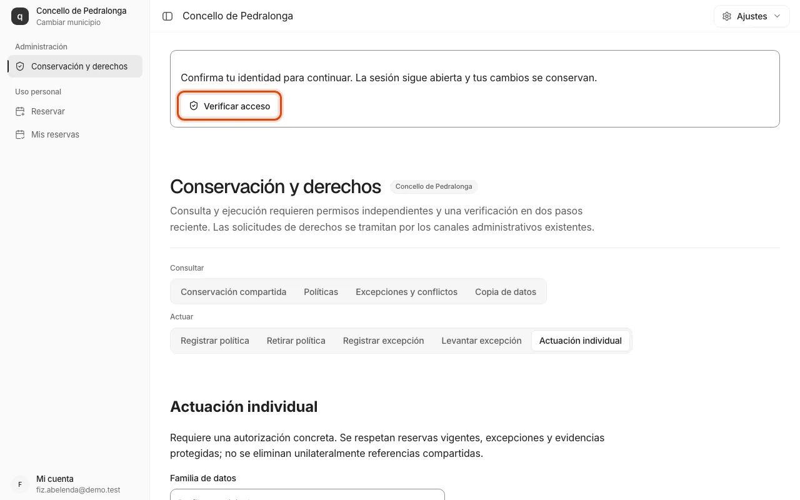

*El aviso aparece encima de la página con el botón recuadrado Verificar acceso; debajo sigue el formulario con los datos escritos.*

#### Qué no hace una actuación individual

Suprimir un perfil municipal no cierra la cuenta global de la persona ni afecta a otros municipios. Retirar una identidad global, desde el ámbito global de privacidad, impide recuperarla después con una reactivación.

### Resultado

La actuación queda aplicada o el impedimento queda registrado, siempre con su evento de auditoría, sin supresiones parciales y sin tocar datos de otros ámbitos.

## CU-22 — Recuperar una instancia sin rehabilitar datos restringidos

Sirve para devolver el servicio a partir de una copia de seguridad sin que vuelvan al uso datos que se suprimieron o bloquearon después de esa copia. Lo realiza el personal de operación autorizado, con credenciales separadas de las de la aplicación y fuera de su interfaz. La copia se restaura en una base nueva y cerrada, se reproducen las actuaciones de privacidad posteriores a partir de un checkpoint externo y se revisa todo antes de decidir la reapertura.

**Antes de empezar:** necesitas una copia de la base de datos de procedencia confiable con su SHA-256, el checkpoint de privacidad más reciente con su SHA-256, las credenciales administrativas de PostgreSQL y de mantenimiento, el cliente de PostgreSQL 17 y la autorización del procedimiento. El destino debe tener provisionados los roles de Quenda y recibir el mismo `AUTH_SECRET` que el origen, porque cifra los segundos factores. **Especificación:** [CU-22](../08_casos_de_uso.md#cu-22--recuperar-una-instancia-sin-rehabilitar-datos-restringidos).

Los comandos se ejecutan desde la raíz del código de Quenda. `PG_BIN` (la carpeta del cliente de PostgreSQL 17) y las cadenas de conexión que usan los comandos (`BACKUP_DATABASE_URL` para la copia, `MIGRATION_DATABASE_URL` para el checkpoint, `RESTORE_ADMIN_DATABASE_URL` para restaurar y revisar) se cargan en el entorno desde el gestor de secretos; nunca se escriben en la línea de comandos ni quedan en el historial de la terminal. Para restaurar, `RESTORE_ADMIN_DATABASE_URL` apunta al administrador del clúster de destino; a partir del paso 5 apunta a la base restaurada. En las consultas con `psql`, `DOMAIN_DATABASE_URL` es la conexión del rol de la aplicación a esa misma base.

### Paso a paso

1. **Haz la copia lógica.** Con un rol de copia con lectura íntegra, crea la copia en un directorio privado. El comando devuelve la ruta, el SHA-256 y la duración.

   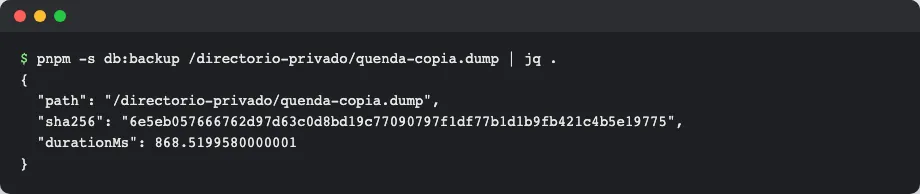

   *La salida de `pnpm -s db:backup` indica la ruta del archivo, su SHA-256 (guárdalo por un canal confiable: hará falta para restaurar) y la duración en milisegundos.*

   En el ejemplo, después de esta copia el personal de privacidad suprime el perfil municipal de una persona vecina ([CU-21](#cu-21--ejecutar-una-actuación-individual-de-privacidad)). La copia ya no refleja esa supresión.

2. **Guarda el checkpoint de privacidad.** Con las credenciales de mantenimiento, exporta el checkpoint a un archivo nuevo, fuera de las copias. Contiene referencias de las supresiones, bloqueos y excepciones, no los datos.

   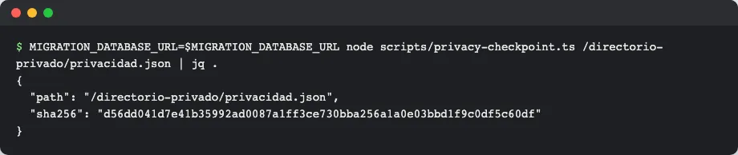

   *La salida de `pnpm -s privacy:checkpoint` indica la ruta del checkpoint y su SHA-256. El checksum prueba que el archivo no ha cambiado, no que sea el último: su actualidad se comprueba por separado.*

3. **Restaura la copia en una base nueva y cerrada.** Con un administrador de PostgreSQL, indica la copia, su SHA-256 y el nombre de una base que no exista.

   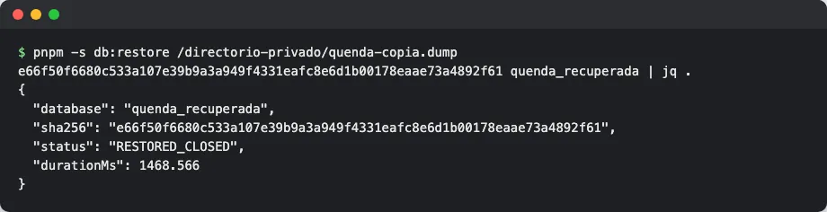

   *`pnpm -s db:restore` devuelve el estado `RESTORED_CLOSED`: la copia se ha cargado en `quenda_recuperada`, que queda cerrada. No autoriza abrirla al tráfico.*

4. **Comprueba que el destino está cerrado.** El rol de la aplicación no puede conectarse a la base restaurada.

   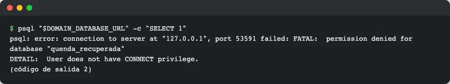

   *psql termina con «permission denied for database "quenda_recuperada"» y «User does not have CONNECT privilege»: el acceso ordinario está cerrado.*

5. **Revisa lo que contiene la copia antigua.** Con el administrador, consulta la base restaurada. En el ejemplo, el perfil suprimido después de la copia sigue ahí, la barrera de recuperación está activa y la política de conservación restaurada sigue vigente.

   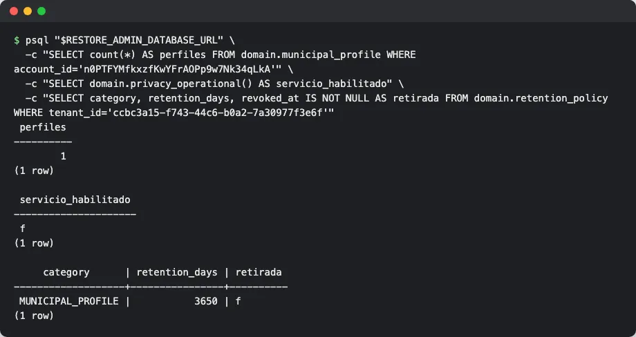

   *perfiles vale 1 (la copia conserva el perfil suprimido), servicio_habilitado vale f (la barrera impide que la API y los workers arranquen) y la política de perfiles municipales figura con retirada en f.*

6. **Reproduce las actuaciones de privacidad posteriores.** Indica el checkpoint, su SHA-256 y la referencia de la autorización de recuperación.

   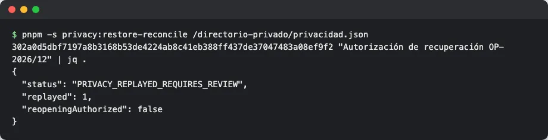

   *`pnpm -s privacy:restore-reconcile` devuelve el estado `PRIVACY_REPLAYED_REQUIRES_REVIEW`: se ha reproducido 1 actuación, y `reopeningAuthorized: false` recuerda que esto no autoriza la reapertura.*

7. **Comprueba el efecto.** Repite la consulta del paso 5.

   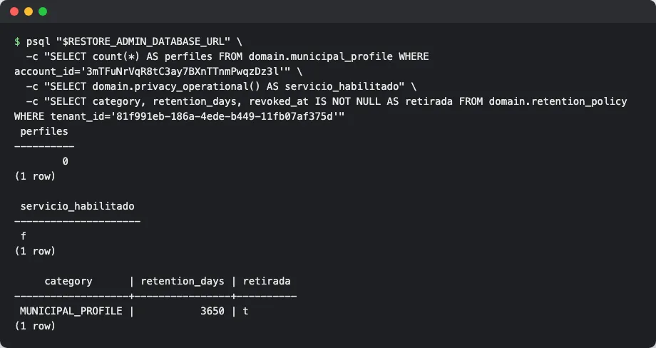

   *perfiles vale ahora 0: la supresión posterior a la copia se ha vuelto a aplicar. La barrera sigue activa (servicio_habilitado en f) y la política restaurada queda retirada (retirada en t) hasta que el responsable la revise.*

8. **Concilia la integridad.** Con el administrador, ejecuta la conciliación de solo lectura sobre la base restaurada.

   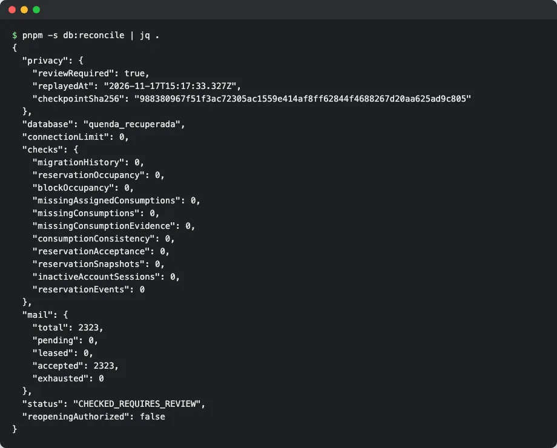

   *El informe de `pnpm -s db:reconcile` repite el estado de privacidad (revisión pendiente y checkpoint reproducido), confirma que la base sigue con límite de conexiones 0, muestra 0 incoherencias en cada comprobación de reservas, ocupaciones, consumos y sesiones, y resume los correos de reservas (2 pendientes de envío y ninguno agotado) y, en `invitationMail`, los avisos de invitación. El estado `CHECKED_REQUIRES_REVIEW` y `reopeningAuthorized: false` indican que la revisión operativa sigue siendo obligatoria.*

9. **Decide la reapertura.** Ningún comando autoriza la reapertura. Antes, el responsable operativo verifica que el checkpoint es el más reciente, resuelve las diferencias con los responsables del tratamiento, revisa políticas, excepciones, sesiones y envíos pendientes frente al registro del transporte de correo, y contrasta las reservas confirmadas después de la copia con evidencia externa. Solo entonces se retira la barrera de recuperación mediante mantenimiento autorizado y se conceden las conexiones y los permisos mínimos de cada rol.

### Si algo no sale como se espera

#### El SHA-256 de la copia no coincide

La restauración comprueba la copia antes de crear nada. Si el checksum no coincide, se detiene y no crea la base.

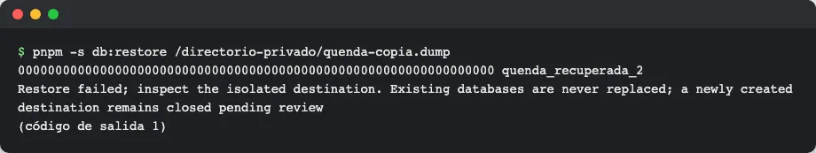

*Es el comando del paso 3 con un checksum erróneo. La salida «Restore failed; inspect the isolated destination…» y el código de salida 1 indican que no se ha restaurado. Comprueba el archivo y su checksum por un canal confiable antes de repetir.*

#### El checkpoint no coincide

Si el checksum del checkpoint no corresponde al archivo, o el checkpoint no es de esta instancia o es anterior a lo que ya conoce la base, la reproducción se rechaza y el destino permanece cerrado.

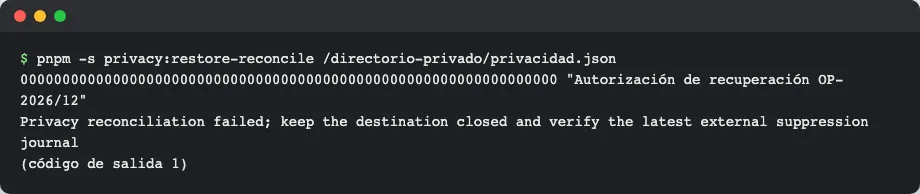

*Es el comando del paso 6 con un checksum que no corresponde al checkpoint. La salida «Privacy reconciliation failed; keep the destination closed and verify the latest external suppression journal» y el código de salida 1 indican que no se ha reproducido nada.*

#### No hay un checkpoint actual

Un checkpoint guardado dentro de la misma copia antigua no demuestra qué ocurrió después. Sin evidencia actual y suficiente, el destino debe seguir cerrado hasta obtenerla.

#### Hay incoherencias en la conciliación

Si la conciliación encuentra incoherencias termina con el estado `INCONSISTENT` y el código de salida 2; si no puede completarse, con el código 1. En ambos casos el destino sigue cerrado mientras se investiga con credenciales autorizadas.

#### Se intenta arrancar el servicio antes de tiempo

Mientras la barrera de recuperación está activa, la API y los workers se niegan a arrancar contra la base restaurada, aunque se hayan concedido de nuevo los permisos de conexión.

### Resultado

La instancia queda restaurada y revisada con las supresiones y bloqueos posteriores a la copia aplicados de nuevo, o permanece cerrada hasta resolver los impedimentos. En ningún caso la recuperación devuelve al uso datos suprimidos o restringidos.
